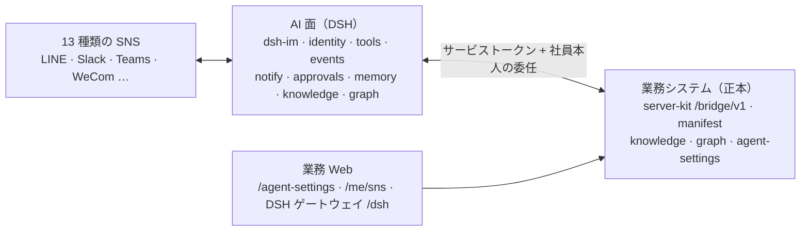

# biz-ai-agent

**公式サイト: [biz-ai.myaiportal.net](https://biz-ai.myaiportal.net/) · このプロジェクトのページ: [Biz AI Agent](https://biz-ai.myaiportal.net/biz-ai-agent.html)**

[](https://biz-ai.myaiportal.net/)
[](LICENSE)
[](https://github.com/deepseek-ai/deepseek-harness)
[](packages/protocol)
[](#クイックスタート)

[English](README.md) · **日本語** · [简体中文](README.zh-CN.md)

**どんな IT システムも AI エージェントに — 業務システム 1 つ + DSH 1 つ = AI 社員 1 人。**

[AI コーディングツールでエージェントを作る](#ai-コーディングツールでエージェントを作る) ·
[クイックスタート](#クイックスタート) ·
[マニュアル（中国語）](docs/MANUAL.md) · [スライド](docs/MANUAL.pptx) ·
[フレームワーク: biz-ai](https://github.com/ITC-cloud-soft/biz-ai)

biz-ai-agent は完全な AI エージェントフレームワークです。エージェントとは、社員がふだん使うチャット（LINE、Slack、Teams、
WeCom、DingTalk、Feishu など 13 種類の SNS）で働く AI 社員のことです。**社員本人の権限で**社内文書から答え、承認カードを
しかるべき人に届け、「なぜこれが自分に届いたのか」を説明し、報告します。**業務システムが正本のまま、決めるのは人です。**

すべてこのリポジトリに入っています。

| 部分 | 内容 |
|---|---|
| **Biz Assistant Framework**（[biz-ai](https://github.com/ITC-cloud-soft/biz-ai) から取り込み。パッケージ `@dsh-bridge/*`、フォーク `@care/*`） | 業務システム側の Bridge v1 と server-kit。DSH（DeepSeek Harness）上の AI 面：SNS の本人連携と連携コード、業務ツール、イベント、通知、承認、長期記憶、AI 社員のプロフィール、文書読み取り、Web アシスタント。13 種類の SNS の IM ゲートウェイ dsh-im。web-kit。DSH ゲートウェイ。製品プロファイル。テストツール |
| **エージェント層**（このリポジトリ独自） | 権限を守る**ナレッジ**（質問者の権限で検索し、出典は業務画面）、**グラフ**（「なぜ自分に届いたのか」）、**設定プラグイン** `/agent-settings`（モデル、文書、検索方式 BM25F / RAG / ナレッジグラフ、SNS の承認と報告）、社員本人の SNS 連携ページ `/me/sns`、サインイン画面、2 つのサンプルシステム、**agent-builder スキル** |

## 基本の考え方

- **エージェントはまず普通の IT システム。** データ、ロール、誰が何を見られるか、誰が決めるかは業務システムが持ちます。
  ドラッグ＆ドロップのフローエディタはありません。フローはコードで、AI コーディングツールが書き、manifest、適合性テスト、
  テスト、評価、ログが守ります。
- **AI 社員は読んで提案するだけ。決めるのは人。** 質問した社員本人の委任で読み取ります。「書き込み」は提案だけで、人が Web
  またはチャットで採用したときにだけ実行されます。金額は人が決めます。
- **誰に知らせるかは業務システムが決める。** Web 画面と同じルールで判断します。
- **イベントと通知に個人情報を載せない。** ID、数値、日付、状態だけ。氏名、理由、金額は権限を確認したうえで Web に表示します。
- **権限が先。** すべての検索、すべてのグラフの回答は、並べ替えの前に質問者の権限で絞り込みます。

## AI コーディングツールでエージェントを作る

**エージェントをゼロから書く必要はありません。** このリポジトリには `agent-builder` スキルが入っています。リポジトリの
ルートで AI コーディングツールを開き、必要な業務を伝えれば、AI がこのフレームワークでエージェントを開発し、検証します。
[`examples/equipment-loans`](examples/equipment-loans) は、AI がこのスキルだけに従ってゼロから作ったものです。
[`examples/expense-claims`](examples/expense-claims) も同じく AI が、誰も質問に答えない無人の条件で作りました。スキルが間違っていた・足りなかった・順番が悪かった 20 か所を [`SKILL_REPORT.md`](examples/expense-claims/SKILL_REPORT.md) にまとめています。

**おすすめの進め方：先に開発、次に設定、最後にチャットで試す**（[公式サイトの同じ節](https://biz-ai.myaiportal.net/biz-ai-agent.html#order)）

| 段階 | すること | 必要なもの |
|---|---|---|
| 0（任意） | 完成形を見る：参考実装の画面（[クイックスタート](#クイックスタート)）か、LINE まで含めた `npm run e2e -- --serve` | モデルもチャットのアカウントも不要 |
| 1 | 業務を準備する：誰が使うか、誰が何を読めるか、誰が承認するか、文書（テストは架空のデータ）。チャットで試すかどうかもここで決める | — |
| 2 | AI コーディングツールに開発とテストを任せる（下記）。チャットで試すなら、DSH ゲートウェイとプロファイルも作るよう頼む | 模擬のモデルと LINE だけ、キー不要 |
| 3 | できたエージェントを起動し、`/agent-settings` で設定：モデル（RAG・ナレッジグラフのときだけ）、ナレッジの状態、承認者と報告の受け手 | RAG・グラフにはテスト用のモデルのキー |
| 4 | DSH とチャットをつなぐ：プロファイルを入れ、会話用モデルのキーで DSH を起動し、SNS ページでテスト用のボットを作り、`/me/sns` で連携して、質問・承認カード・通知を試す | テスト用のチャットのアカウント、架空のデータ |
| 5 | 普通の Web サイトと同じように公開する | 本番のキーとボット |

設定画面 `/agent-settings` は段階 2 で作られる業務システムの一部（エージェントごとに 1 つ）なので、開発のあとに使います。開発用の
文書はリポジトリの `knowledge/*.md` に置きます（評価と権限のテストがこれを使います）。画面からのアップロードは、公開後に管理者が
追加するためのものです。モデルは開発の前には選びません（既定の検索 BM25F はモデル不要）。

### 1. スキルはリポジトリに入っています

リポジトリをクローンしてインストール（[クイックスタート](#クイックスタート)）したら、リポジトリのルートでツールを開きます。

| ツール | 使い方 |
|---|---|
| [Claude Code](https://claude.com/claude-code) | ルートで `claude` を起動。スキルは `.claude/skills/agent-builder/` にあり、自動で読み込まれます。`/agent-builder` で直接呼べます |
| [Codex](https://developers.openai.com/codex) | ルートで `codex` を起動。スキルは `.agents/skills/agent-builder/` にあり、自動で見つかります。`$agent-builder` で直接呼べます |
| その他の AI コーディングツール | 「まず `skills/agent-builder/SKILL.md` を全部読んで、その手順に従って」と頼みます |

スキル本体は [`skills/agent-builder/SKILL.md`](skills/agent-builder/SKILL.md)（英語、AI 向け）です。このリポジトリの
参考実装をコピーし、このリポジトリのテストを実行するので、このリポジトリの中で使ってください（ファイルだけ別の場所に
コピーしても動きません）。

### 2. ふだんの言葉で頼む

```text
agent-builder スキルで「出張経費」の AI エージェントを作って:
- 社員は LINE で経費の規程を質問し、自分の申請の状況を確認する
- 部門の申請はマネージャーが承認し、10 万円を超えるものは経理も承認する
- 経理は毎月、件数の報告を受け取る
- 規程の文書は <あなたの文書のパス>（日本語と中国語）
```

ほかの言語で頼んでも同じです。AI はこう進めます。

1. **まず決めることを聞きます** — 誰が使うか、何を読んでよいか、誰が承認するか、どの文書を誰が読めるか、正しい答えとは何か、
   どの SNS か。`examples/<system-id>/AGENT_PLAN.md` に書き、回答を待ちます。答える人がいないときは推奨の既定値を使い、
   「要確認」と書きます。
2. 参考実装をコピーし、業務システムと manifest を書き、適合性テスト **52 / 52** まで通します。
3. ナレッジとグラフをつなぎ、**チューニングの前に**評価を書き、設定画面、SNS の承認と報告、DSH プロファイルを書きます。
4. どのステップもコマンドで検証し、作ったもの、実行したコマンドと結果、「未検証」のもの、「要確認」の決定を報告します。

あなたがすること：決定に答える、文書を用意する（テストは架空のデータだけ）、計画と報告を確認する、手元で画面を試す、公開する。

### 3. AI が作るファイル

`examples/<system-id>/` にある普通の Node.js プロジェクトで、すべて git に入ります。

| ファイル | 内容 |
|---|---|
| `AGENT_PLAN.md` | 決定とその根拠：誰が何を決めたか、何が要確認か、数値 |
| `bridge.manifest.yaml` | システムの自己紹介（オントロジー）：ロール、エンティティ、イベント、AI のツール、画面のルート |
| `src/app.mjs` | 業務システム本体：データ、サインイン、業務ルール（hooks）、業務 API、設定プラグイン、ナレッジ、グラフ、DSH ゲートウェイ |
| `src/server.mjs` | 起動入口：ポート、秘密情報、データディレクトリを環境変数から読む |
| `knowledge/*.md` | 文書（閲覧範囲は文書の中に書く） |
| `evals/` | 評価の問題（`knowledge.evals.json`）と `run.mjs` |
| `test/*.test.mjs` | 業務ルール、適合性、ナレッジの権限、グラフ、評価の下限、設定プラグインのテスト |
| `dsh-profile/` | AI 面（DSH）の製品プロファイル |
| `README.md` | 何をするか、起動方法、評価とテストの数値 |

### 4. 普通の Web サイトと同じように公開する

- **業務システムは普通の Node.js の Web アプリです。** `npm install` して `NODE_ENV=production node src/server.mjs` で起動し
  （systemd、pm2、Docker などで常駐）、HTTPS のリバースプロキシ（nginx、Caddy など）の後ろに置き、ドメインを向けます。
- 秘密情報は環境変数だけで渡します。データディレクトリは永続ストレージに置きます。
- **AI 面（DSH）は同じマシンで動くもう 1 つのプロセスです。** 127.0.0.1 だけで待ち受け、Web アプリの中の DSH ゲートウェイ
  経由でアクセスされます。IM の webhook は Web アプリの公開パスに向けます（例：`https://<あなたのサイト>/dsh-hooks/line`）。
- ほかに必要なのはモデルの API（AI 社員の会話用）だけです。データベースは pgvector を使うときだけ必要です。

## クイックスタート

**Node.js 24.9 以上**（固定版の DSH CLI の要件。`npm install` / `npm test` だけなら 22.19 以上で動きます）、npm、エンドツーエンド
テスト用に PATH 上の **pnpm** が必要です。データベース、API キー、チャットのアカウントは不要です。

```sh
git clone https://github.com/ITC-cloud-soft/biz-ai-agent.git && cd biz-ai-agent
npm install
npm run vendor:install      # 初回のみ：vendor のフォークの依存
npm test                    # すべてのパッケージ、プラグイン、サンプル：約 900 テスト、失敗 0（PostgreSQL / MySQL がないと少し skip）
npm run e2e                 # 本物の DSH + 模擬モデル + 模擬 LINE でパイロットを実行：15 / 15 PASS
```

最初の `npm run e2e` は固定版の DSH CLI を `.dsh-cli/` に入れます（公開 npm レジストリから約 900 MB、git 対象外）。グローバルに
入れた DSH には触れません。`npm run e2e -- --serve` は終わった後も動かし続けます：`http://127.0.0.1:19751/login` を開きます
（パスワードは `e2e/.work/serve.txt`）。

**DSH なしで画面を試す**（ターミナル 2 つ。架空の社員 `admin`、`admin2`、`manager`、`staff1`、`staff2`、パスワード `leave-dev`）：

```sh
echo MOCK_MODEL_KEY=anything > examples/leave-requests-knowledge/.env.local
node examples/leave-requests-knowledge/dev/mock-model.mjs    # ポート 19760 の模擬モデル（AI ではありません）
node examples/leave-requests-knowledge/src/server.mjs        # パイロット http://127.0.0.1:19750/login
```

`admin` でサインイン → `/agent-settings`：検索方式（BM25F / RAG / ナレッジグラフ）を切り替え、文書をアップロードし、`admin2`
で承認します。ここでは SNS ページに「DSH に接続していません」と出ますが、DSH がないので正常です。詳しくは
[マニュアル第 4 章](docs/MANUAL.md#4-第一次运行安装测试本地试用)。

## しくみ



- **質問** — 社員が LINE で質問 → ナレッジのツールが**その社員の委任で**検索 → 業務システムはその人が読める節だけを出典
  （業務画面）つきで返す → 出典ガードとリンクガードが回答を確認 → 出典つきの回答が LINE に返る。あなたに見えないものは、
  AI にも見えません。
- **承認** — 管理者が文書をアップロード → 業務システムが `approval.requested` を書く → 承認カードが別の管理者に届く
  （アップロードした本人には届かない）→ LINE で「承認」→ Web と同じ `mayDecide` のルールで判断 → 公開 → 件数だけの報告。

## リポジトリの中身

| パス | 内容 |
|---|---|
| `packages/` | ★ protocol（Bridge v1、manifest の検証、適合性 52 項目）、server-kit、dsh-core、gateway、web-kit、help、telemetry、testing · knowledge、graph、agent-settings |
| `plugins/` | ★ identity、tools、events、notify、approvals、assistant、memory、persona、reader · knowledge（ツールモジュール + 出典ガード）、graph（ツールモジュール） |
| `profile/` | ★ DSH 製品プロファイルのテンプレート、インストーラ、チェッカー |
| `vendor/` | ★ dsh-im（13 種類の SNS）、dsh-auto-tasks、dsh-proactive（MIT のフォーク。初回に `npm run vendor:install`） |
| `examples/` | leave-requests-knowledge（参考実装）、equipment-loans（AI がスキルで作ったもの）、expense-claims（AI が無人で作ったもの。スキルの報告つき）· ★ leave-requests、equipment-inspection（テストに PostgreSQL が必要）、care-billing（manifest と対応表のみ） |
| `skills/` | agent-builder（エージェントを作るスキル）· ★ biz-assistant-integration（既存システムにフレームワークを入れるスキル） |
| `.claude/skills/`、`.agents/skills/` | Claude Code と Codex が agent-builder を読み込むための入口 |
| `docs/` | マニュアル、設計、API · ★ GUIDELINE（日 / 英 / 中）、ARCHITECTURE など |
| `e2e/run.mjs` | 本物の DSH でのエンドツーエンドテスト |

★ = Biz Assistant Framework から [`scripts/sync-framework.mjs`](scripts/sync-framework.mjs) で取り込んだもの（コミットは
[`framework.sync.json`](framework.sync.json)）。ここで直接編集せず、フレームワーク（[biz-ai](https://github.com/ITC-cloud-soft/biz-ai)）を
直してから同期し直します（`npm run sync-framework -- --from <フレームワークのチェックアウト>`。マニュアル第 13 章）。

## ドキュメント

| 文書 | 内容 |
|---|---|
| [`docs/MANUAL.md`](docs/MANUAL.md)（[スライド](docs/MANUAL.pptx)） | **マニュアル**（中国語）：構成、初回の実行、画面の使い方、AI コーディングツールでのエージェント作り、既存システムの接続、AI 面、ナレッジ、デプロイ、ルール、テスト、トラブルシューティング |
| [`skills/agent-builder/SKILL.md`](skills/agent-builder/SKILL.md) | agent-builder スキル（英語、AI コーディングツール向け） |
| [`docs/GUIDELINE.md`](docs/GUIDELINE.md)（[英](docs/GUIDELINE.en.md) / [中](docs/GUIDELINE.zh-CN.md)） | フレームワークの開発ガイドライン：接続の手順、拡張ポイント、MUST / SHOULD のルール、テスト、FAQ |
| [`docs/ARCHITECTURE.md`](docs/ARCHITECTURE.md) | アーキテクチャ、イベントの流れ、本人確認と委任、受信者の保証、安全の約束 |
| [`docs/KNOWLEDGE_API.md`](docs/KNOWLEDGE_API.md)、[`docs/GRAPH_API.md`](docs/GRAPH_API.md) | ナレッジ検索とグラフ：ルート、ルール、適合性 K-01…K-08 と G-01…G-07（英語） |
| [`packages/agent-settings/README.md`](packages/agent-settings/README.md) | 設定プラグインのインターフェース |
| [`docs/MULTI_AGENT_PLATFORM.md`](docs/MULTI_AGENT_PLATFORM.md) | 草案：Agent Hub（会社のすべてのエージェントを 1 か所で管理） |
| [`docs/STATUS.md`](docs/STATUS.md) | 現在の状況（中国語） |

文書、テスト、評価のデータはすべて架空です。モデルは決めていません。BM25F はモデルなしで動き、モデルのインターフェースは
オーナーが選んだ OpenAI 互換または Azure OpenAI のエンドポイントを使えます。

## ライセンス

[Apache License 2.0](LICENSE) — [`NOTICE`](NOTICE) も参照。`vendor/` のフォークは上流のライセンス（MIT）のままです。

公式サイト: https://biz-ai.myaiportal.net/
