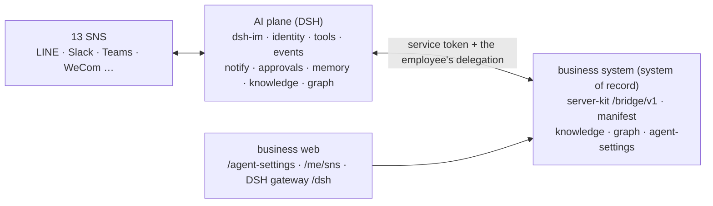

# biz-ai-agent

**Official website: [biz-ai.myaiportal.net](https://biz-ai.myaiportal.net/) · this project's page: [Biz AI Agent](https://biz-ai.myaiportal.net/en/biz-ai-agent.html)**

[](https://biz-ai.myaiportal.net/)
[](LICENSE)
[](https://github.com/deepseek-ai/deepseek-harness)
[](packages/protocol)
[](#quick-start)

**English** · [日本語](README.ja.md) · [简体中文](README.zh-CN.md)

**Turn any IT system into an AI agent — one business system + one DSH = one AI employee.**

[Build an agent with an AI coding tool](#build-an-agent-with-an-ai-coding-tool) ·
[Quick start](#quick-start) ·
[Manual (Chinese)](docs/MANUAL.md) · [Slides](docs/MANUAL.pptx) ·
[Framework: biz-ai](https://github.com/ITC-cloud-soft/biz-ai)

biz-ai-agent is a complete AI agent framework. An agent is an AI employee that works in your staff's own chat (LINE, Slack,
Teams, WeCom, DingTalk, Feishu and more — 13 SNS): it answers from company documents **with each employee's own rights**, sends
approval cards to the right person, explains *"why did this reach me?"*, and reports — while **your business system stays the
system of record and people decide**.

Everything is in this repository:

| part | what |
|---|---|
| **Biz Assistant Framework** (copied in from [biz-ai](https://github.com/ITC-cloud-soft/biz-ai); packages `@dsh-bridge/*`, forks `@care/*`) | Bridge v1 and server-kit for the business system; the AI plane on DSH (DeepSeek Harness): SNS identity and link codes, business tools, events, notifications, approvals, long-term memory, the AI employee's profile, document reading, the web assistant; dsh-im, the IM gateway for 13 SNS; web-kit; the DSH gateway; the product profile; the test harness |
| **agent layer** (this repository's own) | permission-aware **knowledge** (search with the asker's rights, sources on the business screens), the **graph** ("why did this reach me?"), the **settings plugin** `/agent-settings` (models, documents, search method BM25F / RAG / knowledge graph, SNS approvals and reports), the employee's SNS link page `/me/sns`, the sign-in page, two example systems and the **agent-builder skill** |

## Core ideas

- **An agent is first an ordinary IT system.** The business system owns the data, the roles, who sees what and who decides. No
  drag-and-drop flow editor: flows are code, written with AI coding tools and guarded by the manifest, the conformance suite,
  tests, evals and logs.
- **The AI employee reads and proposes; people decide.** It reads with the asking employee's own delegation; its only "write"
  is a proposal that a person accepts on the web or in chat. Amounts are decided by people.
- **The business system decides who is told**, with the same rule as its web screens.
- **No personal data in events and notifications** — IDs, numbers, dates and states only; names, reasons and amounts are shown on
  the web after a permission check.
- **Permissions first** — every search and every graph answer is filtered by the asker's rights before it is ranked.

## Build an agent with an AI coding tool

**You do not write the agent from scratch.** This repository ships the `agent-builder` skill: open an AI coding tool at the root
of the repository, describe the business you need, and the AI builds the agent with this framework and verifies it.
[`examples/equipment-loans`](examples/equipment-loans) was built from scratch by an AI that followed only this skill.

**The recommended order: build first, then set it up, then try it on chat** ([on the website](https://biz-ai.myaiportal.net/en/biz-ai-agent.html#order))

| step | what | needs |
|---|---|---|
| 0 (optional) | see the finished thing: the reference's screens ([Quick start](#quick-start)) or `npm run e2e -- --serve` with LINE | no model, no chat account |
| 1 | prepare the business: who uses it, who may read what, who approves, the documents (fictional data for tests); decide whether you will test on a chat platform | — |
| 2 | let the AI coding tool build and test it (below). If you will test on chat, ask it to wire the DSH gateway and the profile too | mocks only, no keys |
| 3 | start the agent you built and set it up on `/agent-settings`: models (only for RAG / knowledge graph), the knowledge status, approvers and report readers | a test model key for RAG / graph |
| 4 | connect DSH and a chat platform: install the profile, start DSH with the conversation model's key, create a test bot on the SNS page, link your account on `/me/sns`, then try questions, approval cards and notifications | a test chat account, fictional data |
| 5 | deploy it like a website | production keys and bots |

The settings screen `/agent-settings` is part of the system built in step 2 (one per agent), so it comes after development. Documents
for development go in `knowledge/*.md` in git (the evals and permission tests depend on them); uploading on the screen is for
administrators after go-live. No model is chosen before development: the default search, BM25F, needs none.

### 1. The skill is already in the repository

Clone the repository, install it ([Quick start](#quick-start)), then open your tool at the repository root:

| tool | how |
|---|---|
| [Claude Code](https://claude.com/claude-code) | run `claude` at the root. The skill is in `.claude/skills/agent-builder/` and loads automatically; `/agent-builder` calls it directly |
| [Codex](https://developers.openai.com/codex) | run `codex` at the root. The skill is in `.agents/skills/agent-builder/` and is discovered automatically; `$agent-builder` calls it directly |
| any other AI coding tool | ask it to "read `skills/agent-builder/SKILL.md` completely first and follow its steps" |

The skill itself is [`skills/agent-builder/SKILL.md`](skills/agent-builder/SKILL.md) (English, written for the AI). It copies the
reference examples and runs the tests of this repository, so use it here — not as a lone file elsewhere.

### 2. Ask for it in your own words

```text
Use the agent-builder skill to build a "travel expenses" AI agent:
- employees ask about the expense rules and check their own claims on LINE;
- managers approve their team's claims; above 100,000 yen finance approves too;
- finance gets a monthly count report;
- the rules are in <your documents> (Japanese and Chinese).
```

Requests in other languages work the same way. What the AI does:

1. **Asks you first** — who uses the agent, what it may read, who approves, who may read which document, what a correct answer
   is, which SNS — and writes it into `examples/<system-id>/AGENT_PLAN.md`. When nobody can answer, it takes the recommended
   default and marks it "to confirm".
2. Copies the reference implementation and writes the business system and its manifest, up to conformance **52 / 52**.
3. Adds knowledge and the graph, writes the evals **before tuning**, adds the settings screens, SNS approvals and reports, and
   writes the DSH profile.
4. Verifies every step with commands and reports what was built, the commands and their results, what is "not verified" and what
   is still "to confirm".

What stays with you: answering the decisions, the documents (tests use fictional data only), reviewing the plan and the report,
trying the screens on your machine, and deploying.

### 3. What the AI produces

An ordinary Node.js project in `examples/<system-id>/`, all in git:

| file | what |
|---|---|
| `AGENT_PLAN.md` | the decisions and their evidence: who decided what, what is still to confirm, the numbers |
| `bridge.manifest.yaml` | the system's self-description (its ontology): roles, entities, events, the AI's tools, screen routes |
| `src/app.mjs` | the business system: data, sign-in, business rules (hooks), business API, the settings plugin, knowledge, graph, DSH gateway |
| `src/server.mjs` | the entry point: port, secrets and data directory from environment variables |
| `knowledge/*.md` | the documents, with their visibility written inside |
| `evals/` | the eval questions (`knowledge.evals.json`) and `run.mjs` |
| `test/*.test.mjs` | business rules, conformance, knowledge permissions, graph, eval floor, settings plugin |
| `dsh-profile/` | the product profile of the AI plane (DSH) |
| `README.md` | what it does, how to start it, the eval and test numbers |

### 4. Deploy it like an ordinary website

- **The business system is an ordinary Node.js web app**: `npm install`, `NODE_ENV=production node src/server.mjs` (kept running by
  systemd, pm2, Docker …) behind an HTTPS reverse proxy (nginx, Caddy …) on your domain.
- Secrets come only from environment variables; the data directory goes on persistent storage.
- **The AI plane (DSH) is one more process on the same machine**: it listens on 127.0.0.1 only and is reached through the DSH
  gateway inside your web app. IM webhooks point at the web app's public paths (e.g. `https://<your site>/dsh-hooks/line`).
- Besides that you need only a model API (for the AI employee's conversation). A database is needed only for pgvector.

## Quick start

Needs **Node.js 24.9+** (the pinned DSH CLI requires it; `npm install` / `npm test` alone run on 22.19+), npm, and **pnpm** on
PATH for the end-to-end run. No database, no API key, no chat account.

```sh
git clone https://github.com/ITC-cloud-soft/biz-ai-agent.git && cd biz-ai-agent
npm install
npm run vendor:install      # once: the vendor forks' own dependencies
npm test                    # every package, plugin and example: about 900 tests, 0 fail (a few skip without PostgreSQL / MySQL)
npm run e2e                 # the pilot on a REAL DSH with a mock model and a mock LINE: 15 / 15 PASS
```

The first `npm run e2e` installs the pinned DSH CLI into `.dsh-cli/` (about 900 MB from the public npm registry, git-ignored); a
DSH you installed globally is not touched. `npm run e2e -- --serve` keeps everything running afterwards: open
`http://127.0.0.1:19751/login` (the password is in `e2e/.work/serve.txt`).

**Try the screens without DSH** (two terminals; fictional employees `admin`, `admin2`, `manager`, `staff1`, `staff2`, password `leave-dev`):

```sh
echo MOCK_MODEL_KEY=anything > examples/leave-requests-knowledge/.env.local
node examples/leave-requests-knowledge/dev/mock-model.mjs    # a fake model on port 19760 (not an AI)
node examples/leave-requests-knowledge/src/server.mjs        # the pilot on http://127.0.0.1:19750/login
```

Sign in as `admin` → `/agent-settings`: switch the search method (BM25F / RAG / knowledge graph), upload a document, approve it as
`admin2`. The SNS page says "DSH is not connected" here — that is expected without DSH. Details: [manual §4](docs/MANUAL.md#4-第一次运行安装测试本地试用).

## How it works



- **A question** — an employee asks on LINE → the knowledge tool searches **with that employee's delegation** → the business system
  returns only the sections they may read, with their sources (business screens) → the citation guard and the link guard check the
  answer → the answer with its sources goes back to LINE. What you cannot see, the AI cannot see.
- **An approval** — an administrator uploads a document → the business system writes `approval.requested` → the approval card
  reaches another administrator (never the uploader) → "Approve" on LINE → the same `mayDecide` rule as the web → published → a
  count-only report.

## What's in this repository

| path | what |
|---|---|
| `packages/` | ★ protocol (Bridge v1, manifest validation, conformance 52), server-kit, dsh-core, gateway, web-kit, help, telemetry, testing · knowledge, graph, agent-settings |
| `plugins/` | ★ identity, tools, events, notify, approvals, assistant, memory, persona, reader · knowledge (tool module + citation guard), graph (tool module) |
| `profile/` | ★ the DSH product profile template, installer and checker |
| `vendor/` | ★ dsh-im (13 SNS), dsh-auto-tasks, dsh-proactive (MIT forks; `npm run vendor:install` once) |
| `examples/` | leave-requests-knowledge (the reference implementation), equipment-loans (built by an AI with the skill) · ★ leave-requests, equipment-inspection (its tests need PostgreSQL), care-billing (manifest and mapping only) |
| `skills/` | agent-builder (the skill for building agents) · ★ biz-assistant-integration (bringing the framework into an existing system) |
| `.claude/skills/`, `.agents/skills/` | entry points so Claude Code and Codex load agent-builder |
| `docs/` | the manual, designs and APIs · ★ GUIDELINE (ja / en / zh), ARCHITECTURE … |
| `e2e/run.mjs` | the end-to-end run on a real DSH |

★ = copied from the Biz Assistant Framework at the commit in [`framework.sync.json`](framework.sync.json) by
[`scripts/sync-framework.mjs`](scripts/sync-framework.mjs). Do not edit those copies here: fix the framework
([biz-ai](https://github.com/ITC-cloud-soft/biz-ai)) and sync again (`npm run sync-framework -- --from <framework checkout>`; manual §13).

## Docs

| document | what |
|---|---|
| [`docs/MANUAL.md`](docs/MANUAL.md) ([slides](docs/MANUAL.pptx)) | **the manual** (Chinese): structure, first run, the screens, building an agent with an AI coding tool, connecting an existing system, the AI plane, knowledge, deployment, rules, tests, troubleshooting |
| [`skills/agent-builder/SKILL.md`](skills/agent-builder/SKILL.md) | the agent-builder skill (English, for AI coding tools) |
| [`docs/GUIDELINE.en.md`](docs/GUIDELINE.en.md) ([ja](docs/GUIDELINE.md) / [zh](docs/GUIDELINE.zh-CN.md)) | the framework's development guideline: integration steps, extension points, MUST / SHOULD rules, testing, FAQ |
| [`docs/ARCHITECTURE.md`](docs/ARCHITECTURE.md) | architecture, event flow, identity and delegation, recipient guarantees, safety promises (Japanese) |
| [`docs/KNOWLEDGE_API.md`](docs/KNOWLEDGE_API.md), [`docs/GRAPH_API.md`](docs/GRAPH_API.md) | the knowledge search and the graph: routes, rules, conformance K-01…K-08 and G-01…G-07 |
| [`packages/agent-settings/README.md`](packages/agent-settings/README.md) | the settings plugin's interface |
| [`docs/MULTI_AGENT_PLATFORM.md`](docs/MULTI_AGENT_PLATFORM.md) | draft: Agent Hub, one place to manage every agent of a company |
| [`docs/STATUS.md`](docs/STATUS.md) | where things stand (Chinese) |

All data in the documents, tests and evals is fictional. No model is chosen for you: BM25F works without one, and the model
interfaces take any OpenAI-compatible or Azure OpenAI endpoint that the owner picks.

## License

[Apache License 2.0](LICENSE) — see also [`NOTICE`](NOTICE). The forks in `vendor/` keep their upstream licenses (MIT).

Official website: https://biz-ai.myaiportal.net/
