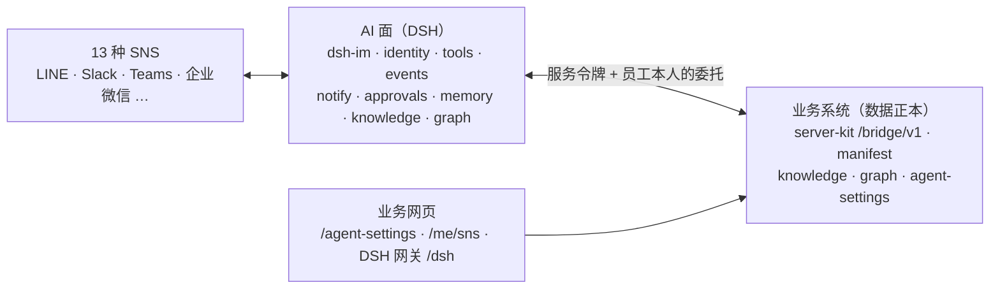

# biz-ai-agent

**官方网站：[biz-ai.myaiportal.net](https://biz-ai.myaiportal.net/) · 本项目介绍页：[Biz AI Agent](https://biz-ai.myaiportal.net/zh/biz-ai-agent.html)**

[](https://biz-ai.myaiportal.net/)
[](LICENSE)
[](https://github.com/deepseek-ai/deepseek-harness)
[](packages/protocol)
[](#快速开始)

[English](README.md) · [日本語](README.ja.md) · **简体中文**

**把任何 IT 系统变成 AI agent —— 一个业务系统 + 一个 DSH = 一个 AI 员工。**

[用 AI 编程工具造 agent](#用-ai-编程工具造-agent) ·
[快速开始](#快速开始) ·
[使用手册](docs/MANUAL.md) · [幻灯片](docs/MANUAL.pptx) ·
[框架：biz-ai](https://github.com/ITC-cloud-soft/biz-ai)

biz-ai-agent 是一个完整的 AI agent 框架。agent 是在员工平常用的聊天工具（LINE、Slack、Teams、企业微信、钉钉、飞书等 13 种
SNS）里工作的 AI 员工：**以员工本人的权限**根据公司文档回答问题，把审批卡片发给该批的人，解释"这件事为什么发给我？"，并做报告。
**业务系统始终是数据正本，由人来决定。**

全部都在这个仓库里：

| 部分 | 内容 |
|---|---|
| **Biz Assistant Framework**（从 [biz-ai](https://github.com/ITC-cloud-soft/biz-ai) 拷入；包名 `@dsh-bridge/*`，fork 为 `@care/*`） | 业务系统一侧的 Bridge v1 和 server-kit；DSH（DeepSeek Harness）上的 AI 面：SNS 身份连携和连携码、业务工具、事件、通知、审批、长期记忆、AI 员工资料、文档读取、Web 助手；13 种 SNS 的 IM 网关 dsh-im；web-kit；DSH 网关；产品 profile；测试工具 |
| **agent 层**（本仓库自己的） | 按权限的**知识**（以提问者的权限检索，出处是业务画面）、**图谱**（"这件事为什么发给我？"）、**设置插件** `/agent-settings`（模型、文档、检索方式 BM25F / RAG / 知识图谱、SNS 审批和报告）、员工本人的 SNS 连携页 `/me/sns`、登录页、两个示例系统和 **agent-builder skill** |

**模型可以自己选。** DeepSeek 只是默认值。对话模型在 DSH 的 Models 页面设置，可选 OpenAI、Azure OpenAI、Anthropic、DeepSeek、OpenAI 兼容网关或自建服务器（vLLM 等），由 DSH 自带的 `dsh-llm-pi-ai` 适配器连接。默认的检索（BM25F）不用模型；RAG 和知识图谱可以接任何 OpenAI 兼容或 Azure OpenAI 端点。

## 核心思想

- **agent 首先是一个普通的 IT 系统。** 数据、角色、谁能看什么、谁来决定，都在业务系统里。没有拖拽式的流程编辑器：流程是代码，
  由 AI 编程工具来写，由 manifest、一致性测试、测试、评测和日志守护。
- **AI 员工只读和提案，人来决定。** 以提问员工本人的委托读取数据；它能做的"写"只有提案，要人在网页或聊天里采纳才会执行。
  金额由人决定。
- **业务系统决定通知谁**，和网页画面用同一个规则。
- **事件和通知不带个人信息** —— 只有 ID、数值、日期、状态；姓名、理由、金额在网页上确认权限后显示。
- **权限优先** —— 每一次检索、每一个图谱回答，都先按提问者的权限过滤，再排序。

## 用 AI 编程工具造 agent

**不用自己从零写 agent。** 仓库里带着 `agent-builder` skill：在仓库根目录打开 AI 编程工具，说出你需要的业务，AI 就用这个框架
把 agent 开发出来并验证好。[`examples/equipment-loans`](examples/equipment-loans) 就是 AI 只按这个 skill 从零造出来的。
[`examples/expense-claims`](examples/expense-claims) 也是 AI 造的，而且是在没人回答它提问的无人条件下完成的；skill 说错、漏写、顺序不对的 20 处都写在 [`SKILL_REPORT.md`](examples/expense-claims/SKILL_REPORT.md) 里。

**推荐的顺序：先开发，再设置，最后在聊天里试**（[官网上的同一节](https://biz-ai.myaiportal.net/zh/biz-ai-agent.html#order)）

| 步骤 | 做什么 | 需要什么 |
|---|---|---|
| 0（可选） | 先看成品：参考实现的画面（[快速开始](#快速开始)），或连 LINE 在内的 `npm run e2e -- --serve` | 不需要模型和聊天账号 |
| 1 | 准备业务：谁用、谁能看什么、谁审批、文档（测试用虚构数据）；决定要不要在聊天工具上做测试 | — |
| 2 | 交给 AI 编程工具开发和测试（见下文）。要在聊天上测试，就让 AI 把 DSH 网关和 profile 也做好 | 只用假模型、假 LINE，不需要密钥 |
| 3 | 启动造好的 agent，在 `/agent-settings` 设置：模型（只有 RAG / 知识图谱才需要）、知识状态、审批人和报告接收人 | RAG / 图谱要测试用的模型 key |
| 4 | 接上 DSH 和聊天工具：安装 profile，带着对话模型的 key 启动 DSH，在 SNS 页创建测试机器人，在 `/me/sns` 连携，试提问、审批卡片、通知 | 测试用的聊天账号、虚构数据 |
| 5 | 像普通网站一样发布 | 正式的密钥和机器人 |

管理端 `/agent-settings` 是第 2 步造出来的业务系统的一部分（每个 agent 一份），所以放在开发之后。开发用的文档放进仓库的
`knowledge/*.md`（评测和权限测试都靠它们）；画面上传是上线后管理员追加文档用的。开发前也不用选模型（默认的检索 BM25F 不需要模型）。

### 1. skill 已经在仓库里

clone 仓库、完成安装（[快速开始](#快速开始)）后，在仓库根目录打开你的工具：

| 工具 | 做法 |
|---|---|
| [Claude Code](https://claude.com/claude-code) | 在根目录启动 `claude`。skill 在 `.claude/skills/agent-builder/`，自动加载；输入 `/agent-builder` 可直接调用 |
| [Codex](https://developers.openai.com/codex) | 在根目录启动 `codex`。skill 在 `.agents/skills/agent-builder/`，自动发现；用 `$agent-builder` 可直接调用 |
| 其他 AI 编程工具 | 告诉它"先完整读 `skills/agent-builder/SKILL.md`，按它的步骤做" |

skill 的正文是 [`skills/agent-builder/SKILL.md`](skills/agent-builder/SKILL.md)（英文，写给 AI 看的）。它要复制本仓库的参考实现、
运行本仓库的测试，所以要在本仓库里用，不要只把这个文件拷到别处。

### 2. 用平常的话说需求

```text
用 agent-builder skill 帮我造一个"出差报销"的 AI agent：
- 员工在 LINE 上问报销规定、查自己的申请进度；
- 经理审批本部门的申请，超过 10 万日元的还要财务批准；
- 财务每月收到件数报告；
- 报销规定的文档在 <你的文档路径>（日文和中文各一份）。
```

用其他语言说也一样。AI 会这样做：

1. **先问你决定** —— 谁用、能读什么、谁审批、哪份文档给谁看、什么是正确答案、用哪个 SNS —— 写进
   `examples/<system-id>/AGENT_PLAN.md`，等你回答。没人能回答时，用推荐的默认值并标上"待确认"。
2. 复制参考实现，写业务系统和 manifest，跑到一致性测试 **52 / 52**。
3. 接知识和图谱，**在调参之前**写评测，再接设置画面、SNS 审批和报告，写 DSH profile。
4. 每一步都用命令验证；最后报告做了什么、跑了哪些命令和结果、哪些"未验证"、哪些决定"待确认"。

你要做的：回答决定；提供文档（测试只用虚构数据）；看计划和报告；在本机打开画面试用；发布。

### 3. AI 造出来的文件

都在 `examples/<system-id>/`，是一个普通的 Node.js 项目，全部进 git：

| 文件 | 是什么 |
|---|---|
| `AGENT_PLAN.md` | 决定和证据：谁决定了什么、哪些待确认、数字 |
| `bridge.manifest.yaml` | 系统的自我介绍（本体）：角色、实体、事件、AI 的工具、画面路由 |
| `src/app.mjs` | 业务系统本身：数据、登录、业务规则（hooks）、业务 API、设置插件、知识、图谱、DSH 网关 |
| `src/server.mjs` | 启动入口：从环境变量读端口、密钥、数据目录 |
| `knowledge/*.md` | 知识文档（可见范围写在文档里） |
| `evals/` | 评测题（`knowledge.evals.json`）和 `run.mjs` |
| `test/*.test.mjs` | 业务规则、一致性、知识权限、图谱、评测下限、设置插件的测试 |
| `dsh-profile/` | AI 面（DSH）的产品 profile |
| `README.md` | 说明、启动方法、评测和测试的数字 |

### 4. 发布：和普通网站一样

- **业务系统就是一个普通的 Node.js 网站。** `npm install` 后用 `NODE_ENV=production node src/server.mjs` 启动（用 systemd、pm2、
  Docker 等常驻），前面放 HTTPS 反向代理（nginx、Caddy 等），域名指向它。
- 密钥只用环境变量给；数据目录放在持久的磁盘上。
- **AI 面（DSH）是同一台机器上再起的一个进程**：只监听 127.0.0.1，由网站里的 DSH 网关访问。IM 的 webhook 地址填网站的公开路径
  （例：`https://<你的网站>/dsh-hooks/line`）。
- 另外只需要模型的 API（AI 员工对话用）。数据库只在用 pgvector 时才需要。

## 快速开始

需要 **Node.js 24.9 以上**（固定版本的 DSH CLI 的要求；只做 `npm install` / `npm test` 的话 22.19 以上即可）、npm，以及端到端测试用的、
PATH 上的 **pnpm**。不需要数据库、API key 和聊天账号。

```sh
git clone https://github.com/ITC-cloud-soft/biz-ai-agent.git && cd biz-ai-agent
npm install
npm run vendor:install      # 第一次：vendor 里 fork 的依赖
npm test                    # 全部包、插件、示例：约 900 个测试，0 失败（没有 PostgreSQL / MySQL 时有几个 skip）
npm run e2e                 # 在真实 DSH + 假模型 + 假 LINE 上跑试点：15 / 15 PASS
```

**不想在本机准备环境：** [在 GitHub Codespaces 里打开](https://codespaces.new/ITC-cloud-soft/biz-ai-agent)，dev container 会装好 Node 24 和 pnpm，并执行 `npm install` 和 `npm run vendor:install`；之后运行 `npm test` 和 `npm run e2e`。

第一次 `npm run e2e` 会把固定版本的 DSH CLI 装进 `.dsh-cli/`（从公共 npm 仓库下载，约 900 MB，git 忽略），不会碰你全局安装的 DSH。
`npm run e2e -- --serve` 跑完后不退出：打开 `http://127.0.0.1:19751/login`（密码在 `e2e/.work/serve.txt`）。

**不用 DSH 试用画面**（开两个终端；虚构的员工 `admin`、`admin2`、`manager`、`staff1`、`staff2`，密码 `leave-dev`）：

```sh
echo MOCK_MODEL_KEY=anything > examples/leave-requests-knowledge/.env.local
node examples/leave-requests-knowledge/dev/mock-model.mjs    # 端口 19760 的假模型（不是 AI）
node examples/leave-requests-knowledge/src/server.mjs        # 试点 http://127.0.0.1:19750/login
```

用 `admin` 登录 → `/agent-settings`：切换检索方式（BM25F / RAG / 知识图谱），上传文档，用 `admin2` 批准。这里 SNS 页会显示
「未连接 DSH」，没有 DSH 时这是正常的。详见[手册第 4 章](docs/MANUAL.md#4-第一次运行安装测试本地试用)。

## 工作原理



- **一次提问** —— 员工在 LINE 上提问 → 知识工具**以这个员工的委托**检索 → 业务系统只返回他能看的段落和出处（业务画面）→
  出处守卫和链接守卫检查回答 → 带出处的回答发回 LINE。你看不到的内容，AI 也看不到。
- **一次审批** —— 管理员上传文档 → 业务系统写入 `approval.requested` → 审批卡片发给另一个管理员（不发给上传者）→ 在 LINE 上按
  「承認」→ 用和网页相同的 `mayDecide` 规则判断 → 发布 → 只有件数的报告。

## 仓库里有什么

| 路径 | 内容 |
|---|---|
| `packages/` | ★ protocol（Bridge v1、manifest 校验、一致性 52 项）、server-kit、dsh-core、gateway、web-kit、help、telemetry、testing · knowledge、graph、agent-settings |
| `plugins/` | ★ identity、tools、events、notify、approvals、assistant、memory、persona、reader · knowledge（工具模块 + 出处守卫）、graph（工具模块） |
| `profile/` | ★ DSH 产品 profile 模板、安装和检查脚本 |
| `vendor/` | ★ dsh-im（13 种 SNS）、dsh-auto-tasks、dsh-proactive（MIT 的 fork；第一次 `npm run vendor:install`） |
| `examples/` | leave-requests-knowledge（参考实现）、equipment-loans（AI 用 skill 造的）、expense-claims（AI 无人值守造的，附 skill 报告）· ★ leave-requests、equipment-inspection（测试要 PostgreSQL）、care-billing（只有 manifest 和对照表） |
| `skills/` | agent-builder（造 agent 的 skill）· ★ biz-assistant-integration（把框架接入已有系统的 skill） |
| `.claude/skills/`、`.agents/skills/` | 让 Claude Code 和 Codex 加载 agent-builder 的入口 |
| `docs/` | 手册、设计、API · ★ GUIDELINE（日 / 英 / 中）、ARCHITECTURE 等 |
| `e2e/run.mjs` | 真实 DSH 上的端到端测试 |

★ = 由 [`scripts/sync-framework.mjs`](scripts/sync-framework.mjs) 从 Biz Assistant Framework 拷入的部分（来源 commit 见
[`framework.sync.json`](framework.sync.json)）。不要在这里直接改：在框架（[biz-ai](https://github.com/ITC-cloud-soft/biz-ai)）里改好再同步
（`npm run sync-framework -- --from <框架的克隆>`，见手册第 13 章）。

## 文档

| 文档 | 内容 |
|---|---|
| [`docs/MANUAL.md`](docs/MANUAL.md)（[幻灯片](docs/MANUAL.pptx)） | **使用手册**：整体结构、第一次运行、画面怎么用、用 AI 编程工具造 agent、接入已有系统、AI 面、知识层、部署、规则、测试、故障排查 |
| [`skills/agent-builder/SKILL.md`](skills/agent-builder/SKILL.md) | agent-builder skill（英文，给 AI 编程工具） |
| [`docs/GUIDELINE.zh-CN.md`](docs/GUIDELINE.zh-CN.md)（[日](docs/GUIDELINE.md) / [英](docs/GUIDELINE.en.md)） | 框架开发指南：接入步骤、扩展点、MUST / SHOULD 规则、测试、FAQ |
| [`docs/ARCHITECTURE.md`](docs/ARCHITECTURE.md) | 架构、事件流、身份和委托、接收人保证、安全承诺（日文） |
| [`docs/KNOWLEDGE_API.md`](docs/KNOWLEDGE_API.md)、[`docs/GRAPH_API.md`](docs/GRAPH_API.md) | 知识检索和图谱：路由、规则、一致性检查 K-01…K-08 和 G-01…G-07（英文） |
| [`packages/agent-settings/README.md`](packages/agent-settings/README.md) | 设置插件的接口 |
| [`docs/MULTI_AGENT_PLATFORM.md`](docs/MULTI_AGENT_PLATFORM.md) | 草案：Agent Hub，在一个地方管理公司的所有 agent |
| [`docs/STATUS.md`](docs/STATUS.md) | 当前进度 |

文档、测试和评测里的数据全部是虚构的。不替你选模型：BM25F 不用模型就能工作，模型接口可以接负责人选的任何 OpenAI 兼容或
Azure OpenAI 端点。

## 许可证

[Apache License 2.0](LICENSE) —— 另见 [`NOTICE`](NOTICE)。`vendor/` 里的 fork 保留上游的许可证（MIT）。

官方网站：https://biz-ai.myaiportal.net/

想把你们自己的业务系统接上 AI？我们提供 30 分钟的免费 AI 化诊断：https://biz-ai.myaiportal.net/zh/diagnosis.html?utm_source=github&utm_medium=referral&utm_campaign=readme&utm_content=biz-ai-agent
