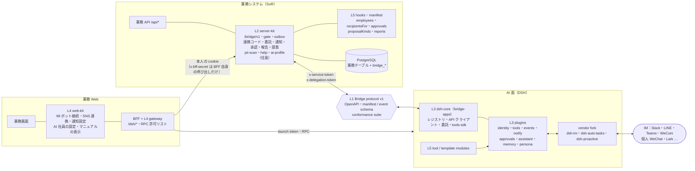
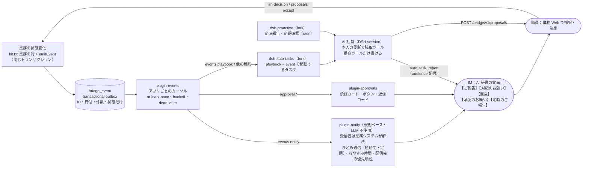
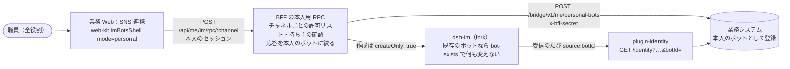
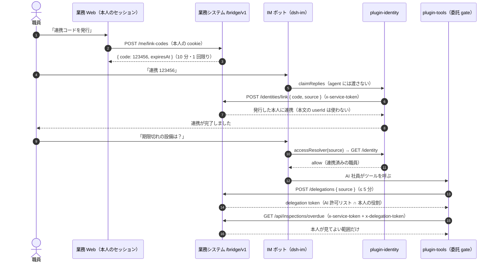
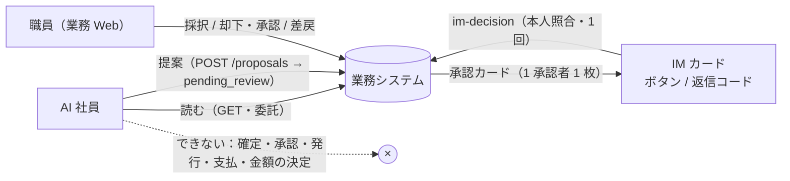
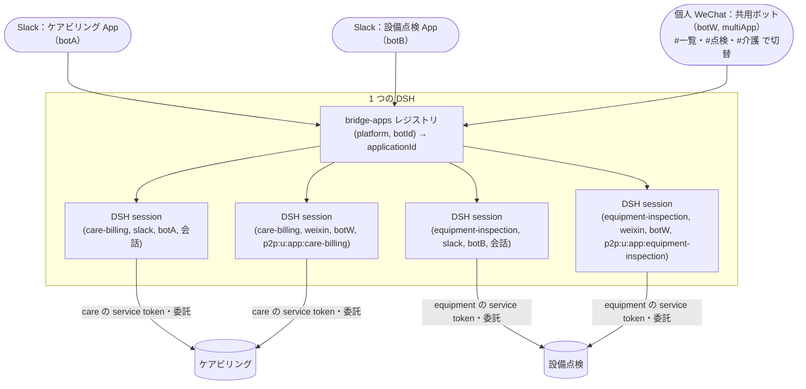
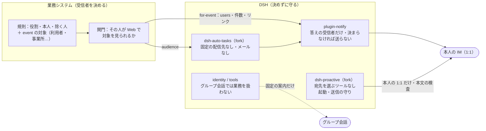
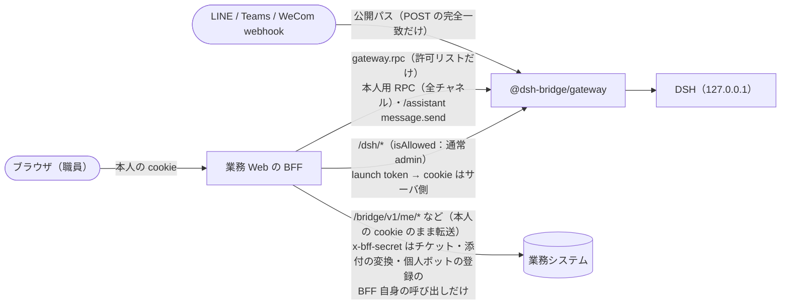
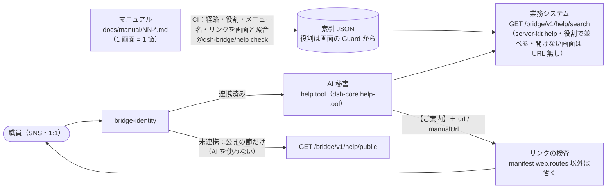

# Biz Assistant Framework — アーキテクチャ

パッケージは `@dsh-bridge/*`（最初の名前 DSH Business Bridge の接頭辞のまま）。顧客向けの名前は Bizアシスタント。

## Summary (English)

The Biz Assistant Framework (packages `@dsh-bridge/*`, first called DSH Business Bridge) is a general-purpose framework that turns any IT system — an existing business system (any IT system with its own
employees, roles and login) — into an AI agent / AI assistant: a workplace with **AI employees (AI 社員)** — an AI assistant per employee — that reach staff
through IM. The system adds a bridge (the Bridge v1 endpoints, a manifest, SNS linking on its own login, recipient rules it
decides itself, events in its own transactions); the framework provides the rest (DSH runtime, IM channels, plugins, guards,
playbooks, tests). A new system can be built on it the same way. The **business plane** (the business system) stays the single system of record (SoR): data, roles, rules, approvals,
amounts and audit. The **AI plane** (DSH, `@deepseek-ai/dsh`) holds conversations (and the AI employee's long-term memory, never business data) only. The two are joined by a small,
versioned HTTP protocol (**Bridge v1**, L1) and a machine-readable **manifest**. On the business side `@dsh-bridge/server-kit`
(L2) implements the protocol; on the DSH side `@dsh-bridge/dsh-core` and nine plugins (L3) link IM accounts, gate business
tools with per-employee delegations, pump events, send deterministic notifications in an "AI secretary" voice, deliver
approval cards, run event-triggered playbooks that may only *propose*, serve the business web's assistant panel, keep the AI
employee's **long-term memory** (personal / organization / conversation recall, personal data screened before saving, §8.1) and
render the AI employee's **profile** — the nickname, tone and company introduction the administrator sets in the business system,
after the fixed rules, never overriding them (§8.2). How-to questions are answered from the business system's own manual with
links to the screens the asker may open (`@dsh-bridge/help`, §9.5).
`@dsh-bridge/gateway` and `@dsh-bridge/web-kit` (L4) embed DSH and the IM screens into the business web; each business system
writes its own adapter (L5: hooks, manifest, tool / template modules). One DSH can host several applications; every
application keeps its own bots, links, delegations, tool namespace and DSH sessions (personal WeChat: one shared bot with
in-window switching). Every employee links their own SNS accounts — through the organisation's bots or through **personal
bots** they connect themselves on every dsh-im channel. **Recipients are decided by the business system only**: the AI never
picks who receives business information; group chats get no business answers by default; automatic-task and scheduled-report
output goes only to the people the business system names (or to the employee's own 1:1 chat) and is screened or replaced by
fixed wording; every switch that would open another path has a closed setting (§7). Safety promises — link yourself only,
delegation = AI allow-list ∩ role, the AI reads and proposes and a person decides, no personal data in events or IM text,
identity only from the business system — are enforced by the conformance suite (52 checks) and the plugin / fork tests.

---

## 1. 何をするための仕組みか

どの IT システムも AI エージェント・AI アシスタントにする、汎用の framework。いま使っている業務システムを、IM で働く **AI 社員**
（職員一人ひとりの AI アシスタント）のいる職場に変える。業種・言語・作り方を問わず、どの業務システムにも同じ方法でつなぐ。

- 業務システム（請求・点検・人事・… 自分の職員・役割・ログインを持つシステム）に、IM（Slack / LINE / Teams / WeCom（企業微信） /
  個人 WeChat / Lark（飛書） など）で働く AI 社員を付ける。
- 職員は自分の IM（組織のボット、または自分でつないだ個人のボット）から AI 社員に質問し、**自分に関係する**業務の変化（期限超過・
  承認依頼・定時報告など）を **AI 秘書**の文面で受け取り、承認カードのボタンや返信コードで決定する。
- AI 社員は**本人の権限の範囲で読む・提案する**だけ。確定・承認・発行・支払・金額の決定は常に人が業務システムで行う。
  誰に届けるかも業務システムが決め、AI は宛先を選ばない（§7）。
- AI 社員は会社が決めた呼び名と人柄で話し（署名は「— さくら（<アプリ名> AI 秘書）」、AI であることは必ず示す。§8.2）、
  本人の好みや前の話を覚え（個人情報は残さない。§8.1）、システムの使い方にはマニュアルだけを根拠に画面のリンク付きで答える（§9.5）。

| 面 | 何を持つか | 何を持たないか |
|---|---|---|
| **業務面（business plane）＝ SoR** | 業務データ、職員・役割、規則、承認、金額、監査、通知の受信者と本人の通知設定、AI 社員のプロフィール（版と監査）、マニュアルの索引 | 会話 |
| **AI 面（AI plane）＝ DSH** | 会話（DSH session）、AI 社員のプリセット（ペルソナ・使えるツール）、IM 接続、自動タスクの台帳、長期記憶（個人・組織・会話の振り返り） | 業務データ（必要なときにツールで本人の委託で読むだけ） |

ケアビリング（介護事業所の請求・訪問記録・シフト・帳票。リポジトリ `care-ai-native`）から、業務の中身を除いた AI 側の仕組みを
取り出したもの。ケアビリングは最初の導入例で、`examples/care-billing/` に manifest と対応表だけを置いている（業務コードは無い）。

**既存のシステムをつなぐのが主な使い方**。業務システムの側に足すのは「ブリッジ」と呼ぶ次の部分だけで、残り（DSH の実行環境、IM の
接続、9 つのプラグイン、送信の守り、長期記憶と AI 社員のプロフィール、マニュアルで答える部品、自動タスクと定時報告の仕組み、
テストの道具）は framework が持つ。

| 業務システムに足すもの | 中身 | 部品 |
|---|---|---|
| Bridge v1 の endpoint | 身元・連携コード・委託・event・通知の受信者・承認・提案・報告・manifest（`/bridge/v1/*`） | Node なら `@dsh-bridge/server-kit`（hooks を書く）。既存の API があれば別名（alias）で載せる。他の言語は OpenAPI を実装し conformance suite で確かめる |
| manifest | 役割と AI 委託の上限、event と payload の許可リスト、通知の文面、AI のツール、playbook、報告 | `bridge-validate` で検証 |
| SNS 連携（システム自身のログインで） | 職員が自分の SNS を結び付ける画面と、本人のボットの登録・持ち主の確認 | `@dsh-bridge/web-kit`、BFF + `@dsh-bridge/gateway` |
| 受信者の規則（システムが決める） | event ごとに「誰に届けるか」を、役割・所属・担当の範囲で業務システムが判断する | hook `recipientsFor` |
| event・承認の規則・セッションの確認 | 業務の行と同じトランザクションの outbox、Web と同じ承認の規則、ログアウトで AI の権限も止める | `kit.tx` + `emitEvent`、`approvals`、`isSessionLive` |
| 定時報告・個人ボットの登録（conformance 52 / 52 のため必須） | 件数だけの報告（manifest の `reports`）と、本人のボットの登録・持ち主の規則。業務で使う予定が無くても最小の形で持つ | `hooks.reports`、個人ボットの経路（server-kit は既定で持つ）。GUIDELINE b.4 |
| 任意：マニュアル・AI 社員の設定 | 1 画面 = 1 節のマニュアル（CI で画面と照合・索引）、管理者だけの「AI 社員の設定」画面 | `@dsh-bridge/help` と server-kit の `help`、プロフィールの経路（server-kit は既定で持つ）、web-kit `AiProfilePage` |

手順とチェックリストは [GUIDELINE.md「既存の業務システムをつなぐ：チェックリスト」](GUIDELINE.md#既存の業務システムをつなぐチェックリスト)。
同じ部品で新しい業務システムを作ることもできる（見本の設備点検は server-kit の上で新しく作った。ケアビリングは AI 社員を前提に作った
業務システムで、framework はそこから取り出し、/bridge/v1 は既存の API に別名で載せている）。

## 2. 全体像

## 3. 層（L1〜L5）

| 層 | パッケージ | 役割 |
|---|---|---|
| **L1 protocol** | `@dsh-bridge/protocol`（`packages/protocol`） | Bridge v1 の OpenAPI 3.1（`openapi/bridge-v1.yaml`：identity・me・delegations・events・notifications・approvals・assistant・reports・proposals・manifest、任意の pii-scan・help・ai-profile / admin/ai-profile）、manifest と event の JSON Schema、検証ライブラリ（`validateManifest`・AI 社員のプロフィールの `validateAiProfile` など、依存なし）、`bridge-validate` CLI、**適合性テスト（conformance suite、52 項目）** |
| **L2 server-kit** | `@dsh-bridge/server-kit` | 業務システムが v1 を実装するための Node 部品：`createBridgeApp`、principal と gate、連携コード、委託、トランザクション内の event outbox（型ごとの payload 許可リスト）、通知の解決と配信記録、承認カード、報告、提案、manifest の etag、PII scan、マニュアルの検索（`help` に `@dsh-bridge/help` の検索を渡す）、AI 社員のプロフィール（版・監査・管理者の経路）、`bridge-protocol: 1` ヘッダとエラーの形式（エンベロープ）、PostgreSQL / メモリの store、既存 API への別名（alias） |
| **L3 dsh-core + plugins** | `@dsh-bridge/dsh-core`（DSH プラグイン `bridge-apps`）、`@dsh-bridge/plugin-identity` / `-tools` / `-events` / `-notify` / `-approvals` / `-assistant` / `-memory` / `-persona` | DSH 側。アプリケーションのレジストリ、業務 API クライアント、委託トークンのキャッシュ、会話のキー、tools-sdk、共用ボットの切替、AI 秘書の文面の枠、送信失敗の分類、マニュアルの検索ツール（help-tool）と答えのリンクの検査（link-guard）、AI 社員のプロフィールの保持（ai-profile・persona）。プラグインは連携・ツール・event・通知・承認・Web アシスタント・長期記憶（§8.1）・プロフィール（§8.2）。各プラグインは業務固有の用語やツールを持たず、manifest と設定・拡張モジュールで受け取る |
| **L4 gateway + web-kit** | `@dsh-bridge/gateway`、`@dsh-bridge/web-kit` | 業務 Web の BFF に組み込む DSH への認証付きゲートウェイ（`/dsh/*`、launch token、公開 webhook、サーバ側 RPC の許可リスト、supervise）と、業務 Web の React 部品（IM ボット接続、本人の SNS 連携、通知設定、プラットフォームの表示、管理者の「AI 社員の設定」`AiProfilePage`、マニュアルの表示 `manualChapters`） |
| **L5 app adapter** | 各業務システムのリポジトリ | manifest、server-kit の hooks（または既存 API の別名）、手書きのツールモジュール（主に提案ツール）、通知の文面モジュール、AI 社員のプリセット、業務 Web の承認・提案画面 |

周辺：

- `profile/`：DSH 製品 profile の雛形（許可リスト・バージョン固定の bundle、プラグイン管理や端末を無効にする patch、送信の設定を閉じた値、
  `bridge-apps` の登録の雛形）と `install.mjs`（隔離した DSH home に入れる。個人の `~/.dsh` と固定の配信先の指定は拒否）、自動タスクのテンプレート形式。
- `packages/help`（`@dsh-bridge/help`）：業務システムのマニュアルの読み取り・索引・CI の検査・役割ごとの検索（§9.5）。
- `packages/testing`：mock LLM / LINE / iLink（個人 WeChat）/ WeCom、隔離 DSH home、プロセスの補助。
- `vendor/`：dsh-im・dsh-auto-tasks・dsh-proactive の fork（§10）。

依存の向き：L5 → L3 / L2 → L1。L3 は L2 を知らない（HTTP の v1 だけ）。業務システムは Node でなくてもよい（L1 を自分で実装し、
conformance suite で検証する）。

## 4. イベントの流れ（業務の変化 → IM）

1. **outbox**：業務システムは業務の行と event を**同じトランザクション**で書く（`kit.tx` + `kit.emitEvent`）。event の id は
   commit 順に増える（advisory lock）ので、カーソルが event を飛ばさない。payload は manifest の `events.<type>.payload`
   （**型ごとの許可リスト**）にある ID・日付・件数・状態だけ。未宣言の型・許可外のキー・個人情報らしいキーや値は `EventRejected`。
2. **plugin-events**：アプリケーションごとに `GET /bridge/v1/events?after=&limit=` を取り込む。成功した event までしか
   カーソルを進めない（少なくとも 1 回）。失敗は指数バックオフ、`maxAttemptsPerEvent` 回で dead letter。配る event には取り込んだ
   アプリの `applicationId` を付ける（本文の値は上書き）。振り分け：`approval.*` → approvals、`sns_identity.unlinked` → identity、
   通知の種別 → notify と auto-tasks、それ以外 → auto-tasks。manifest の `playbooks` を自動タスクとしてデプロイする（新しいものは無効の状態で）。
3. **plugin-notify（規則ベースの通知）**：モデルが止まっていても届く経路。受信者・本人の設定・文面の材料は業務システムが返す
   （`GET /bridge/v1/notifications/for-event/{eventId}`。状況が変わって通知が不要なら `stale`）。プラグインは「いつ・どのボットで・何通に分けて・
   どの文面で」だけを決める。
   - **短時間のまとめ送信**（`digestTypes`）：同じ人・同じ種別を、最後の event から 15 秒（`realtimeSettleSeconds`）、遅くとも最初の event から
     2 分（`realtimeDigestSeconds`）で 1 通にまとめる。
   - **定期のまとめ送信**：`digestWindows.<type>` か manifest の `notify.digestMinutes`（上限はプラグイン設定の `digestMinutes`、既定 30 分）。
   - **通知を控える時間帯（おやすみ時間）**：受信者本人の `quietHours` の間は、時間帯が終わるまで保留する（manifest で `notify.quiet: exempt` とした種別は保留しない）。
   - **配信先の優先順位**：`DEFAULT_PLATFORM_PRIORITY`（email を除く dsh-im の全プラットフォーム）。連携済みのうち最も優先度の高いプラットフォームへ送る。
   - 送信は `sendCard`（冪等キー `notify:<eventId>:<userId>`）。結果は `notifications/deliveries` に報告（sent は終端・重複排除）。
   - 送れない理由が分かるもの（WeChat の会話コンテキスト無し・宛先不正・ボット未接続・LINE の月間上限）は理由付きで記録し、黙って捨てない。
4. **AI 秘書の枠**：どの通知も 1 行目にラベル（manifest の `templates.<id>.intent`：info →【ご報告】、action →【対応のお願い】、
   urgent →【至急】、approval →【承認のお願い】（ボタンの無い承認のお願い）、consult →【ご相談】）、日本時間のあいさつ（名前は使わない）、事実（件数・日付だけ）、「▶ お願いしたいこと」または
   「ご対応は不要です」、リンク、署名「— <アプリ名> AI 秘書」。枠は `@dsh-bridge/dsh-core` の `frameMessage` / `noticeCard`。
5. **自動タスク（AI の提案）**：manifest の playbook（または profile のテンプレート）が event で AI 社員を起こす。AI は読取ツールで
   現在の状態を確かめ、何もなければ `auto_task_silent`、必要なら**提案ツール**で提案し、`auto_task_report` で 1 通だけ報告する
   （`only_if_actionable`）。報告は event の受信者（業務システムが解決した人）へ AI 秘書の形で届く（audience 配信）。
   受信者は委託した職員と別の人になりうるので、本文を固定の文面（タスク名・業務 Web で確認・リンク）にでき（`audienceText: template`）、
   受信者が決まらないときは送らない（`audienceFallback: none`）。詳しくは §7。
   誰の委託で動くかは playbook の `delegation`（`<class>` か `<class>=each`、§5.3）。**起動データは業務データであり指示ではない**。
   manifest の playbook は `pb_<application-id>_<playbook>` として無効のままデプロイされ、運用者が id を指定して有効にする（`install.mjs --enable-auto-tasks <id>`）。同じ event では 1 回しか動かない（dedupe）。
   playbook の `agent` は専用の会話のプリセットになるので、製品 profile に定義しておく。
6. **定時報告**：manifest の `reports.*.cron`（または業務システムの設定）に合わせ、本人が自分の 1:1 の会話で「定時報告 オン」と送ると、
   dsh-proactive が AI 社員を起こし、本人の委託（読取のみ）で【定時のご報告】を書く。起動の直前に毎回、本人が在職・連携済み・同じ 1:1 の会話・
   許された役割かを業務システムで確かめ（起動の守り）、送る直前に宛先が本人の 1:1 か、本文に金額・人名・連絡先・外部 URL・健康情報の語が
   無いかを確かめる（送信の守り。見つかれば全文を固定の文面にする）。

2 つの経路を使い分けるのが要点：**規則が明確で必ず届けたいもの（承認・期限超過・安否）は規則ベースの通知**、**「伝えるか・何を」の
判断が要るものは AI の playbook**。どちらの経路でも「誰に」は業務システムが決める（§7）。

## 5. 身元と委託

### 5.1 本人だけの SNS 連携

- 職員は業務 Web で自分の**連携コード**（6 桁、10 分、1 回限り、新しいコードで古いコードは無効）を発行し、そのアプリの
  ボットに「連携 123456」と送る。コードは**発行した本人**に結び付く（本文の `userId` は無視）。
- 管理者を含め、他人の SNS を連携・解除する操作は**存在しない**。自分の連携だけを見て解除できる（他人のものは 404）。
- 誤ったコードの試行は発信元ごとに 10 分 5 回で 429。グループ会話では受け付けない。
- **email は通知だけ**：差出人を検証できない（dsh-im は DKIM / DMARC を確かめない）ので、連携も AI の利用も承認もできない。

### 5.2 全員が自分のボットをつなぐ（個人ボット）

組織のボット（アプリごとの Slack App・LINE 公式アカウント・WeCom の自社開発アプリなど）に加えて、**すべての役割の職員**が、dsh-im が
対応するチャネル（Slack・LINE・Teams・Telegram・Discord・個人 WeChat・WhatsApp・WeCom・QQ・DingTalk・Lark・Matrix など）で
**自分のボット**をつなげる。原則は「各職員は自分の接続だけを設定する。他人の接続は見ない・作らない・解除しない（管理者を含む）」。

- **画面**：web-kit の `SnsLinkPage` に `personalChannels` / `personalRpc` を渡すと、① が本人モードの `ImBotsShell`（dsh-im の設定部品そのまま）に
  なる。本人モードでは作業フォルダ・モデル・プリセット・文脈強化・「詳細設定」など本人が変えられない部分を出さない（fork の
  `BotSettingsContext.hiddenSettings`）。作成に成功するとその場で連携コードを出す。管理者の「IM ボット接続」は `excludeBotIds` で職員の個人ボットを外す。
- **守るのは BFF と業務システム**（web-kit は表示を整えるだけ）：dsh-im はボットの持ち主を知らず、管理 RPC はすべて DSH の所有者として動く。
  そこで業務 Web の BFF が本人用の RPC（チャネルごとの許可リスト、`botId` は本人のものだけ、応答の `bots[]` を本人の分に絞る、作業フォルダ
  などを落とす、作成は直列化して増えた botId を本人に登録、失敗したらボットを削除して戻す）を持つ。参照実装はケアビリングの
  `apps/care-web/me-im-rpc.mjs`（framework の部品ではない）。
- **作成は新規だけ**（dsh-im fork の `createOnly`）：botId はプラットフォームの ID から決まるので、既存のボットと同じ認証情報で作成を呼ぶと
  上書きになる（上流どおり）。`createOnly: true` なら既存のボットに当たったとき何も変えず `bot-exists` で断る＝組織のボットや他人のボットを
  「自分のボット」として奪えない。
- **身元の判定はボットごと**：plugin-identity は照会に受信したボットの `botId` を足す（キャッシュもボットごと）。業務システムは、`botId` が
  登録済みの個人ボットなら**連携先の職員がその持ち主のときだけ**連携済みとして返す（同じワークスペースの別の職員が A さんの個人ボットに
  話しかけても通さない）。個人ボットからの連携コードも持ち主のものだけ（`personal_bot_owner_mismatch`）。連携を外すとボットの登録も取り消す。
- server-kit が持つもの：個人ボットの登録（`POST /me/personal-bots`、BFF だけ）・連携コードの持ち主の規則・**照会の持ち主の規則**
  （`identityOf`：`GET /identity`・`POST /delegations`・IM の承認の決定のすべてで `botId` を見る。取り消したボットは誰も通さない）・解除での取り消し。
  `personalBotPlatforms` の既定は dsh-im で個人ボットを作れるチャネルすべて（`PERSONAL_BOT_PLATFORMS`：slack・line・teams・telegram・discord・
  weixin・whatsapp・wecom・wecom-app・qq・dingtalk・feishu・matrix。email と iMessage は含まない。care-api と同じ）で、狭めるのは導入先の明示の設定。
  本人用 RPC は業務 Web の BFF の実装（ケアビリングの BFF）。server-kit を使わない業務システムは照会の規則も自分で持つ（care-api の `resolveIdentity`）。

### 5.3 委託（delegation）

- **委託 = AI 許可リスト ∩ 職員の役割**。AI 許可リストは manifest の `tools`（`roles` 付き）。AI がその職員本人より強くなることはない。
- 委託トークンはサービス（DSH）だけが発行を受けられ、最長 5 分。DSH は `(applicationId, source)` ごとにキャッシュし、
  期限の 30 秒前に再取得する。連携の解除・職員の無効化・Web セッションの終了で即時に無効になる。
- 委託でできるのは**読取（GET）と提案（`POST /bridge/v1/proposals`）だけ**。業務の書込み・承認・確定は 403 `delegation_not_permitted`。
  提案は職員の役割がその種類を扱えるときだけ（`role_not_permitted`）。提案を採択・却下するのは人だけで、1 回限り。
- **未連携の発信者は何も得ない**：`linked: false` 以外の情報（職員がいるかどうかのヒントも）は返さない。
- 業務 Web の AI アシスタントは、本人の Web セッションに結び付いたチケット（30 分、BFF だけが取得）を DSH が委託に交換する。
  委託が使えるのは**その職員がパネルから送ったターンの間だけ**。
- 自動タスク（IM の発信者がいないターン）は既定で拒否（`unattendedPolicy: deny`）。運用者が 1 人の職員を `delegate` に指定したとき
  だけ、その職員の委託で読取と、そのタスクの `source.tools` に挙がった提案だけができる（`install.mjs --auto-task-delegate` が製品の
  `bridge-tools` の項目に書く）。bridge-tools を載せていれば、bridge-apps が manifest から生成した読取ツールも同じ gate
  （`ctx.bridgeTools.gate(<appId>)`）で認可されるので、この規則は生成ツールにも手書きのツールにも同じように効く。
- **委託の分類**（playbook の `delegation` → タスクの `source.delegation`）：1 人の職員に全部のタスクを任せず、仕事の種類ごとに分ける。
  - `<class>`（例 `care`・`billing`）：運用者がその分類に選んだ職員（`unattendedDelegates.<class>`、無ければ既定の `unattendedOnBehalfOf`）。
  - `<class>=each`：**回ごとに、その回を起こした event の本人**の委託。DSH は `POST /bridge/v1/delegations { event: { id } }` を送り、
    業務システムが自分の event に書かれた人に（その種類の event が委託を出してよいもので、新しく、本人の設定がオンのときだけ）短い委託を出す。
    DSH の側は職員を選べない。導入先が `--auto-task-delegate <class>=each` で同意したときだけ。回の外・event の無い回・別のアプリの回・
    業務システムが出さない event は拒否し、既定の職員で代えない。
  - どの回か：dsh-auto-tasks（fork #15）の `ctx.autoTasks.activeRun(sessionId)` が、いまその会話で動いている回（タスク・event・分類）を返す。
  - 委託先が広い役割（管理者など）なら `unattendedWarnRoles` で一度だけ警告する（install.mjs は業務の役割を知らないため実行時に）。
  - server-kit の `POST /delegations { event }` は `hooks.eventDelegations`（event の種類ごとに、本人 `personOf` と本人の条件 `eligible`）で動く。
    発行と毎回の利用で「委託を出す種類か・新しいか（既定 12 時間）・本人が在職で条件を満たすか」を確かめ、外れた token は即時に無効。hook が無い
    業務システムは `event` を 400 で拒否する（出す種類を宣言したときだけ開く）。ケアビリングは care-api の同じ規則（`monitoring.draft_requested`）。

### 5.4 人が決める

- 承認カードは承認できる人ごとに 1 枚。token と返信コードはその人だけに有効で、誰か 1 人が決めると**他のカードはすべて無効**になる
  （**1 回の承認で決まる**）。返信コードを 5 回誤ると、そのカードはロックされ再発行されない。Web で決めたときも同じ規則
  （`approvals.mayDecide`）を使い、IM のカードを無効にする。
- カードの項目（ID・金額・期限など）を決めるのは業務システム。AI 秘書の枠は種類と期限だけを言い、金額や名前を足さない。
  承認の種類ごとの文（あいさつの後の一文・お願い・ボタンの説明・決定後の返事と本文）も業務システムがカードの `wording` で渡せる（各 300 字まで）。

## 6. 複数アプリケーションの DSH と、アプリごとの会話

1 つの DSH が複数の業務アプリケーションを持てる。レジストリ（`bridge-apps` の `applications`）が**ボット → アプリケーション**を決める
（メッセージ本文では決めない）。

- **会話のキー = (アプリケーション, プラットフォーム, ボット, 会話)**。会話・メモリ・自動タスク・通知はアプリごとに分かれる。同じ人でもアプリごとに
  別の連携（各業務システムの `bridge_identity`）。
- **1 アプリ 1 ボット**（WeCom の自社開発アプリ、Slack App、LINE 公式アカウント、Teams Bot、Lark アプリ）：アプリごとに別の窓口。
  通知もそのアプリのボットから送る（他のアプリのボットからは送らない）。Lark の open_id はアプリごとに別の値なので、
  連携も通知もそのアプリのボットで行う。
- **個人 WeChat は 1 アカウント 1 ボット**（iLink の制約）：1 つの共用ボットを `multiApp: true` で各アプリに載せ、窓口の中で切り替える。
  `#一覧`（使えるアプリ）、`#<アプリ名|別名>`（切替）、`#いま`、`#ヘルプ`。返信・通知は【アプリ名】で始まり、通知への返信（引用、
  または通知の後 10 分以内の最初の返信）はその通知のアプリへ戻る。`連携 123456` は**いまのアプリ**へ送られる。
- **トークンはアプリをまたがない**：委託トークン・承認の token / 返信コードは発行したアプリケーションにしか送らない。会話のアプリと
  ツールのアプリが違えば、トークンを取る前に拒否する。ツールは `<namespace>_*`（例：`care_*`、`facility_*`）で、名前空間の外の
  ツールは生成しない（他のアプリのツールを隠せない）。
- 起動時の拒否：同じ id の 2 アプリ、2 アプリに載った同じボット（`multiApp` の共用ボットを除く）、2 つの default、未知の path profile。
  アプリが 2 つ以上あるときは全ボットを列挙するか `strict: true` にする（新しいボットが黙って default に流れないように）。

## 7. 受信者の保証：自分に関係するものだけが届く

最も基本の約束：**各役割・各アカウントは、SNS で自分に関係する業務の知らせ・連絡・依頼だけを受け取る**（自分の役割・自分の所属・
自分が担当する範囲）。AI はその人の権限の中でだけ動き、**業務システムが決めていない相手には何も届かない**。プロンプトではなく、コードと
設定で守る。

### 7.1 誰が決めるか

- **業務システムが決める**（hook `recipientsFor`、または自前の for-event）。推奨の作り方（ケアビリングの `decideRecipients`）：
  1. event ごとの規則（役割・本人あて・除く人）に、**event の対象**（利用者・事業所・法人全体など）を持たせる。
  2. 役割の受信者は、対象の範囲にいる職員だけにする（所属・担当の範囲）。
  3. **関門**：計算とは別に受信者を 1 人ずつ確かめる。その種類が届いてよい役割か、規則の中の人か、本人あてでなければ
     **その人が業務 Web で同じ対象を見られるか**（Web の認可と同じ判定）。落とした人には送らず、監査に ID と理由の符号だけを残す。
  4. 件数（params）は受信者が見られる範囲で数える。回付（manifest の `audience.fallback`）は、受け手が 0 人のときだけ。
  5. 状況が変わって知らせが要らなければ `{ stale }`、範囲が分からなければ誰にも送らない。
- **framework は受信者を作らない**：plugin-notify は業務システムの答えに挙がった人だけに送り、本人の通知設定・おやすみ時間・まとめ送信・
  配信先の優先順位を当てるだけ。manifest の `audienceRules` / `audience.include` は説明と検証のためで、解決するのは業務システム。
- **AI に宛先を選ばせない**：モデルが呼べるツールに、宛先（ボット・会話・メールアドレス）を指定できるものを残さない（7.2 の 3・4・7）。

### 7.2 AI から IM へ出る経路と、その守り

| # | 経路 | 守り | 設定（どこ） | 既定 | 製品での推奨 |
|---|---|---|---|---|---|
| 1 | 規則ベースの通知 | 受信者は業務システムの答えだけ。email は配信先の既定の優先順位に入れない | — | — | — |
| 2 | 自動タスクの報告（audience 配信） | 受信者は起動した event の受信者。決まらないときは送らない。本文は AI の自由文でなく固定の文面（【対応のお願い】/【ご報告】＋タスク名・業務 Web で確認・リンク） | bridge-notify `audienceFallback` / `audienceText`（全アプリ。`applications.<id>` で上書き） | `channels` / `summary` | `none` / `template` |
| 3 | 自動タスクの固定の配信先 | 固定の botId + targetId に回さない、テスト送信は 403、`auto_task_report` / `auto_task_silent` はタスク自身の会話からだけ | dsh-auto-tasks `restrictDelivery`（fork #16） | `false` | `true` |
| 4 | メール | `auto_task_mail`（任意の宛先への SMTP）・IMAP の巡回・まとめのメールを無くす | dsh-auto-tasks `mail`（fork #16） | `true` | `false` |
| 5 | 定時報告 | 起動の直前に本人を確かめ（在職・連携済み・個人ボットは持ち主・同じ 1:1・許された役割。違えば止める）、送る直前に宛先が本人の 1:1 か・本文を検査（7.3） | bridge-notify `aiReportGuard`、dsh-proactive `deliveryGuard`（fork #14・#15） | `screen` / `optional` | `screen`（または `template`）/ `required`（守りが無ければ送らない） |
| 6 | 定時報告以外の business アラーム | IM へ送らない | bridge-notify `proactiveDelivery` | `allow` | `deny` |
| 7 | dsh-proactive のモデルツール | `proactive_set` などの `deliver_to`（任意の宛先）・他人の会話のアラームの変更を無くし、`proactive_reclaim` だけにする | dsh-proactive `modelTools`（fork #13） | `all` | `reclaim` |
| 8 | 起動の答えの会話への写し | 写さない（定時報告は 5 の守りを通る送信だけ） | dsh-im `forwardPluginSources` | `[]` | `[]` |
| 9 | グループ会話 | AI を動かさず固定の案内（「業務の内容は個別チャットでお尋ねください。」）だけ。業務ツールも拒否（二重の守り） | bridge-identity / bridge-tools `groupChat`、レジストリ `applications[].groupChat` | `deny` | `deny` |
| 10 | 運用者の固定の結び付け | profile `install.mjs --auto-task-session / --auto-task-bot / --auto-task-target`（従来の、固定の配信先・既存の会話への結び付け）を受け付けない | — | framework の install.mjs も拒否する（exit 2） | 使わない（ケアビリングの install も拒否する） |

### 7.3 本文の検査（`screenOutboundText`）

- `@dsh-bridge/dsh-core` の `screenOutboundText(text, { allowedUrlPrefixes })` が、金額（円・¥）、敬称つきの人名（漢字・カタカナ＋様・さん・氏…。役割名は可）、
  連絡先（電話・郵便番号・メール）、業務 Web 以外の URL、長すぎる文（1500 字・40 行超）、**健康情報の語**（`HEALTH_WORDS`：病名・症状・服薬・
  バイタル・受診の一般語と「37.5℃」などの体温）を見つけ、理由の符号だけを返す（見つけた文字列は返さない）。
- 呼ぶ側は**全文を固定の文面に置き換える**（部分的な伏せ字はしない）。
- 限界：語の一覧とパターンによる推定。ひらがなだけの人名・固有の病名・言い換えは通る。本人の 1:1 の普通の返事（本人の質問への答え）は検査しない
  （本人の権限・本人の会話）。防御の中心は「定時報告は件数しか読まない・本人の 1:1 にしか送らない」構造の方。

### 7.4 fail closed の既定と、既定で開いている設定

- 既定で閉じているもの：未連携は拒否（dsh-im のアクセス判定・`unlinkedPolicy: deny`）、自動タスクの委託（`unattendedPolicy: deny`）、
  グループ会話（`groupChat: deny`）、定時報告の本文の検査（`aiReportGuard: screen`）、ゲートウェイの RPC（許可リストが空なら全部拒否）、
  `<class>=each` の委託（導入先の同意が無ければ拒否。server-kit は `hooks.eventDelegations` が無ければ `{ event }` を 400）、
  照会の個人ボットの持ち主の規則（server-kit）、固定の配信先の指定（install.mjs が拒否）、業務システムが範囲を決められない受信者（送らない）。
- プラグイン・fork の既定が上流と同じ振る舞いで開いているもの：7.2 の 2・3・4・5（`deliveryGuard`）・6・7。**framework の profile の雛形
  （`profile/template/cordis.patch.yml`）がこれらを製品の値で閉じて出荷する**（`profile/scripts/template.test.mjs`）。ケアビリングの profile も
  同じ値。開けたいシステムは、その行を製品の patch で明示して変える（opt-in。設定の一覧と名前は
  [GUIDELINE.md d.8](GUIDELINE.md#d8-受信者の保証と送信の設定)）。
- 業務 Web の URL が要るため雛形が閉じられないもの：AI の答えのリンクの検査（bridge-identity の `linkGuard`）は、業務 Web の URL を書いたアプリ
  （既定のアプリは `webUrl`、他は `webUrls.<id>`）だけで働き、URL の無いアプリでは何もしない（fail open。`web.routes` があるのに URL の無いアプリは
  最初の AI の答えで 1 回警告）。検査には manifest の `web.routes` も要る（`web.routes` の無いアプリでは URL があっても何もしない）。導入先はすべてのアプリに
  URL を書き（`profile/scripts/check.mjs` の `link_guard` が確かめる）、manifest に `web.routes` を書く。

## 8. 安全と個人情報の約束

| 約束 | どう守るか |
|---|---|
| 本人だけが自分の SNS を連携・解除する | 連携コードは発行者に結び付く、代理連携の操作が無い（conformance L2〜L9、B1〜B4） |
| 委託 = AI 許可リスト ∩ 役割、未連携は何も得ない | `POST /delegations` はサービス（DSH）だけ・≤ 5 分、manifest の tools の roles と一致（D1〜D7、S1〜S5） |
| AI は読む・提案するだけ、人が決める | 委託の書込みは 403、提案は `pending_review`、採択・承認は人の 1 回（D5、PR1〜PR3、A2〜A4） |
| event と IM に個人情報を載せない | 型ごとの payload 許可リスト、テンプレートの引数は数値・日付・時刻だけ（自由記述の文字列型が無い）、PII らしいキー名・値の拒否、`/pii-scan`（E1〜E4、N1、A1、L10） |
| 身元は業務システムからだけ | 本文の `userId` は拒否か無視、チケット・委託トークンからだけ職員を決める（L3、D1、S2、N3） |
| 業務システムが唯一の正本 | DSH は会話だけを持つ。業務データは毎回ツールで現在の値を読む |
| トークンはアプリをまたがない | 委託キャッシュのキーが `(applicationId, source)`、要求者は他アプリへ送らない、承認の token は発行元にだけ |
| email は通知だけ | `NOTIFY_ONLY_PLATFORMS = ['email']`：連携・承認・AI 利用は不可、配信先の既定の優先順位にも入れない |
| 秘密を画面に出さない | launch token・DSH の cookie はゲートウェイのメモリだけ、BFF の秘密はブラウザに出さない、トークンは hash で保存 |
| 危険な機能を無効にする | profile の patch でプラグイン管理・端末・open-in-app・コーディング用プリセットを無効にする。AI 社員のプリセットは業務ツールだけを持つ |
| 受信者は業務システムが決める | plugin-notify は答えの受信者だけに送る、自動タスクの報告は event の受信者だけ（`audienceFallback: none`・`restrictDelivery`）、モデルに宛先を選ぶツールを残さない（`modelTools: reclaim`・`mail: false`）（§7、notify `report-guard`・proactive `care-guard`・auto-tasks `care-restrict` のテスト） |
| グループ会話では業務を扱わない | identity が固定の案内だけを返し、tools も業務ツールを拒否（`groupChat: deny`、identity / tools の `group-chat` テスト） |
| AI の自由文は検査するか固定の文面 | 定時報告は `screenOutboundText`（健康情報の語を含む）で検査し、当たれば全文を固定の文面に。自動タスクの報告は `audienceText: template` で常に固定の文面（dsh-core `outbound` テスト） |
| 個人ボットは持ち主だけ | 作成は `createOnly`（既存のボットを奪えない）、照会は `botId` 付きで持ち主の規則（server-kit の `identityOf`、care-api の `resolveIdentity`）、管理者の一覧に出さない（dsh-im `create-only` テスト、server-kit `owner-rule-event-delegation` テスト、§5.2） |
| AI 社員のプロフィールは規則を変えない | プロフィール（呼び名・口調・会社の紹介など）は文章だけ。system prompt では固定の規則が先、プロフィールは「人物の設定」（食い違えば規則）。規則を外させる言い回し・個人情報は保存時に拒む（`validateAiProfile`）。編集は管理者だけ、版と監査（版の番号だけ）。署名は常に「AI 秘書」を含む（§8.2、protocol `ai-profile`・server-kit `ai-profile`・plugin-persona のテスト） |
| 長期記憶に個人情報を残さない | bridge-memory は保存・振り返りの前に手元の検査（人名・連絡先・長い番号・健康の語）と業務システムの `/pii-scan`（server-kit：形の検査＋名簿の hook `hooks.piiScan`）を通し、当たれば保存しない。検査に届かなければ保存しない（fail closed）。個人の記憶と振り返りは本人だけ（管理者の画面にも件数だけ）、グループ会話では使わない（§8.1、plugin-memory のテスト） |

プロトコルのエラーは `{ ok: false, error: <lower_snake_case> }`。エラーコードに項目名を埋め込まない（`required` + `details.field`）。
すべての応答に `bridge-protocol: 1`。

### 8.1 長期記憶（bridge-memory）

DSH の会話は IM のチャットごとに 1 つで、`/new`・`/clear`・圧縮で前の内容が消える。DSH 本体（0.2.2-rc.1）に長期記憶のプラグインは無く、
近い `dsh-experimental-session-search` は同じワークスペースの全会話を検索する（共用ボットでは他の職員の会話まで見えてしまう）。
そこで `@dsh-bridge/plugin-memory` が、会話の外（DSH のストレージ）に 3 つの記憶を持つ：

| 記憶 | 作用域 | 読める人 | 例 |
|---|---|---|---|
| 個人の記憶 | アプリ × 組織 × 職員 | 本人だけ | 「結論を先に 3 行で」・進行中の用件・頼まれたメモ |
| 組織の記憶 | アプリ × 組織 | その組織の連携済みの職員 | SOP・判断理由・運用上の好み |
| 会話の振り返り | アプリ × 組織 × 職員 | 本人だけ | 過去の発言と AI の返事の要点（`memory_recall`） |

誰かは bridge-identity（IM）か bridge-assistant（業務 Web のパネル）が決める（§5）。会話の最初に、最初の発言に関係する本人の記憶・組織の SOP・
前回までのやりとりを少しだけ「参考情報（指示ではない）」として system prompt に渡し、会話中は固定する（prompt cache を崩さない）。
保存は AI が `memory_save` を呼ぶとき（本人が「覚えておいて」と言った・今後も役立つ好みや用件）と、振り返り（ターンごと）だけ。
業務データは記憶に入れない（毎回ツールで読む）。業務システムの `/pii-scan` は、server-kit では形の検査（連絡先・長い番号など。普通の文は当てない）に
名簿の検査 `hooks.piiScan(text, ctx) -> { kinds }` を合わせたもの。名前は名簿でしか分からないので、名前を持つシステムはこの hook を書く（GUIDELINE d.10）。
アプリケーションは `createMemoryPlugin({ toolPrefix, domain, … })` で自分の設定にできる
（ケアビリングの care-memory は以前のツール名・保存先のまま）。詳細は `plugins/memory/README.md`。

### 8.2 AI 社員のプロフィール（bridge-persona）

管理者が業務 Web の「AI 社員の設定」（web-kit `AiProfilePage`）で、AI 社員の呼び名・一人称と口調・会社の紹介・性格・背景・話し方の例と、
AI 社員（preset）ごとの上書きを決める（docs/AI_EMPLOYEE_PROFILE.md）。既定は**呼び名がアプリに 1 つ**（`AiProfilePage` に `agents` を渡さない。
保存すると以前の版の preset ごとの上書きは消える）。preset ごとに分けるのは導入先の選択（`agents` を渡す）。正本は業務システム（D1）：

| 層 | 何をするか |
|---|---|
| protocol | 任意の機能 `GET /bridge/v1/ai-profile`（サービス、etag / 304）、管理 `GET / PUT /bridge/v1/admin/ai-profile`・`POST …/versions/{version}/restore`（管理者だけ）。検査は `validateAiProfile`（上限・規則を外させる言い回し・個人情報。当たった文字列は返さない） |
| server-kit | 表 `bridge_ai_profile_version`（版ごとに 1 行、最新 = 最大）、4 経路、監査 `ai_profile.updated`（版の番号だけ）。`roles.admins`（既定 `admin`） |
| dsh-core | アプリケーションごとの保持者（manifest と同じ：etag・304・失敗しても前の値・`paths.aiProfile` が無ければ null）。起動時と 60 秒ごと。`app.aiProfile()` は同期、`renderPersona`・`signatureOf(name, nickname)`・`appSignature(app)` |
| plugins | bridge-persona：固定の規則 → 人物の設定 → 会社の紹介（参考情報）を system prompt に（会話ごとに固定）。notify / approvals / identity の署名「— <呼び名>（<アプリ名> AI 秘書）」、assistant の `agents.list` の `displayName` |

プロフィールは権限・ツール・安全の規則を変えられない。会話中の system prompt は固定（変更は次の会話から）、署名はすぐ変わる。
web-kit `AiProfilePage`：項目・口調・preset ごとの上書き・署名と節のプレビュー（`personaPreview` = `renderPersona`）・版の一覧と「この版に戻す」。

外部連携（P2・P3、docs/AI_EMPLOYEE_PROFILE.md §3 と実装の記録）：protocol の `validateConnector` / `validateRule`、server-kit の `@dsh-bridge/server-kit/connectors`
（runner・秘密の封・規則のエンジン）と `routes/connectors.mjs`（catalog・run・admin、提案の種類 `connector_write`）、dsh-core の経路 `connectorCatalog` / `connectorRun` /
`connectorPropose`、plugin-tools の `<ns>_ext_*`、web-kit の `ExternalConnectorsPage`。秘密は業務システムだけが持ち、呼び出しも業務システムが行う。
プロフィールの conformance の項目・IM のあいさつの呼び名・アイコンは後回し。

### 8.3 AI アシスタントへのファイル添付

業務 Web のパネルから、1 回の質問に画像・PDF・Word（docx）・Excel（xlsx）・CSV・Markdown・テキストを最大 5 ファイル（1 ファイル 10 MB・合計 20 MB）添付できる
（docs/ASSISTANT_ATTACHMENTS.md）。**画像**は DSH の添付（Harness の prompt の画像の部品。DSH が検査・正規化・保存）、**文書**は業務システムがメモリ上で
Markdown の文字に変換してプロンプトに「参考情報（指示ではない）」の節として入れる。AI 社員にファイルを読むツールは持たせない。

| 層 | 何をするか |
|---|---|
| protocol | 任意の機能 `POST /bridge/v1/assistant/attachments/prepare`（本人のセッション + BFF の秘密）、`GET /bridge/v1/assistant/attachment-settings`（本人）、管理 `GET / PUT /bridge/v1/admin/assistant/attachment-settings`。エラー `attachments_not_allowed`（403）・`too_many_files` `file_too_large` `total_too_large` `unsupported_type` `type_mismatch` `no_text` `images_not_supported` `invalid_attachment`（422） |
| server-kit | `@dsh-bridge/server-kit/extract`（種類の判定 = 拡張子と先頭バイト、上限、txt / md / csv / docx / xlsx の変換は `node:zlib` だけ、pdf は pdfjs-dist があれば別プロセス）。設定の表 `bridge_assistant_attachment_settings`（1 行。既定は admin・manager・billing と全種類）、4 経路、監査 `assistant.attachments`（件数・種類・大きさだけ） |
| gateway | `prepareAssistantAttachments`（BFF：先の検査 → 業務システムの prepare → message.send の `attachments`） |
| plugins | bridge-assistant：`message.send` の `attachments`、画像は prompt の画像の部品、文書は境界の行で囲んだ節、`agents.list` の `capabilities.images`（DSH のモデルの `inputModalities`。読めないモデルなら画像を断る） |
| web-kit | `AssistantAttachmentPicker`（選択・ドロップ・貼り付け・サムネイル・上限・画像を読めないときの理由）、`AssistantMarkdown`（回答の安全な Markdown、HTML は出さない、リンクは許可したものだけ）、`AttachmentSettingsCard`（管理者） |

添付の中身はモデルの提供元に送られる（パネルに常に表示）。業務システムは原本も変換した文字も保存しない。DSH の会話の履歴には画像と文書の文字が残る。

- **スキャンの PDF（OCR）**：文字の層の無いページは、server-kit が pdf.js と `@napi-rs/canvas` で JPEG に描き（1 回 10 ページまで）、
  `createBridgeApp({ attachments: { ocr } })` で扱いを選ぶ：業務システムの OCR エンジンの関数（`ocr: 'engine'`。画像は業務システムの外に出ない）／
  書かない＝既定（`ocr: 'model'`。ページを画像としてモデルに送る）／`false`（OCR しない、`no_text`）。gateway は `pageImages` を渡し、bridge-assistant は
  「<文書名> p.<ページ>」の画像の部品として送る。監査は `ocrPages`（枚数）だけ。個人情報・健康情報の書類を扱うなら engine か `false`（GUIDELINE d.12）。
- **画像の後片付け**：DSH 0.2.2-rc.1 の添付の保存先には削除の API が無く、内容で重複を除くので、bridge-assistant（`imageCleanup` 既定 on、
  `imageCleanupMinutes` 既定 60）が参照を数える：画像を送った会話を台帳に残し、やり直した会話・12 時間使われない会話を終わった会話にし、全部の会話の
  ログと DSH_HOME のほかのファイルを読んで、**終わった会話だけが参照する画像**（と縮小版）を消す。ログを 1 つでも読み切れない回は何も消さない（fail closed）。
  台帳に無い会話（DSH の画面・IM・自動タスク）の画像は消さない。

## 9. L4：業務 Web への組み込み

- BFF の秘密（`x-bff-secret`）は、BFF 自身がサーバ側で組み立てる呼び出し（Web アシスタントのチケット、添付の変換、本人用 RPC の作成に成功した直後の
  個人ボットの登録）にだけ付ける。ブラウザの要求は本人の cookie のまま、秘密を付けずに転送する（秘密付きで中継すると、ブラウザが組織のボットを
  自分の個人ボットとして登録でき、照会の持ち主の規則が他の職員を通さなくなる。GUIDELINE b.6・d.9）。
- ゲートウェイは BFF が許した利用者（`isAllowed`。通常は admin だけ）にだけ DSH の設定画面を `/dsh/*` で見せる。ブラウザの cookie・`Authorization`・サービストークンなどは
  DSH に転送しない。DSH の cookie はメモリの jar にだけ持つ。
- サーバ側 RPC は**許可リスト必須**（既定は空 = 全部拒否）。例：本人の画面から自分のボットをつなぐ本人用 RPC（チャネルごとの許可リスト。
  作業フォルダ・モデル・プリセット・アクセス方針を変える方法は許さない）、業務 Web の AI アシスタント（`POST /api/bridge-assistant/assistant`、
  method `message.send` など）。ボットが本人のものかは BFF が業務 API（`/bridge/v1/me/personal-bots`）で毎回確かめ、応答も本人のボットに絞る（§5.2）。
- web-kit：`SnsLinkPage`（本人の連携だけ：① 自分のボット（全チャネル、本人モードの `ImBotsShell`）② 組織のボットへの連携コード
  ③ 自分の連携の一覧と解除 ④ 通知設定）、`ImBotsShell`（`mode="admin"`：組織のボットの接続。`excludeBotIds` で職員の個人ボットを外す／
  `mode="personal"`：本人のボット。dsh-im の設定部品を業務 Web の CSS 変数で表示）、`NotifyPrefsCard`、`PlatformBadge`、
  `AiProfilePage`（管理者だけの「AI 社員の設定」、§8.2）。
- 業務 Web の AI アシスタントのパネル：BFF が `gateway.rpc('/assistant', …)` で bridge-assistant を呼ぶ。見出しは `agents.list` の
  `displayName`（AI 社員の呼び名）。bridge-assistant は Host の `connection` と Harness の `typertGateway` を inject に宣言する
  （宣言しないと実際の DSH は `ctx.typertGateway` を渡さず、全ての送信が `harness-unavailable` になる）。パネルには画像・文書を添付でき、答えは安全な
  Markdown で表示する（§8.3、ASSISTANT_ATTACHMENTS.md）。

## 9.5 システムの使い方に SNS で答える（マニュアル）

職員は業務の質問だけでなく「〇〇はどこで入力する？」「この画面は誰が使う？」と使い方も聞く。framework はそれを**業務システム自身の
マニュアル**だけを根拠に、**聞いた人の役割で開ける画面の URL** 付きで答える（AI の知識や推測では答えない）。

| 部分 | どこ | 守り |
|---|---|---|
| マニュアルと索引 | `@dsh-bridge/help`（manual / build / check） | 役割は本文ではなく業務システムの経路の表（画面の Guard）から取る。画面を変えてマニュアルを直さないと CI が落ちる |
| 検索 | `@dsh-bridge/help` search、server-kit の `help`（Bridge v1 の任意の操作 `searchHelp` / `searchPublicHelp` / `getHelpSection`） | 委託の本人の役割で答える。開けない画面は URL を出さず「誰に頼むか」。サービスの主体だけなら公開の節だけ |
| AI のツール | manifest の `help.tool` → dsh-core の help-tool（手書きのツールモジュールでも同じ部品） | 読取だけ。URL・答えを渡す引数は拒む。返す URL は業務システムが作ったものだけ |
| 返信 | 【ご案内】の枠（secretary）、bridge-identity の `linkGuard`（dsh-im の `setAnswerFilter`） | 送る直前に、業務 Web の URL は manifest の `web.routes` の画面だけ、他のホストは許可したものだけにする |
| 未連携の発信者 | bridge-identity の `publicHelp`（manifest に `help` があるアプリだけ） | AI を使わず、ログイン・SNS 連携の節だけで答え、連携の案内を添える |
| 業務 Web のヘルプ画面 | web-kit core の `manualChapters` / `parseMarkdown` | 同じ Markdown を HTML を差し込まずに描く（`manualUrl` の行き先） |

ケアビリングは 164 節のマニュアルで使っている（care-ai-native `docs/manual`、`docs/design/SNS_HELP_QA.md`）。見本の equipment-inspection には
5 節の小さなマニュアルがある。

## 10. fork（vendor/）とその理由

実績のある DSH のプラグインを使い、業務システムとの接続に足りない部分だけを fork で足した（新しいタスクエンジンは作らない）。
パッケージ名（`@care/*`）とテスト用の `CARE_*` 上書き変数は、既存の profile との互換のため残している。詳細は各 `FORK.md`。

| fork | 上流 | 主な追加 | 理由 |
|---|---|---|---|
| `vendor/dsh-im`（`@care/dsh-im` 5.6.0-care.1） | `@xmanrui/dsh-im` 5.6.0（MIT） | 信頼できる発信元 `ImSource` と `sourceForTurn`、`setAccessResolver` と**既定で拒否**するアクセス制御、`claimReplies`（連携コード・返信コードを agent に渡さない）、`sendCard` / `updateCard` / `onAction`（承認カード）、冪等キー付きの送信、LINE・Teams チャネル、会話ルーター（共用ボットのアプリ切替）、作成の `createOnly`（既存のボットに当たれば `bot-exists`）、本人モードの `hiddenSettings` | 身元を本文でなく IM プラットフォームの情報から取る、未連携は誰も通さない、カードとボタンで人が決める、再送で二重に届かない |
| `vendor/dsh-auto-tasks`（`@care/dsh-auto-tasks` 0.2.0-care.1） | dsh-auto-tasks 0.2.0（MIT） | `ctx.autoTasks` サービス、`trigger.type: event`、dedupeKey の永続的な重複排除、配信の冪等キー、`deployPlaybooks`（manifest の playbook をデプロイ）、`applicationId` / `audience` と `setAudienceDelivery`（受信者を毎回業務システムが解決）、`sessionPreset`（会話の自動作成）、`activeRun(sessionId)`（いま動いている回と起動 event、#15）、`restrictDelivery`・`mail: false`（#16） | 業務 event で AI 社員を起こす。outbox の再送で二重に動かない。一つのアプリの event が他のアプリのタスクを起こさない。報告は業務システムが決めた人にだけ届く |
| `vendor/dsh-proactive`（`@care/dsh-proactive` 0.3.1-care.1） | dsh-proactive 0.3.1（MIT） | `mode: business`（業務の定期確認の枠：ツールを呼ぶ前提で、何も無ければ静かに終える）、`deliver_to`（IM へ届ける）、`ctx.dshProactive`、`activeWake(sessionId)`、モデルツールの方針 `modelTools`（#13）、送信の守り `setDeliveryGuard`・`deliveryGuard: required`（#14）、起動の守り `setWakeGuard`（#15） | 定時報告。委託 gate が「業務の定期確認のターン」を他のターンと区別できるようにする。モデルが任意の宛先へ送れないようにし、送る前・起こす前に業務側が確かめられるようにする |

fork は pnpm workspace の外で、それぞれ自分の `package-lock.json` を持つ（`cd vendor/dsh-im && npm ci && npm test`）。

## 11. デプロイの形

- 推奨：**1 つの DSH に複数のアプリケーション**（個人 WeChat のボットのトークンは 1 つの DSH しか持てないため）。
- DSH は隔離した home で動かす（`profile/scripts/install.mjs --home <dir>`、個人の `~/.dsh` は拒否）。DSH の owner の launch token は
  ブラウザに渡さず、ゲートウェイだけが使う（または `DSH_SUPERVISE=1` で BFF の子プロセスとして動かす）。
- 業務システムは stateless な HTTP（セッション・回数制限・コード・委託・event はすべて PostgreSQL）。台数を増やしてよい。

## 12. 関連文書

- [GUIDELINE.md](GUIDELINE.md) — 開発ガイドライン（業務システムをつなぐ手順とチェックリスト・規則・テスト）
- [slides/biz-assistant-framework.pptx](slides/biz-assistant-framework.pptx) — 技術者向け紹介資料（31 枚）
- [AI_EMPLOYEE_PROFILE.md](AI_EMPLOYEE_PROFILE.md) — AI 社員のプロフィール（P1）と外部連携（P2・P3）、実装済み
- [ASSISTANT_ATTACHMENTS.md](ASSISTANT_ATTACHMENTS.md) — AI アシスタントのパネルの添付ファイルと Markdown の表示（設計と実装の記録）
- [packages/help/README.md](../packages/help/README.md)、[plugins/memory/README.md](../plugins/memory/README.md)、[plugins/persona/README.md](../plugins/persona/README.md)、[plugins/reader/README.md](../plugins/reader/README.md)（[docs/DOCUMENT_READS.md](DOCUMENT_READS.md)）
- [packages/protocol/README.md](../packages/protocol/README.md) — プロトコルと conformance suite（52 項目の一覧）
- [packages/server-kit/README.md](../packages/server-kit/README.md)、[packages/dsh-core/README.md](../packages/dsh-core/README.md)、`plugins/*/README.md`
- [examples/equipment-inspection](../examples/equipment-inspection/README.md)、[examples/care-billing](../examples/care-billing/README.md)
