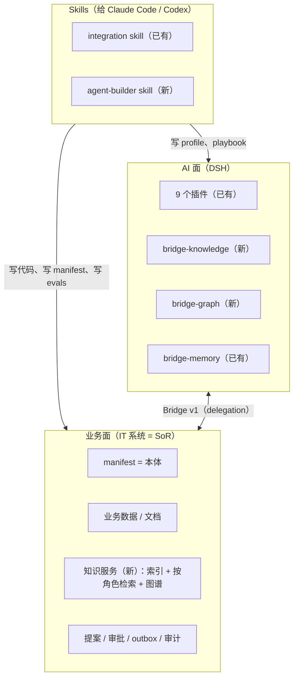

# 从「让 IT 系统变成 AI 员工」到「通用 AI agent 框架」

> 2026-11-14。内部讨论用。2026-11-14 从 framework 仓库（`docs/`）移到本仓库 biz-ai-agent；文中 `packages/…`、`examples/…`、`docs/…` 等路径指 framework 仓库。
> English summary: Biz Assistant already has the five layers a general agent needs (schema = manifest, data = the business
> system, governed actions = proposals / approvals, agents = DSH, memory = bridge-memory). What it lacks is a knowledge layer
> (RAG and a semantic graph) that keeps the framework's rules: retrieval with the employee's own rights, sources that point to
> screens, no personal data. The DSH ecosystem already has a dozen RAG / graph-memory plugins, but they are single-user
> and permission-blind (some AGPL). Proposal: a `bridge-knowledge` plugin (retrieval in the business system, extending
> `@dsh-bridge/help`) and a `bridge-graph` plugin (the manifest as the ontology plus business relations). Do not build a
> drag-and-drop flow editor; ship skills instead, and let coding agents (Claude Code, Codex) write the flows as code, with the
> manifest, the conformance suite, evals and traces as the guard rails. An agent is first an IT system.

## 0. 结论先行

1. **同意你的两个判断。**
   - **「agent 首先得是一个 IT 系统」**：一个能长期、安全地替人做事的 agent，必须有 IT 系统的基本面：
     身份、权限、数据的唯一来源、事务、审计、运维、测试和版本。这正是 Biz Assistant 已经做好的部分，也是我们和
     「聊天机器人 + 工具」类框架的根本区别。
   - **「不需要拖拽式 flow」**：在 Claude Code / Codex 能可靠写代码的今天，flow 用代码写更好——可以版本管理、
     可以 review、可以测试、可以回滚。拖拽编辑器解决的是「人写不了代码」，而这个问题已经由 coding agent 解决了。
     需要的是 **skill**（让 coding agent 知道怎么做对）和**护栏**（让做出来的东西可验证）。
2. **要成为通用 agent 框架，缺的是知识层。** 具体是 RAG（文档检索）和语义知识图谱。其余四层我们都有：
   语义层（manifest）、数据层（业务系统）、受治理的动作层（提案 / 审批）、agent 层（DSH）、记忆层（bridge-memory）。
3. **DSH 生态里 RAG / 知识图谱插件已经不少**（十个以上），但都是**个人或单一工作区**用的：不按员工的权限过滤，
   不管个人信息，来源指向文件而不是业务画面；部分是 AGPL 或预发布版。企业场景不能直接用，可以参考。
4. **建议**：
   - 做两个新插件：`bridge-knowledge`（RAG，检索在业务系统一侧完成，按提问者的角色过滤）和
     `bridge-graph`（以 manifest 为本体的语义图谱）；
   - 再把现有的集成 skill 扩展成「造 agent 的 skill」；
   - 拖拽编辑器不做。
   - MVP 大约 5 周，按周估算，见第 7 节。

## 1. 调研：DSH 生态的 RAG / 知识图谱插件（2026-11-14）

都是社区插件，没有 DeepSeek 官方的。下表依据各插件的 README 和插件目录页，**没有逐个读源码或实测**。

### 1.1 RAG（文档检索）

| 插件 | 做法 | 备注 |
|---|---|---|
| [Soren-ABT/dsh-knowledge](https://github.com/Soren-ABT/dsh-knowledge) | 分块、本地或 OpenAI 兼容 / Ollama 的 embedding、混合检索（向量 + 关键词）、管理面板 | 功能最全；第三方页面显示 **AGPL-3.0**（不能并入我们的 Apache-2.0 产品，只能参考） |
| [NaughtDZ/dsh-knowledge](https://github.com/NaughtDZ/dsh-knowledge) | 导入 Office / 文本，经 OpenAI 兼容端点做 embedding，按工作区检索，可选 reranker | 简单 |
| [imkelt/DSH-RAG](https://github.com/imkelt/DSH-RAG) | 显式 `/rag` 命令：BM25 →（配置后）embedding + RRF 融合 + 重排，强调带来源 | 普通对话不检索；依赖 SiliconFlow |
| [chenzhiya77/dsh-harness-rag](https://dsh-plugin.org/plugins/chenzhiya77/dsh-harness-rag) | **向量 + 知识图谱 + wiki 三路检索**，带检索质量评测，自带 Qdrant 服务 | 最接近「RAG + 图谱」 |
| [Breeze136/dsh-kb-rag](https://github.com/Breeze136/dsh-kb-rag) | 文献（PDF / Zotero）→ SQLite，混合检索，结果带章节、页码、DOI | 面向论文 |
| [AlowEnsoul/dsh-rag-kb](https://github.com/AlowEnsoul/dsh-rag-kb) | 本地 Ollama embedding + 余弦相似度，多个知识库 | 纯本地 |
| [local-knowledge-base](https://dshpluginhub.ai/en/plugins/local-knowledge-base) | 按文件开关：TF-IDF 向量或 BM25 | 轻量 |

### 1.2 知识图谱 / 图谱记忆

| 插件 | 做法 | 备注 |
|---|---|---|
| [adoresever/graph-memory](https://dsh-plugin.org/plugins/adoresever/graph-memory) | 从对话抽取三元组，生成 TASK / SKILL / EVENT 节点和有类型的边，SQLite，跨会话召回子图 | 被引用最多；**预发布版**（1.6.0-beta）；「压缩约 75%」只有目录页这么说，没有基准 |
| [123caiji/dsh-memory-toolkit](https://github.com/123caiji/dsh-memory-toolkit) | 上面的图谱记忆 + PageRank、社区发现、向量 + FTS5 双路召回 + 省 token 编排 | 打包版 |
| [dsh-memory](https://dsh-plugin.org/plugins/34262315716/dsh-memory) | 分层记忆 + 知识图谱 + 版本（worldline）+ 向量 RAG，SQLite，MIT | |
| [menotbobbybrown/dsh-plugin-memory](https://github.com/menotbobbybrown/dsh-plugin-memory) | 持久知识图谱 + 长期记忆（偏好、约定），语义召回 | |
| [dsh-knowledge-graph](https://dsh-plugin.org/plugins/fango19961106-dotcom/dsh-knowledge-graph) | 3 个工具（`kg_remember` / `kg_search` / `kg_recent`），单个 FTS5 库 | 没有图遍历 |

没有找到明确实现 GraphRAG（社区摘要 + 图遍历检索）的插件。

### 1.3 共同的缺口：为什么企业场景不能直接用

| 缺口 | 企业里会出什么事 | Biz Assistant 的规则 |
|---|---|---|
| **不按员工权限过滤**：知识库属于一个工作区，谁问都检索全部 | 共用的公司 bot 把人事文件答给普通员工 | AI 只能**以提问者本人的权限**读（delegation × 角色） |
| **个人信息不管** | 文档或对话里的姓名、病历进了向量库和图谱，删不掉 | 保存前检查（`/pii-scan`），业务数据不长期保存 |
| **来源是文件或片段** | 员工没法核对，也不知道去哪个画面处理 | 链接只能是业务系统的画面（`web.routes`），由 link-guard 把关 |
| **数据在 DSH 本地**（SQLite / Qdrant） | 和业务系统的数据不同步，权限变了索引也不知道 | 业务系统是唯一来源（SoR），AI 每次通过工具现读 |
| **许可、成熟度** | AGPL 不能并入；beta 版接口会变 | Apache-2.0，固定版本 + 一致性测试 |

结论：社区插件证明了需求和技术路线（混合检索、重排、三元组图谱、子图召回都已经很成熟），但
**「谁能看到什么」这一层只能由业务系统来回答**——这正是我们的位置。

## 2. 我们已经有的：一个 agent 的五层，只差知识层

以 ontology 驱动的架构来对照（语义层 / 数据层 / 受治理的动作层 / agent 层 / 记忆层）：

| 层 | Biz Assistant 里对应的东西 | 状态 |
|---|---|---|
| **语义层（Schema / 本体）** | **manifest**：角色和委托上限、实体（含 PII 等级、画面链接）、事件和白名单 payload、模板、工具、playbook、报告、术语表。机器可读，`bridge-validate --strict` 检查 | ✅ |
| **数据层** | 业务系统本身（SoR），Bridge v1；外部 API 由 connectors（管理员登记，业务系统执行） | ✅ |
| **受治理的动作层** | 读工具（delegation × 角色）、**提案**（AI 只提，人接受）、**审批卡片**（人在聊天里一键决定）、transactional outbox、审计 | ✅ |
| **agent 层** | DSH + 9 个插件：身份、manifest 生成的工具、事件、通知、审批、助手、记忆、人设、读图 | ✅ |
| **记忆层** | bridge-memory：个人记忆（只有本人）、组织记忆、对话回顾（90 天）；保存前查个人信息 | ✅ |
| **知识层（RAG / 图谱）** | `@dsh-bridge/help`：**按提问者角色检索手册**（BM25F、字符 bigram，中日文不需要分词器；看不到的画面不给 URL，只告诉该问谁）——这其实已经是一个「有权限的 RAG」，只是只覆盖手册 | ⚠️ 只有手册 |

也就是说：**通用 agent 框架所需的骨架已经在了。** 补上知识层，就能从「给已有 IT 系统加 AI 员工」扩展到「用
IT 系统的方式造任意 agent」。

## 3. 「agent 首先得是一个 IT 系统」：具体是哪些东西

一个能托付工作的 agent，至少要回答下面 10 个问题。拖拽工具和多数 agent 框架只回答了第 6 个。

| # | 问题 | 框架里的回答 |
|---|---|---|
| 1 | 它替**谁**做事？ | 员工本人的会话或聊天绑定 → delegation（5 分钟、只读或只能提案） |
| 2 | 它能看到**什么**？ | manifest 的工具白名单 × 员工角色；业务系统自己做最后检查 |
| 3 | 它能**改**什么？ | 什么都不能直接改：只能提案，由人接受；写接口对 delegation 返回 403 |
| 4 | 数据的**唯一来源**在哪？ | 业务系统（SoR）；AI 不长期保存业务数据 |
| 5 | 事情和通知**不丢、不重**？ | outbox（业务变更和事件在同一事务里）、幂等键、去重 |
| 6 | **流程**怎么定义？ | playbook（manifest）+ 代码（工具模块、hooks） |
| 7 | 发给**谁**？ | 业务系统决定收件人（和画面同一套规则），插件不自己找人 |
| 8 | 出了事**能查**吗？ | 审计、事件流、日志（遥测包会给敏感信息打码） |
| 9 | **怎么证明**它是对的？ | 一致性测试 52 项、业务测试、e2e（`pnpm demo`） |
| 10 | 怎么**上线、升级、停掉**？ | profile 模板（外发设置默认关闭）、固定版本、开关、委托随时撤回 |

所以「通用 agent 框架」的本质不是更灵活的 flow 编辑器，而是**把这 10 项做成默认就有**，让任何 agent 一出生就是一个合格的 IT 系统。

## 4. 为什么不做拖拽式 flow，做什么来代替

**同意不做。** 理由：

- 拖拽 flow 的本质是「给不会写代码的人一个受限的编程语言」。coding agent 出现后，这个前提不成立了：
  需求用自然语言讲给 Claude Code / Codex，产出的是普通代码。
- 代码比画布强的地方：git 管版本、PR 做 review、测试能跑、diff 看得懂、能回滚、能复用库、没有表达力上限。
- 画布上的复杂 flow 最后都会变成「一张没人看得懂的图」；代码至少还有测试和类型。

**但画布在三件事上确实有价值，不做画布也要以别的方式补上：**

| 画布带来的 | 代码世界里的替代 | 框架里的现状 |
|---|---|---|
| 一眼看懂流程 | 从 manifest / 代码**生成**图（只读的 Mermaid），不手画 | 文档里有图；可以加 `bridge-validate graph` 自动生成 |
| 运行时看到每一步 | **trace**：每次 agent 运行的步骤、工具调用、耗时、结果（脱敏） | 有审计和遥测；缺一个面向运营的 trace 视图 |
| 非程序员改参数 | 管理画面改**配置**（AI 员工人设、外部连接器、通知开关），不改流程 | ✅ 已有（web-kit 的人设页面、连接器页面） |

**代替画布的是 skill + 护栏：**

- **skill**：告诉 coding agent「在这个框架里怎么做对」——先诊断、再计划、遇到该人决定的事就停下来问、
  最后用命令验证。现有的 `biz-assistant-integration` 就是这种 skill。
- **护栏**：让 coding agent 写出来的东西**可以被机器判定对错**：
  - manifest 的严格校验；
  - 一致性测试；
  - 业务测试；
  - 后面还要加 **evals**，即检索和回答质量的评测集。

只要护栏足够硬，人就不必逐行看代码。

## 5. 设计：通用 AI agent 框架

### 5.1 `bridge-knowledge`：有权限的 RAG

- **检索在业务系统一侧**（server-kit 新增 `knowledge` 选项，`GET /bridge/v1/knowledge/search`，Bridge v1 的可选能力）：
  - 业务系统知道每份文档谁能看。索引里带上每个块的可见角色或可见范围，**检索时按提问者的 delegation 过滤**，
    和 `help` 用的是同一个思路。
  - 结果带「来源 = 业务画面的链接」，link-guard 照常把关。
- **以 `@dsh-bridge/help` 为基础扩展**：
  - 现在的 BM25F + 字符 bigram 保留，作为默认，中日文不需要分词器；
  - 加可选的 embedding（OpenAI 兼容端点、Azure OpenAI、本地模型）和 RRF 融合、重排；
  - 文档来源：手册、业务系统的附件、connectors 拉来的外部资料、`document-reads` 识别出的扫描件文字。
- **个人信息**：索引前走 `/pii-scan`；PII 等级为 `personal` 的实体不进索引，需要时通过工具现读。
- **在 DSH 一侧**：`bridge-knowledge` 插件只把 `knowledge.search` 暴露成工具，并要求回答带上来源；它自己不存任何索引。

### 5.2 `bridge-graph`：以 manifest 为本体的语义图谱

- **图的骨架 = manifest**：实体、角色、事件（哪个实体的什么变化）、工具（读写哪个实体）、playbook（什么事件触发什么）。
  这部分是确定的，可以从 manifest 直接生成，不需要大模型抽取。
- **图的实例 = 业务关系**：业务系统通过可选接口 `GET /bridge/v1/graph/neighbors?entity=&id=` 返回某个对象的邻居，例如
  「这张修理单 → 设备 → 场所 → 负责人的角色」。只返回 ID 和类型，按提问者的权限过滤。
- **用途**：
  - 让 agent 先在图上定位，再调用工具，减少乱调工具；
  - 回答「为什么」（这个审批为什么到了我这里）；
  - playbook 的影响分析（改了这个事件会触发什么）。
- **对话图谱记忆**（类似 graph-memory）放进 bridge-memory 的个人记忆里做，规则不变：只有本人、不存业务数据、先查个人信息。

### 5.3 `agent-builder` skill：「造 agent」的 skill

把现有的集成 skill 推广成「从需求造一个 agent」：

1. **问清楚**：这个 agent 替谁做事，读什么、提什么、谁来决定（skill 只记录选项和推荐，由人来决定）。
2. **先造 IT 系统**：
   - 有现成系统 → 走集成 skill；
   - 没有 → 用 server-kit 生成一个，`examples/leave-requests` 就是最小的模板（一个文件，52/52）。
3. **写本体**：manifest，包括实体、角色、事件、工具、playbook。
4. **接知识**：knowledge 来源和可见范围、图谱的邻居接口。
5. **写 evals**：一组固定问题和期望来源，每次修改都要跑。
6. **验证**：严格校验、一致性测试、业务测试、evals、e2e。
7. **上线**：profile、默认关闭的外发设置、委托。

产出的是一个**普通的 IT 系统 + 一组普通的 DSH 插件配置**，全部在 git 里。

## 6. 风险和反方意见（诚实地说）

- **非程序员**：业务部门的人确实不会用 Claude Code。我们的答案是：他们不改流程，只改配置，并在聊天里做决定；
  流程的修改交给 IT 部门加 coding agent。如果目标客户里有大量「业务部门自己搭 agent」的需求，这条路线会吃亏。
- **coding agent 的产出要验证**：skill 和护栏能降低风险，但 evals 本身也要人来定，「什么样的回答算对」是业务问题。
- **RAG 质量**：中日文检索、表格、扫描件是难点，需要评测集，不能只凭感觉。
- **DSH 仍是 developer preview**：接口会变。我们的插件固定 DSH 版本，跟着 RC 跑一致性测试。
- **范围膨胀**：「通用」很容易变成什么都做。建议只做知识层 + skill，其余（多 agent 编排、长任务等）沿用 DSH 和 super-agent 方案
  （`docs/super-agent`）的成果，不在这里重复。

## 7. 路线图（按周，MVP 优先）

| 周 | 内容 | 完成的判据 |
|---|---|---|
| 1 | `knowledge` 接口设计：Bridge v1 可选能力、OpenAPI、一致性检查项（越权检索必须为空） | protocol 加检查项并通过 |
| 2 | server-kit `knowledge` 选项（基于 help：BM25F + 可见范围）+ `bridge-knowledge` 插件 | leave-requests 加几份文档，按角色检索的测试通过 |
| 3 | 可选 embedding + RRF + 重排；`/pii-scan` 接入索引 | 中日英各 20 题的 evals，记录命中率 |
| 4 | `bridge-graph`：从 manifest 生成骨架 + `graph/neighbors` | 「为什么到我这里」的问答在 e2e 里通过 |
| 5 | `agent-builder` skill（英文）+ 用它从零造一个新示例 | coding agent 按 skill 造出的系统 52/52 通过，并且 evals 达标 |

试点：先在 leave-requests（最小）和官网 biz-ai-web（真实的社区、咨询、手册）上做。

## 8. 需要你决定的事

1. **方向**：是否按「知识层 + agent-builder skill，不做拖拽编辑器」推进。
2. **embedding 的模型**：DeepSeek 没有 embedding 接口；选项有 Azure OpenAI（日本东部，和 super-agent 方案的敏感数据规则一致）、本地模型、
   或者先只用 BM25F。我的推荐是**先 BM25F，再接 Azure OpenAI**。
3. **对外表述**：是否把「通用 AI agent 框架」写进官网和 README。建议等第 5 周用 skill 造出新示例之后再写，用事实说话。
4. **社区插件**：是否把 MIT 许可的社区插件当作「个人工作区」可选项写进文档（和 bridge-knowledge 分开）。

## 参考

- [Soren-ABT/dsh-knowledge](https://github.com/Soren-ABT/dsh-knowledge) · [NaughtDZ/dsh-knowledge](https://github.com/NaughtDZ/dsh-knowledge) ·
  [imkelt/DSH-RAG](https://github.com/imkelt/DSH-RAG) · [dsh-harness-rag](https://dsh-plugin.org/plugins/chenzhiya77/dsh-harness-rag) ·
  [Breeze136/dsh-kb-rag](https://github.com/Breeze136/dsh-kb-rag) · [AlowEnsoul/dsh-rag-kb](https://github.com/AlowEnsoul/dsh-rag-kb) ·
  [local-knowledge-base](https://dshpluginhub.ai/en/plugins/local-knowledge-base)
- [graph-memory](https://dsh-plugin.org/plugins/adoresever/graph-memory) · [123caiji/dsh-memory-toolkit](https://github.com/123caiji/dsh-memory-toolkit) ·
  [dsh-memory](https://dsh-plugin.org/plugins/34262315716/dsh-memory) · [menotbobbybrown/dsh-plugin-memory](https://github.com/menotbobbybrown/dsh-plugin-memory) ·
  [dsh-knowledge-graph](https://dsh-plugin.org/plugins/fango19961106-dotcom/dsh-knowledge-graph)
- 框架内：`packages/help`（按角色的手册检索）、`plugins/memory`、`docs/DOCUMENT_READS.md`、`docs/AI_EMPLOYEE_PROFILE.md`（connectors）、
  `docs/SUPERAGENT_PROTOTYPE_ANALYSIS.md`、`examples/leave-requests`
