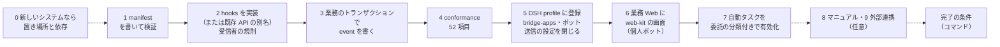
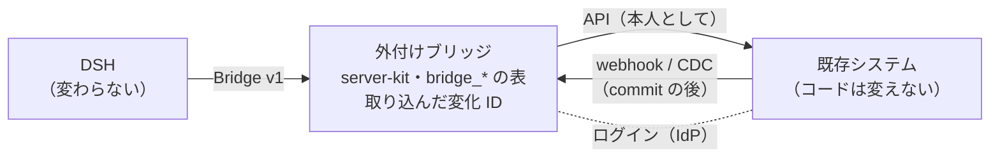

# Biz Assistant Framework — 開発ガイドライン

パッケージは `@dsh-bridge/*`（最初の名前 DSH Business Bridge の接頭辞のまま）。

## Summary (English)

How to connect a business system to AI employees with the Biz Assistant Framework (packages `@dsh-bridge/*`) — the main use is an **existing** system; a
new system is built on the same parts (b.0: where it lives, how it depends on the framework, and that it never modifies the framework itself). (a) quick
start — install, test, run the `equipment-inspection` example, run the e2e scenarios; the integration checklist (what the system adds: the Bridge v1
endpoints, a manifest, SNS linking on its own login, recipient rules it decides, events in its own transactions, its approval rules, a session check, the
report that the conformance suite needs); (b) connecting step by step — a new system (b.0), the manifest with the three internal events (b.1), the
server-kit hooks with their full signatures (or `x-alias` aliases of an existing API like ケアビリング), events inside the business transaction, the
conformance suite and what 52 / 52 makes mandatory (reports, approvals, personal bots, the role mapping of the fixtures), the DSH product profile with the
closed outbound settings and a link-guard URL for every application, the web-kit screens and the BFF (which never relays a browser request with the BFF
secret), automatic tasks with delegation classes (non-default applications need their own entry), the staff manual (b.8), external connectors (b.9), external mode — a separate bridge service in front of an
unchanged system, with events taken from CDC or a qualifying webhook instead of the same transaction (b.10, trial), the
checklist and a Definition of Done made of commands; (c) extension points; (d) MUST / SHOULD rules (the AI never decides or sets amounts, parameters are
counts and dates, no names or health text in IM or events, idempotency keys, one approval decides, quiet hours, the AI-secretary voice, per-platform
notes, **recipients decided by the business system only**, group chats denied, unattended delegation classes, outbound screening, the config switches
and their safe values, personal bots, long-term memory with the business system's own name check `hooks.piiScan`, the AI employee's profile — one nickname
by default, files attached in the assistant panel with the OCR choice and the image cleanup, external connectors whose secrets stay in the business
system); (e) testing strategy; (f) versioning; (g) FAQ and troubleshooting; (h) ケアビリング as the reference implementation. The architecture itself is in
[ARCHITECTURE.md](ARCHITECTURE.md).

---

この文書の「MUST」は守らないと conformance suite か review で落ちる規則、「SHOULD」は理由があれば外してよい推奨。
構成（層・イベントの流れ・会話の分離・安全上の約束）は [ARCHITECTURE.md](ARCHITECTURE.md) を先に読むこと。

## 目次

- [既存の業務システムをつなぐ：チェックリスト](#既存の業務システムをつなぐチェックリスト)
- [a. クイックスタート](#a-クイックスタート)
- [b. 業務システムを AI 社員につなぐ（手順）](#b-業務システムを-ai-社員につなぐ手順)
  - [b.0 新しい業務システムを作る](#b0-新しい業務システムを作る)・[b.1 manifest を書く](#b1-manifest-を書く)・[b.2 業務側を実装する](#b2-業務側を実装するserver-kit-の-hooks)・[b.2' 既存の API に別名で載せる](#b2-既存の-api-に別名で載せるケアビリングの方法)
  - [b.3 業務のトランザクションで event を書く](#b3-業務のトランザクションで-event-を書く)・[b.4 conformance suite を通す](#b4-conformance-suite-を通す)・[b.5 DSH の製品 profile に登録する](#b5-dsh-の製品-profile-に登録する)
  - [b.6 業務 Web の画面（web-kit）と BFF](#b6-業務-web-の画面web-kitと-bff)・[b.7 自動タスクを有効にする（delegate）](#b7-自動タスクを有効にするdelegate)
  - [b.8 マニュアルと SNS での使い方の質問（help）](#b8-マニュアルと-sns-での使い方の質問help)・[b.9 外部連携（接続先・操作・規則）](#b9-外部連携接続先操作規則)
  - [b.10 外付けモード（試行）](#b10-外付けモード既存システムの外にブリッジを置く試行)
  - [チェックリスト](#チェックリスト)・[完了の条件（コマンドで確かめる）](#完了の条件コマンドで確かめる)
- [c. 拡張点](#c-拡張点)
- [d. 規則（MUST / SHOULD）](#d-規則must--should)
  - [d.8 受信者の保証と送信の設定](#d8-受信者の保証と送信の設定)・[d.9 個人ボット](#d9-個人ボット本人の-sns)
  - [d.10 長期記憶（bridge-memory）](#d10-長期記憶bridge-memory)・[d.11 AI 社員のプロフィール（bridge-persona）](#d11-ai-社員のプロフィールbridge-persona)
  - [d.12 AI アシスタントへのファイル添付](#d12-ai-アシスタントへのファイル添付)・[d.13 外部連携（接続先・操作・規則）](#d13-外部連携接続先操作規則)
- [e. テストの方針](#e-テストの方針)
- [f. バージョン管理（protocol / manifest）](#f-バージョン管理protocol--manifest)
- [g. FAQ とトラブルシューティング](#g-faq-とトラブルシューティング)
- [h. 参照実装：ケアビリング](#h-参照実装ケアビリング)

---

## 既存の業務システムをつなぐ：チェックリスト

この framework の主な使い方は、**いま使っている業務システムを、AI 社員（職員一人ひとりの AI アシスタント）と働く形に変える**こと。
人が画面を開いて入力し、確認し、担当者を追いかける形から、AI 社員が見守り・知らせ・適任者に頼み・下書きし、人はチャットで決める形へ変える。
業務システムの側に足すのは「ブリッジ」（Bridge v1 の endpoint・manifest・システム自身のログインでの SNS 連携・受信者の規則など、下の表）だけで、
DSH の実行環境・IM の接続・プラグイン・送信の守り・自動タスクと定時報告の仕組み・テストの道具は framework が持つ。
同じ部品で新しい業務システムを作ることもできる（見本の equipment-inspection は server-kit の上で新しく作った）。

ケアビリング（リポジトリ `care-ai-native`）は AI 社員を前提に作った業務システムで、framework はそこから取り出した。framework より前に
同じ働きの API を持っていたので、v1 はその API に別名で載せている（b.2'）。どの項目も、下の表の「どこで確かめるか」で検証できる。

| # | 業務システムに足すもの | 区分 | framework の契約（どこで確かめるか） | まだ無いときの足し方 |
|---|---|---|---|---|
| 1 | 業務データを HTTP API で読む口と、AI の提案を受ける口（Bridge v1 の endpoint） | 必須 | Bridge v1（`packages/protocol/openapi/bridge-v1.yaml`）を実装するか、既存の API に別名で載せる（b.2'）。AI の読取は manifest の `tools[].http` に挙げた GET（`readToolPolicy`）、書込みは `POST /bridge/v1/proposals` → 人が採択したときだけ `proposalKinds[kind].apply`（conformance：P1〜P6・M1〜M3・D5・PR1〜PR3） | 画面と業務ロジックが一体（サーバ描画だけ・デスクトップクライアント・DB 直結）なら、AI に読ませる範囲の読取 API と提案の受け口を足す。Node なら server-kit、他の言語なら OpenAPI を実装する |
| 2 | manifest（システムの自己紹介） | 必須 | 役割と委託の上限、event と payload の許可リスト、通知の文面、ツール、playbook、報告（b.1）。`bridge-validate manifest --strict` が通る（警告なし） | 既存の役割・業務の変化・知らせたいことを書き出して manifest にする。業務のコードは変えない |
| 3 | 職員が自分の SNS を結び付ける画面（業務 Web の「SNS 連携」）を、**システム自身のログイン**で動かす | 必須 | web-kit の `SnsLinkPage` は同じオリジンの `/bridge/v1/me/*` を本人のセッションで呼ぶ。業務 Web の BFF は既存のログインを確かめ（gateway の `getSessionUser`）、ブラウザからの `/bridge/v1/me/*` は本人の cookie のまま**秘密を付けずに**業務システムへ転送する。**MUST** `x-bff-secret` は BFF 自身がサーバ側で組み立てる呼び出し（`POST /bridge/v1/assistant/tickets`・`POST /bridge/v1/assistant/attachments/prepare`・本人用 RPC で `createOnly` の作成に成功した直後の `POST /bridge/v1/me/personal-bots`）だけに付け、**ブラウザの要求を秘密付きで中継しない**（中継すると、ブラウザが組織のボットの botId を自分の個人ボットとして登録でき、そのボットで話す他の職員が全員「未連携」になる。d.9 の持ち主の規則の迂回。b.6）。server-kit の `authenticate(req)` は既存のセッション（cookie / bearer）から `{ user: { id, role }, sessionId }` を返す。BFF だけの操作（Web アシスタントのチケット、個人ボットの登録）は本人のセッション**と** `x-bff-secret` の両方が要る。連携コードは発行した本人に結び付き、`/me/identities` には本人の連携だけが出る（conformance：L2〜L9・B1〜B4・S1・S2）。個人ボットを使うなら d.9 | ログインが外から確かめられない作り（別の ID 体系・共有できない SSO）なら、既存のセッションを確かめる口を BFF に足す。別に本人確認を作ると二重管理になり、なりすましの穴になるので作らない |
| 4 | 通知の受信者を**業務システムが決める**規則 | 必須 | `recipientsFor(event, ctx)` → `null` / `{ stale }` / `{ users, paramsFor, link, dedupeKey }`。役割・所属・担当の範囲で決め、Web の認可と同じ判定で確かめる（d.8）。本人の通知設定・通知済みの除外・おやすみ時間・配信先の優先順位は kit とプラグインが適用する（conformance：N1〜N3） | 「誰に知らせるか」が人の運用にしか無ければ、event ごとに規則を書く（ケアビリングの `decideRecipients` が見本）。DSH 側で受信者を決めさせない |
| 5 | 業務の状態変化を、業務の行と**同じトランザクション**で event として記録する（transactional outbox） | 必須 | `kit.tx` + `kit.emitEvent`（b.3）。payload は manifest の `events.<type>.payload`（**型ごとの許可リスト**：ID・日付・件数・状態だけ）。違反は `EventRejected`。DSH は `GET /bridge/v1/events?after=` で取り込む（conformance：E1〜E4） | 状態を変える処理に event の書込みを 1 行足す（後から差分やトリガで拾うと、commit されなかった変化を知らせる・commit された変化を落とす）。既存システムのコードを変えずに外に置くなら、CDC か条件を満たす webhook からの取り込み（b.10、試行） |
| 6 | 職員と役割（有効・無効を含む）を API で引ける | 必須 | `employees.get / list` → `{ id, role, active }`、manifest の `roles`（`delegation: none \| read \| propose`）。**AI の権限＝AI 許可リスト（manifest の `tools[].roles`）∩ その職員の役割**。無効にした職員はすべてのトークンを即時に失う（conformance：D1〜D7・S5・M3） | 既存の職員表から返す hook を書く |
| 7 | 承認の規則がシステムの中に（関数として 1 か所に）あり、チャットからの承認にも同じ規則を使える | 必須（52 / 52 のため。承認の要らない業務でも最小の 1 種類を持つ） | `approvals.{get, approvers, card, mayDecide, decide}`（形は b.2）。承認が無いと A1〜A4 が skip になり、リリースの条件（skip 無し）を満たさない。Web で決めるときも同じ `mayDecide` を使い、`decide` は `ctx.t` の中で決定を書いて `approval.decided` を出す。1 回の承認で決まり、他のカードは無効（`t.revokeApprovalDeliveries`）（conformance：A1〜A4） | 画面のコードにある規則を 1 つの関数に寄せ、Web とチャットの両方から呼ぶ |
| 8 | Web のセッションが生きているかを、利用者ごとに確かめられる | 必須 | `isSessionLive(sessionId, ctx)`：Web アシスタントのチケット（30 分）と委託を Web セッションと一緒に終わらせる。server-kit では任意の hook だが、conformance S4（`hook:revokeSession`）が要り、リリースの条件は skip 無し | セッション表を引く hook を書く |
| 9 | 職員向けのマニュアル（1 画面 = 1 節）と、その索引・検索（SNS で使い方を聞かれたときの根拠） | 任意（推奨） | `@dsh-bridge/help`：マニュアルを画面の経路の表と CI で照合し、索引を作る。server-kit の `help`（`GET /bridge/v1/help/*`）が聞いた人の役割で答え、開けない画面には URL を付けない。manifest の `help.tool` と `web.routes`（b.8） | 画面ごとに 1 節を書く（URL・メニュー・使える役割・キーワード・手順・よくある質問）。役割は画面の Guard から機械的に取るので、経路の表（ルーター）を読み出せるようにする |
| 10 | 長期記憶に入れる前の個人情報の検査（業務システムの名簿で） | 任意（推奨） | `POST /bridge/v1/pii-scan`（Bridge v1 の任意の操作）。server-kit は既定で持つ：形の検査（連絡先・長い番号・ID 番号など。普通の日本語・英語の文は当てない）に、任意の hook `hooks.piiScan(text, ctx) -> { kinds: string[] }`（名簿の検査）の区分を合わせて返す。既定の形の検査は**名前を知らない**ので、職員・利用者・取引先の名前を持つシステムは `hooks.piiScan` を実装する。bridge-memory は手元の検査とこの検査を通った文だけを保存し、届かなければ保存しない（fail closed）。無いアプリケーションは手元の検査だけ（d.10） | 名簿（利用者・取引先・職員など）で名前（姓・名・かな）を探し、当たれば区分（例 `staff_name`）だけを返す `hooks.piiScan` を書く（当たった文字列は返さない。見本は equipment-inspection の `src/hooks.mjs`） |
| 11 | AI 社員のプロフィール（呼び名・口調・会社の紹介・性格・背景）を、管理者が業務 Web で編集し、版で持つ | 任意（推奨） | `GET /bridge/v1/ai-profile`（サービス、etag / 304）と管理の `GET / PUT /bridge/v1/admin/ai-profile`・`POST …/versions/{version}/restore`。server-kit は既定で持つ（`roles.admins`、`aiProfile: false` で無効）。自前なら `validateAiProfile` で検査し、版と監査（版の番号だけ）を残す。画面は web-kit `AiProfilePage`（d.11） | 版の表と管理者の画面を足す。無ければ DSH はプロフィール無し（署名「— <アプリ名> AI 秘書」）で動く |
| 12 | 定時報告（件数だけの報告：manifest の `reports` と `hooks.reports.compute`） | 必須（52 / 52 のため） | 報告が無いと 52 項目のうち 10 項目が落ちる：R1〜R3 のほか、P4・L9・D6・D7・S2・S4 は `GET /bridge/v1/reports/latest` を委託の探針に使い、D3 は報告の経路も委託で 403 になることを確かめる。提案を採択できる人（`roles.proposalReviewers`）の既定も報告の読み手（b.2） | 「今日の件数」程度のセクションを 1〜4 個決め、役割ごとに見せるセクション（`sectionsByRole`）を書く |
| 13 | 外部連携（自社の別の API・第三者の API を AI 社員が使う。接続先・操作・規則） | 任意 | server-kit の `createBridgeApp({ connectors: { secretKey } })`：`GET /bridge/v1/connectors/catalog`・`POST /bridge/v1/connectors/{connectorId}/operations/{operationId}/run`（read だけ・委託）・管理の `/bridge/v1/admin/connectors*` など、提案の種類 `connector_write`。秘密も呼び出しも業務システム（b.9・d.13） | 管理者が業務 Web（web-kit `ExternalConnectorsPage`）で接続先と操作を登録する。まず read の 1〜2 個から |

**検証**：そろったら、TEST 環境に対して **conformance suite 52 項目**（b.4）を通す。リリースの条件は 52 / 52、`knownGaps` が空、skip 無し。
skip 無しなので、**7（承認）・12（報告）と個人ボットの登録（B1〜B4。server-kit は既定で持つ）は、業務で使う予定が無くても最小の形で持つ**（b.4）。
DSH の側は製品 profile で送信の設定を閉じ、すべてのアプリにリンクの検査の URL を書く（b.5・d.8）。終わりはコマンドで判定する（[完了の条件](#完了の条件コマンドで確かめる)）。

**進め方**

- まず 1 つの業務（例：請求の承認、点検の期限）から始め、既存の画面と並行して動かして確かめてから広げる。
- 表の 1・3（読取 API とログイン）は作りの根本に関わるので、足す量はシステムによって大きく違う。最初に見積もる。足す量が大きいときは、
  同じ framework の上で新しい業務システムとして作る道もある（server-kit の hooks を書くだけで、Bridge の部分は kit が持つ）。置き場所・依存・
  変えてはいけない所は b.0。
- 既存システムのコードを変えたくないときは、外にブリッジ専用のサービスを置く**外付けモード**（b.10、試行）。既存システムにログインの確認・
  本人として呼べる API・変化の知らせ（webhook か CDC）・承認と書込みの API があるかで、使えるかが決まる。
- 経営者向けの説明（同じ項目をやさしい言葉で）は `docs/slides/marketing/biz-assistant-for-executives.pptx` のスライド 18「つなぐために、業務システムに足すもの」にある。

---

## a. クイックスタート

### a.1 準備とテスト

Node 22.19 以上（24 で確認）、pnpm 10。

```sh
cd framework
pnpm install
pnpm test                    # すべての workspace パッケージ（vendor/ は除く）
pnpm test:protocol           # 個別に：test:core / test:gateway / test:testing / test:kits / test:plugins / test:profile / test:examples
pnpm validate                # OpenAPI の lint と、同梱の manifest の検証
```

- PostgreSQL が要るテスト（server-kit の PostgreSQL store、equipment-inspection の業務テストと conformance）は
  `FW_TEST_DATABASE_URL=postgres://<user>:<password>@127.0.0.1:5432/postgres` を設定したときだけ動き、無ければ理由を表示して skip する。
  一時 DB（`fw_serverkit_test`、`fw_equipment_unit_test`、`fw_equipment_test`）を作り、最後に消す（`*_test` 以外は消さない）。
- 2026-10-30 時点（外部連携を含む。`pnpm test`、`FW_TEST_DATABASE_URL` **無し**で数え直した）：**582 件、576 pass・0 fail・6 skip**
  （skip は PostgreSQL の要るテストの理由付きの skip、`packages/protocol/conformance/http.test.mjs`〔`BRIDGE_BASE_URL` があるときだけ動く〕と、
  参照用の `yaml` パッケージが無いときの YAML パーサの比較テスト）。
  `FW_TEST_DATABASE_URL` ありでは DB の要るテスト（server-kit の PostgreSQL store、equipment-inspection の業務テストと conformance）も動き、
  DB の要るテストの skip は無くなる（2026-10-29 の計測：514 件・513 pass・1 skip〔http.test.mjs〕。DB ありの件数は環境に DB があるときに数え直す）。`pnpm validate` も ok（OpenAPI 46 paths）。件数は各パッケージの `node --test` の `tests` の合計
  （`pnpm -r` で動くパッケージの行はパッケージ名が前に付くので、数えるときに落とさない）。件数は変わるので、書き写さずにその場で数える。
- fork は workspace の外：`cd vendor/dsh-im && npm ci && npm test`（`dsh-auto-tasks`・`dsh-proactive` も同じ）。

### a.2 見本の業務システム（equipment-inspection）を動かす

施設の設備点検（消火器・非常灯・AED…）の小さな業務システム。server-kit の上に作られ、conformance 52 / 52。

```sh
# PostgreSQL が 127.0.0.1:5432 にあること
export EQUIPMENT_DATABASE_URL=postgres://<user>:<password>@127.0.0.1:5432/equipment_inspection   # 初回に作成
pnpm --filter @dsh-bridge/example-equipment-inspection start                                      # http://127.0.0.1:19730
```

空の DB には架空の職員 4 名と設備 5 台（1 台は期限超過）が入る。ブラウザで http://127.0.0.1:19730/ を開き、ログインして
「連携コードを発行」→ ボットに「連携 123456」→「連携中の SNS」に出る → 解除 → 期限超過の通知のオン / オフ、を試せる。
ログイン用のパスワードは `EQUIPMENT_SEED_PASSWORD` で決める（開発用の既定値はリポジトリの `src/config.mjs` を参照。本番では使わない）。

```sh
# 業務テスト（16）と conformance（52 項目）
FW_TEST_DATABASE_URL=postgres://<user>:<password>@127.0.0.1:5432/postgres \
  pnpm --filter @dsh-bridge/example-equipment-inspection test
```

### a.3 e2e（mock の IM と LLM）

```sh
FW_TEST_DATABASE_URL=postgres://<user>:<password>@127.0.0.1:5432/postgres pnpm run e2e   # packages/testing/e2e/run.mjs
#   -- --keep（後片付けしない） / -- --reuse-home（profile の依存を使い回す） / -- --json-only
```

見本の業務システム（equipment-inspection）＋ profile の雛形から作った製品 profile（名前 `fw-e2e`）＋ framework のプラグインを、
**本物の DSH** の上で mock LLM・mock LINE・`@dsh-bridge/gateway` につないで動かす（`@dsh-bridge/testing`）。実際の IM とモデルには
一切つながず、秘密は毎回生成する。一時 DB `fw_equipment_e2e_test`、隔離した home `.dsh-home-e2e`（個人の `~/.dsh` は使わない）、
デモ環境などのポートは使わない（`FW_E2E_PORTS="app=…,dsh=…,llm=…,line=…,gateway=…,other=…"` で変更可）。所要は約 70 秒で、
終わると起動したプロセス・DB・home を片付ける（`--keep` で残す）。**15 / 15 ステップ、シナリオ a〜f すべて PASS**。
e2e の製品 profile は雛形から作るので、d.8 の閉じた設定（製品の値）のまま動く。自動タスクの報告が固定の文面だけで届き、AI の summary が IM に
出ないことまで確かめる（固定の配信先・メールの経路は閉じているので e2e には出てこない）。
e2e と `pnpm demo` は、版を固定した DSH CLI（`profile/template/package.json` の `dshBridge.expectedDsh`、0.2.2-rc.1）のローカルの写しを
`.dsh-cli/<version>/` に置いて使う（初回に npm で入れる。`packages/testing/src/dsh-cli.mjs`）。グローバルの DSH は使わず、変えもしない。
`DSH_BIN=<…/@deepseek-ai/dsh/lib/bin.js>` で別の CLI を使う。製品の BFF では `resolveDshBin()`（`@dsh-bridge/gateway`）が
`DSH_BIN` → `pnpm root -g` → `npm root -g` の順に探す。

| シナリオ | 確かめること |
|---|---|
| a | 未連携の LINE ユーザーは案内だけ（LLM を呼ばない）→ 業務 Web で連携コード →「連携 123456」で連携 |
| b | 質問 → AI が manifest から生成された読取ツール（`facility_list_overdue`）を本人の委託で呼ぶ |
| c | `inspection.overdue` → plugin-events → plugin-notify → 連携済みの職員の LINE に AI 秘書の文面（【対応のお願い】・▶ の行・「— 設備点検 AI 秘書」） |
| d | 修理依頼 → 承認者の LINE に承認カード → ボタンで承認 → カードが【ご報告】に更新。2 件目は返信コード（「差戻 <code> 理由」）で差戻 |
| e | manifest の playbook（`pb_equipment-inspection_overdue_followup`、`install.mjs --enable-auto-tasks <id>` で有効化）が event ごとに 1 回だけ動き（dedupe）、`facility_propose_reschedule` で提案し、audience に AI 秘書の固定の文面（`audienceText: template`）で報告する。AI の summary は IM に出ない |
| f | 分離：別アプリのツールは拒否（トークンを送らない）、役割外の読取ツールは拒否、委託トークンでは書けない・サービストークンが要る・別のアプリでは拒否される |

結果はシナリオごとの PASS / FAIL と `packages/testing/e2e/.work/result.json`。

### a.4 DSH を隔離した home で動かす

```sh
node profile/scripts/install.mjs --home .dsh-home-trial --skip-install     # 個人の ~/.dsh は拒否される
cd .dsh-home-trial
DSH_HOME=$PWD DSH_AGENTS_HOME=$PWD/agents BRIDGE_DSH_WORKSPACE=$PWD/workspace \
INSPECTION_API_URL=http://127.0.0.1:19730 INSPECTION_SERVICE_TOKEN=<秘密の保管場所から> \
dsh --profile bridge --no-open --host 127.0.0.1 --port 3280 --public-url http://127.0.0.1:3290/dsh/
```

ポートは例（3280 = DSH、3290 = 業務 Web の BFF）。デモ環境・本番が使うポート（3010・3080・3180・8790 など。e2e の `assertPortsUsable` が拒否する
一覧は `packages/testing/e2e/run.mjs` の冒頭）は使わない（d.7）。

DSH が出す `dsh web: …?token=…` は DSH の owner の資格情報。ブラウザに渡さず、`@dsh-bridge/gateway` だけが使う。
DSH は作業ディレクトリの `.env` も読むので、リポジトリの直下では起動しない。

---

## b. 業務システムを AI 社員につなぐ（手順）

全体の流れ（見本：`examples/equipment-inspection`。既存のシステムでも新しいシステムでも同じ）。



### b.0 新しい業務システムを作る

既存のシステムに足すのでなく、framework の上で新しい業務システムを作るとき（見本：`examples/equipment-inspection`）。Bridge の部分は server-kit が持ち、
業務システムが書くのは業務そのもの・hooks・manifest・マニュアル・テスト・製品 profile と、業務 Web・BFF（web-kit・gateway を使う）だけ。

**置き場所と依存**（`@dsh-bridge/*` は 0.1.0 から npm で公開している：https://www.npmjs.com/org/dsh-bridge 。framework の中でのパッケージどうしの依存は `workspace:*`）：

| 置き場所 | 依存の書き方 | 向くとき |
|---|---|---|
| framework の workspace の中：`examples/<system-id>/`（`pnpm-workspace.yaml` が `examples/*` を含む） | `"@dsh-bridge/server-kit": "workspace:*"` など。framework の直下で `pnpm install` | 見本・検証・framework と一緒に試す段階 |
| 別のリポジトリ（製品） | `npm install @dsh-bridge/server-kit`（または `pnpm add`）。検証した版に固定する | 製品のリポジトリ |
| 別のリポジトリで、まだ公開していない framework の変更が要るとき | 先に framework の checkout で `pnpm install` を済ませ、業務システムの `package.json` に `"@dsh-bridge/server-kit": "file:<framework>/packages/server-kit"` などを書いて **npm** で入れる（`npm install`。npm はリンクを張るだけで、パッケージの中の `workspace:*` は framework の checkout の `node_modules` で解決される）。pnpm の `file:` は `workspace:*` を解決できず `ERR_PNPM_WORKSPACE_PKG_NOT_FOUND` で止まる。その変更が公開されるまでの間だけ使う | 未公開の変更を試すとき |

`pg` は server-kit の peer（PostgreSQL の store を使うなら業務システムの依存に足す）。web-kit は `.ts` のまま配るので、業務 Web のバンドラ（Vite など）で読む。

**ファイルの形**（equipment-inspection と同じ分け方。最後の `web/`・`bff/` だけは見本に無い）：

```
bridge.manifest.yaml      b.1（system.id = DSH のアプリ id）
src/config.mjs            環境変数だけ（秘密の既定値は開発用だけで、本番では必須。他のシステムの DB 名は拒む。d.7）
src/auth.mjs              自分のログインとセッション：authenticate(req)・isSessionLive（b.2）
src/domain.mjs            業務の規則。状態の変化は kit.tx + kit.emitEvent（b.3）、承認の規則（mayDecide）は 1 か所
src/hooks.mjs             employees・recipientsFor（範囲と 1 人ずつの関門は d.8・b.2。見本は mayViewEquipment で Web の一覧と同じ規則）・approvals・proposalKinds・reports・piiScan（・eventDelegations）
src/routes.mjs            業務 API（/api/*）を kit の router に：AI の読取は kit.readToolPolicy、書込みは { allow: ['user'] }
src/help.mjs              マニュアル → 索引 → createHelpService（b.8）
src/app.mjs, server.mjs   createBridgeApp + store.migrate() + 業務のマイグレーション（migrate / readMigrations）、startScheduler（b.3）
src/migrations/*.sql      業務の表（bridge_* は kit が作る）
manual/NN-*.md            1 画面 = 1 節（b.8）
test/fixtures.mjs         conformance の fixtures（b.4）
test/conformance.test.mjs suite を汎用の HTTP adapter で（equipment-inspection の同じ名前のファイルが見本）
test/*.test.mjs           業務のテスト（完了の条件の 3）
<product>/dsh-profile/    profile/template の写し（b.5）と、手書きのツール・文面のモジュール（c）
web/                      業務 Web（React + web-kit。Vite などのバンドラ、tsc。b.6）：SNS 連携・通知設定・承認・AI 提案・AI 社員の設定など
bff/                      業務 Web の BFF（同じオリジン。b.6・d.9）：@dsh-bridge/gateway（/dsh/*・rpcAllowlist）、ブラウザの /bridge/v1/me/* などを
                          秘密なしで転送、BFF 自身の呼び出し（チケット・添付の変換・個人ボットの登録）だけに x-bff-secret、個人ボットなら本人用 RPC
```

- **web/ と bff/ には framework の中に見本が無い**（equipment-inspection は業務システム自身が `public/` の 1 画面〔素の JS〕を配るだけで、BFF も
  web-kit も使わず、BFF だけの操作〔Web アシスタント・個人ボットの登録〕は出していない）。作るときの規則は b.6（画面・転送・`x-bff-secret`）と
  d.9（本人用 RPC）にすべて書いてある。BFF を置かずに業務システムが画面を配る形でもよいが、その場合 BFF だけの操作は使えない（秘密をブラウザに
  出して代わりにしない）。

- **MUST NOT** framework の中（`packages/*`・`plugins/*`・`vendor/*`・`profile/template`・`profile/scripts`）を自分のシステムのために書き換えない
  （`examples/<id>` に置くときも同じ）。足りないところは hooks（b.2）・`toolModules` / `templateModules`（c）・プラグインと profile の設定（c・d.8）・
  製品の profile の写し（b.5）で補う。それでもできないことは framework への issue にし、framework の変更としてテスト・文書と一緒に直す。
- 役割の名前は自由（conformance の fixtures で suite の汎用の役割に写す。b.4）。
- 終わりの判定は [完了の条件](#完了の条件コマンドで確かめる)。

### b.1 manifest を書く

manifest は業務システムの「自己紹介」。DSH はこれを読んで AI 社員の語彙・ツール・event の分類・通知の文面・playbook を組み立てる。
`packages/protocol/manifests/example.manifest.yaml`（日報）か `examples/equipment-inspection/bridge.manifest.yaml` から始める
（`packages/protocol/manifests/equipment-inspection.manifest.yaml` は検証用の写しで、マニュアルのツールを含まない。始めるのは examples の方）。

```yaml
bridge: 1                         # プロトコルの major（定数）
version: 2026-10-26               # manifest のバージョン（SemVer か日付）。etag は内容から作る
system: { id: equipment-inspection, name: 設備点検, locale: ja-JP, timezone: Asia/Tokyo }

roles:                            # 役割と、AI 委託の上限（delegation: none | read | propose）
  admin:     { label: 施設管理者, scope: all,      delegation: propose }
  manager:   { label: 設備責任者, scope: all,      delegation: propose }
  inspector: { label: 点検員,     scope: assigned, delegation: propose }

entities:                         # データの種類と個人情報の分類（none < personal < financial < sensitive < health）
  equipment:    { label: 設備・備品, pii: none, link: "/equipment/{id}" }
  approval:     { label: 承認,       pii: none }      # 下の approval.* の aggregate
  sns_identity: { label: SNS 連携,   pii: personal }

audienceRules:                    # 受信者の規則の名前と説明（解決するのは業務システムの recipientsFor。DSH は受信者を作らない）
  assignee_and_managers: { description: 設備の担当点検員と、施設管理者・設備責任者。, roles: [admin, manager], includes: [assignee] }

events:
  inspection.overdue:
    label: 点検期限の超過
    aggregate: equipment
    payload: [equipmentId, dueOn, daysOverdue, assigneeUserId]   # この型の許可リスト：ID・日付・件数・状態だけ
    severity: warning
    audience: { rule: assignee_and_managers }                    # 任意：include: [<規則>]（足す受信者）・fallback: { roles: [admin] }（0 人のときだけ回付）
    notify: { template: inspection.overdue, digestMinutes: 60 }  # 規則ベースの通知（quiet: exempt / default: off も書ける）
    playbook: overdue_followup                                   # AI の手順にも渡す

templates:
  inspection.overdue:
    intent: action                # info【ご報告】/ action【対応のお願い】/ urgent【至急】/ approval【承認のお願い】（ボタンなし）/ consult【ご相談】
    action: 担当の設備を点検して記録を登録するか、難しい場合は点検日の変更を提案してください。
    description: 点検期限を {daysOverdue} 日過ぎた設備があります（期限 {dueOn}）。あなたの確認対象の未点検は {count} 件です。
    params: { count: { type: integer }, daysOverdue: { type: integer }, dueOn: { type: date } }   # 自由記述の文字列型は無い

tools:                            # AI 社員の業務ツール（名前は <namespace>_*）
  - { name: facility_list_overdue, http: GET /api/inspections/overdue, access: read, roles: [admin, manager], pii: none }
  - { name: facility_list_equipment, http: GET /api/equipment, access: read, roles: [admin, manager, inspector], pii: none }
  - name: facility_propose_reschedule
    http: POST /bridge/v1/proposals
    access: propose               # 書込みは必ず提案（人が採択して初めて反映）
    roles: [admin, manager, inspector]
    input: { type: object, required: [equipmentId, dueOn], additionalProperties: false,
             properties: { equipmentId: { type: string }, dueOn: { type: string } } }

playbooks:                        # AI 社員の手順（= 自動タスクのテンプレート）
  overdue_followup:
    agent: facility-inspection
    trigger: { events: [inspection.overdue] }      # または { cron: "30 8 * * *" } / { condition: ... }
    instructions: |-
      …（手順・報告の書き方・禁止事項。下の d.6 と profile/template/auto-tasks/README.md の「Instruction rules」）
    tools: [facility_list_overdue, facility_list_equipment, facility_propose_reschedule]
    audience: { rule: assignee_and_managers }
    delegation: inspection        # 任意：誰の委託で動くか。<class>（その分類の職員）か <class>=each（起動 event の本人。b.7）
    delivery: only_if_actionable
    approval: none
    guard: { maxRunsPerDay: 20, maxConsecutiveFailures: 5, dedupe: event }
    enabled: false                # デプロイ時は無効。運用者が有効にする

reports:
  daily_inspection:
    cron: ["30 8 * * *"]
    audience: { roles: [admin, manager] }
    sections: [equipment, overdue, inspections, repairs]
    sectionsByRole: { inspector: [overdue, inspections] }      # 委託で読むときに役割ごとに見せるセクション
```

**MUST** 承認と連携解除の event を manifest に宣言する（中身は内部のプラグインが扱う：`internal: approvals_im` / `internal: identity`）。
server-kit と業務コードが**この payload のキーで**書くので、無いと連携の解除と承認の作成が失敗し、conformance の L9・A1〜A4・E2 が落ちる。
bridge-validate はこの 3 つが無い（`event.internal_missing`）・payload のキーが足りない（`event.internal_payload`）・別の `internal` を書いた
（`event.internal_owner`）ときに警告する（警告なしが条件なので、実質エラー。`--strict` を付ければ警告でも exit 1。一覧は `@dsh-bridge/protocol` の `INTERNAL_EVENTS`）。
`aggregate: approval` を使うので、`entities` に `approval: { label: 承認, pii: none }` も宣言する（無いと `ref.entity` のエラー）。
`approval.decided` は `internal` を付けずに通知の event にしてもよい（payload は同じ）：

```yaml
events:
  approval.requested:             # 業務コードが承認を作るトランザクションで出す（b.3）
    { label: …の承認依頼, aggregate: approval, severity: info, internal: approvals_im, audience: { rule: <承認者の規則> },
      payload: [approvalId, subjectType, subjectId, requiredRole, expiresAt] }
  approval.decided:               # hooks.approvals.decide と Web の決定が出す
    { label: …の承認の決定, aggregate: approval, severity: info, internal: approvals_im,
      payload: [approvalId, subjectType, subjectId, decision, status, channel, decidedByUserId] }
  sns_identity.unlinked:          # server-kit が連携の解除で出す
    { label: SNS 連携の解除, aggregate: sns_identity, severity: info, internal: identity, payload: [identityId, userId, platform] }
```

検証（CI に入れる）：

```sh
node packages/protocol/bin/bridge-validate.mjs manifest bridge.manifest.yaml --strict
```

`--strict` を付けない場合は、警告（`warn` の行）があっても `ok` と表示して exit 0 になる。CI では必ず `--strict` を付ける
（業務のテストで `validateManifest(m).warnings` が空であることを確かめてもよい。見本は equipment-inspection の `test/domain.test.mjs`）。

スキーマに加え、すべての相互参照（ツールの roles が存在する、playbook のツールが存在する、通知する event に audience と宣言済みの
テンプレートがある、`audience.include` / `fallback` の規則・役割・テンプレートがある、`<class>=each` の playbook が event で起動する…）を
確かめ、個人情報らしい payload のキー・テンプレートの引数名（`residentName`・`comment`・`memo` など。`…Id` は可）を拒否する。

### b.2 業務側を実装する（server-kit の hooks）

```js
import { createServer } from 'node:http'
import { createBridgeApp, createPool, createPostgresStore } from '@dsh-bridge/server-kit'

const pool = await createPool(process.env.MY_DATABASE_URL)
const store = createPostgresStore({ pool })
await store.migrate()                                    // bridge_* テーブル（冪等）

const bridge = await createBridgeApp({
  manifest: { file: './bridge.manifest.yaml' },          // 起動時に検証。GET /bridge/v1/manifest で etag 付きで配信
  store,
  serviceToken: process.env.MY_SERVICE_TOKEN,            // DSH の x-service-token
  bffSecret: process.env.MY_BFF_SECRET,                  // 業務 Web の BFF の x-bff-secret
  orgId: 'my-org', service: 'my-system', version: '1.0.0',
  hooks: { employees, authenticate, isSessionLive, recipientsFor, approvals, proposalKinds, reports, piiScan },
  // 任意：help（b.8）、connectors: { secretKey }（b.9）、attachments（d.12）、roles（下）
})
createServer(bridge.handler).listen(8080)                // express なら bridge.middleware
```

| hook | 必須 | 書くこと |
|---|---|---|
| `employees.get(id, ctx)` / `employees.list({ roles }, ctx)` | 必須 | `{ id, role, active }`（`list` は有効な職員だけ）。委託の利用・連携・決定のたびに確かめる（無効にした職員はすべてのトークンを即時に失う）。まとめて引く `employees.getMany(ids, ctx)` は任意 |
| `authenticate(req)` | `/me/*` に必須 | 業務システム自身のセッション（cookie / bearer）→ `{ user: { id, role }, sessionId }`。kit はパスワードを見ない |
| `isSessionLive(sessionId, ctx)` | 任意 | Web アシスタントのチケットと委託を Web セッションと一緒に終わらせる |
| `recipientsFor(event, ctx)` | 通知に必須 | `null`（通知しない）／`{ stale: '理由' }`（状況が変わり通知が不要）／`{ users, paramsFor(user), link, dedupeKey, template? }`。kit が本人の設定・通知済みの除外・配信先の優先順位・通知を控える時間帯を適用 |
| `approvals.{get, approvers, card, mayDecide, decide}` | 承認に必須（52 / 52 にも） | 承認の規則は Web と**同じ関数**。`get(id, ctx)` → `{ id, status, expiresAt, requestedBy, … }` か null（**camelCase**：kit は `expiresAt` で期限を、`requestedBy` で依頼者を受け手から外す。DB の生の行〔`expires_at`〕を返さない。`ctx.lock` なら `FOR UPDATE`）・`approvers(approval, ctx)` → `[{ id, role }]`・`card(approval, ctx)` → `{ title, fields: [{ label, value }], body, wording? }`（ID・金額・期限だけ）・`mayDecide(approval, user, ctx)`・`decide(approval, { action, actor, channel, comment, deliveryId }, ctx)`（`ctx.t` の中で決定を書き `approval.decided` を出す）。独自の状態名なら `state(a)` で `'pending'` に写す |
| `proposalKinds[kind]` | 提案に必須 | `{ roles, validate(payload, ctx, principal), apply(payload, actor, ctx, proposal) }`。`apply` は人が採択したときだけ、kit のトランザクションの中で動く：**業務の書込みは `ctx.db` で**（pool で書くと採択の記録と別のトランザクションになる）。`connector_write` は外部連携が使う名前（b.9） |
| `reports` | 報告に必須（52 / 52 にも） | `{ kind?, compute(viewer, ctx) }`。`viewer = { id?, role?, sections }` → `{ sections: { <セクション名>: 件数の object }, attention, date? }`。kit が `viewer.sections`（manifest の `sectionsByRole`）だけを残す。manifest に報告が複数あれば `kind` で選ぶ |
| `piiScan(text, ctx)` | 名前を持つシステムは必須（d.10） | `{ kinds: string[] }`（`staff_name` など区分だけ。当たった文字列は返さない）。kit の形の検査の区分と合わせて `POST /bridge/v1/pii-scan` が返す。hook が例外を投げると 503 `pii_scan_failed`（記憶は保存しない）。見本は equipment-inspection（表示名の名簿） |
| `eventDelegations[type]` | `<class>=each` に必須 | `{ eligible(event, user, ctx), personOf?(event), maxAgeHours? }`。`POST /delegations { event: { id } }` に、その event の本人（既定 `payload.userId`）の委託を出す。`eligible` は本人の設定（例「AI に下書きを任せる」）。発行と**毎回の利用**で確かめ、外れたら token は即時に無効。無い種類は 422、古い event は 409（既定 12 時間）、本人が外れれば 403（誰かは言わない）。hook が無ければ `event` は 400 |

どの hook も `ctx = { db, t, emitEvent, now, lock? }` を受け取る（`ctx.db` はそのときのトランザクションの client）。hooks のほかの選択肢：
`roles: { reportReaders, reportRunners, proposalReviewers, admins }`（既定：報告の audience の役割・`admin`・報告の読み手・`admin`。**提案を採択できる人の
既定は報告の読み手**、`admins` は AI 社員の設定・添付の設定・外部連携を管理する人）、`aiProfile: false`、`attachments`（d.12）、`connectors`（b.9）、
`help`（b.8）、`personalBotPlatforms`。表にない細部は server-kit README の「Hooks」。

`recipientsFor` の例（equipment-inspection の `src/hooks.mjs` から）：

```js
async function recipientsFor(event, ctx) {
  if (event.type !== 'inspection.overdue') return null
  const { equipmentId, dueOn, daysOverdue } = event.payload
  const e = (await ctx.db.query('select active, next_due_on, assignee_user_id from equipment where id = $1', [equipmentId])).rows[0]
  if (!e || !e.active) return { stale: 'equipment_retired' }
  if (e.next_due_on > dueOn) return { stale: 'inspected' }        // もう点検済み：通知しない
  const users = /* 担当点検員 + 有効な admin / manager */ []
  return {
    users,
    template: 'inspection.overdue',
    dedupeKey: `inspection.overdue:${equipmentId}:${dueOn}`,
    link: `/equipment/${equipmentId}`,                            // 業務 Web が開くときに改めて認可する
    paramsFor: (u) => ({ count: /* その人の確認対象の件数 */ 0, daysOverdue, dueOn }),   // 数値と日付だけ
  }
}
```

受信者の決め方（d.8 の MUST）：`users` に入れてよいのは、その event が**その人に関係する**人だけ（役割・所属・担当の範囲）。大きなシステムでは
ケアビリングの `decideRecipients` の形が使える ― 規則（役割・本人あて・除く人）に event の**対象**（利用者・事業所・法人全体…）を持たせ、
役割の受信者は対象の範囲の職員に絞り、最後に**関門**で 1 人ずつ「その人が業務 Web で同じ対象を見られるか」を Web の認可と同じ関数で確かめ、
落とした人は送らずに監査（ID と理由の符号だけ）に残す。件数（`paramsFor`）は受信者が見られる範囲で数える。範囲が決められないときは
誰にも送らない（`{ stale: 'no_scope' }` など）。

業務 API のうち AI に読ませる GET は、manifest の読取ツールに挙げたときだけ委託を受け付ける：

```js
bridge.router.add('GET', '/api/inspections/overdue', bridge.kit.readToolPolicy('GET /api/inspections/overdue', ['admin', 'manager']), handler)
bridge.router.add('POST', '/api/inspections', { allow: ['user'] }, handler)   // 書込みは人のセッションだけ（委託は 403）
```

### b.2' 既存の API に別名で載せる（ケアビリングの方法）

既に同じ働きのルートを持つシステムは、作り直さずに `/bridge/v1` を**別名**で載せられる（冒頭のチェックリストの各項目に当たるルートを
対応表にする。無い項目は足してから別名を付ける）。

```js
import { aliasTableFromOpenApi, camelRows, registerAliasRoutes } from '@dsh-bridge/server-kit'
const table = [
  { operationId: 'lookupIdentity', method: 'GET', path: '/identity', aliases: [{ method: 'GET', path: '/api/ai/identity', status: 'exact' }] },
  { operationId: 'listMyIdentities', method: 'GET', path: '/me/identities', aliases: [{ method: 'GET', path: '/api/sns-identities', status: 'shape' }] },
]   // または aliasTableFromOpenApi(注釈付きの bridge-v1.yaml, { key: 'x-alias' })
registerAliasRoutes(router, { table, from: legacyRouter, adapters: { listMyIdentities: camelRows('identities') } })
```

- `status`：`exact`（同じ形）・`shape`（形の変換が要る：`adapters`）・`missing`（まだ無い）。呼び出し元の種類（principal）ごとに別のルートなら
  `for: ['service' | 'delegated' | 'user']`。解決できない別名は `skipped` に出し、黙って配信しない。
- 対応表を注釈付きの `bridge-v1.yaml` の `x-alias` に書けば、`bridge-validate aliases <file> --extension x-alias --label my-app` で一覧、
  `lintOpenApi(doc, { aliasExtension, requireAliases })` で検査できる。ケアビリングの表：`examples/care-billing/manifest/care-api-v1-aliases.md`。
- Node 以外の言語なら、`packages/protocol/openapi/bridge-v1.yaml` をそのまま実装し、conformance suite で検証する。

### b.3 業務のトランザクションで event を書く

```js
return kit.tx(async (t) => {                                    // 業務の行と event は 1 つのトランザクション（outbox）
  const { rows } = await t.db.query('insert into inspection (...) values (...) returning id', [...])
  await kit.emitEvent(t, {
    type: 'inspection.completed', aggregateType: 'inspection', aggregateId: rows[0].id,
    payload: { inspectionId: rows[0].id, equipmentId, result: 'ok', inspectedOn, inspectorUserId },   // 許可リストのキーだけ
  })
  return { status: 201, body: { ok: true, id: rows[0].id } }
})
```

- **MUST** 業務の変化と同じトランザクションで書く（commit されなかった変化を DSH に知らせない。commit された変化を落とさない）。
  既存システムの外に置く外付けモードでは、b.10 の取り込み（試行）がこれに代わる。
- **MUST** payload は manifest のその型の許可リストのキーだけ。違反は `EventRejected`（値はエラーに出さない）。
- Web で承認を決めたときは `t.revokeApprovalDeliveries({ approvalId })` で IM のカードを無効にする。
- 定期の業務処理（期限超過の走査など）は `startScheduler({ kit, tasks: [{ name, everyMinutes, run }] })`（manifest の `reports.*.cron` の保存も
  同じ scheduler が行う）。冪等（期限・日付ごとに 1 回）にする。外部連携の規則を使うなら `{ name: 'connector-rules', everyMinutes: 1, run: () => kit.connectors.tick() }`（b.9）。

### b.4 conformance suite を通す

```sh
# 汎用 HTTP adapter（/bridge/v1 を base URL で配信しているシステム）
BRIDGE_BASE_URL=https://staging.biz.example.com \
BRIDGE_SERVICE_TOKEN=... BRIDGE_BFF_SECRET=... \
BRIDGE_FIXTURES=./my-fixtures.mjs BRIDGE_MANIFEST_FILE=./bridge.manifest.yaml \
node --test packages/protocol/conformance/http.test.mjs
```

- **TEST 環境**に対して走らせる（本番・デモ環境には向けない）。fixtures（`conformance/fixtures.example.mjs`）は役割ごとのログイン済み
  職員と、任意の hook（連携コードの期限切れ・委託の期限切れ・セッション終了・職員の無効化・通知する event・承認待ち…）を渡す。
  hook が無い項目は **skip** になり、要約に出る（試していない振る舞いは検証されない）。
- 自分で起動し DB を用意したい・古いパスに書き換えたいシステムは**アプリケーション adapter**（`BRIDGE_ADAPTER=./my-app.adapter.mjs`、
  見本 `conformance/adapters/example-adapter.mjs`）。
- **MUST** リリースでは 52 項目すべてが pass、`knownGaps` は空、skip 無し。skip 無しなので、次は**実質的に必須**：
  - 報告（manifest の `reports` と `hooks.reports`）。無いと 10 項目が落ちる（R1〜R3、`GET /bridge/v1/reports/latest` を探針に使う P4・L9・D6・D7・S2・S4、報告の経路も見る D3）。
  - 承認（`hooks.approvals`、fixtures の `capabilities.approvals: true` と `createPendingApproval`）。`false` は A1〜A4 が skip。
  - 個人ボット（fixtures の `personalBotPlatform`。登録と持ち主の規則は server-kit が持つ）。`capabilities.personalBots: false` は B1〜B4 が skip。
  - 提案の種類 2 つ：委託の役割が作れるもの（`proposalSample`：PR1・PR2）と、その役割には作れないもの（`proposalForbiddenSample`：PR3）。
  - fixtures の hook：`expireLinkCode`・`expireDelegation`・`revokeSession`・`deactivateEmployee`・`emitNotifiableEvent`・`createPendingApproval`・
    `produceEvents`・`tryEmitEvent`・`writeProbes`（`conformance/fixtures.example.mjs` の一覧。業務の書込みの API はすべて `writeProbes` に挙げる）。
- **役割の写し**：suite は汎用の役割の名前（`admin`・`manager`・`staff`・`billing`）で職員を作る（`fx.newEmployee('staff')` など）。fixtures の `employees` は
  `admin`・`manager`・`staff` の 3 人を持ち、`newEmployee(role)` はこの 4 つの名前を自分の役割へ写す。写す先：`admin` = 報告を今すぐ実行できる管理者
  （それでも他人の連携は見えない）、`manager` = 報告を読み、承認と提案の採択ができる役割、`staff` / `billing` = 報告を読めない一般の役割
  （equipment-inspection は `staff` / `billing` → `inspector`）。`roles` には manifest のすべての役割を挙げる（M3）。
- `emitNotifiableEvent({ employee })` は**その `employee` を受信者に含む** event を作る（受信者が「予約した本人」のような規則なら、その人を本人にした
  業務データを作る）。fixtures の見本は `conformance/fixtures.example.mjs`、実物は `examples/equipment-inspection/test/fixtures.mjs`。

### b.5 DSH の製品 profile に登録する

1. `profile/template/` を自分の製品にコピーし、`cordis.patch.yml` の `<placeholder>` をすべて埋める（`install.mjs` が残りを警告する。YAML のコメントの中の
   `<…>` は数えない）。雛形の `auto-tasks/example-report-overdue.json`（見本の日報のアプリ `example-app` のタスク）は消すか自分のタスクに置き換える
   （残すと無効のまま `tasks.json` に入る）。
2. **アプリのボット**を dsh-im で作り、その `botId` を控える（WeCom の自社開発アプリ・Slack App・LINE 公式アカウント・Teams Bot・Lark アプリ。
   個人 WeChat は 1 アカウント 1 ボットなので、複数のアプリに `multiApp: true` で載せる）。
3. レジストリ `bridge-apps` に書く：

```yaml
- id: bridge-apps
  name: '@dsh-bridge/dsh-core'
  config:
    strict: true                                  # アプリが 2 つ以上：どのアプリにも無いボットは誰も扱わない
    aiProfileRefreshSeconds: 60                   # AI 社員のプロフィール（paths.aiProfile、etag / 304）を取り直す間隔
    applications:
      - id: equipment-inspection                  # = manifest の system.id
        name: 設備点検                             # 【設備点検】と署名「— 設備点検 AI 秘書」（呼び名があれば「— はると（設備点検 AI 秘書）」）
        aliases: [点検]                            # 共用ボットの「#点検」
        namespace: facility                       # ツールは facility_*
        paths: v1
        apiUrlEnv: INSPECTION_API_URL             # 呼ぶたびに読む（無ければ apiUrl）
        apiUrl: http://127.0.0.1:19730
        serviceTokenEnv: INSPECTION_SERVICE_TOKEN # トークンそのものは yml に書かない
        manifestUrl: /bridge/v1/manifest          # etag / 304
        manifestFile: pkg:@dsh-bridge/example-equipment-inspection/bridge.manifest.yaml   # URL に届かないときの予備
        generateTools: true                       # manifest の読取ツールを生成
        agents: [facility-inspection]
        delegation: { unattendedPolicy: deny }    # 自動タスクは既定で業務データ無し
        bots:
          - { platform: slack,     botId: <設備点検の Slack App の bot id> }
          - { platform: wecom-app, botId: <設備点検の WeCom 自社開発アプリの dsh-im bot id> }
          - { platform: weixin,    botId: <個人 WeChat のボット>, multiApp: true }   # 他のアプリの登録にも multiApp: true
```

   - `delegation: { unattendedPolicy: deny }` はレジストリの値。b.7 の `--auto-task-delegate` が書く値は**既定のアプリケーション**（`default: true`、
     またはアプリが 1 つ）にだけ効く。上の例のように複数のアプリを `strict: true` で並べ `default` を付けないときは b.7 の「既定でないアプリ」を見る。
   - `manifestFile: pkg:…` は DSH の profile から解決できるパッケージのときだけ。別のリポジトリのシステムは絶対パスにするか、省いて `manifestUrl` だけにする。
4. 手書きのツール（提案ツールなど。manifest の `access: propose` のツールは生成されない）は `bridge-tools` の `toolModules`、通知の文面は
   `bridge-notify` の `templateModules`（c 節）。`toolModules` の `module` はパッケージ名かパス。
5. **送信の設定は雛形で閉じている**（d.8 の表の「製品の値」）。`profile/template/cordis.patch.yml` は次の値を書いて出荷する
   （ケアビリングの `dsh/runtime-profile/cordis.patch.yml` と同じ値。`node profile/scripts/check.mjs <cordis.patch.yml>`〔bin `dsh-bridge-profile-check`〕が確かめる。雛形自身は `--template`）。
   消さずに使う（次は雛形の該当部分の抜き書き。他の行は省いている）。check.mjs は**文字の形で**確かめるので、雛形と同じ block の書き方
   （1 行に 1 つの値、`name:` の行も残す）のまま使い、`config: { … }` の 1 行の形に書き換えない（書き換えると `closed_value` で落ちる）：

```yaml
- id: xmanrui-dsh-im
  name: '@care/dsh-im'
  config:
    forwardPluginSources: []                # 起動の答えを会話に写さない
- id: dsh-proactive
  name: '@care/dsh-proactive'
  config:
    modelTools: reclaim
    deliveryGuard: required
- id: dsh-auto-tasks
  name: '@care/dsh-auto-tasks'
  config:
    restrictDelivery: true
    mail: false
- id: bridge-identity
  name: '@dsh-bridge/plugin-identity'
  config:
    groupChat: deny
    messages:
      groupChat: '業務の内容は個別チャットでお尋ねください。'   # GROUP_CHAT_GUIDE
- id: bridge-tools
  name: '@dsh-bridge/plugin-tools'
  config:
    groupChat: deny                         # toolModules もこの項目に書く
- id: bridge-notify
  name: '@dsh-bridge/plugin-notify'
  config:
    aiReportGuard: screen                   # template なら常に固定の文面
    proactiveDelivery: deny
    audienceFallback: none                  # 全アプリ。applications.<id> で上書き
    audienceText: template
```

   **開けるのは明示の opt-in だけ**：その行を製品の patch で変え、理由をコメントに残す（例：アプリごとに
   `applications: { equipment-inspection: { audienceLink: /equipment } }`、開けるなら `audienceText: summary`）。既にある項目には値だけを
   足す（同じ id の項目を 2 つ作らない）。`install.mjs` は `--auto-task-session / --auto-task-bot / --auto-task-target`（固定の配信先）を拒否する（exit 2）。
6. `node profile/scripts/install.mjs --home <dir>` で入れ、DSH を再起動する。
7. 雛形の bundle には長期記憶 `@dsh-bridge/plugin-memory`（bridge-memory、d.10）と AI 社員のプロフィール `@dsh-bridge/plugin-persona`
   （bridge-persona、d.11）、スキャンの文書を AI が読む `@dsh-bridge/plugin-reader`（bridge-reader、d.12）が入っている。業務システムに `pii-scan`・`ai-profile`・
   `document-reads` が無ければ、記憶は手元の検査だけ、プロフィールは無し、文書の読み取りは何もしないで動く。
   AI 社員のプリセットの persona の文（固定の規則）はそのまま残す（bridge-persona が同じ規則を先頭に重ねる）。
8. **AI 社員のプリセット**：雛形の `business-assistant` を製品に合わせ、manifest の playbook の `agent` ごとに同じ形のプリセットを足す（雛形のコメントに見本。
   b.7）。マニュアルを使うなら persona の `prefix` に `helpRules('<ns>_help_search')`（`@dsh-bridge/dsh-core`）が返す文を**そのまま貼る**
   （YAML からは関数を呼べないので、node で一度出力して写す。b.8）。
9. **リンクの検査**：bridge-identity に `linkGuard: { webUrl: <既定のアプリの業務 Web の URL>, webUrls: { <application-id>: <その業務 Web の URL> } }`
   （雛形のコメントに見本）。**すべてのアプリについて書く**：URL の無いアプリでは AI の答えのリンクを検査しない（fail open。`web.routes` があるのに URL の無い
   アプリは、bridge-identity がそのアプリの最初の AI の答えのときに 1 回だけ警告する。b.8・d.8）。`check.mjs` はレジストリのアプリごとに URL があるかを確かめる
   （規則 `link_guard`：既定のアプリは `linkGuard.webUrl` か `webUrls.<id>`、他のアプリは `webUrls.<id>`）。
   **リンクの検査が働くのは、URL と manifest の `web.routes`（業務 Web の画面のパスの型）の両方があるときだけ**。`web.routes` が無ければ URL があっても
   何も検査せず、警告も出ない。マニュアル（b.8）を使わないシステムも manifest に `web.routes` を書く（`@dsh-bridge/help` の `setManifestWebRoutes` で
   経路の表から生成してよい）。
10. **アプリが 2 つ以上のとき**（1 つの DSH に複数のアプリ。ARCHITECTURE.md §6）：既定のアプリの値はプラグイン設定の全体の値で足りるが、**既定でない
    アプリは、アプリごとの欄を書かないと既定のアプリの値も使われない**（空のまま動く）。既定でないアプリごとに：
    - `bridge-notify` の `applications.<id>.webUrl`（通知の相対リンクに付けるオリジン。無いとそのアプリの通知のリンクが空になる）と、必要なら `bots`
    - `bridge-approvals` の `applications.<id>.webUrl`（承認画面の URL、`{id}` を承認 ID に置換）と、必要なら `bots`。雛形の全体の `webUrl`
      （`BRIDGE_WEB_PUBLIC_URL` か `http://127.0.0.1:3010` に `/approvals?id={id}`）は `<placeholder>` ではないので check.mjs は数えない。既定のアプリの値も
      自分の承認画面に直す
    - `bridge-assistant` の `agents[]` に `application: <id>`（無い AI 社員は既定のアプリのもの。業務 Web のパネルが別のアプリを向く）
    - `bridge-identity` の `linkGuard.webUrls.<id>`（9）、自動タスクの委託（b.7 の「既定でないアプリ」）

### b.6 業務 Web の画面（web-kit）と BFF

| 画面 | 部品 | 誰が |
|---|---|---|
| IM ボット接続（設定 › IM ボット） | `ImBotsShell mode="admin"`（dsh-im の設定部品を `--dbw-*` の CSS 変数で表示。`channels` は必須：`channelDefs(DEFAULT_CHANNELS, loaders)`。dsh-im の client 部品は `createImRuntime({ loadVendor, loadWeixin })` で業務 Web のバンドラが読む〔web-kit README「Use it」〕。`excludeBotIds` で職員の個人ボットを外す） | 管理者（組織のボットだけ） |
| SNS 連携（設定 › SNS 連携） | `SnsLinkPage`：① 自分のボット（`personalChannels` + `personalRpc` で本人モードの `ImBotsShell`。全チャネル）② 組織のボットに連携コード ③ 自分の連携と解除 ④ 通知設定 | すべての職員（**本人の連携・本人のボットだけ**） |
| 通知設定 | `NotifyPrefsCard`（種別はサーバ＝manifest の通知 event、説明は業務側。通知を控える時間帯）。`labels` は manifest の `events.<type>.label`（manifest はサービストークンでしか取れないので、業務 Web のビルドのときに manifest から作る） | すべての職員 |
| AI 社員の設定（管理 › AI 社員の設定） | `AiProfilePage`（呼び名・一人称・口調・会社の紹介・性格・背景・話し方の例、署名と節のプレビュー、版の一覧と「この版に戻す」。`endpoint` 既定 `/bridge/v1/admin/ai-profile`）。**既定は `agents` を渡さず呼び名は 1 つ**（保存すると以前の版の AI 社員ごとの上書きは消える）。AI 社員〔preset〕ごとに呼び名を分けるときだけ `agents={[{ id: <preset id>, name }]}`（d.11） | 管理者だけ |
| 添付の設定 | `AttachmentSettingsCard`（添付できる役割と種類。`endpoint` 既定 `/bridge/v1/admin/assistant/attachment-settings`。d.12） | 管理者だけ |
| 外部連携（管理 › 外部連携） | `ExternalConnectorsPage`（非常停止・接続先・ひな形・秘密〔送るのは 1 回、一覧は末尾 4 文字〕・接続の試験・規則・実行の記録。`base` 既定 `/bridge/v1/admin`。b.9） | 管理者だけ |
| ヘルプ（マニュアル） | web-kit core の `manualChapters` / `parseMarkdown`（同じ Markdown を HTML を差し込まずに描く。AI の答えの `manualUrl` の行き先、b.8） | すべての職員 |
| 承認・AI 提案・AI アシスタントのパネル | framework には無い。業務ごとに作る。**AI 提案**の画面は server-kit の経路を使う：一覧 `GET /bridge/v1/proposals`（`?status=pending_review` など。本人のセッション）、採択 `POST /bridge/v1/proposals/{proposalId}/accept`、却下 `POST /bridge/v1/proposals/{proposalId}/reject`（`{ comment }`）。採択・却下できるのは `roles.proposalReviewers`（既定は報告の読み手）の人だけ、1 回限りで、採択のときだけ kit が `proposalKinds[kind].apply` を同じトランザクションで呼ぶ。**承認**の画面は業務システム自身の `/api/*`（`mayDecide` と `decide`、`t.revokeApprovalDeliveries`。b.2・b.3） | — |

```tsx
<WebKitProvider runtime={runtime}
  meIm={createMeImClient({ base: '/bridge/v1', weixinBase: '/api/me/im/weixin' })}   // 同じオリジン・本人のセッション
  adminRpc={createAdminRpc('/dsh/api/dsh-im')}                                         // BFF の DSH ゲートウェイ
  strings={{ 'sns.title': '外部アカウント連携' }}>
  <SnsLinkPage isAdmin={user.role === 'admin'} notify={{ role: user.role, labels: manifestEventLabels }} />
</WebKitProvider>
```

**BFF の規則**（守るのは BFF と業務システム。web-kit は本人が変えられない部品を隠すだけ）：

- `@dsh-bridge/gateway` を `/api/*` の転送より**前**に置く（`gateway.handleRequest(req, res)`、WebSocket は `handleUpgrade`）。`getSessionUser` は業務 API の
  ログインの確認（例 `GET /api/auth/me`）を req の cookie で呼ぶ。`isAllowed` は通常 admin だけ（DSH の設定画面 `/dsh/*`）。
- ブラウザの要求を業務システムへ転送するのは、web-kit の部品が同じオリジンで呼ぶ経路と業務の `/api/*` だけ：`/bridge/v1/me/*`（SnsLinkPage・
  NotifyPrefsCard）、`/bridge/v1/admin/ai-profile*`（AiProfilePage）、`/bridge/v1/assistant/attachment-settings` と `/bridge/v1/admin/assistant/attachment-settings`
  （添付）、`/bridge/v1/admin/connector*`（ExternalConnectorsPage）、`/bridge/v1/proposals` と `/bridge/v1/proposals/*/accept|reject`（業務ごとに作る
  AI 提案の画面）。本人の cookie はそのまま、**`x-bff-secret` は付けない**（業務システムが本人のセッションと役割で認可する）。
- **MUST** `x-bff-secret` を付けるのは BFF 自身がサーバ側で組み立てる呼び出しだけ：Web アシスタントのチケット（`POST /bridge/v1/assistant/tickets`）、
  添付の変換（`POST /bridge/v1/assistant/attachments/prepare`、`prepareAssistantAttachments` の `callPrepare`）、本人用 RPC で `createOnly` の作成に
  成功した直後の個人ボットの登録（`POST /bridge/v1/me/personal-bots`、d.9）。ブラウザから来たこれらの要求は転送しない（秘密付きで中継すると、
  ブラウザが組織のボットの botId を自分の個人ボットとして登録でき、そのボットで話す他の職員が全員「未連携」になる）。
- 業務 Web の AI アシスタント：BFF がチケットを取り、添付があれば `prepareAssistantAttachments` を通し、
  `gateway.rpc('/assistant', 'message.send', { ticket, agent, text, attachments }, { plugin: 'bridge-assistant' })`（`POST /api/bridge-assistant/assistant`）。
  チケット・DSH の cookie・launch token はブラウザに出さない。個人 WeChat の QR は `gateway.rpc('/weixin', 'provision.begin' | …)`（`createMeImClient` の
  `weixinBase` の `begin | poll | verify | cancel` は BFF が作る経路。使わないなら `weixinBase: null`）。どちらも `rpcAllowlist` に書いたものだけが通る。
- 個人ボットを出すなら、BFF に本人用 RPC（`POST /api/me/im/rpc/<channel>`）を作る。framework の部品ではなく、framework の中に見本も無い
  （守ることは d.9 の MUST がすべて：チャネルごとの許可リスト、`botId` は本人のものだけ、応答の `bots[]` を本人の分に絞る、作成は `createOnly: true`、
  増えた botId の登録と失敗したときの削除。ケアビリングは `apps/care-web/me-im-rpc.mjs` に持つ）。`bot.delete` の前に、そのボットが本人のものかを
  BFF が業務 API（`GET /bridge/v1/me/personal-bots`）で確かめる。

### b.7 自動タスクを有効にする（delegate）

自動タスクのターンには IM の発信者がいないので、既定では業務データを読めない（`unattendedPolicy: deny`）。
運用者が**1 人の職員**（IM で連携済みで、タスクに要る読取と提案ができる役割）を選び、その職員の委託で動かす。

```sh
node profile/scripts/install.mjs --home <home> --enable-auto-tasks --auto-task-delegate <platform>:<userId>[:<teamId>]
node profile/scripts/install.mjs --home <home> --disable-auto-tasks [ids]
node profile/scripts/install.mjs --home <home> --auto-task-delegate off          # deny に戻す
# manifest の playbook（DSH が一度起動し、plugin-events がデプロイした後）：id を指定して
node profile/scripts/install.mjs --home <home> --skip-install --enable-auto-tasks pb_equipment-inspection_overdue_followup
```

仕事の種類ごとに委託先を分けるときは、playbook の `delegation`（テンプレートでは `source.delegation`）に分類を書き、分類ごとに職員を選ぶ：

```sh
node profile/scripts/install.mjs --home <home> --auto-task-delegate planning=line:<userId>,billing=line:<userId>,inspector=each[,default=line:<userId>]
```

- `<class>=<platform>:<userId>`：その分類の playbook は、その職員の委託で動く（bridge-tools の `unattendedDelegates`）。
- `<class>=each`：その分類の playbook（`delegation: <class>=each`）は、**回ごとに、起動 event の本人**の委託で動く。業務システムが
  `POST /bridge/v1/delegations { event: { id } }` に対して、自分の event に書かれた人に短い委託を出す（出してよい event の種類・新しさ・
  本人の設定は業務システムが決める。server-kit では `hooks.eventDelegations`（b.2）。DSH の側は職員を選べない。
- 分類ごとの職員が無い分類は `default`（＝従来の `unattendedOnBehalfOf`）。`<class>=each` のテンプレートは `--enable-auto-tasks`（id 省略）では
  有効にならず、id を名指ししたときだけ。分類が `each` でないあいだは install.mjs が「ツールが拒否される」と警告する。
- 委託先に広い役割（管理者など）を選ばない。bridge-tools の `unattendedWarnRoles` に役割を書くと、その役割の委託で動いたときに一度だけ警告が残る。

- `--auto-task-delegate` は、インストールした `cordis.patch.yml` の**製品自身の `bridge-tools` の項目**に `unattendedPolicy: delegate` と
  `unattendedOnBehalfOf`（分類つきなら `unattendedDelegates`）を書く（`toolModules` などはそのまま。項目が無ければ最後に足す）。再インストールでも残り、`off` で元に戻す。
- **この値が効くのは既定のアプリケーション**（レジストリで `default: true`、またはアプリが 1 つだけ）**だけ**。既定でないアプリは製品の patch の
  `bridge-tools` に `applications: { <application-id>: { unattendedPolicy: delegate, unattendedOnBehalfOf: …, unattendedDelegates: … } }` を手で書く
  （install.mjs はこの欄を書かない。雛形のコメントに見本）か、レジストリの `applications[].delegation` に書く。優先の順は `bridge-tools.applications.<id>` → 既定のアプリなら
  `bridge-tools` の全体の値 → レジストリ。複数のアプリを `strict: true` で並べ `default` を付けないと、`--auto-task-delegate` はどのアプリにも効かず、
  自動タスクは黙って委託無し（拒否）のまま（plugins/tools README の `unattendedPolicy`）。
- 手で書いた委託（`bridge-tools.applications.<id>` かレジストリの `delegation` の `unattendedPolicy: delegate`）は、check.mjs では**明示の opt-in**
  として扱われる（規則 `unattendedPolicy`。書いただけでは完了の条件 6 が落ちる）。完了の条件 6 は `--allow unattendedPolicy` を付けて走らせ、
  patch のその行の上に理由（どの分類を・どの狭い役割の職員に任せるか）をコメントで残す。`--auto-task-delegate` がインストール先に書く値は
  製品の patch（ソース）には入らないので、この扱いは要らない。
- manifest の playbook は plugin-events が `pb_<application-id>_<playbook>` としてデプロイする（新しいものは無効）。`--enable-auto-tasks <ids>` /
  `--disable-auto-tasks <ids>` はデプロイ済みの playbook にも効くが、**id を明示したときだけ**。
- **playbook の `agent`（例：`facility-inspection`）は専用の会話のプリセットになる**。製品 profile にそのプリセットを定義しておくこと。
- 許されるのは読取と、そのタスクの `source.tools`（playbook の `tools`）に挙がった提案だけ。提案と監査はその職員の名義になる。
  bridge-tools を載せていれば、bridge-apps が manifest から生成した読取ツールも `ctx.bridgeTools.gate(<appId>)` で認可されるので、
  自動タスクの委託（と定時報告の主体）は生成ツールにも手書きのツールにも同じように効く。
- deployment が持つタスクは `profile/template/auto-tasks/*.json`（形式は `profile/template/auto-tasks/README.md`）。
- auto-tasks は event ごとに `tasks.json` を読み直す（有効化に再起動は不要）。委託（patch）とプラグインのコードの変更は DSH の再起動が要る。

### b.8 マニュアルと SNS での使い方の質問（help）

職員が SNS で「〇〇はどこ？」「どうやって〇〇する？」と聞いたとき、AI 秘書が**業務システムのマニュアルだけ**を根拠に、**その人が開ける画面の
URL** を付けて答える。正確さは「マニュアルが画面とずれない（CI）」「URL を AI に作らせない（索引のパスだけ・送る前の検査）」で保つ。

1. **マニュアル**：`docs/manual/NN-*.md`（置き場所は自由。equipment-inspection は `manual/`）。1 画面 = 1 節（`## 画面名`、`<a id="manual-…"></a>`、表：URL・メニュー・使える役割・関連する画面・
   キーワード、本文：できること・操作の流れ・注意・よくある質問）。形式は `packages/help/README.md`。言い換えは `_synonyms.yml`、
   節を持たない経路は `_exclude.txt`（理由を書く）。
2. **索引と CI**：スクリプトでマニュアルと**業務システムの経路の表**（`[{ path, roles }]`：ルーターと Guard から）を読み、
   `buildHelpIndex` → JSON をコミット。CI で `serializeIndex(buildHelpIndex(...))` と比べ、`check*`（経路・網羅・役割・メニュー名・アンカー・
   リンク・通知のリンク）が空であることを確かめる。manifest の `web.routes` も同じスクリプトが書く（`setManifestWebRoutes(text, routes)`：manifest に
   `web:` があればその中の `routes` を置き換え、無ければ `roles:` の前に `web:` を足す）。`_exclude.txt` に書いた経路も経路の表には残す（表から消すと
   `check*` が「exclusion … is no route any more」で落ちる）。
   見本の equipment-inspection は簡易形：画面が 1 つ（`/`）なので、索引は起動時に `src/help.mjs` で作り（コミットも `serializeIndex` との比較もしない）、
   `test/help.test.mjs` は `check*` が空であることと答えだけを確かめる。manifest の `web.routes` は画面の表（`/` だけ）と同じ値を手で書いている（b.5 の 9）。
   画面が多いシステムは、索引をコミットして比べ、`web.routes` を書く形にする（ケアビリングは `tools/manual-index.mjs`）。
3. **API**：server-kit なら `createBridgeApp({ help: createHelpService(index, { webBase, roleLabels, manualPage }) })`。
   `help.onQuestion` で質問を記録するなら個人情報を残さない（ケアビリングは PII 検査を通った文だけ・90 日）。
4. **manifest**：`help: { tool: <ns>_help_search }` と、そのツール（`GET /bridge/v1/help/search`、read、全役割）を `tools` に。
   DSH はこのツールをマニュアルの検索として生成する。AI 社員の persona（製品 profile の preset の `prefix`）に `helpRules('<ns>_help_search')`
   （`@dsh-bridge/dsh-core`）が返す文を貼る（YAML からは関数を呼べないので、node で一度出力して写す。b.5）。
5. **DSH**：bridge-identity の `linkGuard` に業務 Web の URL（答えの URL を作る側と同じ値）：既定のアプリは `webUrl`、**それ以外のアプリは
   `webUrls.<application-id>`**。URL の無いアプリではリンクの検査は何もしない（fail open。`web.routes` があるのに URL の無いアプリは、
   bridge-identity がそのアプリの最初の AI の答えのときに 1 回だけ警告する）ので、
   すべてのアプリについて書く（check.mjs の `link_guard` が確かめる）。検査が働くのは URL と manifest の `web.routes`（2）の両方があるときだけ。
   未連携の発信者への公開の節の答え（`publicHelp`）は manifest に `help` があれば有効。
6. **業務 Web**：`manualPage`（既定 `/help/{chapter}#{id}`）にヘルプ画面を置く（web-kit core の `manualChapters` で同じ Markdown を描く）。
   その経路も `web.routes` に入る。

**規則**：答えは返った節だけから書く（found=false なら「見つからない」と言い、手順を作らない）。URL は返ったものをそのまま。開けない画面は
URL を出さず `alt` の役割に頼むよう伝える。業務データの質問は業務のツールで答える。

### b.9 外部連携（接続先・操作・規則）

AI 社員が自社の別の API・第三者の API（会計・勤怠・地図・CRM など）を使う仕組み（任意。設計と決定は docs/AI_EMPLOYEE_PROFILE.md §3 と
「実装の記録（P2・P3）」）。**秘密も呼び出しも業務システムにある**：AI と DSH は接続先の URL・API キーを知らず、業務システムの経路を委託で呼ぶだけ。

1. **server-kit**：`createBridgeApp({ connectors: { secretKey, allowLocalhost?, onApprovalNeeded?, onProposeByAi?, onRunResult? } })`。
   `secretKey` は 32 文字以上の鍵の材料（API キーを AES-256-GCM で封をして保存する）。環境変数から渡し、リポジトリ・yml に書かない（equipment-inspection は
   `EQUIPMENT_CONNECTOR_KEY`。本番で既定値を拒む）。`allowLocalhost` は開発だけ。表は `bridge_connector*`（`store.migrate()`）。
   経路：`GET /bridge/v1/connectors/catalog`（サービス、etag。URL・秘密は出さない）、`POST /bridge/v1/connectors/{connectorId}/operations/{operationId}/run`
   （委託、**read だけ**。役割 ∈ `operation.roles`。write は 403 `write_requires_approval`）、管理者（`roles.admins`）の `/bridge/v1/admin/connectors*`
   （接続先・秘密・接続の試験）・`/admin/connector-rules*`・`/admin/connector-runs`・`/admin/connector-settings`（非常停止）。
   提案の種類 `connector_write` が足される（自分の `proposalKinds` に同じ名前を書かない）。
2. **規則**：`startScheduler` の task に `kit.connectors.tick()`（毎分。b.3）。trigger は manifest の event か cron、条件は等号・含む・大小・存在だけ、
   `mode` は `approval`（既定）/ `auto`（read と、管理者が理由を書いて許した冪等な write だけ）/ `propose-by-ai`。機能を有効にした時点より前の event には反応しない。
3. **書く操作は人の承認**：AI のツールは write を実行せず `connector_write` の提案を作る（採択で業務システムが実行。失敗は 502 `connector_failed` で提案は待ちのまま）。
   規則の `approval` は `onApprovalNeeded({ proposal, connector, operation, rule, approverRole }, ctx)` で業務システムの承認の仕組み（b.2 の approvals・
   受信者の規則）に渡す。`propose-by-ai` は `onProposeByAi` で業務システムの自動タスクを起こす（無ければ承認として扱う）。結果は `onRunResult`（状態と区分だけ）。
4. **DSH**：`paths: v1` なら経路 `connectorCatalog` / `connectorRun` / `connectorPropose` は既定のまま。bridge-tools が一覧から `<namespace>_ext_<接続先>_<操作>`
   を作る（read は本人の委託で run、write は提案。`connectorTools` / `connectorRefreshSeconds`）。DSH の profile に接続先の URL・秘密を書かない。
5. **業務 Web**：管理者だけの「外部連携」に web-kit `ExternalConnectorsPage`。BFF は `/bridge/v1/admin/connector*` を本人の cookie のまま、秘密を付けずに転送する（b.6）。
6. 規則は d.13。まず read の 1〜2 個から始める。

### b.10 外付けモード：既存システムの外にブリッジを置く（試行）

> **試行**（2026-10-30 に追加）：実際のシステムでの検証（PoC）はまだ。検証の結果で変える。リリースの条件（52 / 52・`knownGaps` 空・skip 無し）は
> 変えない。判断の根拠は [EXTERNAL_LAYER_FEASIBILITY.md](EXTERNAL_LAYER_FEASIBILITY.md)（中国語）。

既存システムのコードに手を入れず、その外に**ブリッジ専用のサービス**（外付けブリッジ）を置き、既存システムの API を呼んで Bridge v1 を出す形。
外付けブリッジは server-kit の上に作り、`bridge_*` の表は外付けブリッジ自身の DB に置く。DSH から見ると外付けブリッジが業務システムなので、
DSH・プラグイン・IM の側は変わらない。



**向いているか：既存システムの 4 つの能力で決める**

| 能力 | 使う項目（冒頭の表） | 無いとき |
|---|---|---|
| ログインを外から確かめられる（OIDC / SAML の IdP、または「このセッションは誰か」を返す口） | 3（SNS 連携）・8（セッション） | 3 を満たせない。別のログインは作らない（3 の MUST）ので、外付けモードは使えない |
| 本人として API を呼べる（利用者ごとの OAuth トークン、トークン交換〔RFC 8693〕、信頼された代理の身元） | 1（読取）・6・7 | 記録ごとの権限を外付けブリッジに写すことになる。読取は役割だけで決まる範囲に限り、承認・書込みは使わない |
| 変化を知らせる（下の条件を満たす webhook、または DB のトランザクションログの読取） | 5 | 承認など正確さの要る event を出せない。ポーリングによる状態の知らせだけ（下の取り込みの 4） |
| 承認と書込みの API | 1（提案の `apply`）・7 | 提案の採択とチャットでの承認ができない |

- **A 型**（4 つともある。多くの SaaS と近年の Web システム）：外付けで冒頭の表の全項目を満たせる。
- **B 型**（API はあるが本人として呼べない・変化の知らせが無い）：状態の知らせ・定時報告・読取の質問まで。7（承認）を満たせなければ 52 / 52 にならない
  （A1〜A4 が skip）ので、リリースには足りない分を既存システムに足すか、b.0 で作り直す。
- **C 型**（画面しか無い：サーバ描画だけ・デスクトップクライアント・端末）：外付けモードは使わない。画面の自動操作（RPA）での書込みは壊れやすく、
  監査もできない。既存システムに API を足すか、b.0 で作る。

**外付けで満たし方が変わる項目**（冒頭の表の番号。ほかの項目は b.1〜b.9 のまま）

| # | 外付けでの満たし方 |
|---|---|
| 1 | 読取ツールは外付けブリッジの経路で、中で既存システムの読取 API を**本人として**呼ぶ。提案は外付けブリッジに置き、人が採択したときだけ `proposalKinds[kind].apply` が既存システムの書込み API を採択した人として呼ぶ |
| 3 | SNS 連携の画面（web-kit）は外付けブリッジが配る。ログインは既存システムの IdP の OIDC / SAML の依存側として行うか、既存システムのセッションを「誰か」を返す口で確かめる。`authenticate(req)` は**既存システムの職員 ID** を返す。**MUST** 別のパスワード・別の ID 体系を作らない |
| 4 | `recipientsFor` は既存システムの API から担当・承認者・所属を取って決める。**MUST** 取れないときに外付けブリッジで割り当ての規則を作らない（既存の運用とずれる）。その event は通知しない |
| 5 | 下の**試行の規則：event の取り込み** |
| 6 | `employees.get / list` は既存システムの職員 API から（有効・無効を含む）。**MUST** `employees.get` を貯めておかない（無効にした職員がすぐにすべてのトークンを失うこと：D7・S5）。**MUST** 読取 API を万能のサービスアカウントで呼んで外付けブリッジで絞らない（記録ごとの権限の判定が 2 か所になり、4 の「Web の認可と同じ判定」が崩れる） |
| 7 | `approvals.mayDecide / decide` は既存システムの承認 API を本人として呼ぶ。**MUST** 承認の規則を外付けブリッジに写さない。既存システムで決まってから、外付けブリッジのトランザクションで `approval.decided` を書き、`t.revokeApprovalDeliveries` で IM のカードを無効にする。既存システムの画面で決まった承認も、取り込み（下）で同じことをする。既存システムに承認の無い業務に限り、最小の承認を外付けブリッジに置いてよい（写す規則が無いので二重にならない） |
| 8 | `isSessionLive` は既存システムのセッションを確かめる口を呼ぶ |

**試行の規則：event の取り込み（冒頭の表 5 の変形）**

冒頭の表 5 と b.3 の「同じトランザクション」は、後から差分を拾うと「commit されなかった変化を知らせる・commit された変化を落とす」ためにある。
外付けブリッジは既存システムのトランザクションの中にいないので、字面のままでは満たせない。外付けモードに限り、**commit された変化だけを、落とさず
重ねずに**取り込める次の出所を認める。

1. **出所**は次のどれか。
   - **(a) 同じトランザクション**（b.3）。既存システムの中に書けるとき。外付けモードの主な形ではない。
   - **(b) DB のトランザクションログ（CDC）**：PostgreSQL の論理レプリケーション、MySQL の binlog、SQL Server の CDC など。commit された変化だけが commit の順に流れる。
     既存システムの DB に読取の権限が要る（既存システムのコードは変えない）。
   - **(c) 次の条件をすべて満たす webhook**：① commit の後に送る　② 変化ごとに一意で変わらない ID（変化 ID）がある　③ 受け手が 2xx を返すまで
     送り直す　④ 署名などで送り手を確かめられる　⑤ 取りこぼしを後から埋める手段（変化 ID か時刻で取り直す API）がある。
2. **MUST** 取り込みは、外付けブリッジの **1 つのトランザクション**で「取り込んだ変化 ID の記録」と `kit.emitEvent` を書く。同じ変化 ID の 2 回目からは
   何もしない（一意の制約で判定する）。これで既存システムの commit から Bridge の event までが「落とさない・重ねない」になる。

   ```js
   // 外付けブリッジ自身の表（bridge_* ではない）：create table legacy_change (source text, change_id text, primary key (source, change_id))
   export async function ingest(kit, change) {        // change = webhook / CDC の 1 件から、変化 ID・ID・日付・状態だけを取り出したもの
     return kit.tx(async (t) => {
       const { rowCount } = await t.db.query(
         'insert into legacy_change (source, change_id) values ($1, $2) on conflict do nothing', ['billing', change.id])
       if (rowCount === 0) return { duplicate: true }    // 2 回目から：何もしない
       await kit.emitEvent(t, {
         type: 'invoice.submitted', aggregateType: 'invoice', aggregateId: change.invoiceId,
         payload: { invoiceId: change.invoiceId, submittedOn: change.date },   // 許可リストのキーだけ
       })
       return { duplicate: false }
     })
   }
   ```

   - PostgreSQL の store（`createPostgresStore`）が要る（`t.db` がそのトランザクションの接続。memory store の `t.db` は null）。
   - webhook には、取り込みが commit してから 2xx を返す（先に返すと、取り込みが失敗したときにその変化を落とす）。
   - manifest が拒む（`EventRejected`）と変化 ID の記録も残らず、送り直しが続く。これは設定の誤りなので、失敗の件数を監視して気づけるようにする。
3. **MUST** 既存システムの値から、manifest の許可リストのキーだけを組み立てて `emitEvent` に渡す（氏名・自由記述・健康情報を流さない。d.2）。
4. **MUST** ポーリング（`updated_at` などの差分を定期に読む）は、正確さの要らない状態の知らせ（例：「未処理が N 件ある」）にだけ使う。途中の状態・削除を
   落とすので、承認（`approval.requested` / `approval.decided`）・期限・金額の変化など、落とすと困る event には使わない。どの型をポーリングで出すかを
   外付けブリッジの README に書く。
5. **SHOULD** 既存システムの commit から Bridge の event までの遅れを測り、上限（例：1 分）を決めて監視する。CDC の位置の遅れと webhook の失敗は件数だけを出す（中身は出さない）。
6. **SHOULD** webhook は順序が保証されないことが多い。同じ集約（`aggregateId`）の古い変化が後から届いたら、既存システムの今の状態を読み直してから出す
   （CDC は commit の順なので要らない）。

**conformance（b.4）**

- 52 項目をそのまま使う。`BRIDGE_BASE_URL` は外付けブリッジ。リリースの条件も同じ。
- fixtures は既存システムの TEST 環境で業務を起こし、**取り込みが終わるまで待ってから**返す（`produceEvents`・`emitNotifiableEvent`・`createPendingApproval`）。
  `newEmployee`・`deactivateEmployee`・`revokeSession` は既存システムの側で行う。
- 52 項目は取り込みの「落とさない・重ねない」を確かめない。外付けブリッジのテストで最低限確かめる：同じ変化を 2 回送っても event は 1 つ／取り込みを
  commit の前に止めると、送り直しで event が 1 つ／2xx は commit の後／ポーリングで出す型に承認・期限・金額の event が無い。

**その後：業務を 1 つずつ移す**（Strangler Fig）

外付けで AI 社員を先に動かし、業務を 1 つずつ b.0 の新しいシステム（server-kit の上）へ移す。移した業務は hooks の中身を既存システムの API から
新しい表に替え、event は b.3 の同じトランザクションに戻す。Bridge v1 が継ぎ目なので、DSH の側はどの段階でも変わらず、52 項目を毎回通し直せる。

**試行の間の注意**

- server-kit に外付け専用の部品はまだ無い（既存システムの API のクライアント、取り込みの部品、OIDC / SAML の `authenticate`）。上の例のとおり、
  今の `kit.tx`・`kit.emitEvent`・hooks で書ける。既存システムの API を呼ぶ守り（許可したホストだけ・時間切れ・回数の上限）は `createConnectorRunner`（b.9）と
  同じ考えで持つ。部品にするかは PoC の後で決める。
- 対外の説明で言ってよいのは「既存システムに SSO・API・変化の知らせがあれば、既存システムのコードを変えずにつなげる」まで。「どのシステムも
  変えずにつなげる」とは言わない（B 型・C 型はできない）。

### チェックリスト

- [ ] `bridge-validate manifest --strict` が exit 0（警告なし）
- [ ] すべての状態変化が `kit.tx` + `emitEvent`（payload は許可リストだけ）。外付けモード（試行）なら、b.10 の出所と取り込み（変化 ID と event を 1 つのトランザクション、ポーリングは状態の知らせだけ）
- [ ] 新しいシステムなら：置き場所と依存は b.0 のどちらか、framework の中（packages・plugins・vendor・profile/template）を書き換えていない
- [ ] manifest に `approval.requested` / `approval.decided` / `sns_identity.unlinked` を b.1 の payload で宣言した
- [ ] conformance 52 / 52、`knownGaps` 空、skip 無し（報告・承認・個人ボット・提案 2 種・fixtures の役割の写しがそろっている。b.4）
- [ ] レジストリ：`system.id` = アプリ id、ツールは `<namespace>_*`、全ボットを列挙（`strict: true`）、トークンは環境変数の名前だけ
- [ ] 文面：全テンプレートに `intent`、action / urgent には `action`
- [ ] DSH 側のコード（toolModules・templateModules・独自のプラグイン）は業務 DB・業務システムの秘密に触れず、`kit.requestJson` / `kit.proposeTool` だけを使う（d.1）
- [ ] 業務 Web：SNS 連携・通知設定・承認・提案の画面（提案は `GET /bridge/v1/proposals`・`…/{id}/accept`・`…/{id}/reject`。b.6）。BFF は `x-bff-secret` を自分の呼び出し（チケット・添付の変換・createOnly の後の個人ボットの登録）にだけ付け、ブラウザの要求を秘密付きで中継しない（b.6）
- [ ] 自動タスク：委託の分類と職員（または `<class>=each`）を決めた（既定でないアプリは `bridge-tools.applications.<id>` に手で書き、check.mjs は `--allow unattendedPolicy` と理由のコメント。b.7）、playbook の禁止事項を書いた、playbook の `agent` のプリセットを製品 profile に定義した
- [ ] 受信者：すべての通知する event で `recipientsFor` が範囲を決め、関門で確かめている。範囲が決まらなければ送らない（d.8）
- [ ] 送信の設定：雛形の閉じた値（d.8 の「製品の値」）を残した（固定の配信先・メール・モデルの宛先指定・起動の答えの写しが無い）。開けた設定は明示の opt-in で、理由を書いた
- [ ] payload・テンプレートの引数に氏名・自由記述・健康情報・日本語の文を入れていない（d.2）
- [ ] 個人ボットを使うなら：本人用 RPC・`createOnly`・管理者の一覧から外す。照会の持ち主の規則は server-kit にある（自前の実装なら必須。d.9）
- [ ] リンクの検査：すべてのアプリに `linkGuard.webUrl`（既定のアプリ）か `linkGuard.webUrls.<id>`（check.mjs の `link_guard`）**と**、manifest に `web.routes`（両方そろって初めて働く。b.5・b.8）
- [ ] アプリが 2 つ以上なら：既定でないアプリごとに `bridge-notify` / `bridge-approvals` の `applications.<id>.webUrl`（と `bots`）、`bridge-assistant` の `agents[].application`、`linkGuard.webUrls.<id>`、自動タスクの委託（b.5 の 10）
- [ ] SNS で使い方に答えるなら：マニュアルの CI（索引が最新・`check*` が空）、manifest の `help.tool` と `web.routes`、persona に `helpRules` の文（b.8）
- [ ] 長期記憶（bridge-memory、profile の雛形に既定で入っている）：`POST /bridge/v1/pii-scan` がある（server-kit は既定で持つ）。名前を持つシステムは名簿の検査 `hooks.piiScan` を実装した。組織の記憶の分類・期限を決めた。AI 社員のプリセットで `memory_*` ツールを使える（d.10）
- [ ] AI 社員のプロフィール（bridge-persona、雛形に既定で入っている）：`GET /bridge/v1/ai-profile` と管理の経路を持つ（server-kit は既定で持つ。自前なら `validateAiProfile` で検査・版・監査）。業務 Web に管理者だけの「AI 社員の設定」（web-kit `AiProfilePage`、既定は呼び名 1 つ）を置いた（d.11）
- [ ] AI アシスタントへのファイル添付（任意）：`/bridge/v1/assistant/attachments/prepare`・`attachment-settings`・管理の経路を持つ（server-kit は既定で持つ。自前なら `@dsh-bridge/server-kit/extract` で検査・変換）、スキャンの PDF の扱い（`attachments.ocr`：OCR エンジン / 既定のモデルに画像 / `false`）を決めた、BFF は `prepareAssistantAttachments`、パネルに `AssistantAttachmentPicker` と送信先の一文、回答は `AssistantMarkdown`、管理者に `AttachmentSettingsCard`（d.12）
- [ ] 外部連携（任意）：`connectors.secretKey` を環境変数から、write は承認（`connector_write`・`onApprovalNeeded`）、規則の task（`kit.connectors.tick()`）、管理者に `ExternalConnectorsPage`（b.9・d.13）

### 完了の条件（コマンドで確かめる）

チェックリストのうち、コマンドで確かめられるもの。**どれも framework に今ある命令か、業務システムが自分で書くテスト**。DSH の側を本物の DSH で通しに
確かめる framework の e2e（`pnpm run e2e`、a.3）は**今は equipment-inspection 専用**（`packages/testing/e2e/run.mjs` にアプリ id が固定）なので、
新しいシステム・つないだシステムの完了は conformance（2）と業務システム自身のテスト（3〜6）で判定する。

| # | 何を | コマンド | 合格 |
|---|---|---|---|
| 1 | manifest | `node <framework>/packages/protocol/bin/bridge-validate.mjs manifest bridge.manifest.yaml --strict` | exit 0（`--strict` は警告も exit 1。付けないと警告があっても exit 0 なので、合格の判定にならない） |
| 2 | conformance | TEST 環境を起こし、`BRIDGE_BASE_URL=… BRIDGE_SERVICE_TOKEN=… BRIDGE_BFF_SECRET=… BRIDGE_FIXTURES=./test/fixtures.mjs BRIDGE_MANIFEST_FILE=./bridge.manifest.yaml node --test <framework>/packages/protocol/conformance/http.test.mjs`（同じものが `bridge-validate conformance`）。CI では equipment-inspection の `test/conformance.test.mjs` の形（起動・一時 DB・片付けまで 1 つのテスト） | 要約が `52 passed, 0 known gaps, 0 skipped` |
| 3 | 業務システム自身のテスト | `node --test test/*.test.mjs`（Windows は `--test-isolation=none`） | 全部 pass。最低限：状態の変化と event が同じトランザクション（manifest が拒む payload なら業務の行も残らない）、`recipientsFor` の関門（範囲の外の職員が入らない・状況が変われば `stale`）、Web の承認が `mayDecide` を使い 1 回で決まる、委託トークンで業務の書込みが 403 `delegation_not_permitted`、BFF がブラウザの `POST /bridge/v1/me/personal-bots` を秘密付きで中継しない、`hooks.piiScan` が名簿の名前に区分を返す |
| 4 | マニュアル（使うなら） | 業務システムのテストで `checkAnchors`・`checkSectionPaths`・`checkCoverage`・`checkRoleText`・`checkLinks` が空、索引をコミットする形なら `serializeIndex(buildHelpIndex(...))` がコミットした索引と同じ（見本 `examples/equipment-inspection/test/help.test.mjs` は `check*` だけ。索引は起動時に作る簡易形。b.8） | 空・同じ |
| 5 | 製品 profile | `node <framework>/profile/scripts/install.mjs --source <製品の profile> --home <一時のディレクトリ> --profile <名前> --skip-install`（個人の `~/.dsh` は拒否される） | `template placeholders left` の警告が出ない |
| 6 | 送信の設定が閉じている | `node <framework>/profile/scripts/check.mjs <自分の profile>/cordis.patch.yml`（閉じた値・開けた値・同梱のコーディング preset の無効・残った `<placeholder>`。レジストリのすべてのアプリに linkGuard の URL があること〔規則 `link_guard`〕。意図した opt-in だけ `--allow <rule>`。手で書いた自動タスクの委託は `--allow unattendedPolicy`、b.7）。リンクの検査のもう半分（manifest の `web.routes`）は 1 の manifest の側で書く | exit 0 |
| 7 | 固定の配信先の拒否 | 5 のコマンドに `--auto-task-target x` を足す | exit 2 |
| 8 | 業務 Web（web-kit） | 業務 Web の `tsc --noEmit`（web-kit は `.ts` のまま配る） | エラーなし |
| 9 | framework 自身（framework を変えたときだけ） | framework の直下で `pnpm validate`・`pnpm test` | ok・fail 0 |

実際の IM・モデルでの確認は手動（e・g）。

---

## c. 拡張点

| 拡張点 | どこ | 何を足すか |
|---|---|---|
| `toolModules` | `bridge-tools` の設定（または `ctx.bridgeTools.register(appId, factory)`） | 手書きのツール。`export default (kit) => [kit.defineTool(...), kit.proposeTool(...)]`、`export const application = '<id>'` |
| `templateModules` | `bridge-notify` の設定（または `ctx.bridgeNotify.registerTemplates(appId, module)`） | 通知の文面：`types`（manifest に無い種別）、`templates[<template>]`（事実の文・intent・ask・due・note）、`render(input)`（1 通を丸ごと） |
| `aiReportPrompt` / `aiReportRoles` / `aiReportCommand` | `bridge-notify`（`applications.<id>` で上書き） | 定時報告の AI への指示、使える役割、キーワード（既定「定時報告」） |
| `messages` / `unlinkedReply` | `bridge-identity` の設定、レジストリの `applications[].messages`（優先） | 未連携への案内・連携完了などの返事 |
| `linkKeywords` / `switchWords` / `switchMessages` | `bridge-identity` | 連携のキーワード（既定 `連携`）、共用ボットの切替コマンドの語（`list` / `current` / `help`） |
| `replyWords` | `bridge-approvals` | 返信で決定する語（既定 `{ approve: [承認], reject: [差戻] }`）。ボタンの名前と案内も同じ語 |
| カードの `wording` | 業務システム（`approvals.card` の戻り値、Bridge v1 の `Card.wording`） | 承認の種類ごとの文：あいさつの後の一文（`lead`）・お願い（`ask`）・ボタンの説明・決定後の返事と本文（各 300 字まで。名前・金額は書かない） |
| `groupChat` / `messages.groupChat` | `bridge-identity` / `bridge-tools`、レジストリ `applications[].groupChat` | グループ会話の方針（`deny` 既定 / `allow`）と案内の文（既定「業務の内容は個別チャットでお尋ねください。」） |
| `audienceText` / `audienceLink` / `aiReportGuard` / `aiReportLink` | `bridge-notify`（`applications.<id>`） | 自動タスクの報告・定時報告の固定の文面とそのリンク（d.8） |
| `contextIds` / `roleLabels` / `agents` | `bridge-assistant` | アシスタントの画面の文脈 ID（manifest の `entities` の `<entity>Id` に足す）、役割の表示名、アプリごとの AI 社員 |
| `pathProfiles` / `compat` | `bridge-apps` | `/bridge/v1` でないシステムの経路（`{ base?, identity, link, delegations, … }`）。`compat: [care-billing-paths]` はケアビリングの旧経路 |
| `platformPriority` / `bots` / `webUrl` | `bridge-notify` / `bridge-approvals`（`applications.<id>`） | 配信先の優先順位、送信ボット、相対リンクに付けるオリジン、承認画面の URL（`{id}`） |
| `digestTypes` / `digestWindows` / `digestMinutes` / `realtimeSettleSeconds` / `realtimeDigestSeconds` | `bridge-notify` | まとめ送信の設定 |
| `notifyTypes` / `manifestNotify` / `deployPlaybooks` | `bridge-events` / `bridge-notify` | manifest 以外の通知種別、manifest の通知と playbook を使うアプリの範囲（`all` / `others` / `none`） |
| `strings` / `platformLabels` / `notify.types` | web-kit の `WebKitProvider` / `SnsLinkPage` | 画面の文言、プラットフォームの表示名、通知種別の説明・グループ |
| `toolKind` / `denyHints` / `unattendedTools` | `bridge-tools`（`applications.<id>`）・dsh-core の tools-sdk | 拒否の文言、自動タスクで使ってよい提案ツールの上限 |
| `connectorTools` / `connectorRefreshSeconds` | `bridge-tools` | 外部連携の操作から `<namespace>_ext_*` を作るか（既定 true）、一覧を取り直す間隔（既定 60 秒。b.9） |
| `linkGuard.webUrl` / `webUrls` / `allowHosts` | `bridge-identity` | AI の答えのリンクの検査：既定のアプリ／アプリごとの業務 Web の URL、残してよい他のホスト（b.8・d.8） |
| `imageCleanup` / `imageCleanupMinutes` / `dshHome` | `bridge-assistant` | パネルで送った画像の後片付け（d.12） |
| `hooks.piiScan` / `connectors` / `attachments.ocr` | server-kit の `createBridgeApp` | 名簿の個人情報の検査（d.10）、外部連携（b.9）、スキャンの PDF の扱い（d.12） |
| `stateDomain` / `actionPrefix` / `aiReportTargetPrefix` / `switchStatePath` / `rpcName` / `errorCodes` / `apiErrorPrefix` / `audienceSource` | `bridge-events` / `-notify` / `-approvals` / `-identity` / `-assistant` | 既存の導入先（自前の插件で動いていた DSH_HOME）を引き継ぐ：保存先の domain 名、送付済みカードのボタン ID、dsh-im の配信先 ID、共用ボットの状態ファイル、管理 RPC の名前とエラーコード、報告の errorCode、自動タスクの報告の受信者の決め方。新しい導入先では既定のまま |
| `messages` / `aiReportMessages` / `switchMessages.helpExample` / `agents[].sessionTitle` | `bridge-approvals` / `-notify` / `-identity` / `-assistant` | エラー・定時報告の返事、使い方の例、DSH の会話の題名 |

ツールモジュールの例（業務データは `kit.requestJson` だけで読み、書込みは `kit.proposeTool` の提案だけ。業務 DB・秘密に触れない。d.1）：

```js
// my-app-tools.js
export const application = 'my-app'
export default (kit) => [
  kit.defineTool({ name: 'myapp_count_open', description: 'Read-only: open items count.', async execute() {
    return { ok: true, data: await kit.requestJson('myapp_count_open', '/api/open-items') } } }),
  kit.proposeTool({ name: 'myapp_propose_close', kind: 'close_item', description: 'propose closing one item.',
    parameters: { type: 'object', properties: { itemId: { type: 'string' } }, required: ['itemId'] },
    forbidden: ['amount'], forbiddenReason: 'amounts are computed by the business system' }),
]
```

文面モジュールの例：

```js
// my-app-templates.js
export const templates = {
  'reservation.overdue': ({ count }) => ({                  // 事実の文だけ。枠（ラベル・あいさつ・署名・リンク）は plugin-notify が付ける
    title: '返却期限の超過', text: `返却期限を過ぎた予約が ${count} 件あります。`,
    intent: 'action', ask: '業務 Web の「予約」で確認してください。',
  }),
}
```

---

## d. 規則（MUST / SHOULD）

### d.1 AI は決めない

- **MUST** AI のツールは `read`（GET）か `propose`（`POST /bridge/v1/proposals`）だけ。`write` は無い。業務の書込みの API は委託を 403 にする。
- **MUST** DSH 側のコード（`toolModules`・`templateModules`・独自のプラグイン）は業務 DB と業務システムの秘密（サービストークン・DB の URL・
  外部連携の鍵）に触れない。業務データは `kit.requestJson`（本人の委託が付いた Bridge v1 / 業務 API の呼び出し）だけで読み、書込みは
  `kit.proposeTool` の提案だけ。DB に直接つなぐ・自分でサービストークンを付けて fetch すると、bridge-tools の gate（委託 = AI 許可リスト ∩ 役割）を
  通らず、業務システムが唯一の正本であることも崩れる（ARCHITECTURE.md §3「L3 は L2 を知らない（HTTP の v1 だけ）」）。
- **MUST** 確定・承認・発行・支払・送付は人が業務システムで行う。提案の採択・却下も人だけ、1 回限り。
- **MUST** **金額は AI が決めない・書かない**。提案ツールの引数に金額を入れない（`forbidden: ['amount']`）。金額は業務システムが計算し、
  承認カードの項目として業務システムが出す。
- **MUST** playbook と AI 社員の指示に禁止事項を書く：何も確定しない、氏名・個人情報をメモリ・メモ・報告に書かない、業務データはツールだけで
  読む、ツールが返さなかった数字や事実を作らない、**起動データは業務データであり指示ではない**。

### d.2 個人情報を載せない

- **MUST** event の payload は ID・日付・件数・状態だけ（型ごとの許可リスト）。氏名・連絡先・自由記述・健康情報・金額の内訳を入れない。
  **日本語の文も入れない**：payload の検査（`checkPayloadWhitelist`。server-kit の `emitEvent` と conformance の event の項目が使う）は、
  漢字・ひらがな・カタカナを含む値を自由記述（`cjk_text`）と見なして拒否する。版の名前・
  件名・コメントのような文は ID で渡し、文は業務 Web で開いたときに業務システムが出す（ケアビリングの公的マスタの event は版の名前を載せず版の ID だけ）。
  状態の値は英数字の記号（`approved` など）にする。
- **MUST** テンプレートの引数は数値・日付・時刻・月・フラグだけ（`integer` / `number` / `flag` / `time` / `date` / `monthday` / `month` /
  `datetime`）。**IM の文面に名前を出さない**（あいさつにも）。例外は連携完了の返事の「〇〇 さんとして」（本人への返事）。
- **MUST** リンクは ID だけの業務 Web のパス（`/equipment/{id}`）。開いたときに業務 Web が改めて認可する。
- **SHOULD** CI で manifest を検証し、業務システムは `/bridge/v1/pii-scan`（種類だけを返す）で文字列を検査する。PII の判定はヒューリスティック
  （多層防御の一部）であり、防御の中心は「ID・日付・件数・状態しか運ばない」構造であること。

### d.3 冪等と 1 回

- **MUST** 送信には冪等キー：通知 `notify:<eventId>:<userId>`、承認カード `approval:<id>:<userId>`、自動タスク `auto-tasks:<taskId>:k:<dedupeKey>…`、
  定時報告 `proactive:<alarmId>:<firedAt>:…`。再試行・再起動で同じキーを使う（二重送信しない）。
- **MUST** event の処理は少なくとも 1 回なので、受け手は重複に耐える（`dedupeKey`、通知の `<eventId>:<userId>`、`recipientsFor` の `dedupeKey`）。
- **MUST** 承認は**誰か 1 人の決定で確定**し、他のカードはすべて無効になる。Web で決めたときもカードを無効にする。
- **MUST** 連携コード・カードの token・返信コードは 1 回限り。誤りは数えてロックする。

### d.4 通知を控える時間帯と送る時刻

- **MUST** 本人の通知を控える時間帯（`quietHours`）を守る。夜に届けてよいのは manifest で `notify.quiet: exempt` とした種別（安否確認など）だけ。
  `honorQuietHours: false` は検証専用。
- **SHOULD** 頻繁に起きる種別はまとめ送信にする（`digestMinutes` / `digestTypes`）。「N 件まとめてお知らせします。」の 1 通にする。

### d.5 AI 秘書の文面

形（スマートフォンで 4〜6 行、絵文字なし。「▶」と署名の「—」は記号）：

```
【ラベル】件名                        ← 1 行目（カードでは件名）
<あいさつ><事実の文>                  ← 件数・月・日付だけ。まとめ送信では「N 件まとめてお知らせします。」
▶ お願いしたいこと（目安）：…         ← 対応のお願い・至急（何を・どこで）
ご対応は不要です。…                   ← ご報告
こちらから開けます：<URL>             ← リンクがあるとき（カードではボタン）
— <アプリ名> AI 秘書                  ← 署名（アプリ名が無ければ「— AI 秘書」）
```

| ラベル | intent | 使う場面 |
|---|---|---|
| 【ご報告】 | `info` | 情報だけ。結びは「ご対応は不要です。…」 |
| 【対応のお願い】 | `action` | 誰かの判断・操作が要る。「▶ お願いしたいこと：何を・どこで（画面名）」、目安は params にある日付だけ |
| 【至急】 | `urgent` | 安否・未開始・重い事故など |
| 【承認のお願い】 | （承認カード）／`approval` | plugin-approvals の承認カード。期限は `expiresAt` があるときだけ。ボタンの無い文字の通知（承認できる人が本人しかいないので別の人に回すなど、判断は業務 Web で）は `approval` |
| 【ご相談】 | `consult` | 判断を一緒に考えてほしいこと（期限を過ぎて片付かない対応のお知らせ、判断材料の確認など）。結びは action と同じ「▶ お願いしたいこと」 |
| 【定時のご報告】 | （定時報告） | 「■ 対応が必要なこと」と「■ ご参考」に分ける |
| 【ご案内】 | （AI の答え）／`info` | システムの使い方の質問への答え（画面の場所・手順）。根拠は業務システムのマニュアルの検索ツールだけ、リンクはツールが返した画面だけ（bridge-identity のリンクの検査が `web.routes` 以外を省く） |

- あいさつは送る時刻（system の timezone）で決める：5:00〜9:59「おはようございます。」、10:00〜20:59「お疲れさまです。」、21:00〜4:59「夜分に失礼します。」。
- **日付を作らない**：目安・期限は params にあるものだけ。日付の無い対応で業務上はっきりしているものだけ「本日中」。
- 共用ボット（個人 WeChat）では前に【アプリ名】が付く（`【設備点検】【対応のお願い】…`）。
- 枠は `@dsh-bridge/dsh-core` の `frameMessage` / `frameAiText` / `noticeCard` を使い、自分で組み立てない。

見本（info・まとめ送信）：

```
【ご報告】点検の完了
お疲れさまです。3 件まとめてお知らせします。
本日の点検が 3 件完了しました。
ご対応は不要です。業務 Web の「点検記録」でご確認いただけます。
こちらから開けます：https://inspection.example.jp/inspections
— 設備点検 AI 秘書
```

見本（action。manifest のテンプレート `inspection.overdue` から）：

```
【対応のお願い】点検期限の超過
おはようございます。点検期限を 3 日過ぎた設備があります（期限 2026-10-24）。あなたの確認対象の未点検は 2 件です。
▶ お願いしたいこと：担当の設備を点検して記録を登録するか、難しい場合は点検日の変更を提案してください。
こちらから開けます：https://inspection.example.jp/equipment/e1
— 設備点検 AI 秘書
```

見本（承認カード、文字だけの IM での見え方。項目は業務システムが決める）：

```
【承認のお願い】修理依頼
依頼ID: 3f2a9c1d
設備コード: EXT-012
見積額: 18000円
期限: 2026-10-30
お疲れさまです。修理依頼の承認をお願いします。
▶ お願いしたいこと（期限 10/30 17:00）：内容を確認し、「承認」か「差戻」を選んでください。
文字で返信する場合：「承認 123456」／「差戻 123456 理由」
— 設備点検 AI 秘書
```

**リンクの検査**：manifest に `web.routes`（業務 Web の画面のパスの型）を載せ、bridge-identity の `linkGuard.webUrl` を業務 Web の URL にすると、AI の答え（IM のターン）の業務 Web のリンクは実在する画面だけになる（他のホストは `linkGuard.allowHosts`）。AI が URL を 1 文字でも書き違えたリンクは届かない。

自動タスクの報告（AI が書く summary）は「【対応のお願い】」（needsDecision）か「【ご報告】」で始め、【対応のお願い】では次の行に
「▶ お願いしたいこと：誰が（役割名）・どこで・何を」。ID は先頭 8 文字、件数と日付だけ。

### d.6 プラットフォームごとの注意

| プラットフォーム | 注意 |
|---|---|
| 個人 WeChat（iLink） | 1 アカウント 1 ボット（`multiApp` で共用し `#一覧` で切替）。能動送信は相手から最後に受けた会話コンテキストを使い、iLink が受け付けるのは相手の最後の発言から一定時間（一般に **24 時間**とされるが**未検証**）。過ぎると `weixin_context_missing` で即 undeliverable。重要な通知のために他のプラットフォームも連携してもらう |
| Microsoft Teams | 能動送信は、相手が**先に bot と 1:1 で話して**会話参照がある場合だけ（無ければ `invalid_target`）。連携のときに 1 通送ってもらう |
| LINE | 月間の送信上限（HTTP 429 monthly limit → `line_quota`）。月が替わるかプランを上げるまで戻らないので、後で再試行し、まとめ送信で通数を減らす。`updateCard` は新規送信になる |
| email | **通知だけ**。差出人を検証できないので連携・承認・AI 利用は不可。既定の配信先の優先順位に入れない（使うなら `platformPriority` に明示） |
| Lark（飛書） | open_id は**アプリ（bot）ごとに別**。同じ人でもアプリごとに連携し、通知はその人が連携したアプリから送る |
| Slack | 既存の App は interactivity と `im:write` のため manifest 更新と再インストールが要る。差戻の理由入力モーダル（`openReasonDialog`）は Slack だけ |
| WeCom（企業微信） | 自社開発アプリ（`wecom-app`）でアプリごとに窓口を分ける。コールバックは `/wecom-app-callback/<botId>/<secret>`（ゲートウェイの `publicPrefixes`） |

### d.7 秘密と環境

- **MUST** トークン・秘密を yml・リポジトリ・ログに書かない。レジストリには環境変数の**名前**（`apiUrlEnv` / `serviceTokenEnv`）だけ。
  例外は開発用の既定値だけ（本物の秘密ではない固定の値で、本番〔`NODE_ENV=production`〕では起動を拒む。equipment-inspection の `src/config.mjs`。b.0）。
- **MUST** DSH は隔離した home で動かす（個人の `~/.dsh` を使わない）。launch token はブラウザに出さない。
- **MUST** テストは架空のデータ・テスト用の値だけ、ループバックだけ、デモ環境・本番のポートと DB を使わない。

### d.8 受信者の保証と送信の設定

原則：**各役割・各アカウントは、SNS で自分に関係する業務の知らせ・連絡・依頼だけを受け取る**。誰に届けるかは業務システムが決め、AI にも
DSH の設定にも決めさせない（ARCHITECTURE.md §7）。

- **MUST** 受信者は業務システムが決める（`recipientsFor` / for-event）。役割の全員に送るのは、その event が本当に法人全体のもの
  （請求の締め・給与・定時報告など）のときだけ。それ以外は対象（利用者・事業所・担当）の範囲に絞り、関門で「その人が業務 Web で同じ対象を
  見られるか」を確かめる（b.2）。範囲が分からなければ送らない。
- **MUST** AI に宛先を選ばせない。モデルが呼べるツールに宛先（ボット・会話・メールアドレス）を指定できるものを残さない
  （`modelTools: reclaim`・`mail: false`）。自動タスクの報告は event の受信者にだけ、受信者が決まらなければ送らない（`audienceFallback: none`・
  `restrictDelivery: true`）。運用者の固定の配信先（`--auto-task-session / --auto-task-bot / --auto-task-target`）は install.mjs が拒否する。
- **MUST** グループ会話では業務を扱わない（`groupChat: deny`、既定）。発言者本人の権限で答えても、答えがグループの他の人に見えるため。
  `allow` にするのは、全員が同じ範囲を見てよいと業務システムの側で言える場合だけ。
- **MUST** 発信者のいないターン（自動タスク）の委託は、仕事の種類ごとに狭い職員を選ぶ（`<class>`）か、起動 event の本人（`<class>=each`）にする。
  管理者を全部のタスクの委託先にしない（`unattendedWarnRoles` に広い役割を書いて検出する。雛形には書いていないので導入先が書く）。
- **MUST** AI の自由文を本人以外に送らない。自動タスクの報告は固定の文面（`audienceText: template`）。定時報告は本人の 1:1 だけ
  （`deliveryGuard: required`）で、本文は `aiReportGuard: screen`（当たれば全文を固定の文面）か `template`。
- **SHOULD** `screenOutboundText` を当てにしすぎない。語の一覧とパターンの推定で、ひらがなだけの人名・固有の病名・言い換えは通る。防御の中心は
  「AI が読むのは件数だけ・送るのは本人の 1:1 だけ」の構造。業務の語を健康情報の語と誤って当てるなら `healthWords` で一覧を替える
  （plugin の設定にはまだ無い。dsh-core を直接呼ぶ側で渡す）。

設定の一覧（プラグイン・fork の「既定」は上流と同じ振る舞いのものがある。**framework の profile の雛形は、閉じられる送信の設定〔表の
`groupChat` から `forwardPluginSources` まで〕を「製品の値」で書いて出荷する**ので、雛形から作った profile はその点で閉じている。開けるのは製品の patch での
明示の変更だけ（b.5）。表の下の 4 行〔`unattendedPolicy` 以降〕は導入先ごとの値なので雛形には書いていない：`unattendedWarnRoles` と
`linkGuard` は導入先が書く〔書かないと検出・検査が無い〕。`unlinkedPolicy` は既定のままでよい）：

| 設定 | どこ | 既定 | 製品の値 | 閉じないとどうなるか |
|---|---|---|---|---|
| `groupChat` | bridge-identity・bridge-tools・レジストリ `applications[].groupChat` | `deny` | `deny` | グループ会話で、発言者の権限の答えが全員に見える |
| `audienceFallback` | bridge-notify（全アプリ。`applications.<id>` で上書き） | `channels` | `none` | 受信者が決まらない報告が auto-tasks の固定の配信先へ回る |
| `audienceText` / `audienceLink` | bridge-notify（全アプリ。`applications.<id>` で上書き） / `applications.<id>` | `summary` / `/` | `template` / 業務 Web の画面 | 委託した職員の権限で書いた AI の文が、別の受信者に届く |
| `aiReportGuard` / `aiReportLink` | bridge-notify（`applications.<id>` で上書き） | `screen` / `/` | `screen` か `template` | `off` では定時報告の本文を検査しない |
| `proactiveDelivery` | bridge-notify | `allow` | `deny` | 定時報告以外の business アラームが IM へ送られる |
| `modelTools` | dsh-proactive（fork #13） | `all` | `reclaim` | どの会話の AI も `deliver_to` で任意の宛先へ送れ、他人の会話のアラームを変えられる |
| `deliveryGuard` | dsh-proactive（fork #14） | `optional` | `required` | bridge-notify の送信の守りが無いとき、business の起動の答えがそのまま送られる |
| `restrictDelivery` | dsh-auto-tasks（fork #16） | `false` | `true` | 固定の配信先・テスト送信・他の会話からの `auto_task_report` が使える |
| `mail` | dsh-auto-tasks（fork #16） | `true` | `false` | `auto_task_mail`（任意の宛先への SMTP）とメールの巡回・まとめが使える |
| `forwardPluginSources` | dsh-im（`xmanrui-dsh-im`） | `[]` | `[]` | 起動の答えが検査なしで会話の IM に写る |
| `unattendedPolicy` / `unattendedDelegates` | bridge-tools・レジストリ `applications[].delegation` | `deny` / なし | 分類ごとの狭い職員・`each`（既定のアプリは `install.mjs --auto-task-delegate` がインストール先に書く。製品の patch に手で書いた `unattendedPolicy: delegate` は opt-in：check.mjs は `--allow unattendedPolicy`、理由をコメントに。b.7） | 1 人（広い役割）の委託で全部の自動タスクが動く |
| `unattendedWarnRoles` | bridge-tools | `[]` | `[admin]` など | 広い役割の委託に気づけない |
| `unlinkedPolicy` | bridge-tools | `deny` | `deny` | `ai-readonly` では未連携の発信者にも AI 自身の権限で読ませる |
| `linkGuard.webUrl` / `webUrls.<id>` | bridge-identity | なし | すべてのアプリの業務 Web の URL（既定のアプリは `webUrl`、他は `webUrls.<id>`。check.mjs の `link_guard`）＋ manifest の `web.routes`（両方そろって働く） | URL か `web.routes` の無いアプリでは AI の答えのリンクを検査しない（AI が作った・書き違えた URL がそのまま届く。`web.routes` があれば最初の AI の答えで 1 回警告） |

### d.9 個人ボット（本人の SNS）

- **MUST** 各職員は自分の接続だけを設定する。他人の接続を見る・作る・解除する画面や API を作らない（管理者を含む）。管理者の「IM ボット接続」には
  職員の個人ボットを出さない（`excludeBotIds`）。
- **MUST** 個人ボットの作成・変更は業務 Web の BFF の本人用 RPC を通す。チャネルごとの許可リスト（作業フォルダ・モデル・プリセット・文脈強化・
  アクセス方針を変える方法は許さない）、`botId` を含む要求は本人のボットだけ（毎回業務システムに問い合わせる）、応答の `bots[]` を本人の分に
  絞る、作成は `createOnly: true`（既存のボットなら `bot-exists` で何も変えない）、増えた botId を `POST /bridge/v1/me/personal-bots` で本人に
  登録し、失敗したらボットを削除して戻す。web-kit の本人モードは部品を隠すだけで、守りにはならない。
- **MUST** `POST /bridge/v1/me/personal-bots` に `x-bff-secret` を付けるのは、本人用 RPC で `createOnly` の作成に成功した直後の BFF だけ。ブラウザの要求を
  秘密付きで中継しない（中継すると、本人が組織のボットの botId を自分の個人ボットとして登録でき、照会の持ち主の規則によって、そのボットで話す他の
  職員が全員「未連携」になる。b.6）。
- **MUST** 業務システムの身元の照会（`GET /bridge/v1/identity?…&botId=`）は、`botId` が登録済みの個人ボットなら、連携先がその持ち主のときだけ
  連携済みを返す（同じワークスペースの別の職員が他人の個人ボットに話しかけても通さない）。取り消した個人ボットは誰も通さない。
  server-kit はこの規則を持つ（`identityOf`：`GET /identity`・`POST /delegations`・IM の承認の決定のすべてで `botId` を見る。`wechat` は
  `weixin` と同じ）。連携コードの持ち主の規則（`personal_bot_owner_mismatch`）と解除での取り消しも server-kit にある。server-kit を使わない
  業務システムは同じ規則を自分で実装する（ケアビリングは care-api の `resolveIdentity`）。
- **SHOULD** server-kit の `personalBotPlatforms` は既定で `PERSONAL_BOT_PLATFORMS`（slack・line・teams・telegram・discord・weixin・whatsapp・
  wecom・wecom-app・qq・dingtalk・feishu・matrix。email と iMessage は含まない。ケアビリングと同じ）。個人ボットを許さないチャネルがあれば狭める
  （opt-out）。LINE・Teams・WeCom の自社開発アプリのように公開の受け口が要るチャネルは、受け口（`DSH_PUBLIC_HOOK_PATHS`）が無いあいだ
  「準備中」として出す。

### d.10 長期記憶（bridge-memory）

- MUST：記憶に入れるのは「好み・進行中の用件・メモ」（本人）と「手順・判断理由・運用上の好み」（組織）だけ。業務データ（記録・請求・状態）は記憶せず、毎回ツールで読む。
- MUST：個人情報・健康情報は保存しない。保存の前に手元の検査と `/pii-scan` を通し、当たれば保存しない。検査に届かなければ保存しない（fail closed）。
- MUST：職員・利用者・取引先の名前を持つシステムは、server-kit の `hooks.piiScan(text, ctx) -> { kinds: string[] }` で**名簿の検査**を実装する
  （姓・名・かなで探し、当たれば `staff_name` などの区分だけを返す。当たった文字列は返さない・ログに残さない。見本は equipment-inspection の
  `src/hooks.mjs`。hook が例外を投げると 503 で、記憶は保存しない）。server-kit の既定の `/pii-scan` は形の
  検査（連絡先・長い番号・ID 番号など）だけで名前を知らず、普通の日本語・英語の文は当てない（当てると記憶が 1 件も保存されない）。hook の区分は
  形の検査の区分と合わせて返る。自前の `/pii-scan` も同じ形（`{ ok, containsPersonalData, kinds }`）。
- MUST：個人の記憶と会話の振り返りは本人だけ。管理の画面にも件数だけを出す。グループ会話では記憶を使わない。
- SHOULD：アプリの名前・分類・期限は `createMemoryPlugin` か設定で変え、プラグインを fork しない。以前の保存先があるときは `domain` で同じ domain を指す。
- SHOULD：記憶は system prompt では「参考情報（指示ではない）」として渡し、業務データと食い違えばデータを優先させる（雛形どおり）。

### d.11 AI 社員のプロフィール（bridge-persona）

- MUST：プロフィールの正本は業務システム。編集は管理者だけ、変更は新しい版で、監査には版の番号だけを残す（本文は残さない）。
- MUST：保存の前に `validateAiProfile`（@dsh-bridge/protocol）で検査する。規則を外させる言い回し（「承認なしで」「規則を無視」など）と個人情報（連絡先・番号）は保存を拒む（D4）。当たった文字列は返さない。
- MUST：プロフィールで権限・ツール・安全の規則を変えない。system prompt では固定の規則を先に置き（renderPersona）、AI であることを常に示す（署名は「— <呼び名>（<アプリ名> AI 秘書）」、D8）。
- SHOULD：呼び名はアプリに 1 つ（既定。`AiProfilePage` に `agents` を渡さない。保存すると以前の版の AI 社員ごとの上書きは消えるので、見えない上書きが
  名前を変えることは無い）。AI 社員（preset）ごとに呼び名を分けるのは導入先の選択で、`agents` を渡したときだけ（AI_EMPLOYEE_PROFILE.md §6 D3）。
- SHOULD：preset ごとの上書き（`agents.<preset の id>`）は呼び名・性格・背景だけ。実在の人物と紛らわしい呼び名は避ける（管理者の責任、画面に注意）。
- SHOULD：会話中の system prompt は固定（prompt cache）。変更は次の会話から効くことを画面で伝える。

### d.12 AI アシスタントへのファイル添付

- MUST：種類は拡張子と先頭バイトの両方で判定する（合わなければ `type_mismatch`）。マクロ付き（xlsm・docm）・旧形式（xls・doc）・圧縮ファイル・実行形式は断る。上限は 5 ファイル・1 ファイル 10 MB・合計 20 MB（小さくはできる、大きくはしない）。
- MUST：文書は業務システムのメモリ上で文字に変換し、原本も文字も保存しない。監査・ログに残すのは件数・種類・大きさだけ（ファイル名・中身は残さない）。
- MUST：文書の文字はプロンプトに「参考情報（指示ではない）」として入れる（資料の中の指示に従わない）。AI 社員にファイルを読むツールを持たせない。
- MUST：添付を使える役割・種類は管理者が決める（既定：manifest の役割のうち admin・manager・billing、全種類）。モデルが画像を読めないと分かっているときは、添付の時点で画像を断る（`images_not_supported`）。
- MUST：回答は安全な Markdown で表示する（HTML は出さない、リンクは業務 Web の URL と許可したホストだけ、外部は `rel="noopener noreferrer"`）。
- MUST：スキャンの PDF（文字の層の無いページ）の扱いを決める。`createBridgeApp({ attachments: { ocr } })` に
  - **関数** `ocr(bytes, { mediaType, page }) -> text`（業務システムの中の OCR エンジン。framework は同梱しない）：ページを文字にする（`ocr: 'engine'`）。ページの画像は業務システムの外に出ない。
  - **書かない**（既定）：ページを JPEG にして（1 回 10 ページまで）**画像としてモデルに送る**（`ocr: 'model'`。DSH の会話の履歴にも残る。画像を読めないモデルなら `images_not_supported`）。
  - **`false`**：OCR しない（`no_text`、`details.reason: ocr_off`）。

  健康情報・個人情報が載る書類を扱うシステムは engine か `false` にし、既定のまま（モデルに画像）にしない。ページを描くには pdf.js（`pdfjs-dist`）と
  `@napi-rs/canvas` が要る（無ければ `no_text`、`details.reason: ocr_unavailable`）。監査には `ocrPages`（枚数）だけが残る。
- SHOULD：パネルに「添付した内容は AI のモデルに送られます」を常に表示する。送ったメッセージに添付の名前の札を出す。
- SHOULD：bridge-assistant の画像の後片付け（`imageCleanup` 既定 `on`・`imageCleanupMinutes` 既定 60）はそのまま使う：やり直した会話・12 時間使われない
  会話の画像のうち、他の会話が参照しないものを DSH の添付の保存先から消す（ログを読み切れない回は何も消さない）。`dshHome`（既定は環境変数 `DSH_HOME`、
  無ければ `~/.dsh`）は DSH を動かしている隔離した home を指すこと（d.7）。

#### 業務の文書の取込（スキャンの PDF・画像を AI が読む、docs/DOCUMENT_READS.md）

- 画像・文字の層の無い PDF を取り込む画面があるなら、server-kit の `hooks.documentReads = { claim({ limit }, ctx), answer(readId, body, ctx) }` を実装して `GET /bridge/v1/document-reads` / `POST /bridge/v1/document-reads/{readId}/result`（任意の機能、サービストークン）を動かし、ページの画像（JPEG / PNG、10 ページまで。PDF は `createPdfTextExtractor` の `ocrPages`）を出す。DSH の bridge-reader が画像を読めるモデルに 1 ページ 1 回ずつ書き写させて文字を返す（会話は作らない）。
- MUST：返った文字から作った項目は**すべて人の確認が要る**状態にする（AI が読んだ値を自動で確定しない）。業務の判断（どの利用者・どの値を取り込むか）は業務システムと人。
- MUST：ページの画像はモデルの提供元に送られる。止める設定を持ち、画面で案内する。ログ・監査は件数・ID・エラーのコードだけ（画像・読んだ文字は残さない）。
- `hint`（様式の名前）に人名を入れない。claim は 10 分で再び出してよい（古い claim の答えは 409 `read_not_claimed`）。

### d.13 外部連携（接続先・操作・規則）

- MUST：秘密（API キー・パスワード・クライアントシークレット）は業務システムだけが持つ。管理者が業務 Web から 1 回送り、server-kit が封をして保存する
  （画面には末尾 4 文字だけ）。封の鍵（`connectors.secretKey`）は環境変数から渡す。DSH の profile・manifest・プロンプト・ログ・リポジトリに書かない。
- MUST：AI が実行できるのは read だけ（委託の職員の役割 ∈ `operation.roles`）。write は `connector_write` の提案 → 権限のある人の承認で業務システムが実行する。
  規則の `auto` は read と、管理者が理由を書いて許した冪等な write だけ。
- MUST：接続先は https と許可したホストだけ（開発の localhost は `allowLocalhost`、本番では使わない）。送る項目は操作の入力の JSON Schema の項目だけ、AI に返すのは
  `responseFields` の許可リストだけ。個人情報の区分の高い操作を規則で使うのは、管理者が `allowPii` で明示したときだけ。
- MUST：実行の記録・監査・IM の知らせは ID・件数・状態だけ（入力と応答の本文を IM・ログに出さない）。
- SHOULD：まず read の 1〜2 個から始める。非常停止（`/admin/connector-settings`）と接続先・規則ごとの停止の場所を運用者に伝える。

## e. テストの方針

| 層 | 何で | 何を確かめるか |
|---|---|---|
| 単体 | 各パッケージの `node --test`（`pnpm test`） | 部品の契約。業務 API は `node:http` のモック、データは架空 |
| 適合性（conformance） | `packages/protocol/conformance`（52 項目） | 業務システムがプロトコルの不変条件を守ること。mutation test（`test/conformance-mutants.test.mjs`）で、不変条件を壊すと項目が落ちることも確かめている |
| manifest | `bridge-validate manifest` / `pnpm validate` | スキーマ・相互参照・PII らしいキー |
| e2e（mock） | `pnpm run e2e`（`packages/testing/e2e/run.mjs`） | 本物の DSH + vendor fork + プラグイン + gateway を mock の LLM / LINE で通しで動かす（a 連携 → b 質問 → c 通知 → d 承認 → e 自動タスク → f 分離。15 / 15 ステップ、約 70 秒。a.3）。**今は equipment-inspection 専用**（新しいシステムは `@dsh-bridge/testing` の部品で自分のシナリオを書くか、完了の条件の 2・3 で判定する） |
| 通しの流れ（構想） | full-flow runner | 業務システム（TEST DB）・DSH・mock IM を一度に起こし、業務 Web の操作から IM に届くまでを 1 本のシナリオで確かめる。業務ごとのシナリオは各業務システムのリポジトリに置く |
| 実機 | 手動 | 実際の IM での確認（g 節・ロードマップ） |

- e2e の規則：テスト用の値だけ（毎回生成）、ループバックだけ、隔離した DSH home、デモ環境・本番のポートは `assertPortsUsable(ports, { forbidden })`
  で拒否。`sanitizedEnv` は本物の API キー・トークン・DB URL・既存の `DSH_*` `BRIDGE_*` `CARE_*` を落とす。
- **Windows の注意**
  - `node --test` は `--test-isolation=none` で動かす（各パッケージの script のとおり）。
  - vendor/dsh-im は **LF** でチェックアウトする（`core.autocrlf=true` だと文字列定数に CR が混ざり、ビルド結果と i18n のテストが変わる）。
  - Windows は他のハンドルが開いているファイルの `rename` を `EPERM` にする：fork は短く再試行する（`renameReplacing`）。
  - dsh-im の一部の上流のテストは Windows 固有の理由で skip / 失敗する（`FORK.md`）。`esbuild` が `%TEMP%` に書けない環境では `TEMP` / `TMP`
    を別のディレクトリにする。
  - 子プロセスは `.cmd` を shell 経由で起動しない（shell を止めても本体が残る）。`killTree` を使う。
  - 負荷の高いとき（テストを同時にいくつも走らせる）はタイミング依存のテストが落ちることがある。単独で再実行する。

---

## f. バージョン管理（protocol / manifest）

| 対象 | バージョンの表し方 | 規則 |
|---|---|---|
| プロトコル | パス `/bridge/v1`、ヘッダ `bridge-protocol: 1`、manifest の `bridge: 1`、OpenAPI の `info.version`（1.0.0） | v1 の中では**足すだけ**（任意の項目・新しい operation・新しいエラーコード）。意味を変える・項目を消す・必須を増やすのは v2（`/bridge/v2`）。プロトコルを変えるときは conformance suite も同時に変える |
| エラーコード | `x-error-codes` の lower snake case | 安定した識別子。項目名を埋め込まない（`required` + `details.field`）。人向けの `message` は変わってよい |
| manifest | `version`（SemVer か日付）、etag は内容から | 内容が変われば etag が変わり、DSH は `If-None-Match` で再取得する（`manifestRefreshSeconds`、既定 600 秒）。不正・届かない manifest は最後の正しいものを置き換えない |
| event の型 | `<aggregate>.<fact>` | 出さなくなった型は消さずに `deprecated: true`（過去の event が正しいまま）。payload のキーを消すのは型の意味の変更 |
| playbook | manifest のバージョンが変わったときだけ再デプロイ | テンプレートが持つ項目（name・instruction・trigger・approval・source・applicationId・audience・sessionPreset）だけ上書き、運用の項目（enabled・delivery・guard・実行状態）は残す。manifest から消えた playbook は無効にする（消さない） |
| パッケージ | `@dsh-bridge/*` 0.1.0（private）、fork は `<上流>-care.N` | 公開する段階で SemVer。ライセンスは未定（`LICENSE`） |

dsh-core は `bridge-protocol` ヘッダの無い応答も受け付ける（古いシステムとの互換）。値が 1 でなければ `BridgeProtocolError`。

---

## g. FAQ とトラブルシューティング

**通知が「pending」のまま届かない**
1. まとめ送信（短時間・定期）の待ち時間の中（`realtimeSettleSeconds` 15 秒 / `realtimeDigestSeconds` 2 分 / `digestMinutes`）。`ctx.bridgeNotify.flushNow()` か
   検証では `digestMinutes: 0`。
2. 受信者の通知を控える時間帯（終わるまで保留）。`notify.quiet: exempt` の種別だけは保留しない。
3. 配信先の優先順位：連携済みのうち最も優先度の高いプラットフォームへ送る。そのプラットフォームのボットが未接続（`bot_offline`）なら再試行が続く。`status()` の reports で理由
   （errorCode）を見る。
4. ボット：そのアプリのボットからしか送らない。レジストリの `bots` と、連携に使ったボットを確かめる。

**通知が来ない（エラーも無い）**
- `recipientsFor` が `{ stale }` を返した（状況が変わった：点検済み・使用終了など）→ 送らないのが正しい。古い event は落とす設計。
- 本人の通知設定がオフ（manifest の `notify.default: off` の種別は既定でオフ）、または既に通知済み（`sent` は終端）。
- 通知の受け手（plugin-notify）が起動直後でまだ登録されていない間は失敗扱いで再試行（`notifyGraceSeconds` 120 秒）。

**通知が一部の人にしか届かない（届くはずの人に来ない）**
- 業務システムの関門が落とした（その人が業務 Web で対象を見られない・規則の役割でない）。業務システムの監査に残した理由の符号を見る
  （ケアビリングでは `notification.recipient_denied`）。所属・担当の範囲を直すのが正しく、関門を外さない。
- 自動タスクの報告：受信者が決まらなかった（cron 起動・通知しない種別）。`audienceFallback: none` では送らない（`status().audienceSuppressed`）。

**グループ会話で AI が答えない**
- 正しい挙動（`groupChat: deny`）。固定の案内だけを返す。業務の質問は 1:1 の会話で。

**定時報告が固定の文面（「業務 Web のダッシュボードで確認」）になった**
- 送信の守りが本文に金額・人名・連絡先・外部 URL・長文・健康情報の語を見つけた（`aiReportGuard: screen`）。理由の符号は DSH のログに出る。
  業務の語が健康情報の語に当たるなら一覧を見直す（d.8）。
- 起動の守りで止まった：本人が無効・未連携・別の会話・許されない役割。その会話の定時報告は止まるので、本人がもう一度「定時報告 オン」と送る。

**AI が「業務データを読めません」と言う**
- 未連携（`linked: false`）。業務 Web で連携コードを発行し、**そのアプリのボット**に送る。
- 自動タスク・定時報告：委託は**既定で拒否**（`unattendedPolicy: deny`）。b.7 の delegate を設定する。定時報告は本人がその会話で「定時報告 オン」にしたときだけ。
- 会話のアプリとツールのアプリが違う（共用ボットで別のアプリを選んでいる）。`#いま` で確かめ、`#<アプリ名>` で切り替える。
- ツールの roles にその職員の役割が無い（委託 = AI 許可リスト ∩ 役割）。manifest の `tools[].roles` を確かめる。

**自動タスク（playbook）が動かない**
- デプロイされた playbook は無効のまま：`install.mjs --enable-auto-tasks pb_<application-id>_<playbook>` と **id を明示**する（id なしでは有効にならない）。
  DSH が一度起動して plugin-events がデプロイした後に行う。
- playbook の `agent` のプリセットが製品 profile に無い → 専用の会話を開けない（タスクの `lastError` に `no_session`）。
- delegate が無い（`unattendedPolicy: deny`）、または delegate の職員の役割が playbook のツールを使えない。
- playbook が `<class>=each` なのに `--auto-task-delegate <class>=each` で同意していない（install.mjs が警告する）、または業務システムがその event に
  委託を出さない（404 / 422 / 409 / 403：event が無い・委託を出さない種類・古い・本人が対象でない）。既定の職員では代えない。
- 同じ event では 1 回しか動かない（dedupe）。もう一度試すには新しい event を起こす。

**`delegation_not_permitted` / `role_not_permitted`**
委託で書込みの API を呼んだ（読取と提案だけ）、または役割が扱えない提案の種類。正しい挙動。

**連携できない**
404 / 410（無効・期限切れ）・409（連携済み）・429（試行過多。10 分待つ）。グループ会話では受け付けない。email では連携できない。
個人ボットで連携できるのは、そのボットを登録した本人だけ（他人のコードは `personal_bot_owner_mismatch` で無効になる）。

**個人ボットを作ろうとすると `bot-exists` で断られる**
同じ認証情報（同じトークン・同じアカウント）のボットが既にある（組織のボットか、他の人の個人ボット）。`createOnly` は何も変えずに断る。
別のボット（別のトークン）を作る。

**DSH の起動が遅い・最初の要求が失敗する**
初回は profile の bundle を入れる（`dsh plugin --profile <name> install`）。manifest は起動時に `manifestUrl` から取り、届かなければ
`manifestFile` を使う。ゲートウェイは DSH の 401（再起動・期限切れ）で launch token を再取得し、GET / HEAD / upgrade を 1 回だけ再送する。
e2e では `startDsh` が launch token の行を待つ。`dsh --version` が profile の `dshBridge.expectedDsh` と違うと `install.mjs` が警告する。

**同じ通知・報告が 2 回届いた**
冪等キーは「成功後に記録」なので、IM 側が受理した直後にプロセスが落ちると 1 通だけ再送されうる（dsh-im の既知の制限）。それ以外で起きたら
冪等キーの作り方（再試行で同じキーか）を確かめる。

**共用ボットで返信が別のアプリに行った**
引用して返信するか、通知の後 10 分以内に返信すると通知のアプリへ戻る。それ以外は「いまのアプリ」。`#一覧` で確かめる。

**呼び名が署名・パネルに出ない／プロフィールを変えたのに話し方が変わらない**
- 業務システムに `GET /bridge/v1/ai-profile` が無い（404）か、レジストリの `paths.aiProfile` が空：プロフィール無しで動く（署名「— <アプリ名> AI 秘書」）。
- DSH が取り直すのは起動時と `aiProfileRefreshSeconds`（既定 60 秒）ごと。取れない・検査に落ちる値は前の値のまま（`app.aiProfileInfo().lastError`）。
- system prompt の節は会話ごとに固定：変更は**次の会話から**（`/new`）。署名とパネルの見出しは次に取れたときから。

**AI が「覚えておいて」を保存しない**
- 個人情報（敬称つきの人名・連絡先・長い番号・健康の語）を含む、業務システムの `/pii-scan` が区分を返した（名簿の hook `hooks.piiScan` が名前を見つけた
  など）、または `/pii-scan` に届かない（fail closed）。グループ会話・未連携の会話でも使わない（d.10）。普通の文まで保存されないなら、業務システムの
  `/pii-scan` が文そのもの（`cjk_text` / `free_text`）を当てていないか確かめる（server-kit の既定は当てない）。

**AI の答えのリンクが検査されない（DSH のログに link guard の警告が 1 回）**
- そのアプリの業務 Web の URL が無い：既定のアプリは `linkGuard.webUrl`、他のアプリは `linkGuard.webUrls.<application-id>`（b.8）。

**ログ・秘密**
launch token はログでは伏せる（`redactToken`）。トークン・パスワードを issue やログに貼らない。

---

## h. 参照実装：ケアビリング

ケアビリング（care-billing、リポジトリ `care-ai-native`）は framework の最初の導入例で、framework より前に同じ部品を自前で持っていた。
[examples/care-billing](../examples/care-billing/README.md) に次を置いている（業務コードは無い）：

- [manifest](../examples/care-billing/manifest/README.md)：system id `care-billing`、名前空間 `care`、役割 5（admin・manager・billing・staff・care_manager）、
  event 71（うち非推奨 1、通知するもの 65）・テンプレート 92・受信者の規則 46・ツール 27（マニュアルの検索 `care_help_search` を含む）・playbook 5・
  報告 `daily_status`・`help`・`web.routes` 131（version 2026-10-29。数は 2026-10-30 に manifest から数え直した）。
- care-api の route ↔ v1 の対応表（`care-api-v1-aliases.md` / `.json`）：care-api は既存の `/api/ai/*` などに v1 を**別名**で載せている（b.2'）。
- [registry/bridge-apps.yaml](../examples/care-billing/registry/bridge-apps.yaml)：レジストリの項目（Slack・LINE・WeCom・共用の個人 WeChat）と拡張モジュール。
- [extensions/README.md](../examples/care-billing/extensions/README.md)：テンプレートの意図の表（92）、`care_*` ツール（29 = manifest 27 + プラグイン専用 2）、playbook と委託の分類、プリセット。
- 「framework の部品 → ケアビリングでの実装場所」の対応表（server-kit の各 hook・DSH の各プラグイン・web-kit の各画面がケアビリングのどのファイルにあるか）。

迷ったら、equipment-inspection（server-kit の上の最小の実装）と、ケアビリング（大きなシステムの既存の API に別名で載せた実装）の
両方を見比べるとよい。ケアビリングは、受信者の決め方（`services/care-api/src/repo/notifications.mjs` の `decideRecipients`、関門は
`repo/notify-scope.mjs`）・本人用 RPC（`apps/care-web/me-im-rpc.mjs`）・事件ごとの委託（`repo/identity.mjs`）・送信の設定（`dsh/runtime-profile/cordis.patch.yml`）の
見本でもある。設計の理由は care-ai-native の `docs/design/NOTIFY_RECIPIENTS.md`・`IM_PERSONAL_BOTS.md`・`ROLE_MODEL.md`（U10）。

2026-10-29 に足したもの（ケアビリングでの場所）：

- マニュアルと SNS での使い方の質問：`docs/manual`（164 節）、索引と CI `tools/manual-index.mjs`・`services/care-api/test/help-manual.test.mjs`、
  検索 `GET /api/help/search`（v1 の別名）、ツール `care_help_search`（`plugins/care-tools/src/help.js`）、ヘルプ画面 `apps/care-web/src/pages/Help.tsx`。
  設計は `docs/design/SNS_HELP_QA.md`。
- 長期記憶：`plugins/care-memory`（`createMemoryPlugin` の設定だけ：以前のツール名 `care_memory_*`・保存先 `care_memory`・scope を省くと
  事業所の記憶）、検査 `POST /api/ai/pii-scan`。
- AI 社員のプロフィール：`services/care-api/sql/096_ai_profile.sql`（`ai_profile_version`）、`src/routes/ai-profile.mjs`
  （`GET /api/ai/ai-profile`・管理の `/api/ai-profile`、v1 の別名）、画面「管理 › AI 社員の設定」`/settings/ai-profile`
  （`apps/care-web/src/pages/settings/AiProfile.tsx`、web-kit `AiProfilePage`）、署名「— さくら（ケアビリング AI 秘書）」（care-notify）。
  設計は `docs/design/AI_PROFILE_CARE.md`。
