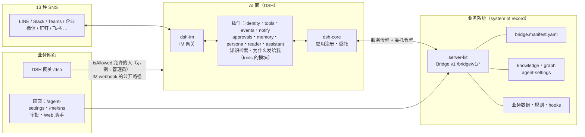
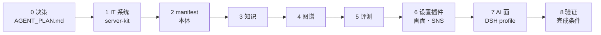

# biz-ai-agent 使用手册

> 版本：2026-11-17 · 对应 biz-ai-agent `main`（拷入的 Biz Assistant Framework 来自 commit `9a86b0f`，见 [`framework.sync.json`](../framework.sync.json)）
>
> 读者：要用这个框架**造 AI agent 的开发者**（第 1–9 章）、**部署和运维的人**（第 10–14 章）、**使用 agent 的管理员和员工**（第 5 章）。
>
> 第 4 章的步骤（pgvector 除外）在 2026-11-17 用一个新克隆的仓库实际跑过（Windows 11、Node.js 24.19、npm 11、pnpm 10）；其余章节按代码逐条核对过。shell 命令是 POSIX sh 写法（Windows 用 Git Bash）。

## 目录

1. [这是什么](#1-这是什么)
2. [整体结构](#2-整体结构)
3. [仓库里有什么](#3-仓库里有什么)
4. [第一次运行：安装、测试、本地试用](#4-第一次运行安装测试本地试用)
5. [画面怎么用：管理员、员工、审批人](#5-画面怎么用管理员员工审批人)
6. [造一个新的 AI agent：交给 AI 编程工具](#6-造一个新的-ai-agent交给-ai-编程工具)
7. [接入一个已有的业务系统](#7-接入一个已有的业务系统)
8. [AI 面：DSH、profile 和插件](#8-ai-面dshprofile-和插件)
9. [知识层：文档、检索方式、图谱、评测](#9-知识层文档检索方式图谱评测)
10. [部署与配置](#10-部署与配置)
11. [安全规则（必须遵守）](#11-安全规则必须遵守)
12. [测试与完成条件](#12-测试与完成条件)
13. [维护：同步 framework、升级](#13-维护同步-framework升级)
14. [故障排查](#14-故障排查)
15. [参考文档索引](#15-参考文档索引)

---

## 1. 这是什么

**biz-ai-agent 是一个完整的 AI agent 框架：把任何 IT 系统变成 AI 员工（AI agent / AI 助手）。**

> **造 agent 不用自己从零写代码。** 仓库里带着造 agent 的 skill：在仓库里打开 Claude Code、Codex 等 AI 编程工具，说出你的业务需求，AI 就按这个框架把 agent 开发出来、测试好（第 6 章）。做好的 agent 像普通网站一样发布（6.4）。

这个仓库的形态是**一个业务一个 DSH**：一个业务系统（system of record）配一个 DSH（AI 面），两者合起来是一个 AI agent。多个 agent 的统一管理（Agent Hub）还在设计中，见 [`docs/MULTI_AGENT_PLATFORM.md`](MULTI_AGENT_PLATFORM.md)（草案）。

它由两部分组成，全部在这个仓库里：

| 部分 | 内容 |
|---|---|
| **Biz Assistant Framework**（由 `scripts/sync-framework.mjs` 拷入：`packages/`、`plugins/`、`profile/`、`vendor/` 的大部分、三个参考示例和部分文档；包名 `@dsh-bridge/*`，vendor 里的 fork 是 `@care/*`） | 业务系统一侧的 Bridge v1 协议和 server-kit；AI 面（DSH）的核心和插件：SNS 身份连携、业务工具、业务事件、通知、审批、长期记忆、AI 员工资料、文档读取、Web 助手；13 种 SNS 的 IM 网关 dsh-im；自动任务和主动投递的守卫；业务网页组件 web-kit；DSH 网关；产品 profile 模板；测试工具 |
| **agent 层**（biz-ai-agent 自己的，包名也用 `@dsh-bridge/*`） | 知识层 `packages/knowledge` + `plugins/knowledge`（按权限检索文档、带出处）、语义图 `packages/graph` + `plugins/graph`（"这件事为什么发给我？"）、设置插件 `packages/agent-settings`（模型、知识文档、检索方式 BM25F / RAG / 知识图谱、SNS 审批和报告、员工本人的 SNS 连携页、登录页）、两个示例、`agent-builder` skill |

### 1.1 核心思想（先读这一段）

- **agent 首先是一个普通的 IT 系统。** 业务系统是唯一的数据正本（system of record）：数据、角色、谁能看什么、谁来决定，都在业务系统里。没有拖拽式的流程编辑器——流程是代码，用编码 agent 来写，由 manifest、一致性测试（conformance）、业务测试、评测（evals）和日志守护。
- **AI 员工只读和提案，人来决定。** AI 员工以**提问的那个员工本人的权限**（委托，delegation）读取数据；它的工具能做的"写"只有提案（proposal），提案要人在网页或聊天里采纳才会执行。金额等由人决定。
- **业务系统决定通知谁。** 通知、审批卡片、报告的接收人由业务系统的 hooks 决定（`recipientsFor`、`approvals.approvers`），和网页的权限判断用同一个规则。
- **事件和通知不带个人信息。** 事件的 payload、通知和卡片的文案参数里只有 ID、数值、日期、状态；姓名、内容、理由、金额等只在网页上、确认权限之后显示。AI 回答员工本人的提问时，只用这个员工有权看的内容。
- **权限优先。** 每一次知识检索、每一个图谱回答，都先按提问者的权限过滤，再排序。

### 1.2 对应 agent 的五层

| agent 的层 | 在这个框架里 |
|---|---|
| Schema（语义层、本体） | `bridge.manifest.yaml`：角色、实体、事件、工具、playbook、报告、术语；图谱的骨架由它生成 |
| Data（数据层） | 业务系统本身（server-kit 的应用，或已有系统 + Bridge v1） |
| Action（受治理的操作层） | 提案（proposal）和审批（approval），由业务系统的规则决定 |
| Agent（智能体层） | DSH 上的 AI 员工；bridge-tools 给它业务工具，知识检索和"为什么发给我"作为 bridge-tools 的工具模块加进来 |
| Memory（记忆层） | bridge-memory（长期记忆，存之前做个人信息检查）、知识层的文档 |

---

## 2. 整体结构



**一次提问的流程（例：员工在 LINE 上问休假规定）**

1. 员工在 LINE 上给组织的机器人发消息 → dsh-im 收到，bridge-identity 查出这是哪个员工（必须先用连携码连携过）。
2. AI 员工决定调用工具 `leave_knowledge_search` → 这个工具以**这个员工的委托**调用业务系统的 `GET /bridge/v1/knowledge/search`。
3. 业务系统按员工的角色过滤文档，返回能看的段落和出处（业务网页的画面 URL）。
4. AI 写回答。出处守卫（`bridge-knowledge-guard`）检查回答是否用 `[n]` 引用了这一轮返回的出处，没有引用时在后面补上出处一栏；链接守卫（bridge-identity 的 `linkGuard`）删掉不属于业务网页的链接。
5. 回答发回 LINE。

**一次审批的流程（例：管理员上传知识文档）**

1. 管理员 A 在 `/agent-settings` 上传文档 → 业务系统先做个人信息检查（查出来就拒绝，不进审批）→ 在事务里写入事件 `approval.requested`，再保存待审批的文档。（设置里关掉"需要审批"时，上传即发布。）
2. bridge-events 拉取事件 → bridge-approvals 请业务系统发放卡片（`POST /bridge/v1/approvals/:id/deliveries`），业务系统用 hook `approvals.approvers` 决定发给谁 → 审批卡片发到管理员 B 的 LINE（**上传者自己收不到，也不能批**）。
3. B 在 LINE 上按「承認」（或在网页上按「批准」）→ 业务系统用同一个 `mayDecide` 规则判断 → 写入 `approval.decided`，文档变为已发布。
4. 索引重建完成后写入 `knowledge.updated`，它的报告（只有件数）发给报告角色。

---

## 3. 仓库里有什么

```
biz-ai-agent/
├─ packages/            包（npm workspaces）
│   ├─ protocol           ★ Bridge v1：OpenAPI、manifest 校验（bridge-validate）、conformance 52 项
│   ├─ server-kit         ★ 业务系统一侧：createBridgeApp、hooks、store、事件 outbox、/bridge/v1/*
│   ├─ dsh-core           ★ AI 面核心：应用注册（bridge-apps）、委托、guardTool、helpRules
│   ├─ gateway            ★ 业务网页的 DSH 网关（/dsh/*，只给 isAllowed 允许的人）
│   ├─ web-kit            ★ 业务网页的 React 组件：ImBotsShell、SnsLinkPage、NotifyPrefsCard、AiProfilePage …
│   ├─ help               ★ 操作手册 → 索引 → 按角色回答"怎么用"
│   ├─ telemetry          ★ 日志格式
│   ├─ testing            ★ 测试工具：mock LLM / LINE、隔离的 DSH home、固定版本的 DSH CLI
│   ├─ knowledge            知识层（业务侧）：按权限检索、PII 检查、BM25F / 向量 / 重排、评测
│   ├─ graph                语义图：manifest → 骨架、neighbors、explainReach
│   └─ agent-settings       设置插件：/agent-settings、/me/sns、登录页、pgvector、知识图谱
├─ plugins/             DSH 插件
│   ├─ identity  tools  events  notify  approvals  assistant  memory  persona  reader   ★
│   ├─ knowledge            知识检索工具（bridge-tools 的模块）+ 出处守卫 bridge-knowledge-guard
│   └─ graph                "为什么发给我"工具（bridge-tools 的模块）
├─ profile/             ★ DSH 产品 profile 模板（template/）和安装、检查脚本（scripts/install.mjs、check.mjs）
├─ vendor/              ★ dsh-im（13 种 SNS）、dsh-auto-tasks、dsh-proactive（fork，各自的 npm）
├─ examples/
│   ├─ leave-requests-knowledge   参考实现（试点）：休假申请 + 知识 + 图谱 + 设置 + DSH 网关
│   ├─ equipment-loans            用 agent-builder skill 从零造出来的示例
│   ├─ leave-requests  equipment-inspection   ★ framework 的参考系统（equipment-inspection 的测试要 PostgreSQL）
│   └─ care-billing               ★ 只有 manifest、注册表和对照表；业务代码在非公开的仓库里
├─ .claude/skills/agent-builder/   Claude Code 自动加载的 skill 入口（指向 skills/agent-builder）
├─ .agents/skills/agent-builder/   Codex 自动加载的 skill 入口（同上）
├─ skills/
│   ├─ agent-builder              造 AI agent 的 skill 正文（本仓库的主 skill，英文）
│   └─ biz-assistant-integration  ★ 把 framework 接入业务系统的 skill（英文）
├─ docs/                手册、设计、API；★ GUIDELINE（日 / 英 / 中）、ARCHITECTURE 等
├─ e2e/run.mjs          真实 DSH 上的端到端测试
└─ scripts/sync-framework.mjs     从 framework 同步 ★ 部分
```

★ = 从 Biz Assistant Framework 拷入的部分（不要在这里直接改，见第 13 章）。

---

## 4. 第一次运行：安装、测试、本地试用

### 4.1 准备

- **Node.js 24.9 以上**（推荐 24）和 npm。`npm install` / `npm test` 在 22.19 以上就能跑，但 e2e 用的 DSH CLI（`@deepseek-ai/dsh@0.2.2-rc.1`）要求 24.9 以上。
- **pnpm**（只有 e2e 和安装 DSH profile 时需要；DSH 用它安装 profile 的插件）。
- Windows / macOS / Linux 都可以。
- e2e 第一次运行会从 npm 公共仓库下载固定版本的 DSH CLI（约 900 MB，放在 `.dsh-cli/`，git 忽略），不需要账号。
- 不需要数据库。RAG 想用 pgvector 时才需要 PostgreSQL + pgvector（Docker 镜像 `pgvector/pgvector:pg17`）。

### 4.2 安装和测试

```sh
git clone <biz-ai-agent 仓库> && cd biz-ai-agent
npm install
npm run vendor:install      # 第一次：vendor（dsh-im 等）各自的依赖
npm test                    # 全部包、插件、示例：约 900 个测试，约 1 分钟
```

- 期望结果：**0 失败**，有几个 skip（2026-11-17 实测：899 个测试，892 通过，7 skip）。skip 的是：
  - 没设 `FW_TEST_DATABASE_URL` 时的 PostgreSQL 测试（server-kit 的 store 测试、equipment-inspection 整个示例）；
  - 没设 `FW_TEST_MYSQL_URL` 时的 MySQL / TiDB 测试；
  - 没设 `BRIDGE_BASE_URL` 时对外部系统的 conformance；
  - 没设 `AGENT_TEST_PG_URL` 时的 1 项 pgvector 测试（其余 pgvector 测试用内置的 PGlite 照样跑）。
- equipment-loans、leave-requests、leave-requests-knowledge 三个示例的输出里有 `# conformance: 52 / 52 checks passed`；equipment-inspection 要设 `FW_TEST_DATABASE_URL` 才会跑。
- `vendor:install` 的锁文件里有一部分包来自 npmmirror（公共镜像），网络受限时可能较慢。

### 4.3 本地试用参考实现（不需要 DSH）

1. 在 `examples/leave-requests-knowledge/.env.local` 里写一行（这个文件 git 忽略，只在 `NODE_ENV` 不是 `production` 时、启动时读一次）：

   ```sh
   MOCK_MODEL_KEY=anything
   ```

2. 开**两个终端**，分别启动：

   ```sh
   node examples/leave-requests-knowledge/dev/mock-model.mjs   # 假模型，端口 19760（MOCK_MODEL_PORT 可改）
   ```

   ```sh
   node examples/leave-requests-knowledge/src/server.mjs       # 试点，端口 19750（LEAVE_PORT 可改）
   ```

   假模型不是 AI，接受任何 key，只让 RAG 和知识图谱的流程能在本机跑。它的端口和 equipment-loans 的默认端口相同，不要同时开。

3. 打开 `http://127.0.0.1:19750/login`。虚构的员工：`admin`、`admin2`（管理员）、`manager`（经理）、`staff1`、`staff2`（员工），开发用密码 `leave-dev`（`LEAVE_SEED_PASSWORD` 可改）。
   - 用 `admin` 登录 → 自动进入 `/agent-settings`。登录页默认都跳到 `/agent-settings`，员工和经理会得到 403：他们请打开 `/me/sns`（或 `/login?next=/me/sns`）。
4. 「模型」页的「基础模型」：Base URL 填 `http://127.0.0.1:19760/v1`，模型名随便填（如 `mock`），API key 选「环境变量名」并填 `MOCK_MODEL_KEY` → 先按「保存」，再按「连接测试」（测试的是保存后的设置，没保存会显示 `no_key`）。想试 RAG，同样设置「Embedding 模型」并打开「使用 Embedding 模型」。
5. 「知识」页：切换检索方式（BM25F / RAG（向量数据库）/ 语义知识图谱）→「应用并重建」；上传文档（选文件或「直接输入正文」，选可读角色），再用 `admin2` 登录，在同一页按「批准」。
6. 「SNS」页显示「未连接 DSH」是正常的：本地试用没有挂 DSH 网关，审批卡片也不会发到 SNS（审批只在网页上）。要看 SNS 部分请用 4.4 的 `--serve`。
7. 想用 pgvector：

   ```sh
   docker run -d --name biz-ai-agent-pgvector-test -e POSTGRES_PASSWORD=<随机> -e POSTGRES_DB=agent_vectors_test \
     -p 127.0.0.1:55433:5432 pgvector/pgvector:pg17
   # .env.local 里加：AGENT_VECTOR_DB_URL=postgres://postgres:<密码>@127.0.0.1:55433/agent_vectors_test
   ```

   重启 `server.mjs`，然后在「知识」页把向量库选成 PostgreSQL + pgvector（只有在 `.data/` 里还没有设置文件时，它才是默认值）。扩展 `vector` 由程序自动创建。

数据（员工、申请、登录会话）在内存里，重启就没了；设置、上传的文档、向量文件和图谱 JSON 在 `examples/leave-requests-knowledge/.data/`（`LEAVE_DATA_DIR` 可改，git 忽略）。

### 4.4 在真实 DSH 上跑（e2e）

```sh
npm run e2e                 # 15 项全部 PASS；第一次要下载 DSH CLI，共约 4 分钟，之后约 1 分钟
npm run e2e -- --serve      # 跑完不退出，可以在浏览器里看（Ctrl+C 结束）
```

- 用的是**真的 DSH**（固定版本的 CLI）+ 仓库内的 profile 模板和插件 + 假模型 + 假 LINE。不连接真实的 IM 和模型，不需要数据库，密钥每次随机生成。
- 端口：19751（试点）、3251（DSH）、3252–3254（假模型、假 LINE、网关）。被占用时报 `port … is already in use`，可用 `BIZ_AI_E2E_PORTS="app=…,dsh=…,llm=…,line=…,gateway=…"` 换。
- `--serve` 时，全部场景跑完后打开 `http://127.0.0.1:19751/login`；五个员工共用一个密码，写在 `e2e/.work/serve.txt`。
- 检查的内容：profile 的安装（知识和图谱的工具模块、出处守卫、链接守卫的 URL）、DSH 在隔离的 home 启动、五个员工用连携码连携 LINE、设置画面的 SNS 页经 DSH 网关连到 dsh-im（只给管理员）、员工的 `/me/sns` 只显示本人、按权限的知识检索和出处、受限节对员工不可见、文档上传 → LINE 上审批 → 报告、网页上的休假申请 → 经理的 LINE 审批卡片 → "为什么发给我"。
- 结果：`e2e/.work/result.json`（`--serve` 时在 Ctrl+C 后写入）；日志：`e2e/.work/dsh.log`、`install.log`。

---

## 5. 画面怎么用：管理员、员工、审批人

设置画面、`/me/sns` 和登录页支持日文 / 英文 / 中文（`?lang=ja|en|zh` 优先，否则跟随浏览器，都不匹配时用日文），浅色 / 深色跟随系统，手机宽度可用。（示例里的 `/handbook/...` 画面是简单的 HTML，不在此列。）

### 5.1 登录 `/login`

设置插件提供的登录页（`signInPage`）。业务系统用 `redirectToSignIn` 指定哪些画面要登录：没登录时打开这些画面会先跳到这里，登录后回到原来的画面。密码只由业务系统确认，AI 看不到。已有登录画面的系统用自己的。

### 5.2 管理员：AI agent 设置 `/agent-settings`（只给 `adminRoles`，默认 `admin`）

| 页 | 能做什么 |
|---|---|
| **概要** | 检索方式、文档数、索引的块数、SNS 的连接状态；设置进度（基础模型、Embedding 模型、文档、组织的 IM 机器人、自己的 SNS 连携） |
| **模型** | **基础模型**：业务系统一侧用来抽取知识图谱。**Embedding 模型**：RAG 用。种类：OpenAI 兼容 / Azure OpenAI（Azure 的"模型"填部署名）、Base URL、模型名、API key。**API key 推荐只填环境变量名**（`^[A-Z][A-Z0-9_]{1,63}$`）；在画面上直接保存 key 要先设主密钥 `AGENT_SETTINGS_KEY`（AES-256-GCM 加密保存，只能写不能读，只显示末尾 4 位）。「连接测试」测试保存后的设置，只回成功（和耗时）或错误码。**「AI 员工的对话模型（DSH）」**：AI 员工对话用的模型在 DSH 一侧设置；按「显示 YAML」得到给 DSH 用的 overlay（`llm-pi-ai` + `agent-default-model`，只含环境变量名；画面上保存的 key DSH 用不了） |
| **知识** | 检索方式：**BM25F**（默认，不用模型）/ **RAG（向量数据库）**（BM25F + 向量，存在 pgvector 或文件）/ **语义知识图谱**（基础模型把文档抽成实体和关系，存成 JSON）→「应用并重建」。上传文档：`.md` / `.txt`，≤ 200 KB，标题、关键词、可读角色（默认全选，按需取消）。文档列表：状态（等待审批 / 已发布 / 驳回 / 含个人信息被拒 / 已撤下），审批人可「批准」「驳回」（上传者看不到这两个按钮），可「撤下」。审批 7 天内没人决定就过期 |
| **SNS** | **组织的 IM 机器人**：dsh-im 自己的设置画面，13 种 SNS（Slack、LINE、Teams、Telegram、企业微信应用、企业微信、钉钉、飞书、QQ、Discord、Matrix、WhatsApp、iMessage）加邮箱，各自原有的接入方式；需要业务系统挂了 DSH 网关，否则显示「未连接 DSH」。**审批和报告**：文档发布要不要审批、审批人角色、报告接收角色、报告时机（重建索引后 / 失败时）。**我的 SNS 连携**：发行自己的连携码 |

> 用 RAG 或知识图谱时，通过个人信息检查的文档正文会发给你选的模型。画面上有明确提示。

### 5.3 员工：我的 SNS 连携 `/me/sns`（所有员工）

1. 点「发行连携码」→ 出现 6 位数字（10 分钟内有效，只能用一次）。
2. 在 LINE / Slack / Teams 等，和组织的机器人**单独聊天**，发送「連携 123456」（关键词默认是日文「連携」，可在 bridge-identity 的 `linkKeywords` 改；在群聊里发的码会作废，要重新发行）。
3. 机器人回复「連携が完了しました。…」，这页也会自动显示新的连携。之后就可以在 SNS 上向 AI 员工提问、接收审批卡片和通知。

这页只显示**本人的**连携，管理员也看不到、改不了别人的。还可以：解除连携、按种类开关通知、设置免打扰时间（默认 22:00–07:00、关闭；按 manifest 的 `system.timezone`，没写时是 UTC）。免打扰时间里的通知在结束后送达；manifest 里标了 `notify.quiet: exempt` 的事件和审批卡片不受免打扰影响。

### 5.4 在 SNS 上用 AI 员工

- **提问**：直接问（"年假怎么申请？"、"这个审批为什么发给我？"）。AI 用你的权限查，回答后附上出处（业务网页的画面链接）。你看不到的内容，AI 也看不到。
- **审批卡片**：【承認のお願い】（请批准）卡片上按「承認」/「差戻」按钮，或者回复「承認 123456」/「差戻 123456 理由」（6 位审批码；驳回要写理由，只按「差戻」时机器人会等你 10 分钟内补上理由）。一个审批只能决定一次，决定后相关的卡片都更新为结果。
- **报告**：【ご報告】只有件数和画面链接；详细内容在网页上确认权限后再看。
- **群聊**：业务内容只在单独聊天里回答（群聊默认拒绝，并回复引导）。

> 机器人的回复和卡片默认是日文，可在 profile 的设置里改（`messages`、`replyWords` 等）。

---

## 6. 造一个新的 AI agent：交给 AI 编程工具

**最快的方法：用仓库带的 skill，让 AI 编程工具（Claude Code、Codex 等）按你的需求把 agent 开发出来。** 你负责说清楚业务、回答它提出的决定、提供文档、确认结果；写代码、写测试、跑验证由 AI 来做。`examples/equipment-loans` 就是 AI 只按这个 skill 从零造出来的。

**推荐的开发顺序**

| 步骤 | 做什么 | 需要什么 |
|---|---|---|
| 0（可选）先体验 | 按 4.3 在本机打开参考实现的管理画面；或 `npm run e2e -- --serve`，看连 LINE 在内的完整流程 | 不需要模型和 SNS 账号 |
| 1 准备业务材料 | 业务需求、谁能看什么、谁审批；文档（测试阶段用虚构数据）。要不要做 SNS 上的交互测试也在这时决定 | — |
| 2 交给 AI 编程工具开发和测试 | 6.1–6.3：AI 先问决定，再写代码，跑通 52 / 52、业务测试和评测。要做 SNS 测试时，告诉 AI 把 DSH 网关和 profile 也做好 | 假模型、假 LINE，不需要密钥 |
| 3 启动造好的 agent，在管理端设置 | `/agent-settings`：模型（只有 RAG / 知识图谱才需要）、确认知识状态（「因个人信息排除」保持 0）、审批人和报告接收人 | 用 RAG / 知识图谱时要测试用的模型 key |
| 4 接上 DSH 和 SNS，做交互测试 | 安装 profile，带着 AI 员工对话用的模型 key 启动 DSH（第 8 章），业务系统设好网关的环境变量（10.1）；在管理端「SNS」页创建测试用的机器人；员工在 `/me/sns` 连携；在聊天里试提问、审批卡片、通知 | 测试用的 SNS 账号、对话模型的 key；只用虚构数据 |
| 5 发布 | 6.4：像普通网站一样 | 正式的密钥和 SNS 机器人 |

> 管理端 `/agent-settings` 是第 2 步造出来的业务系统的一部分（每个 agent 一份），所以放在开发之后。开发用的文档放进仓库的 `knowledge/*.md`：评测和权限测试都靠它们；画面上传的文档存在 `.data/`（不进 git），是上线后管理员追加用的。模型也不在开发前选：默认的 BM25F 不用模型。

### 6.1 准备：skill 已经在仓库里

clone 本仓库、做完 4.2 的安装后，在**仓库根目录**打开你的 AI 编程工具：

| 工具 | 做法 |
|---|---|
| Claude Code | 在仓库根目录启动 `claude`。skill 已放在 `.claude/skills/agent-builder/`，自动加载；也可以输入 `/agent-builder` 直接调用 |
| Codex | 在仓库根目录启动 `codex`。skill 已放在 `.agents/skills/agent-builder/`，自动发现；也可以用 `$agent-builder` 直接调用 |
| 其他 AI 编程工具 | 在对话里说"先完整读 `skills/agent-builder/SKILL.md`，按它的步骤做" |

skill 的正文是 [`skills/agent-builder/SKILL.md`](../skills/agent-builder/SKILL.md)（英文，写给 AI 看的）。它要复制仓库里的参考实现、运行仓库里的测试，所以要在本仓库里用，不要只把这个文件拷到别处。

### 6.2 告诉 AI 你要什么

用平常的话说业务就行，例如：

```text
用 agent-builder skill 帮我造一个"出差报销"的 AI agent：
- 员工在 LINE 上问报销规定、查自己的申请进度；
- 经理审批本部门的申请，超过 10 万日元的还要财务批准；
- 财务每月收到件数报告；
- 报销规定的文档在 <你的文档路径>（日文和中文各一份）。
- 之后要在 SNS 上做交互测试：把 DSH 网关和 profile 也做好。
```

AI 会按 skill 这样做：

1. **先问你决定**（谁用、能读什么、谁审批、文档给谁看、评测的正确答案、用哪个 SNS），写进 `examples/<system-id>/AGENT_PLAN.md`，等你回答。你不在时，它用推荐的默认值并标上"待确认"。
2. 复制参考实现，写业务系统和 manifest，跑到 conformance 52 / 52。
3. 接知识和图谱，**在调参之前**写评测，再接设置画面、SNS 审批和报告，写 DSH profile。
4. 每一步都用命令验证；最后报告做了什么、跑了哪些命令和结果、哪些没验证、哪些决定还待确认。

你要做的：回答决定；提供文档（测试只用虚构数据）；看 `AGENT_PLAN.md` 和报告；照 4.3 的方法在本机打开画面试用；确认后发布（6.4）。

### 6.3 AI 造出来的是哪些文件

都在 `examples/<system-id>/` 里，是一个普通的 Node.js 项目，全部进 git：

| 文件 | 是什么 |
|---|---|
| `AGENT_PLAN.md` | 决定和证据：谁决定了什么、哪些待确认、测试和评测的数字 |
| `package.json` | 包名、依赖、脚本（`test`、`evals`、`start`） |
| `bridge.manifest.yaml` | 系统的自我介绍（本体）：角色、实体、事件、AI 能用的工具、画面路由 |
| `src/app.mjs` | 业务系统本身：数据、登录、业务规则（hooks）、业务 API、设置插件、知识和图谱、DSH 网关的接线 |
| `src/server.mjs` | 启动入口：从环境变量读端口、密钥、数据目录 |
| `knowledge/*.md` | 知识文档（可见范围写在文档里，第 9 章） |
| `evals/knowledge.evals.json`、`evals/run.mjs` | 评测题和运行脚本 |
| `test/*.test.mjs` | 业务规则、conformance、知识权限、图谱、评测下限、设置插件的测试 |
| `dsh-profile/` | AI 面（DSH）的产品 profile（第 8 章） |
| `README.md` | 这个 agent 的说明、怎么启动、评测和测试的数字 |

下面 6.5 是每个文件里写什么的细节：AI 按它做，你自己写或审查时也用它。

### 6.4 发布：和普通网站一样

- **业务系统就是一个普通的 Node.js 网站。** 放到服务器上 `npm install`，用 `NODE_ENV=production node src/server.mjs` 启动（用 systemd、pm2、Docker 等常驻），前面放 HTTPS 反向代理（nginx、Caddy 等），域名指向它。
- 密钥只用环境变量给（10.1）；数据目录放在持久的磁盘上。
- **AI 面（DSH）是同一台机器上再起的一个进程**：只监听 127.0.0.1，由网站里的 DSH 网关访问（第 8 章）。LINE 等 IM 的 webhook 地址填网站的公开路径（例：`https://<你的网站>/dsh-hooks/line`）。
- 另外只需要模型的 API（AI 员工对话用，在 DSH 里设置；RAG 和知识图谱用的模型在设置画面里设）。不需要别的 AI 平台；数据库只在用 pgvector 时才需要。详细见第 10 章。

### 6.5 开发流程的细节

每一步都可以照参考实现 `examples/leave-requests-knowledge` 做。



#### 步骤 0：先决定（人来决定，不要猜）

把选项和建议写进 `examples/<system-id>/AGENT_PLAN.md`（模板：`skills/agent-builder/templates/agent-plan.md`，实例：`examples/equipment-loans/AGENT_PLAN.md`），等负责人决定：

1. agent 为谁工作、能做什么：哪些角色用它；读什么（每个工具和角色）；能提什么提案；谁批准。
2. 文档：谁负责；哪一节给哪些角色。默认最窄的范围，不能默认"所有人"。
3. 什么是正确答案：评测的期望出处是业务决定，由文档负责人确认。
4. 模型：默认 BM25F（不用模型）。模型和端点由负责人选。
5. 用哪个 SNS、组织机器人还是个人机器人、哪些事件要通知。

#### 步骤 1：IT 系统（server-kit）

从参考实现复制：`examples/leave-requests-knowledge` → `examples/<system-id>/`（改 `package.json` 的 `name`）。替换业务：

- 数据和状态变化：在 `kit.tx(async (t) => { …; await kit.emitEvent(t, { … }) })` 里，业务写入和事件**在同一个事务里**（transactional outbox）。
- hooks：`employees`（员工和角色，含停用）、`authenticate` / `isSessionLive`（自己的登录）、`recipientsFor`（通知谁）、`approvals`（`get` / `approvers` / `card` / `mayDecide` / `decide`）、`proposalKinds`（提案的角色、校验和执行）、`reports.compute`（件数）、`piiScan`（名册里的姓名）。
- 业务 API `/api/*`：AI 能读的 GET 用 `kit.readToolPolicy('GET /api/…', roles)`，第一个参数必须和 manifest 里 `tools[].http` 完全一致；所有写入只给人（`{ allow: ['user'] }`，委托会得到 403）。
- 审批规则 `mayDecide` 只写一个函数，网页和聊天卡片都用它；申请人不能批自己的申请。

#### 步骤 2：manifest（本体）

`bridge.manifest.yaml`：`bridge: 1`、`system`（`id`、`timezone` 等）、`web.routes`（每个可被链接的画面）、`roles`（委托上限 `delegation: none | read | propose`）、`entities`（`pii`、画面 `link`）、`events`（三个框架事件 `approval.requested` / `approval.decided` / `sns_identity.unlinked` + 业务事件；payload 只能是 ID、数值、日期、状态）、`tools`（读工具 + `<ns>_knowledge_search` + `<ns>_graph_neighbors` + 提案工具）、`playbooks`（默认关）、`reports`、`templates`、`glossary`。

- `<ns>_graph_neighbors` 在 manifest 里声明端点和权限；AI 实际用来回答"为什么发给我"的工具 `<ns>_graph_why` 由 plugin-graph 提供（第 8 章）。

```sh
npx bridge-validate manifest bridge.manifest.yaml --strict    # 必须输出 ok
```

#### 步骤 3–5：知识、图谱、评测

见第 9 章。

#### 步骤 6：设置插件（画面、SNS、审批、报告）

参照参考实现的 `src/app.mjs`（搜 `createAgentSettings`）：

1. `createBridgeApp` 之前：`const agent = createAgentSettings({ dataDir, env, fetch, vectorDb, adminRoles })`（`dataDir` 必填），用 `agent.approvals(...)` / `agent.recipientsFor(...)` 包住业务自己的 `hooks.approvals` 和 `hooks.recipientsFor`。
2. 之后：`await agent.register(bridge, { baseDocuments, buildIndex, webBase, knowledgeOptions, screen, gateway })` 和 `registerKnowledge(bridge, agent.knowledge)`。`buildIndex(documents, options)` 必填；`gateway` 是 `{ rpcBase: '/dsh/api/dsh-im' }`（挂了 DSH 网关时），不是网关对象本身。
3. manifest：实体 `knowledge_document`（`link: /handbook/{id}`）、事件和模板 `knowledge.updated`、路由 `/agent-settings`、`/me/sns` 和 `/handbook/:docId`。上传的文档链接到 `/handbook/<id>`（`linkPrefix` 可改），所以业务系统要提供这个画面。
4. DSH 网关（SNS 页要用）：`createDshGateway({ target, mountPath: '/dsh', isAllowed, getSessionUser, launchToken })`。`isAllowed` 决定谁能进（示例：只给管理员）；`launchToken` 是**返回 DSH 启动令牌的函数**：生产用 `@dsh-bridge/gateway` 的 `fromEnv` / `fromFile` / `supervise`，或直接用 `gatewayOptionsFromEnv(env)`；`fromValue` 只用于测试。IM 的 webhook（LINE、Teams 等）要加公开路径 `publicPaths`。
5. 请求处理的顺序：`redirectToSignIn`（要登录的画面：`/agent-settings`、`/me/sns`、`/handbook/…`）→ `gateway.handleRequest` → `bridge.handler`。
6. 没有登录页时：`/login` 用 `signInPage({ lang, acceptLanguage, system, next })`，返回的 `html` 和 `headers`（含 CSP）都要发出去；业务系统要有 `POST /api/auth/login`（`{ loginId, password }` → 2xx + cookie）。

#### 步骤 7：AI 面（DSH profile）

见第 8 章：复制 profile 模板；在 `bridge-apps` 注册应用（`generateTools: false`）；`bridge-tools` 的 `toolModules` 加上知识检索和"为什么发给我"；加出处守卫的 bundle；写链接守卫的 URL；用 `install.mjs` 安装，`check.mjs` 检查。

#### 步骤 8：验证

见第 12 章。全部用命令确认，没跑的写"未验证"。

---

## 7. 接入一个已有的业务系统

| 情况 | 路线 |
|---|---|
| 已有系统，Node.js，可以改代码 | 在已有服务器上挂 `createBridgeApp`，hooks 连到已有的表和函数 |
| 已有系统，已经有同等的 API | 用别名把 `/bridge/v1` 挂到已有路由上（GUIDELINE b.2'；CareBilling 是这样做的，它的业务代码不公开，本仓库只有 `examples/care-billing` 的 manifest 和对照表） |
| 已有系统，不是 Node.js | 按 `packages/protocol/openapi/bridge-v1.yaml` 用那种语言实现，用 conformance 验证 |
| 完全不想改代码 | 外挂模式（试行，GUIDELINE b.10）：在外面放一个桥接服务，前提是已有系统有登录确认、可以本人身份调用的 API、提交后的变更通知、审批和写入的 API |

步骤：评估（13 项检查清单）→ 计划 → manifest → hooks 和事件 → conformance 52 / 52 → DSH profile → 业务网页和 BFF → 自动任务。详细见 [`skills/biz-assistant-integration`](../skills/biz-assistant-integration/SKILL.md) 和 [`docs/GUIDELINE.zh-CN.md`](GUIDELINE.zh-CN.md) 开头的检查清单。

- 那个 skill 的 §0（`git clone` framework、`pnpm install`）在本仓库里不用做：framework 已经拷入，用 npm。
- Bridge 部分接好后，再按 6.5 的步骤 3 起加知识、图谱、评测和设置插件（AI 编程工具里的 agent-builder skill 也会接着做）。

> 不要说"不改任何东西就能接上"：计划里要写清楚给已有系统加了什么。

---

## 8. AI 面：DSH、profile 和插件

### 8.1 插件一览

| 包（DSH 里的条目 id） | 做什么 |
|---|---|
| `@dsh-bridge/dsh-core`（bridge-apps） | 应用注册表：哪个机器人属于哪个应用、业务 API 的地址、服务令牌的环境变量名、从 manifest 生成读工具、委托 |
| `@care/dsh-im`（xmanrui-dsh-im） | IM 网关：13 种 SNS 的收发、机器人设置画面 |
| `@dsh-bridge/plugin-identity`（bridge-identity） | 把 IM 的发信人对应到员工：连携码、只有连携过的员工能用 AI、链接守卫（linkGuard）、拒绝群聊 |
| `@dsh-bridge/plugin-tools`（bridge-tools） | 给 AI 员工加业务工具（带委托检查）：manifest 生成的读工具、提案工具、`toolModules` 加载的工具模块 |
| `@dsh-bridge/plugin-events`（bridge-events） | 拉取业务系统的事件（`GET /bridge/v1/events?after=`），分发给其他插件 |
| `@dsh-bridge/plugin-notify`（bridge-notify） | 事件通知：接收人、本人设置、免打扰由业务系统决定；插件只管何时、哪个机器人、什么文案 |
| `@dsh-bridge/plugin-approvals`（bridge-approvals） | 审批卡片：发到审批人的 IM，按钮或回复码决定 |
| `@dsh-bridge/plugin-assistant`（bridge-assistant） | 业务网页右侧的「AI 助手」面板（以本人权限提问） |
| `@dsh-bridge/plugin-memory`（bridge-memory） | 长期记忆：按员工、按组织记住要点；存之前做个人信息检查（不通过不存） |
| `@dsh-bridge/plugin-persona`（bridge-persona） | AI 员工资料（昵称、语气、公司介绍等），由管理员在业务网页编辑 |
| `@dsh-bridge/plugin-reader`（bridge-reader） | 让能看图的模型读取扫描文档（业务系统读不了的 PDF / 图片） |
| `@dsh-bridge/plugin-knowledge`（bridge-tools 的工具模块；bundle 插入条目 `bridge-knowledge-guard`） | 知识检索工具 `<ns>_knowledge_search` + 出处守卫（answer filter） |
| `@dsh-bridge/plugin-graph`（bridge-tools 的工具模块，没有自己的条目） | "为什么发给我"工具 `<ns>_graph_why` |
| `@care/dsh-auto-tasks`（dsh-auto-tasks）、`@care/dsh-proactive`（dsh-proactive） | 自动任务（playbook）和主动投递的守卫 |

### 8.2 安装 profile

模板 `profile/template/` 是给所有业务系统用的，要为知识层改几处。完整可运行的例子是 `e2e/run.mjs` 里生成 profile 的部分（搜 `the product profile`）。

1. 把 `profile/template/` 复制到你的产品里，填写 `cordis.patch.yml` 的所有 `<placeholder>`（`proactive.config.json` 里的 `<namespace>` 也要填；persona 文本里的 `<…>` 也要换掉，`check.mjs` 查不出这两处）。不用的示例自动任务 `auto-tasks/example-report-overdue.json` 删掉。
2. 在 dsh-im 里为应用创建机器人（Slack App、LINE 官方账号、Teams Bot …），记下 `botId`。
3. 写 `bridge-apps` 注册表（`id` = manifest 的 `system.id`，`namespace`，`apiUrlEnv`，`serviceTokenEnv`，`manifestUrl`，**`generateTools: false`**，`bots`）。令牌只写**环境变量名**。模板里是 `generateTools: true`，要改成 `false`：否则 bridge-apps 会按 manifest 生成同名的 `<ns>_knowledge_search`，和知识检索模块冲突（设 `false` 时由 bridge-tools 在模块之后生成读工具，同名的跳过）。
4. 知识检索和"为什么发给我"：
   - 在 profile 的 `package.json` 的 `dependencies` 加 `"@dsh-bridge/plugin-knowledge": "file:{{FRAMEWORK_ROOT}}/plugins/knowledge"`，并把它加进 `dsh.profile.bundles`（放在 `@dsh-bridge/plugin-identity` 之后），它的 bundle 会插入出处守卫 `bridge-knowledge-guard`。
   - `bridge-tools` 的 `config.toolModules`：

     ```yaml
     toolModules:
       - { module: 'file:///<DSH home>/profiles/<name>/node_modules/@dsh-bridge/plugin-knowledge/src/index.js', application: <system-id> }
       - { module: 'file:///<本仓库的绝对路径>/plugins/graph/src/index.js', application: <system-id> }
     ```

   - plugin-knowledge 要用**安装到 profile 里的那一份**（工具模块和出处守卫共用同一份出处记录，加载两份副本时守卫看不到出处）。e2e 就是这样写的。
   - plugin-graph 用文件 URL 加载本仓库里的文件（它依赖的 `@dsh-bridge/graph` 没有发布），所以运行 DSH 的机器上要有本仓库的克隆，并且做过 `npm install`。
   - AI 员工预设的 persona 里贴上 `knowledgeRules('<ns>_knowledge_search')` 的输出（`@dsh-bridge/plugin-knowledge`；日文 persona 用 `knowledgeRules('<ns>_knowledge_search', KNOWLEDGE_RULES_JA)`）。YAML 里不能调函数：用 node 打印一次再贴进去。
5. 审批卡片的链接：bridge-approvals 的 `webUrl` 设成你的审批画面（模板默认 `http://127.0.0.1:3010/approvals?id={id}`）。
6. **发送设置保持模板的"关闭"值**。`check.mjs` 检查的是：

   | 条目 | 必须是 |
   |---|---|
   | xmanrui-dsh-im | `forwardPluginSources: []` |
   | dsh-proactive | `modelTools: reclaim`、`deliveryGuard: required` |
   | dsh-auto-tasks | `restrictDelivery: true`、`mail: false` |
   | bridge-identity | `groupChat: deny`、`messages.groupChat`（群聊的引导文） |
   | bridge-tools | `groupChat: deny` |
   | bridge-notify | `audienceFallback: none`、`audienceText: template`、`proactiveDelivery: deny`、`aiReportGuard: screen` |

   要打开只能显式改那一行并在注释里写理由，`check.mjs` 时加 `--allow <规则>,…`（规则名：`forwardPluginSources`、`modelTools`、`deliveryGuard`、`restrictDelivery`、`mail`、`groupChat`、`audienceFallback`、`audienceText`、`proactiveDelivery`、`aiReportGuard`、`unattendedPolicy`、`fixedDelivery`）。
7. **链接守卫**：模板里 bridge-identity 的 `linkGuard` 是注释掉的，要打开并写 `webUrl`（默认应用的业务网页）；manifest 里也要有 `web.routes`。
8. 基础模型：设置画面「模型」→「AI 员工的对话模型（DSH）」→「显示 YAML」得到的 overlay（只含变量名），启动 DSH 时用 `--patch` 加上。
9. 检查并安装（install.mjs 会调用 DSH CLI 和 pnpm：PATH 上要有 `dsh`，或设 `DSH_BIN`，见下一步）：

   ```sh
   node profile/scripts/check.mjs <你的 profile 目录>/cordis.patch.yml
   node profile/scripts/install.mjs --home <DSH home> --profile <name> --source <你的 profile 目录> --framework-root <本仓库>
   ```

   `--framework-root` 默认就是本仓库；`--home` 默认 `$DSH_HOME`。

10. 启动 DSH（在隔离的 home 里，不在仓库根目录：DSH 会读当前目录的 `.env`）：

    ```sh
    cd <home>
    DSH_HOME=<home> DSH_AGENTS_HOME=<home>/agents BRIDGE_DSH_WORKSPACE=<home>/workspace \
    <APP>_API_URL=http://127.0.0.1:<业务系统端口> <APP>_SERVICE_TOKEN=<从密钥保管处取> BRIDGE_WEB_PUBLIC_URL=<业务网页> \
    <模型 key 的变量名>=<从密钥保管处取> \
    dsh --profile <name> --no-open --host 127.0.0.1 --port <DSH 端口> --public-url <业务网页>/dsh/ --patch <overlay.yml>
    ```

    - 用 `npm run e2e` 下载的固定版本时：`DSH_BIN=<本仓库>/.dsh-cli/0.2.2-rc.1/node_modules/@deepseek-ai/dsh/lib/bin.js`，把上面的 `dsh` 换成 `node "$DSH_BIN"`（`install.mjs` 也认这个变量）。
    - DSH 输出的 `dsh web: …?token=…` 是 owner 凭据：只交给 `@dsh-bridge/gateway`（`launchToken`），不给浏览器。也可以让网关自己启动和看护 DSH（`DSH_SUPERVISE=1`）。

本仓库按"一个业务一个 DSH"使用。framework 也支持多个应用共用一个 DSH（非默认应用要各自写 `webUrl`、`linkGuard.webUrls.<id>` 等，见 GUIDELINE b.5 第 10 条），这里不展开。

---

## 9. 知识层：文档、检索方式、图谱、评测

### 9.1 文档格式（`knowledge/*.md`）

```markdown
---
id: lending-rules
title: Lending rules
link: /handbook/lending-rules
roles: [admin, manager, staff]
keywords: [loan, borrow, return]
---
引言（虚构的公司）。

## Returning equipment {#returning}

文档角色里的人都能看的内容。

## Approval limits {#approval-limits roles=admin,manager}

只有管理员和经理能看的内容。
```

- `id`：`^[a-z0-9][a-z0-9-]{0,62}$`，唯一（节的 `#id` 同样）；`link` 必须匹配 manifest 的 `web.routes`；`roles` 和 / 或 `users: [<员工 id>]`。
- 只有 `##` 和 `###` 开始一个节。节的 `roles=` / `users=` 只能把可见范围**收窄**。文件名以 `_` 开头的不读。
- **不要写行尾注释**：front matter 的值后面写注释，注释会被当成值的一部分，建索引时报错；标题的 `{…}` 后面写注释，`{…}` 就不被识别、变成标题文字，这一节的收窄会**悄悄失效**（变成整份文档的可见范围）。
- 每种服务的语言各写一份文档。
- 建索引时做个人信息检查（邮箱、电话、10 位以上的数字 + 名册里的姓名）。运行中的应用会**丢掉**查出来的块并计数（「知识」页的「因个人信息排除」，自己的文档要保持 0）；测试里直接建索引时会**失败**。要改文档，不能关检查。
- 管理员也可以在设置画面上传（默认要审批）。上传的正文不解析 front matter：标题、关键词、可读角色用表单里填的，id 由标题生成；整份文档有一块被个人信息检查查出来，就整份拒绝。

### 9.2 检索方式

| 方式 | 需要 | 说明 |
|---|---|---|
| BM25F | 无 | 默认。按标题（×3）、关键词（×3）、节标题（×2）、正文（×1）加权；同义词（`synonyms`）、虚词（`fillers`）等通过 `knowledgeOptions` 调整（评测要用同一个 `knowledgeOptions`） |
| RAG | embedding 模型 + 向量库 | BM25F + 向量（RRF 融合）。向量库：**pgvector**（表 `agent_vectors`，只存 embedder 名、SHA-256 摘要、维度、向量，不存正文；需要 `vectorDb` 或 `AGENT_VECTOR_DB_URL`，并在应用里装 `pg`）或文件（`vectors.json`）。没改过的块不重新做 embedding |
| 知识图谱 | 基础模型 | 模型把文档抽成实体和关系，存 `knowledge-graph.json`（只有名字、类型、块 ID 和抽取缓存，不存正文；实体名再做一次个人信息检查）；检索时 BM25F + 图谱 |

三种方式都是**权限优先**：向量和图谱只在提问者能看的块里比较。重建时模型或向量库出错，就退回 BM25F，错误码显示在「概要」「知识」页；打开了「失败时」报告的话，`knowledge.updated` 报告里有失败件数。单个问题的 embedding 出错时，这个问题用 BM25F 回答。

### 9.3 图谱（"为什么发给我"）

- 骨架由 manifest 生成（角色、实体、事件、接收规则），不用模型。
- 业务系统用 `registerGraph(bridge, { canRead, neighbors })` 提供 `canRead`（和画面同一个规则）和 `neighbors`（直接关系）。关系名用 `requested_by`（或 `author`）、`assigned_to`、`required_role`，才能给出对应的理由。
- AI 用的工具 `<ns>_graph_why { entity, id }` 由 plugin-graph 提供，回答理由：你提的申请、分配给你、等你的角色决定、事件的接收规则 …；看不到的对象一律"找不到"。

### 9.4 评测（evals）

- `evals/knowledge.evals.json`：`askers`（提问者和角色）+ `cases`（`id`、`lang`、`asker`、`q`、期望出处 `expect`、不许出现的出处 `forbid`（可选））。出处写 `<docId>#<anchor>` 或 `<docId>`；`expect: []` 表示"什么都不该找到"。每种语言至少 20 题，包括受限节被无权角色提问、和范围外的问题。
- 在示例目录里 `npm run evals`（或在根目录 `npm run evals -w @biz-ai-agent/example-leave-requests-knowledge`）输出 Markdown 表（hit@3、top-1、"找不到"的正确数、泄漏数；`--json` 输出 JSON）。**调参之前先记录第一次的数字。**
- 完成标准：每种语言 hit@3 ≥ 80 %，**泄漏 0**。`test/evals.test.mjs` 固定题数和下限，防止以后悄悄变差（加题时要一起改）。

---

## 10. 部署与配置

### 10.1 环境变量（业务系统一侧）

`<APP>` 是示例里的前缀（试点是 `LEAVE`，equipment-loans 是 `LOANS`）；你的系统用自己的名字。

| 变量 | 用途 |
|---|---|
| `NODE_ENV=production` | 生产模式：下面两个密钥必填（没设就启动失败），不读 `.env.local`，种子员工的密码随机（不显示） |
| `<APP>_SERVICE_TOKEN` | DSH 调业务 API 的服务令牌 |
| `<APP>_BFF_SECRET` | 业务网页的 BFF 调业务 API 时带的 `x-bff-secret` |
| `<APP>_PORT`、`<APP>_HOST` | 监听地址（试点默认 `127.0.0.1:19750`） |
| `<APP>_WEB_URL` | 业务网页的公开 URL（知识出处的链接前缀） |
| `<APP>_SEED_PASSWORD` | 示例的种子员工密码（仅开发） |
| `<APP>_DATA_DIR` | 设置插件的数据目录（设置、上传的文档、向量文件、图谱 JSON）。**git 忽略**；文件存储只支持单进程，用一个实例 + 持久卷。（equipment-loans 没有这个变量，每次启动用新的临时目录） |
| `AGENT_SETTINGS_KEY` | 主密钥（32 字节，64 位十六进制或 base64）：允许在画面上直接保存 API key 时用来加密。格式不对时启动失败；换掉或丢失后，已保存的 key 无法解密 |
| `AGENT_VECTOR_DB_URL` | pgvector 连接（或由业务系统传入自己的连接池 `vectorDb`） |
| 模型 key 的变量（名字自定，如 `AZURE_OPENAI_KEY`） | 画面上只填变量名 |

挂 DSH 网关时（`gatewayOptionsFromEnv`）：`DSH_URL`，`DSH_LAUNCH_TOKEN` / `DSH_LAUNCH_LOG` / `DSH_SUPERVISE=1`（三选一），`DSH_MOUNT_PATH`，`DSH_PUBLIC_URL`，`DSH_PUBLIC_HOOK_PATHS`（IM webhook 的公开路径，如 `/dsh-hooks/line`）等，详见 [`packages/gateway/README.md`](../packages/gateway/README.md)。

### 10.2 AI 面（DSH）

| 变量 | 用途 |
|---|---|
| `DSH_HOME`、`DSH_AGENTS_HOME`、`BRIDGE_DSH_WORKSPACE` | DSH 的 home（隔离的目录，不要用个人的 `~/.dsh`）和其下的目录 |
| `bridge-apps` 里 `apiUrlEnv` / `serviceTokenEnv` 指定的变量 | 业务 API 地址和服务令牌 |
| `BRIDGE_WEB_PUBLIC_URL` | 业务网页的 URL（审批卡片等的链接） |
| 模型 key 的变量 | overlay 里 `apiKeyEnv` 指定的名字 |

### 10.3 部署的形

- 业务系统（含设置插件、知识、图谱）+ 业务网页 / BFF（含 DSH 网关）：同源部署。
- DSH（AI 面）：单独进程，只监听内网 / 本机，由网关访问；IM 平台的 webhook 经网关的公开路径转给 DSH（不经过登录，由 DSH 验签）。
- pgvector：业务系统的 PostgreSQL 加 `vector` 扩展即可（程序会执行 `CREATE EXTENSION IF NOT EXISTS vector`，数据库角色要有权限），也可以单独一个实例。
- `.data/`、`.env.local`、`.dsh-home*`、`.dsh-cli/` 都不进 git。

---

## 11. 安全规则（必须遵守）

- **AI 只读和提案**：AI 员工的工具只有 GET 和 `POST /bridge/v1/proposals`；所有写入 API 对委托返回 403。AI 不决定金额。
- **接收人由业务系统决定**，并对每个人用和网页相同的规则确认"他能在网页上看到这个对象吗"。确定不了就不发。
- **事件和消息不带个人信息**：payload 只有 ID、数值、日期、状态；文案参数只有数值、日期、时刻、月份和标志；链接是只含 ID 的路径。
- **SNS 连携只由本人、在业务系统自己的登录下完成**。管理员也不能替别人连携。不另建身份确认。
- **密钥不进仓库、yml、日志、聊天**：配置里只写环境变量名。
- **发送设置保持模板的关闭值**；打开只能显式 opt-in 并写理由。
- **只用虚构数据、本机、测试环境测试。** 不指向生产或演示的端口和数据库；DSH 用隔离的 home。
- **不在业务系统里修改拷入的 framework**（第 3 章 ★ 的部分）；不足的用 hooks、`toolModules`、`templateModules`、插件和 profile 设置来补；真缺的在 framework 修好再同步（第 13 章）。
- **权限优先**：每个检索和图谱回答都先按权限过滤，有测试证明。

完整版：[GUIDELINE 第 d 节](GUIDELINE.zh-CN.md#d-规则must--should)、[`skills/biz-assistant-integration/references/09-rules.md`](../skills/biz-assistant-integration/references/09-rules.md)（英文）。

---

## 12. 测试与完成条件

以 `examples/leave-requests-knowledge` 和 `examples/equipment-loans` 的 `test/` 为模型。

| 检查 | 命令 / 文件 | 通过的标准 |
|---|---|---|
| manifest | `npx bridge-validate manifest bridge.manifest.yaml --strict` | `ok` |
| conformance | `test/conformance.test.mjs`（通用 HTTP adapter + fixtures） | `52 / 52`，无 skip、无 known gap |
| 业务规则 | `test/app.test.mjs`：申请、审批（申请人不能批）、超时扫描、提案、报告 | 全部通过；故意破坏一条规则时有测试失败 |
| 知识的权限 | `test/knowledge.test.mjs`：每个角色 × 网页和委托 × 生成的问题 | 每个结果都是提问者能看的 |
| 无侧信道 | `test/knowledge.test.mjs`：和"从没有隐藏节的索引"比较结果和分数 | 完全相同 |
| K-01…K-08 | `runKnowledgeChecks`（`@dsh-bridge/knowledge/conformance`），在 `test/knowledge.test.mjs` | 全部通过（K-08 要用一个知识工具不给某些角色的 manifest 再跑一次，见试点的测试） |
| G-01…G-07 | `runGraphChecks`（`@dsh-bridge/graph/conformance`），在 `test/graph.test.mjs` | 全部通过 |
| 评测 | `npm run evals`、`test/evals.test.mjs` | hit@3 ≥ 80 %，泄漏 0 |
| 设置插件 | `test/agent-settings.test.mjs` | 只给管理员、上传者不能批、按角色可见、报告 |
| DSH profile | `node profile/scripts/check.mjs <cordis.patch.yml>` | 无错误 |
| 端到端 | `npm run e2e` | 15 项全部 PASS |
| 全仓库 | `npm test` | 0 失败 |

真实 IM、真实模型上的确认是另外一步；没做的要写"未验证"。

---

## 13. 维护：同步 framework、升级

- 拷入的 framework 部分（第 3 章 ★，以及 `docs/` 里的 GUIDELINE、ARCHITECTURE 等）是 **Biz Assistant Framework 已提交文件的副本**，来源 commit 记在 `framework.sync.json`。framework 的公开版本：[ITC-cloud-soft/biz-ai](https://github.com/ITC-cloud-soft/biz-ai)。
- **改 framework 的代码：在 framework 仓库里改、提交，再同步**（需要 framework 的克隆；外部贡献者请向 framework 提 PR）：

  ```sh
  npm run sync-framework                    # 来源：--from <checkout>，或环境变量 BIZ_AI_FRAMEWORK，默认 ../framework
  npm install && npm run vendor:install && npm test && npm run e2e
  ```

  脚本只拷已提交的文件（拷贝范围内有未提交的改动或未跟踪的文件时会拒绝），把 pnpm 的 `workspace:` 改成普通版本号，上次同步记录过、framework 已删掉的文件这边也删。在这边直接改拷贝过来的文件，下次同步会被覆盖。
- biz-ai-agent 自己的部分（`packages/knowledge`、`graph`、`agent-settings`，`plugins/knowledge`、`graph`，两个示例，agent-builder skill，本手册）同步时不会被碰；framework 新增了同名路径时脚本会拒绝。
- 设置画面改了 `packages/agent-settings/web/` 要重新构建：`npm run build -w @dsh-bridge/agent-settings`（产物 `dist/` 提交）。dsh-im 组件的日文翻译要用 `DSH_IM_JA` 指定，没有时构建出来的 `dist/` 少日文：提交前确认。
- 升级 framework 版本：看 framework 的提交历史（`framework.sync.json` 的 `commit` / `subject` 是上次同步的位置），再跑上面的测试；协议和 manifest 的兼容规则见 GUIDELINE 第 f 节。

---

## 14. 故障排查

| 现象 | 原因和处理 |
|---|---|
| e2e：`port … is already in use` | 上一次的 e2e（特别是 `--serve`）还在跑，或别的程序占了端口。结束它，或用 `BIZ_AI_E2E_PORTS` 换端口 |
| e2e：`timed out waiting for DSH launch line` | DSH 180 秒内没输出启动行（机器慢、内存不足、插件安装或加载卡住）。看 `e2e/.work/dsh.log`、`install.log`；结束残留的 DSH 进程（`.dsh-home-e2e` 下的 node）后重跑 |
| e2e：`the vendor forks have no dependencies yet` | 运行 `npm run vendor:install` |
| e2e：`pnpm was not found` | 安装 pnpm，放到 PATH 上 |
| e2e：DSH 启动出错、Node 版本相关的错误 | DSH CLI 要求 Node.js 24.9 以上 |
| 在 SNS 上问 AI，只回连携的引导（「…連携をお願いします…『連携 123456』と送信してください…」） | 这个 SNS 账号还没连携：在 `/me/sns` 发行连携码，单独聊天发「連携 123456」。同一个账号 10 分钟内不重复发引导，看起来像没回复 |
| 连携码被拒 | 过期（10 分钟）、已用过、或在群聊里发的：重新发行 |
| AI 回答里的链接不见了 | 链接守卫删掉了不属于业务网页的链接。检查 `linkGuard.webUrl` / `webUrls.<应用 id>` 和 manifest 的 `web.routes` |
| 文档的审批卡片没到 | 没有 DSH（4.3 的本地试用不发卡片）；审批人没连携 SNS；审批人就是上传者（不会发给他）；只有一个管理员——把经理加进审批角色（「SNS」页，`sns.approverRoles`）；或关掉了"需要审批"（上传即发布） |
| 检索不到某个文档 | 提问者的角色看不到（正常）；文档被个人信息检查拒绝（看「知识」页的状态）；还没批准；用 `npm run evals -w <示例的包名>` 看分数，加关键词或同义词 |
| 文档状态是"含个人信息" | 文档里有邮箱、电话、长号码或名册里的姓名。改文档后重新上传 |
| 「连接测试」显示 `no_key` | 没保存（测试的是保存后的设置）；变量名填错；或变量没进程序的环境（`.env.local` 改了要重启） |
| RAG 不生效，状态显示已退回 BM25F | embedding 模型连接失败（「模型」页的连接测试），pgvector 连不上（`AGENT_VECTOR_DB_URL`），或应用里没装 `pg`（`vector_db:pg_not_installed`） |
| 画面直接保存 API key 被拒（`key_storage_disabled`） | 没设 `AGENT_SETTINGS_KEY`：改填环境变量名，或设主密钥后重启 |
| SNS 页显示「未连接 DSH」 | 业务系统没挂 DSH 网关（`createDshGateway`，`register(..., { gateway: { rpcBase } })`）。4.3 的本地试用本来就没有 |
| SNS 页显示「无法连接连携基盘（DSH）」 | 网关挂了，但 DSH 没启动或连不上 |
| 打开 `/agent-settings` 返回 403 | 不是管理员角色（只给 `adminRoles`）。员工请用 `/me/sns` |
| `bridge-validate` 报警告 | `--strict` 下警告也算失败：按提示改 manifest |
| conformance 有 skip | 被测系统缺了检查需要的东西：manifest、fixture 的 hook 或数据，或审批、报告、个人机器人等功能。补齐 `test/fixtures.mjs` 或功能：52 / 52 不允许 skip（GUIDELINE b.4） |

更多：[GUIDELINE 第 g 节 FAQ](GUIDELINE.zh-CN.md#g-faq-与故障排查)。

---

## 15. 参考文档索引

| 文档 | 内容 |
|---|---|
| [`skills/agent-builder/SKILL.md`](../skills/agent-builder/SKILL.md) | 给 AI 编程工具的"造 AI agent"步骤（英文；Claude Code、Codex 通过 `.claude/skills/`、`.agents/skills/` 的入口自动加载） |
| [`skills/biz-assistant-integration/`](../skills/biz-assistant-integration/SKILL.md) | 把 framework 接入业务系统的步骤（英文；§0 的 clone 和 pnpm 在本仓库不用做） |
| [`docs/GUIDELINE.zh-CN.md`](GUIDELINE.zh-CN.md)（[日](GUIDELINE.md) / [英](GUIDELINE.en.md)） | framework 开发指南：快速开始、接入步骤、扩展点、规则、测试、FAQ（快速开始里的 pnpm 命令是 framework 仓库的，本仓库用第 4 章的 npm 命令） |
| [`docs/ARCHITECTURE.md`](ARCHITECTURE.md) | 架构：分层、事件流、身份和委托、接收人保证、安全承诺（日文） |
| [`docs/KNOWLEDGE_API.md`](KNOWLEDGE_API.md)、[`docs/GRAPH_API.md`](GRAPH_API.md) | 知识检索和图谱的接口、规则、一致性检查（英文） |
| [`packages/agent-settings/README.md`](../packages/agent-settings/README.md) | 设置插件的现行接口（v0.3）；最初的设计见 [`docs/AGENT_SETTINGS.md`](AGENT_SETTINGS.md)（v0.1，中文） |
| [`docs/STATUS.md`](STATUS.md) | 当前进度、测试数字、待决定事项（中文） |
| [`docs/GENERAL_AGENT_FRAMEWORK.md`](GENERAL_AGENT_FRAMEWORK.md) | 通用 agent 框架的设计和路线图（内部讨论稿，文中路径指 framework 仓库） |
| [`docs/MULTI_AGENT_PLATFORM.md`](MULTI_AGENT_PLATFORM.md) | 多个 agent 的统一管理（Agent Hub）设计草案 |
| [`docs/AI_EMPLOYEE_PROFILE.md`](AI_EMPLOYEE_PROFILE.md)、[`DOCUMENT_READS.md`](DOCUMENT_READS.md)、[`ASSISTANT_ATTACHMENTS.md`](ASSISTANT_ATTACHMENTS.md) | AI 员工资料、扫描文档读取、助手附件（日文） |
| `packages/*/README.md`、`plugins/*/README.md` | 每个包和插件的接口与设置 |
| [`packages/protocol/openapi/bridge-v1.yaml`](../packages/protocol/openapi/bridge-v1.yaml) | Bridge v1 协议 |
