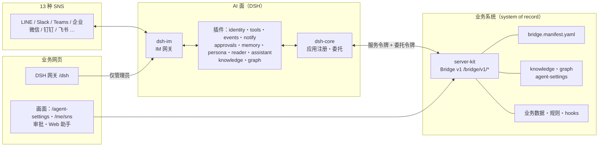
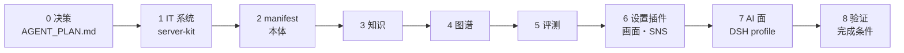

# biz-ai-agent 使用手册

> 版本：2026-11-16 · 对应 biz-ai-agent `main`（framework 同步自 `9a86b0f`，见 [`framework.sync.json`](../framework.sync.json)）
>
> 读者：要用这个框架**造 AI agent 的开发者**（第 1–9 章）、**部署和运维的人**（第 10–12 章）、**使用 agent 的管理员和员工**（第 5 章）。

## 目录

1. [这是什么](#1-这是什么)
2. [整体结构](#2-整体结构)
3. [仓库里有什么](#3-仓库里有什么)
4. [第一次运行：安装、测试、本地试用](#4-第一次运行安装测试本地试用)
5. [画面怎么用：管理员、员工、审批人](#5-画面怎么用管理员员工审批人)
6. [造一个新的 AI agent：全流程](#6-造一个新的-ai-agent全流程)
7. [接入一个已有的业务系统](#7-接入一个已有的业务系统)
8. [AI 面：DSH、profile 和插件](#8-ai-面dshprofile-和插件)
9. [知识层：文档、检索方式、图谱、评测](#9-知识层文档检索方式图谱评测)
10. [部署与配置](#10-部署与配置)
11. [安全规则（必须遵守）](#11-安全规则必须遵守)
12. [测试与完成条件](#12-测试与完成条件)
13. [维护：同步 framework、升级](#13-维护同步-framework升级)
14. [故障排查](#14-故障排查)
15. [参考文档索引](#15-参考文档索引)

---

## 1. 这是什么

**biz-ai-agent 是一个完整的 AI agent 框架：把任何 IT 系统变成 AI 员工（AI agent / AI 助手）。**

它由两部分组成，全部在这个仓库里：

| 部分 | 内容 |
|---|---|
| **Biz Assistant Framework**（`@dsh-bridge/*`，整套拷入） | 业务系统一侧的 Bridge v1 协议和 server-kit；AI 面（DSH）的核心和插件：SNS 身份连携、业务工具、审批、通知、长期记忆、AI 员工资料、文档读取、Web 助手；13 种 SNS 的 IM 网关 dsh-im；业务网页组件 web-kit；DSH 网关；测试工具 |
| **agent 层**（biz-ai-agent 自己的） | 知识层 `knowledge`（按权限检索文档、带出处）、语义图 `graph`（"这件事为什么发给我？"）、设置插件 `agent-settings`（模型、知识文档、检索方式 BM25F / RAG(pgvector) / 知识图谱、SNS 审批和报告、员工本人的 SNS 连携页、登录页）、`agent-builder` skill |

### 1.1 核心思想（先读这一段）

- **agent 首先是一个普通的 IT 系统。** 业务系统是唯一的数据正本（system of record）：数据、角色、谁能看什么、谁来决定，都在业务系统里。没有拖拽式的流程编辑器——流程是代码，用编码 agent 来写，由 manifest、一致性测试（conformance）、业务测试、评测（evals）和日志守护。
- **AI 只读和提案，人来决定。** AI 员工以**提问的那个员工本人的权限**（委托，delegation）读取数据；能做的"写"只有提案（proposal），提案要人在网页或聊天里采纳才会执行。金额等由人决定。
- **业务系统决定通知谁。** 通知、审批卡片、报告的接收人由业务系统的函数决定（`recipientsFor`），和网页的权限判断用同一个规则。
- **不带个人信息。** 事件和 IM 消息里只有 ID、日期、件数、状态；姓名、内容、理由、金额等只在网页上、确认权限之后显示。
- **权限优先。** 每一次知识检索、每一个图谱回答，都先按提问者的权限过滤，再排序。

### 1.2 对应 agent 的五层

| agent 的层 | 在这个框架里 |
|---|---|
| Schema（语义层、本体） | `bridge.manifest.yaml`：角色、实体、事件、工具、playbook、报告、术语；图谱的骨架由它生成 |
| Data（数据层） | 业务系统本身（server-kit 的应用，或已有系统 + Bridge v1） |
| Action（受治理的操作层） | 提案（proposal）和审批（approval），由业务系统的规则决定 |
| Agent（智能体层） | DSH 上的 AI 员工，插件 bridge-tools / bridge-knowledge / bridge-graph 等给它工具 |
| Memory（记忆层） | bridge-memory（长期记忆，存之前做个人信息检查）、知识层的文档 |

---

## 2. 整体结构



**一次提问的流程（例：员工在 LINE 上问休假规定）**

1. 员工在 LINE 上给组织的机器人发消息 → dsh-im 收到，bridge-identity 查出这是哪个员工（必须先用连携码连携过）。
2. AI 员工决定调用工具 `leave_knowledge_search` → bridge-tools 以**这个员工的委托**调用业务系统的 `GET /bridge/v1/knowledge/search`。
3. 业务系统按员工的角色过滤文档，返回能看的段落和出处（业务网页的画面 URL）。
4. AI 写回答；出处守卫（citation guard）在回答后面加上来源，链接守卫（link guard）删掉不属于业务网页的链接。
5. 回答发回 LINE。

**一次审批的流程（例：上传知识文档）**

1. 管理员 A 在 `/agent-settings` 上传文档 → 业务系统在同一个事务里写入文档和事件 `approval.requested`。
2. bridge-events 拉取事件 → bridge-approvals 问业务系统"谁来审批"（`approvals.approvers`）→ 审批卡片发到管理员 B 的 LINE（**上传者自己收不到，也不能批**）。
3. B 在 LINE 上按「承認」→ 业务系统用同一个 `mayDecide` 规则判断 → 发布，写入 `approval.decided` 和 `knowledge.updated`。
4. `knowledge.updated` 的报告（只有件数）发给报告角色。

---

## 3. 仓库里有什么

```
biz-ai-agent/
├─ packages/            包（npm workspaces）
│   ├─ protocol           ★ Bridge v1：OpenAPI、manifest 校验（bridge-validate）、conformance 52 项
│   ├─ server-kit         ★ 业务系统一侧：createBridgeApp、hooks、store、事件 outbox、/bridge/v1/*
│   ├─ dsh-core           ★ AI 面核心：应用注册（bridge-apps）、委托、guardTool、helpRules
│   ├─ gateway            ★ 业务网页的 DSH 网关（/dsh/*，只给允许的人）
│   ├─ web-kit            ★ 业务网页的 React 组件：ImBotsShell、SnsLinkPage、NotifyPrefsCard、AiProfilePage …
│   ├─ help               ★ 操作手册 → 索引 → 按角色回答"怎么用"
│   ├─ telemetry          ★ 日志格式
│   ├─ testing            ★ 测试工具：mock LLM / LINE、隔离的 DSH home、固定版本的 DSH CLI
│   ├─ knowledge            知识层（业务侧）：按权限检索、PII 检查、BM25F / 向量 / 重排、评测
│   ├─ graph                语义图：manifest → 骨架、neighbors、explainReach
│   └─ agent-settings       设置插件：/agent-settings、/me/sns、登录页、pgvector、知识图谱
├─ plugins/             DSH 插件
│   ├─ identity  tools  events  notify  approvals  assistant  memory  persona  reader   ★
│   ├─ knowledge            bridge-knowledge：检索工具 + 出处守卫
│   └─ graph                bridge-graph："为什么发给我"工具
├─ profile/             ★ DSH 产品 profile 模板（template/）和安装脚本（scripts/install.mjs、check.mjs）
├─ vendor/              ★ dsh-im（13 种 SNS）、dsh-auto-tasks、dsh-proactive（fork，各自的 npm）
├─ examples/
│   ├─ leave-requests-knowledge   参考实现（试点）：休假申请 + 知识 + 图谱 + 设置 + DSH 网关
│   ├─ equipment-loans            用 agent-builder skill 从零造出来的示例
│   └─ care-billing  equipment-inspection  leave-requests   ★ framework 的参考系统
├─ skills/
│   ├─ agent-builder              造 AI agent 的 skill（本仓库的主 skill）
│   └─ biz-assistant-integration  ★ 把 framework 接入业务系统的 skill
├─ docs/                手册、设计、API；★ GUIDELINE（日 / 英 / 中）、ARCHITECTURE 等
├─ e2e/run.mjs          真实 DSH 上的端到端测试
└─ scripts/sync-framework.mjs     从 framework 同步 ★ 部分
```

★ = 从 Biz Assistant Framework 拷入的部分（不要在这里直接改，见第 13 章）。

---

## 4. 第一次运行：安装、测试、本地试用

### 4.1 准备

- Node.js **22.19 以上**（24 已确认），npm。
- Windows / macOS / Linux 都可以。e2e 第一次运行会下载固定版本的 DSH CLI（约 900 MB，放在 `.dsh-cli/`，git 忽略）。
- RAG 用向量库时要 PostgreSQL + pgvector（Docker 镜像 `pgvector/pgvector:pg17`）。不用 RAG 不需要数据库。

### 4.2 安装和测试

```sh
git clone <biz-ai-agent 仓库> && cd biz-ai-agent
npm install
npm run vendor:install      # 第一次：vendor（dsh-im 等）各自的依赖
npm test                    # 全部包、插件、示例，约 900 个测试
```

- 期望结果：0 失败。少量 skip 是没有数据库连接的 PostgreSQL / MySQL 测试（设 `FW_TEST_DATABASE_URL`、`FW_TEST_MYSQL_URL`、`AGENT_TEST_PG_URL` 后会跑）。
- 各示例的输出里有 `# conformance: 52 / 52 checks passed`。

### 4.3 本地试用参考实现（不需要 DSH）

```sh
node examples/leave-requests-knowledge/dev/mock-model.mjs   # 假模型（端口 19760）：不是 AI，只让 RAG / 图谱流程能跑
node examples/leave-requests-knowledge/src/server.mjs       # 试点（端口 19750）
```

1. 打开 `http://127.0.0.1:19750/login`。虚构的员工：`admin` / `admin2` / `manager` / `staff1` / `staff2`，开发用密码 `leave-dev`（`LEAVE_SEED_PASSWORD` 可改；生产环境不能用默认值）。
2. 用 `admin` 登录 → 自动进入 `/agent-settings`。
3. 「模型」页：Base URL 填 `http://127.0.0.1:19760/v1`，API key 的**环境变量名**填 `MOCK_MODEL_KEY`（在 `examples/leave-requests-knowledge/.env.local` 里设任意值；这个文件 git 忽略，只在非生产环境读）。
4. 「知识」页：切换检索方式（BM25F / RAG / 知识图谱），上传文档，用 `admin2` 登录批准。
5. 想用 pgvector：

   ```sh
   docker run -d --name biz-ai-agent-pgvector-test -e POSTGRES_PASSWORD=<随机> -e POSTGRES_DB=agent_vectors_test \
     -p 127.0.0.1:55433:5432 pgvector/pgvector:pg17
   # .env.local 里加：AGENT_VECTOR_DB_URL=postgres://postgres:<密码>@127.0.0.1:55433/agent_vectors_test
   ```

数据（员工、申请）在内存里，重启就没了；设置和上传的文档在 `examples/leave-requests-knowledge/.data/`（git 忽略）。

### 4.4 在真实 DSH 上跑（e2e）

```sh
npm run e2e                 # 约 2–4 分钟：15 项全部 PASS
node e2e/run.mjs --serve    # 跑完不退出，可以在浏览器里看
```

- 用的是**真的 DSH**（固定版本的 CLI）+ 仓库内的 profile 模板和插件 + 假模型 + 假 LINE。不连接真实的 IM 和模型，密钥每次随机生成。
- `--serve` 时打开 `http://127.0.0.1:19751/login`，密码在 `e2e/.work/serve.txt`。
- 检查的内容：连携码连携、SNS 设置页经 DSH 网关连到 dsh-im、员工的 `/me/sns`、按权限的知识检索和出处、文档上传 → LINE 上审批 → 报告、"为什么发给我"。结果在 `e2e/.work/result.json`。

---

## 5. 画面怎么用：管理员、员工、审批人

所有画面支持日文 / 英文 / 中文（跟随浏览器，`?lang=ja|en|zh` 可切换），浅色 / 深色跟随系统，手机宽度可用。

### 5.1 登录 `/login`

业务系统自己的登录。没登录时打开 `/agent-settings` 或 `/me/sns` 会先跳到这里，登录后回到原来的画面。密码只由业务系统确认，AI 看不到。已有登录画面的系统用自己的。

### 5.2 管理员：AI agent 设置 `/agent-settings`（只给管理员角色）

| 页 | 能做什么 |
|---|---|
| **概要** | 模型、知识、SNS 的状态一览；索引的文档数和块数；自己的 SNS 连携状态 |
| **模型** | 基础模型（AI 员工对话用）和 embedding 模型（RAG 用）：种类（OpenAI 兼容 / Azure OpenAI）、Base URL、模型名、API key。**API key 推荐只填环境变量名**；直接填 key 要先设主密钥 `AGENT_SETTINGS_KEY`（加密保存，只能写不能读，只显示末尾 4 位）。「连接测试」只回 OK 或错误码。「DSH 用的 overlay」生成 AI 面的模型配置 YAML（只含变量名） |
| **知识** | 检索方式：**BM25F**（默认，不用模型）/ **RAG**（BM25F + 向量，存在 pgvector 或文件）/ **知识图谱**（基础模型把文档抽成实体和关系，存成 JSON）。上传文档（`.md` / `.txt`，≤ 200 KB，选可见角色）、看状态（等待审批 / 已发布 / 驳回 / 含个人信息被拒 / 已撤下）、重建索引 |
| **SNS** | **组织的 IM 机器人**：dsh-im 自己的设置画面，13 种 SNS（Slack、LINE、Teams、Telegram、企业微信应用、企业微信、钉钉、飞书、QQ、Discord、Matrix、WhatsApp、iMessage）加邮箱，各自原有的接入方式（填凭据、扫二维码、手动）；需要业务系统挂了 DSH 网关。**审批和报告**：文档发布要不要审批、审批人角色、报告接收角色 |

> 用 RAG 或知识图谱时，文档正文会发给你选的模型。画面上有明确提示。

### 5.3 员工：我的 SNS 连携 `/me/sns`（所有员工）

1. 点「发行连携码」→ 出现 6 位数字。
2. 在 LINE / Slack / Teams 等，和组织的机器人**单独聊天**，发送「連携 123456」。
3. 机器人回复"已连携"就完成了。之后就可以在 SNS 上向 AI 员工提问、接收审批卡片和通知。

这页只显示**本人的**连携，管理员也看不到、改不了别人的。还可以：解除连携、按种类开关通知、设置免打扰时间（这段时间的通知在结束后送达）。

### 5.4 在 SNS 上用 AI 员工

- **提问**：直接问（"年假怎么申请？"、"这个审批为什么发给我？"）。AI 用你的权限查，回答后附上出处（业务网页的画面链接）。你看不到的内容，AI 也看不到。
- **审批卡片**：【承認のお願い】（请批准）卡片上按「承認」/「差戻」按钮，或者回复审批码（例：「差戻 <code> 理由」）。一个审批只能决定一次，别人决定后其他卡片会失效。
- **报告**：【ご報告】只有件数和画面链接；详细内容在网页上确认权限后再看。
- **群聊**：业务内容只在单独聊天里回答（群聊默认拒绝）。

---

## 6. 造一个新的 AI agent：全流程

> 用编码 agent（Claude Code 等）来做时，让它读 [`skills/agent-builder/SKILL.md`](../skills/agent-builder/SKILL.md)。下面是同一流程的人类版。



### 6.0 先决定（人来决定，不要猜）

把选项和建议写进 `examples/<system-id>/AGENT_PLAN.md`（模板：`skills/agent-builder/templates/agent-plan.md`），等负责人决定：

1. agent 为谁工作、能做什么：哪些角色用它；读什么（每个工具和角色）；能提什么提案；谁批准。
2. 文档：谁负责；哪一节给哪些角色。默认最窄的范围，不能默认"所有人"。
3. 什么是正确答案：评测的期望出处是业务决定，由文档负责人确认。
4. 模型：默认 BM25F（不用模型）。模型和端点由负责人选。
5. 用哪个 SNS、组织机器人还是个人机器人、哪些事件要通知。

### 6.1 IT 系统（server-kit）

从参考实现复制：`examples/leave-requests-knowledge` → `examples/<system-id>/`。替换业务：

- 数据和状态变化：`kit.tx` + `kit.emitEvent` **在同一个事务里**（transactional outbox）。
- hooks：`employees`（员工和角色，含停用）、`authenticate` / `isSessionLive`（自己的登录）、`recipientsFor`（通知谁）、`approvals`（get / approvers / card / mayDecide / decide）、`proposalKinds`（提案的校验和执行）、`reports.compute`（件数）、`piiScan`（名册里的姓名）。
- 业务 API `/api/*`：AI 能读的 GET 用 `kit.readToolPolicy(...)`，所有写入只给人（`{ allow: ['user'] }`）。
- 审批规则 `mayDecide` 只写一个函数，网页和聊天卡片都用它；申请人不能批自己的申请。

### 6.2 manifest（本体）

`bridge.manifest.yaml`：`system`、`web.routes`（每个可被链接的画面）、`roles`（委托上限 `delegation: none | read | propose`）、`entities`（`pii`、画面 `link`）、`events`（三个框架事件 `approval.requested` / `approval.decided` / `sns_identity.unlinked` + 业务事件；payload 只能是 ID、日期、件数、状态）、`tools`（读工具 + `<ns>_knowledge_search` + `<ns>_graph_neighbors` + 提案工具）、`playbooks`（默认关）、`reports`、`templates`、`glossary`。

```sh
npx bridge-validate manifest bridge.manifest.yaml --strict    # 必须 ok
```

### 6.3–6.5 知识、图谱、评测

见第 9 章。

### 6.6 设置插件（画面、SNS、审批、报告）

参照参考实现的 `src/app.mjs`（搜 `createAgentSettings`）：

1. `createBridgeApp` 之前：`createAgentSettings({ dataDir, env, fetch, vectorDb })`，用它包住 `hooks.approvals` 和 `hooks.recipientsFor`。
2. 之后：`agent.register(bridge, { baseDocuments, buildIndex, webBase, knowledgeOptions, screen, gateway })` 和 `registerKnowledge(bridge, agent.knowledge)`。
3. manifest：实体 `knowledge_document`、事件和模板 `knowledge.updated`、路由 `/agent-settings` 和 `/me/sns`。
4. DSH 网关（SNS 页要用）：`createDshGateway({ target, mountPath: '/dsh', isAllowed: 管理员, getSessionUser })`，处理器先过 `redirectToSignIn` 再过 `gateway.handleRequest`。
5. 没有登录页时：`/login` 用 `signInPage(...)`。

### 6.7 AI 面（DSH profile）

见第 8 章：复制 profile 模板，在 `bridge-apps` 注册应用，`bridge-tools` 的 `toolModules` 加上 `@dsh-bridge/plugin-knowledge` 和 `@dsh-bridge/plugin-graph`，出处守卫 bundle，`linkGuard` URL，用 `install.mjs` 安装。

### 6.8 验证

见第 12 章。全部用命令确认，没跑的写"未验证"。

---

## 7. 接入一个已有的业务系统

| 情况 | 路线 |
|---|---|
| 已有系统，Node.js，可以改代码 | 在已有服务器上挂 `createBridgeApp`，hooks 连到已有的表和函数 |
| 已有系统，已经有同等的 API | 用别名把 `/bridge/v1` 挂到已有路由上（GUIDELINE b.2'，CareBilling 的做法） |
| 已有系统，不是 Node.js | 按 `packages/protocol/openapi/bridge-v1.yaml` 用那种语言实现，用 conformance 验证 |
| 完全不想改代码 | 外挂模式（试行，GUIDELINE b.10）：在外面放一个桥接服务，前提是已有系统有登录确认、可以本人身份调用的 API、提交后的变更通知、审批和写入的 API |

步骤：评估（13 项检查清单）→ 计划 → manifest → hooks 和事件 → conformance 52 / 52 → DSH profile → 业务网页和 BFF → 自动任务。详细见 [`skills/biz-assistant-integration`](../skills/biz-assistant-integration/SKILL.md) 和 [`docs/GUIDELINE.zh-CN.md`](GUIDELINE.zh-CN.md) 开头的检查清单。Bridge 部分接好后，再按第 6 章的 6.3 起加知识、图谱、评测和设置插件。

> 不要说"不改任何东西就能接上"：计划里要写清楚给已有系统加了什么。

---

## 8. AI 面：DSH、profile 和插件

### 8.1 插件一览

| 插件（DSH 里的 id） | 做什么 |
|---|---|
| `@dsh-bridge/dsh-core`（bridge-apps） | 应用注册表：哪个机器人属于哪个应用、业务 API 的地址、服务令牌的环境变量名、从 manifest 生成读工具、委托 |
| `@care/dsh-im`（xmanrui-dsh-im） | IM 网关：13 种 SNS 的收发、机器人设置画面 |
| `@dsh-bridge/plugin-identity`（bridge-identity） | 把 IM 的发信人对应到员工：连携码、只有连携过的员工能用 AI、链接守卫（linkGuard）、拒绝群聊 |
| `@dsh-bridge/plugin-tools`（bridge-tools） | 给 AI 员工加业务工具（带委托检查）：manifest 生成的读工具、提案工具、`toolModules`（knowledge、graph） |
| `@dsh-bridge/plugin-events`（bridge-events） | 拉取业务系统的事件（`GET /bridge/v1/events?after=`），分发给其他插件 |
| `@dsh-bridge/plugin-notify`（bridge-notify） | 事件通知：接收人、本人设置、免打扰由业务系统决定；插件只管何时、哪个机器人、什么文案 |
| `@dsh-bridge/plugin-approvals`（bridge-approvals） | 审批卡片：发到审批人的 IM，按钮或回复码决定 |
| `@dsh-bridge/plugin-assistant`（bridge-assistant） | 业务网页右侧的「AI 助手」面板（以本人权限提问） |
| `@dsh-bridge/plugin-memory`（bridge-memory） | 长期记忆：按员工、按组织记住要点；存之前做个人信息检查（不通过不存） |
| `@dsh-bridge/plugin-persona`（bridge-persona） | AI 员工资料（昵称、语气、公司介绍等），由管理员在业务网页编辑 |
| `@dsh-bridge/plugin-reader`（bridge-reader） | 让能看图的模型读取扫描文档（业务系统读不了的 PDF / 图片） |
| `@dsh-bridge/plugin-knowledge`（bridge-knowledge） | 知识检索工具 `<ns>_knowledge_search` + 出处守卫（answer filter） |
| `@dsh-bridge/plugin-graph`（bridge-graph） | "为什么发给我"工具 `<ns>_graph_why` |
| `@care/dsh-auto-tasks`、`@care/dsh-proactive` | 自动任务（playbook）和主动投递的守卫 |

### 8.2 安装 profile

1. 把 `profile/template/` 复制到你的产品里，填写 `cordis.patch.yml` 的所有 `<placeholder>`。
2. 在 dsh-im 里为应用创建机器人（Slack App、LINE 官方账号、Teams Bot …），记下 `botId`。
3. 写 `bridge-apps` 注册表（`id` = manifest 的 `system.id`，`namespace`，`apiUrlEnv`，`serviceTokenEnv`，`manifestUrl`，`generateTools: true`，`bots`）。令牌只写**环境变量名**。
4. `bridge-tools` 的 `config.toolModules` 加上：

   ```yaml
   toolModules:
     - { module: '@dsh-bridge/plugin-knowledge', application: <system-id> }
     - { module: '@dsh-bridge/plugin-graph', application: <system-id> }
   ```

   出处守卫：plugin-knowledge 的 bundle（`dsh.profile.bundles`，放在 `@dsh-bridge/plugin-identity` 之后；见 `plugins/knowledge/README.md` 和 `e2e/run.mjs`）。
5. **发送设置保持模板的"关闭"值**（`forwardPluginSources: []`、`deliveryGuard: required`、`restrictDelivery: true`、`groupChat: deny`、`audienceFallback: none`、`audienceText: template` 等）。要打开只能显式改那一行并在注释里写理由。
6. **链接守卫**：bridge-identity 的 `linkGuard.webUrl` / `webUrls.<应用 id>`，每个应用都要写，manifest 里也要有 `web.routes`。
7. 基础模型：设置画面「DSH 用的 overlay」生成的 YAML（`llm-pi-ai`，只含变量名）。
8. 安装并检查：

   ```sh
   node profile/scripts/install.mjs --home <DSH home> --profile <name> --source <你的 profile 目录> --framework-root <本仓库>
   node profile/scripts/check.mjs <你的 cordis.patch.yml>
   ```

9. 启动 DSH（在隔离的 home，不在仓库根目录）：

   ```sh
   DSH_HOME=<home> dsh --profile <name> --no-open --host 127.0.0.1 --port <port> --public-url <业务网页>/dsh/
   ```

   DSH 输出的 `dsh web: …?token=…` 是 owner 凭据：只交给 `@dsh-bridge/gateway`（`launchToken`），不给浏览器。

多个应用共用一个 DSH 时，非默认应用要各自写 `webUrl`、`linkGuard.webUrls.<id>` 等（GUIDELINE b.5 第 10 条）。

---

## 9. 知识层：文档、检索方式、图谱、评测

### 9.1 文档格式（`knowledge/*.md`）

```markdown
---
id: lending-rules              # [a-z0-9-]，唯一
title: Lending rules
link: /handbook/lending-rules  # 必须匹配 manifest 的 web.routes
roles: [admin, manager, staff] # 和 / 或 users: [<员工 id>]
keywords: [loan, borrow, return]
---
引言（虚构的公司）。

## Returning equipment {#returning}
...
## Approval limits {#approval-limits roles=admin,manager}   ← 节只能把可见范围收窄
```

- 每种服务的语言各写一份文档。
- 建索引时做个人信息检查（格式 + 名册里的姓名）。查出来的块被拒，要改文档，不能关检查。
- 管理员也可以在设置画面上传（要审批）。

### 9.2 检索方式

| 方式 | 需要 | 说明 |
|---|---|---|
| BM25F | 无 | 默认。按标题、关键词、正文加权；同义词（`synonyms`）、虚词（`fillers`）可调 |
| RAG | embedding 模型 + 向量库 | BM25F + 向量（RRF 融合）。向量库：**pgvector**（推荐；表 `agent_vectors` 只存模型名、正文的 SHA-256、维度、向量，不存正文）或文件。没改过的块不重新做 embedding |
| 知识图谱 | 基础模型 | 模型把文档抽成实体和关系，存 `knowledge-graph.json`（只有名字、类型、块 ID）；检索时 BM25F + 图谱 |

三种方式都是**权限优先**：向量和图谱只在提问者能看的块里比较。模型出错时退回 BM25F，并在状态和报告里写明。

### 9.3 图谱（"为什么发给我"）

- 骨架由 manifest 生成（角色、实体、事件、接收规则），不用模型。
- 业务系统提供 `canRead`（和画面同一个规则）和 `neighbors`（直接关系：`requested_by`、`assigned_to`、`required_role`、`subject`、`decided_by` …）。
- `<ns>_graph_why { entity, id }` 回答理由：你提的申请、分配给你、等你的角色决定、事件的接收规则 …；看不到的对象一律"找不到"。

### 9.4 评测（evals）

- `evals/knowledge.evals.json`：固定的问题、提问者、期望出处（`expect`）、不许出现的出处（`forbid`）。每种语言至少 20 个，包括受限节被无权角色提问、和范围外的问题。
- `npm run evals` 输出 Markdown 表（hit@3、泄漏数）。**调参之前先记录第一次的数字。**
- 完成标准：每种语言 hit@3 ≥ 80 %，**泄漏 0**。`test/evals.test.mjs` 固定下限，防止以后悄悄变差。

---

## 10. 部署与配置

### 10.1 环境变量（业务系统一侧）

| 变量 | 用途 |
|---|---|
| `<APP>_SERVICE_TOKEN`、`<APP>_BFF_SECRET` | DSH 调业务系统的服务令牌、BFF 密钥（生产环境必须设，开发默认值不能用） |
| `<APP>_SEED_PASSWORD` | 示例的种子员工密码（仅开发） |
| `<APP>_WEB_URL` | 业务网页的公开 URL（知识出处的链接前缀） |
| `<APP>_DATA_DIR` | 设置插件的数据目录（设置、上传文档、向量文件、图谱 JSON）。**git 忽略** |
| `AGENT_SETTINGS_KEY` | 主密钥（32 字节）：允许在画面上直接输入 API key 时用来加密 |
| `AGENT_VECTOR_DB_URL` | pgvector 连接（或由业务系统传入自己的连接池 `vectorDb`） |
| 模型 key 的变量（名字自定，如 `AZURE_OPENAI_KEY`） | 画面上只填变量名 |

### 10.2 AI 面（DSH）

| 变量 | 用途 |
|---|---|
| `DSH_HOME` | DSH 的 home（隔离的目录，不要用个人的 `~/.dsh`） |
| `bridge-apps` 里 `apiUrlEnv` / `serviceTokenEnv` 指定的变量 | 业务 API 地址和服务令牌 |
| 模型 key 的变量 | overlay 里 `apiKeyEnv` 指定的名字 |

### 10.3 部署的形

- 业务系统（含设置插件、知识、图谱）+ 业务网页 / BFF（含 DSH 网关）：同源部署。
- DSH（AI 面）：单独进程，只在内网被网关访问；IM 平台的 webhook 进入 DSH。
- pgvector：业务系统的 PostgreSQL 加 `vector` 扩展即可，也可以单独一个实例。
- `.data/`、`.env.local`、`.dsh-home*`、`.dsh-cli/` 都不进 git。

---

## 11. 安全规则（必须遵守）

- **AI 只读和提案**：AI 的工具只有 GET 和 `POST /bridge/v1/proposals`；所有写入 API 对委托返回 403。AI 不决定金额。
- **接收人由业务系统决定**，并对每个人用和网页相同的规则确认"他能在网页上看到这个对象吗"。确定不了就不发。
- **事件和消息不带个人信息**：payload 只有 ID、日期、件数、状态；文案参数只有数字和日期；链接是只含 ID 的路径。
- **SNS 连携只由本人、在业务系统自己的登录下完成**。管理员也不能替别人连携。不另建身份确认。
- **密钥不进仓库、yml、日志、聊天**：配置里只写环境变量名。
- **发送设置保持模板的关闭值**；打开只能显式 opt-in 并写理由。
- **只用虚构数据、本机、测试环境测试。** 不指向生产或演示的端口和数据库；DSH 用隔离的 home。
- **不在业务系统里修改 framework**（`packages/*`、`plugins/*`、`vendor/*`、`profile/template`、`profile/scripts`）；不足的用 hooks、`toolModules`、`templateModules`、插件和 profile 设置来补；真缺的在 framework 修好再同步。
- **权限优先**：每个检索和图谱回答都先按权限过滤，有测试证明。

完整版：[GUIDELINE 第 d 节](GUIDELINE.zh-CN.md#d-规则must--should)、[`skills/biz-assistant-integration/references/09-rules.md`](../skills/biz-assistant-integration/references/09-rules.md)。

---

## 12. 测试与完成条件

| 检查 | 命令 / 方法 | 通过的标准 |
|---|---|---|
| manifest | `npx bridge-validate manifest bridge.manifest.yaml --strict` | `ok` |
| conformance | `test/conformance.test.mjs`（通用 HTTP adapter + fixtures） | `52 / 52`，无 skip、无 known gap |
| 业务规则 | `test/app.test.mjs`：申请、审批（申请人不能批）、超时扫描、提案、报告 | 全部通过；故意破坏一条规则时有测试失败 |
| 知识的权限 | 每个角色 × 网页和委托 × 生成的问题 | 每个结果都是提问者能看的 |
| 无侧信道 | 和"从没有隐藏节的索引"比较结果和分数 | 完全相同 |
| K-01…K-08、G-01…G-07 | `runKnowledgeChecks`、`runGraphChecks` | 全部通过 |
| 评测 | `npm run evals`、`test/evals.test.mjs` | hit@3 ≥ 80 %，泄漏 0 |
| 设置插件 | `test/agent-settings.test.mjs` | 只给管理员、上传者不能批、按角色可见、报告 |
| DSH profile | `node profile/scripts/check.mjs <cordis.patch.yml>` | 无错误 |
| 端到端 | `npm run e2e` | 全部 PASS |
| 全仓库 | `npm test` | 0 失败 |

真实 IM、真实模型上的确认是另外一步；没做的要写"未验证"。

---

## 13. 维护：同步 framework、升级

- 拷入的 framework 部分（第 3 章 ★）是 **Biz Assistant Framework 已提交文件的副本**，来源 commit 记在 `framework.sync.json`。
- **改 framework 的代码：在 framework 仓库里改、提交，再同步**：

  ```sh
  npm run sync-framework                    # 默认从 ../framework；或 node scripts/sync-framework.mjs --from <checkout>
  npm install && npm run vendor:install && npm test && npm run e2e
  ```

  脚本只拷已提交的文件（framework 的工作区有未提交改动会拒绝），把 pnpm 的 `workspace:` 改成普通版本号，framework 删掉的文件这边也删。在这边直接改拷贝过来的文件，下次同步会被覆盖。
- biz-ai-agent 自己的部分（knowledge、graph、agent-settings、两个示例、agent-builder skill、本手册）同步时不会被碰。
- 设置画面改了 `packages/agent-settings/web/` 要重新构建：`npm run build -w @dsh-bridge/agent-settings`（产物 `dist/` 提交）。
- 升级 framework 版本时看 GUIDELINE 第 f 节（版本管理）和变更记录。

---

## 14. 故障排查

| 现象 | 原因和处理 |
|---|---|
| e2e：`timed out waiting for DSH launch line` | DSH 启动太慢或端口被占。确认没有残留的 DSH 进程（`.dsh-home-e2e` 下的 node），内存充足，重跑 |
| e2e：`the vendor forks have no dependencies yet` | 运行 `npm run vendor:install` |
| 在 SNS 上问 AI，只回"请先连携" | 这个 SNS 账号还没连携：在 `/me/sns` 发行连携码，单独聊天发「連携 123456」 |
| AI 回答里的链接不见了 | 链接守卫删掉了不属于业务网页的链接。检查 `linkGuard.webUrls.<应用 id>` 和 manifest 的 `web.routes` |
| 审批卡片没到 | 审批人没连携 SNS；或审批人就是申请人 / 上传者（不会发给他）；或只有一个管理员——把经理加进审批角色（`sns.approverRoles`） |
| 检索不到某个文档 | 提问者的角色看不到（正常）；文档被个人信息检查拒绝（看「知识」页的状态）；还没批准；用 `npm run evals` 看分数，加关键词或同义词 |
| 文档状态是"含个人信息" | 文档里有联系方式、长号码或名册里的姓名。改文档后重新上传 |
| RAG 不生效，状态显示已退回 BM25F | embedding 模型连接失败（看「模型」页的连接测试）或 pgvector 连不上（`AGENT_VECTOR_DB_URL`） |
| 画面直接填 API key 被拒 | 没设 `AGENT_SETTINGS_KEY`：改填环境变量名，或设主密钥 |
| SNS 页说"DSH 未连接" | 业务系统没挂 DSH 网关（`createDshGateway`，`register(..., { gateway })`），或 DSH 没启动 |
| 打开 `/agent-settings` 返回 403 | 不是管理员角色（只给 `adminRoles`） |
| `bridge-validate` 报警告 | `--strict` 下警告也算失败：按提示改 manifest |
| conformance 有 skip | 审批、报告、个人机器人等最小功能缺了：52 / 52 不允许 skip（GUIDELINE b.4） |

更多：[GUIDELINE 第 g 节 FAQ](GUIDELINE.zh-CN.md#g-faq-与故障排查)。

---

## 15. 参考文档索引

| 文档 | 内容 |
|---|---|
| [`skills/agent-builder/SKILL.md`](../skills/agent-builder/SKILL.md) | 给编码 agent 的"造 AI agent"步骤（英文） |
| [`skills/biz-assistant-integration/`](../skills/biz-assistant-integration/SKILL.md) | 把 framework 接入业务系统的步骤（英文） |
| [`docs/GUIDELINE.zh-CN.md`](GUIDELINE.zh-CN.md)（[日](GUIDELINE.md) / [英](GUIDELINE.en.md)） | framework 开发指南：快速开始、接入步骤、扩展点、规则、测试、FAQ |
| [`docs/ARCHITECTURE.md`](ARCHITECTURE.md) | 架构：分层、事件流、身份和委托、接收人保证、安全承诺 |
| [`docs/GENERAL_AGENT_FRAMEWORK.md`](GENERAL_AGENT_FRAMEWORK.md) | 通用 agent 框架的设计和路线图 |
| [`docs/KNOWLEDGE_API.md`](KNOWLEDGE_API.md)、[`docs/GRAPH_API.md`](GRAPH_API.md) | 知识检索和图谱的接口、规则、一致性检查 |
| [`docs/AGENT_SETTINGS.md`](AGENT_SETTINGS.md) | 设置插件的设计 |
| [`docs/STATUS.md`](STATUS.md) | 当前进度、测试数字、待决定事项 |
| [`docs/AI_EMPLOYEE_PROFILE.md`](AI_EMPLOYEE_PROFILE.md)、[`DOCUMENT_READS.md`](DOCUMENT_READS.md)、[`ASSISTANT_ATTACHMENTS.md`](ASSISTANT_ATTACHMENTS.md) | AI 员工资料、扫描文档读取、助手附件 |
| `packages/*/README.md`、`plugins/*/README.md` | 每个包和插件的接口与设置 |
| [`packages/protocol/openapi/bridge-v1.yaml`](../packages/protocol/openapi/bridge-v1.yaml) | Bridge v1 协议 |
