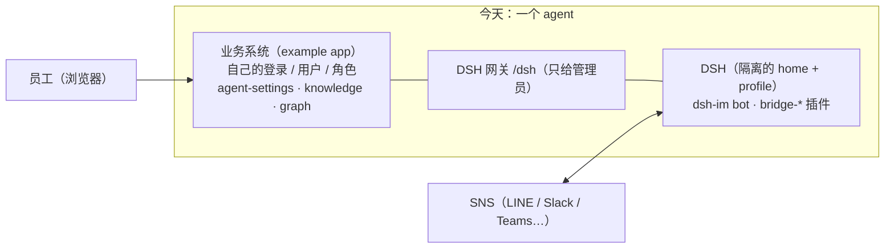
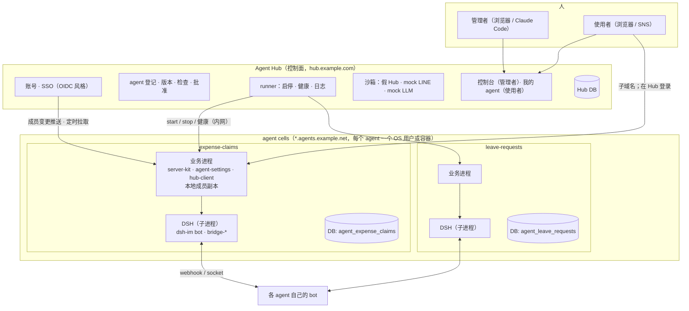
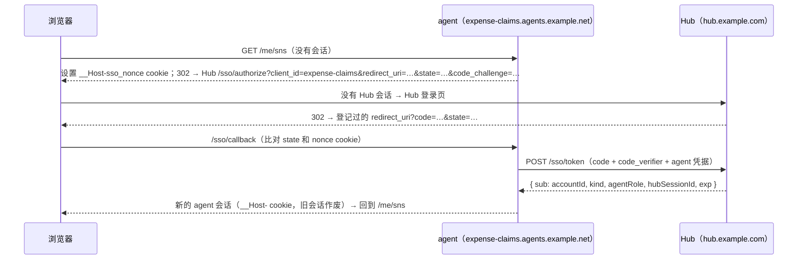
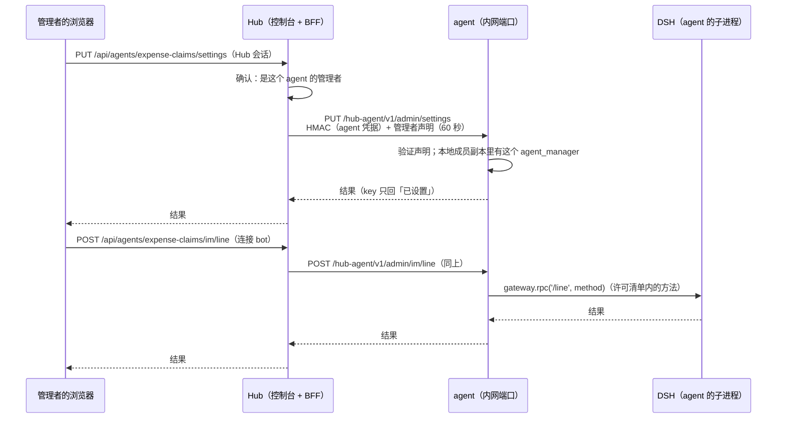
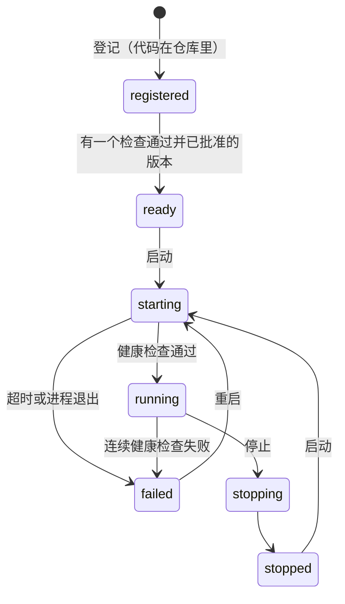
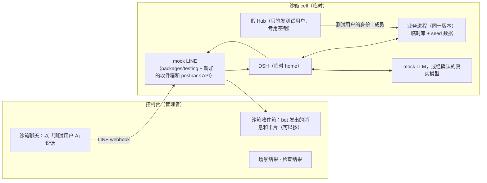

# 多 agent 平台（Agent Hub）设计方案 v0.3

> 2026-11-16 草案，等你 review。尚未实现。本文中的路径都指本仓库 biz-ai-agent。
> v0.1 → v0.2：按独立审查的 15 条意见修改，记录在 §18。
> v0.2 → v0.3（2026-11-16，你的决定）：**管理界面统一到 Hub**。模型、知识、IM bot 的设置页也放进 Hub，数据仍然存在各 agent 里（§5.5）。
> 管理端的 HTML mock：[`mock/hub-console.html`](mock/hub-console.html)（单文件，浏览器直接打开；数据全部虚构）。

**English summary.** Today biz-ai-agent builds and runs one agent: one business system, which is the SoR and has its own login, roles and knowledge, plus one DSH, the AI plane, with its IM bots.

This design adds **Agent Hub**. It is a control plane on the same framework that manages every agent of the company. It provides:

- one account directory with two account kinds, **manager** and **user**;
- per-agent membership, with all users of an agent equal for now;
- an agent registry with versions, where a second person approves every release;
- start and stop of each agent;
- per-agent knowledge;
- a sandbox for simulation tests, with its own fake identity issuer, fictional users, a mock IM channel and a mock or real model;
- debugging views that show no business content.

Each agent runs as an isolated **agent cell**: its business process, which supervises its DSH, together with its own OS user or container, database, data directory, bots and secrets. Each cell has its own subdomain. The agent trusts the hub through an OIDC-style sign-in and keeps a local copy of its members, so the hub is never on the AI's path.

Creating an agent stays in code: the agent-builder skill in Claude Code or a similar tool. The hub registers, tests, runs and observes agents.

All management screens live in the hub, including models, knowledge and IM bots. The data stays in each agent: the hub calls the agent's admin API over the internal network, carrying a signed manager assertion. Managers never browse an agent's own site; that site serves only users.

---

## 0. 结论先行

1. **加一个控制面「Agent Hub」，造 agent 的做法不变。** 每个 agent 仍然是「一个 IT 系统 + 一个 DSH」，仍然用 skill 写成代码。Hub 只管五件事：账号、登记和版本、启动和停止、模拟测试、调试和观测。
2. **一个 agent 一个运行单元（agent cell）。** cell 包括：
   - 业务进程，它用现有的 `DSH_SUPERVISE=1` 把 DSH 当子进程管理；
   - 自己的 OS 用户（或容器）、数据库、数据目录、bot 和密钥。

   这样启停、版本和故障都按 agent 隔离。代价是内存：这台 PC 上一个空闲的 DSH 实测约 **200 MB**，业务进程约 60–100 MB，忙的时候更多，第 1 周实测。框架原有的「一个 DSH 带多个应用」留作以后省资源的选项（§13）。
3. **两种账号，再加上按 agent 的关系。**
   - **管理者**：创建并管理自己负责的 agent，包括知识、启停、模拟测试、调试和成员。
   - **使用者**：使用自己被加入的 agent，包括审批、收报告和提问；通过 SNS 连携来使用。
   - 一个 agent 有多个使用者，现在**彼此平等**：都能审批（但不能批自己发起的），都收报告，都能看到这个 agent 已发布的全部知识。
   - 数据里保留 `memberRole`，以后要分等级时不用迁移。
4. **管理者在运行时不读业务数据，这一点受控、可审计，但不能写成绝对保证。**
   - 画面、日志和 trace 都不给管理者看业务内容。
   - 管理者写的代码会以 agent 的身份运行，理论上能读这个 agent 的数据。所以每个版本上线前，要由**第二个人**（平台管理员或另一位管理者）批准。
   - 每个 cell 用自己的 OS 用户或容器，读不到别的 agent。
5. **身份由 Hub 统一；agent 按 OIDC 的方式信任 Hub，但不依赖 Hub 在线。**
   - 每个 agent 有自己的子域名，浏览器在 Hub 登录。
   - agent 在本地数据库里保存成员的副本，会话用自己的短时效。Hub 停了，对话、审批和通知都照常进行，只是成员变更要等 Hub 恢复后才生效。
   - Hub 和 agent 用**不同的注册域名**，防止 agent 设置父域 cookie 去干扰别人（cookie tossing）。
6. **模拟测试用的是框架现有的 e2e 部件**：`packages/testing` 的 mock LINE 和 mock LLM，以及隔离的 DSH home。沙箱是一个临时的 cell，包括：
   - 自己的「假 Hub」签发身份，正式 agent 绝不信任它；
   - 虚构的测试用户和种子数据；
   - 控制台里的沙箱聊天和收件箱，审批卡片可以直接按。
7. **管理界面统一在 Hub，数据留在各 agent。** 管理者只用 Hub 一个界面，不进 agent 自己的网站：
   - 启停、版本、成员、沙箱、日志，加上模型、知识、IM bot 的设置，全都在 Hub 的控制台里。
   - 设置和知识的数据仍然存在各 agent 自己的库里。Hub 在服务器之间，通过内网调用 agent 的管理 API，并带上「是哪位管理者」的签名声明（§5.5）。
   - agent 自己的网站只留给使用者：SNS 连携页 `/me/sns` 和业务画面。
8. **MVP 约 6 周**（§16），比 v0.1 多一周，用于 cell 隔离和成员同步。要你决定的事见 §17，最重要的三件是：公司 agent 代码放哪个仓库、一个人既是管理者又是使用者时怎么办、谁批准上线。

---

## 1. 需求整理

| # | 需求 | 本设计的回答 |
|---|---|---|
| R1 | 用同一套框架管理、开发、维护公司全部 AI agent | Hub 控制面 + 每个 agent 一个 cell；造 agent 仍用 skill 和代码（§3、§4、§6） |
| R2 | 知识库按 agent 登记 | 每个 agent 的知识独立存放（数据目录、向量库按 agent 分库）；Hub 记录每个 agent 的知识数字和基础知识的版本（§8） |
| R3 | agent 的启动与关闭 | 生命周期状态机，按 cell 启停，启动前检查（§7） |
| R4 | 管理者：创建（skill + Claude Code）、启停、模拟测试、bug 调试 | 控制台 + `biz-agent` CLI + `agent-ops` skill；沙箱；不含正文的调试视图（§7、§10、§11） |
| R5 | 使用者做必要的互动（如审批），通过 SNS 关联自己使用的 agent | 「我的 agent」页面：列出连携状态，按钮跳到该 agent 的连携页（§9） |
| R6 | 一个 agent 多个使用者共用，使用者之间平等 | `memberRole = member`；平等的规则和人数不足时的处理见 §5.4 |
| R7 | 后端要有管理者、使用者两种账号 | `accounts.kind = manager / user`（§5、§12） |

**这一版不做：** agent 之间互相调用（编排）、计费、多家公司（多租户）、拖拽式 flow 编辑器（已决定不做）、使用者之间的上下级。

---

## 2. 现状：今天的「一个 agent」，以及哪些地方假设了只有一个



| 部分 | 现状 | 有多个 agent 时的问题 |
|---|---|---|
| 账号和登录 | 每个业务系统自己管用户和密码（`hooks.authenticate`、`createUser`），角色是业务角色（例：`admin / manager / staff`） | 同一个人在 N 个 agent 有 N 套账号，没法统一加人、停用人 |
| 管理员 | `agent-settings` 的 `adminRoles`（默认 `admin`）是业务角色中的一个；server-kit 在没给 `options.roles` 时，把报告的阅读和执行、提案审核、管理员都默认给 `admin`，没有 `admin` 时给 manifest 的第一个角色（`packages/server-kit/src/app.mjs:102-109`） | 「管理 agent 的人」和「使用 agent 的人」混在一起；角色排序不小心就会把权限给错 |
| 审批 | 业务审批和「文档发布审批」共用 `settings.sns.approverRoles`（`packages/agent-settings/src/index.mjs:154,232`） | 文档发布要「其他管理者」批，业务审批要「其他成员」批，一个设置项分不开 |
| 会话 | `isSessionLive(sessionId)` 在每次换委托和网页助手的票据时都会调用（`gate.mjs:51`、`routes/delegation.mjs:105`） | 如果改成每次去问 Hub，Hub 就进了 AI 的路径 |
| 知识 | `agent-settings` 的 `dataDir`；pgvector 用一张表 `agent_vectors`，没有 agent 列 | 多个 agent 共用 Postgres 时，必须分库或分 schema |
| AI 面 | 每个系统自己起 DSH，或由 `DSH_SUPERVISE=1` 交给 BFF；端口、home、profile 都靠手工 | 没有统一的启停、端口分配和健康检查 |
| SNS | 员工在该系统的 `/me/sns` 发连携码，发给**该系统的 bot**；`sns_identity` 存在该业务系统里 | 使用者需要一个地方看到「我用哪些 agent，各自连上了没有」 |
| 测试 | `e2e/run.mjs`：真的 DSH + mock LINE + mock 模型，场景写死在文件里 | 管理者没办法在画面上「扮成一个使用者和 agent 对话」 |
| 日志 | 进程的标准输出；`packages/telemetry` 已经定义了脱敏的 JSON 日志格式 | 没有按 agent 收集和查看的地方 |
| 代码 | 一个仓库一个应用；`examples/` 既是样例也是 agent | 公司的 agent 不应该放在框架的样例目录里 |

**现成可以用的：**

- dsh-core 的多应用注册（按 bot 路由）；
- 网关：`supervise`、公开 webhook 的转发、`rpcAllowlist`；
- `packages/testing`：mock LINE、mock LLM、隔离的 home；
- `packages/telemetry`：`mask`、trace id；
- `signInPage`、web-kit、`SnsLinkPage` / `ImBotsShell`；
- server-kit 的 `options.roles` 和各个 hooks。

---

## 3. 概念和术语

| 术语 | 含义 |
|---|---|
| **Agent Hub（Hub）** | 控制面：账号、agent 登记、版本、启停、沙箱、观测。自己是一个 Node 服务，画面用 web-kit |
| **agent** | 为一个业务目的服务的 AI agent（报销、请假、设备借用……）。由 `agent.json` 描述（§6），`id` 等于 manifest 的 `system.id` |
| **agent cell** | agent 的一个运行实例：业务进程 + 它管理的 DSH + OS 用户或容器 + 数据库 + 数据目录 + bot + 密钥。正式环境一个 agent 一个 cell；沙箱是临时的 cell |
| **版本（release）** | agent 代码的一个 git commit，加上检查结果和批准记录。只有「检查通过并且已批准」的版本才能在正式环境启动 |
| **管理者（manager）** | 一种账号。创建者也是管理者。管理自己负责的 agent，运行时看不到业务内容 |
| **使用者（user）** | 一种账号。是若干 agent 的成员，通过 SNS 和网页使用这些 agent |
| **成员关系（membership）** | （agent, 使用者）的配对。`memberRole` 现在只有 `member` 一种值，所以成员之间平等 |
| **平台管理员** | 管理者账号上的一个**权限标志**（`platformAdmin`），不是第三种账号。有这个标志的管理者可以创建账号、看所有 agent、批准版本。第一个平台管理员用命令行创建 |
| **沙箱（sandbox）** | 用虚构数据、mock IM、mock 或真实模型运行的临时 cell。身份由沙箱自己的假 Hub 签发，和正式数据、正式 bot、正式 Hub 完全分开 |

---

## 4. 总体架构



**边界规则：**

- **Hub 不碰 agent 的业务。** Hub 不调业务 API，也不读业务表。它只用 agent 专门留给 Hub 的接口（§6.3）：内网健康检查、数字状态、成员变更、连携状态（只有是/否）。
- **agent 之间互不相通。** 每个 agent 有自己的 OS 用户或容器、service token、数据库登录、DSH 和 bot。一个 agent 的工具不能调用另一个 agent，这和 dsh-core「token 不发给其他应用」的规则一致。
- **Hub 不在 AI 的路径上。** 一条消息的路径是：SNS → 该 agent 的 DSH → 该 agent 的业务进程。身份和员工信息都从**本地成员副本**里读（§5.3）。Hub 停了之后：
  - 已经登录的人、对话、审批、通知都照常；
  - 新登录、启停、成员变更要等 Hub 恢复。

---

## 5. 身份、账号和权限

### 5.1 账号

| 项 | 说明 |
|---|---|
| `id` | Hub 发的永久 ID（UUID），**永不复用**。删除是软删除（`deleted_at`），所以 agent 里留下的 userId 永远能查到对应的账号 |
| `kind` | `manager` 或 `user`，创建后不能改。一个人同时要两种身份时怎么办：§17 决定 2 |
| 登录方式 | 第一阶段：密码（Hub 的 `signInPage`）。第二阶段：公司的 IdP（Google / Entra ID），同时给管理者加两步验证 |
| `platformAdmin` | 只有管理者账号能带（§3）。第一个平台管理员用 `biz-agent hub bootstrap` 创建；初始密码只写进主机上的文件，不进 git，也不出现在聊天里 |
| `status` | `active` / `disabled`。停用后 Hub 会话失效，并通知所有相关的 agent（§5.3） |

**谁来建账号：**

- 平台管理员建管理者账号。
- 管理者邀请使用者：发邀请链接，使用者自己设密码。
- 管理者也可以把已有的使用者加进自己负责的 agent。
- 使用者不能自己加入 agent。第二阶段可以加「申请加入」，由管理者批准。

测试用户**不在 Hub 的账号表里**，只存在于沙箱的假 Hub 中（§10.1）。

### 5.2 权限一览

| 操作 | 有平台管理员标志的管理者 | 管理者（自己负责的 agent） | 使用者（自己是成员的 agent） | AI（委托） |
|---|---|---|---|---|
| 建账号 | 管理者、使用者 | 只能邀请使用者 | ✗ | ✗ |
| 登记 agent、登记版本 | ✓ | ✓ | ✗ | ✗ |
| **批准版本上线** | ✓ | ✓，但**不能批自己登记的版本** | ✗ | ✗ |
| 启动、停止、重启、回滚 | ✓ | ✓ | ✗ | ✗ |
| 加入、移除成员 | ✓ | ✓ | ✗ | ✗ |
| 知识：上传、撤下 | ✓ | ✓（发布要审批，见 §8） | ✗ | ✗ |
| 模型、检索方式 | ✓ | ✓（Hub 控制台；数据在 agent，§5.5） | ✗ | ✗ |
| 组织的 IM bot（接入和设置） | ✓ | ✓（Hub 控制台，经 agent 转给 dsh-im 的设置 RPC；DSH 的完整画面关闭，§5.5） | ✗ | ✗ |
| 沙箱：运行、模拟对话、看结果 | ✓ | ✓ | ✗ | ✗ |
| 日志、健康、trace（不含正文） | ✓ | ✓ | ✗ | ✗ |
| **业务数据和对话原文** | ✗ | ✗ | ✓（按该 agent 的业务规则） | 只能以提问者本人的权限读（现有规则） |
| 业务审批 | ✗ | ✗ | ✓（不能批自己发起的） | ✗（只能提案） |
| 自己的 SNS 连携 | ✗（MVP 不做） | ✗（MVP 不做） | ✓（只有本人能做） | ✗ |

### 5.3 身份怎么到达 agent

**登录（OIDC 风格的授权码流程）：**



**防护措施：**

- `state` 绑定发起登录的浏览器：agent 把随机 nonce 放在 `__Host-` cookie 里，回调时比对。这样防住 login CSRF。
- 登录成功后**新发会话 ID**，防止会话固定攻击。
- code 是一次性的，60 秒有效，用 PKCE。code 的 audience 绑定 `client_id`，`redirect_uri` 必须和登记的完全一致，所以拿到别的 agent 的 code 也换不到身份。
- 只有这个 agent 的**成员**才能拿到 code（`agentRole = member`），其他账号一律 403。
  - 管理者不经这个流程登录 agent：管理都在 Hub 里做（§5.5）。
- cookie 一律用 `__Host-` 前缀：`Secure`、`Path=/`、不设 `Domain`。
- Hub 和 agent 用**不同的注册域名**（例：`hub.example.com` 和 `*.agents.example.net`）。这样 agent 的代码即使恶意，也无法用父域 cookie 干扰 Hub。

**角色（必须写清楚，不能靠默认值）：**

- manifest 声明两个角色：`member` 和 `agent_manager`。
- `hubAuth()` 给 server-kit **显式**传入：
  ```js
  options.roles = {
    admins: ['agent_manager'],
    reportReaders: ['member'],
    reportRunners: ['member'],
    proposalReviewers: ['member'],
  }
  ```
  不靠「`admin` 或第一个角色」这个默认值（`app.mjs:102-109`）。
- Hub 的版本检查加一项：`member` 不能出现在 `admins` 里，`agent_manager` 不能出现在业务审批人、报告收件人和提案审核人里。

**员工和会话：本地副本，不每次去问 Hub。**

- 本地成员表：agent 在自己的数据库里放一张 `hub_members`：`accountId`、`agentRole`、`memberRole`、`active`、`version`。
- 员工 hooks：
  - `employees.get / getMany / list` 读这张表，返回 `{ id, role, active }`，不含姓名。
  - 管理者（`agent_manager`）**不出现**在 `employees.list` 的结果里，所以不会成为审批人或通知对象。
  - 管理者的 `agent_manager` 角色只出现在 Hub 调用管理 API 时的签名声明里（§5.5），不会出现在浏览器会话里。
- 同步：
  - **推送**：Hub 向 `POST /hub-agent/v1/events` 推送变更，带 HMAC 签名、时间戳和递增的 `version`。
  - **兜底**：agent 每 60 秒拉一次 `GET /hub/v1/agents/:id/members?since=<version>`。推送丢了，最晚 60 秒补上。
  - **Hub 停了**：沿用最后一份正确的副本（last known good），并在控制台标出「成员同步中断」。
- 会话：
  - agent 自己的会话 15 分钟无活动就过期，`isSessionLive` 只查本地。
  - agent 会话里记着 `hubSessionId`。Hub 注销会话或停用账号时，推送给 agent，agent 立刻作废对应的会话。
  - 会话作废后，挂在这个会话上的网页助手委托也随之失效（现有规则）。
- 取舍：Hub 停的时候，被移除的人在 Hub 恢复之前仍是成员。我们**选择不让对话停下来**，这一点在 §18.4 里请你确认。

**成员被移除时（在 agent 里核对，reconcile）：**

| 东西 | 处理 |
|---|---|
| 会话 | 作废 |
| SNS 连携 | 解除（发出 `sns_identity.unlinked`，DSH 侧忘掉缓存的委托） |
| 他发起的未决审批 | 撤回，发出 `approval.decided`，`status = withdrawn`，并通知其他成员 |
| 他已经做过的决定 | 保留，属于历史 |
| 他还没处理的通知 | 不再发给他 |
| 重新加入 | 当作新成员：需要重新连携，旧的连携不会恢复 |

agent 启动时、每次拉取之后，都按成员集合核对一遍本地的 `sns_identity` 和未决审批。推送丢失也就不会留下不一致。

**agent 的公开网站在平台模式下只有这些：** `/me/sns`、业务画面、`/sso/callback`、公开的 webhook。

- `/agent-settings` 的画面和它的 `/api/agent/*` 不再挂在公开端口上，改到内网端口，作为管理 API（§5.5）。
- `/dsh` 不对浏览器开放，DSH 的完整画面（会话、工作区）**完全关闭**。dsh-im 的设置 RPC 只在服务器一侧用 `gateway.rpc`（带许可清单）。

**放在哪里：** 以上都做成一个小包 `@dsh-bridge/hub-client`。agent 只需要几行代码，不再自己存密码。

### 5.4 「使用者之间平等」具体是什么意思

| 场景 | 规则 |
|---|---|
| 业务审批 | 审批人 = 这个 agent 的全部成员，**发起人除外**（框架原有的四眼原则）。谁先决定就算谁的，后来的人得到 `already_decided` |
| 能审批的人不够 | 发起人以外没有成员可以审批时（成员只有 1 人，或者其他人都被移除了），审批到期（现有的 TTL）后自动失效。成员数降到 1 时，控制台告诉管理者「这个 agent 没人能审批」。有审批的 agent，在成员少于 2 人时不能启动（§7.2） |
| 报告和通知 | 发给全部成员。各人在自己的 `/me/sns` 里调整种类和免打扰（现有功能） |
| 知识的可见范围 | 已发布的知识全体成员都能看。上传时「可见角色」的默认值只有 `member` |
| AI 的权限 | 每个成员的委托相同：读工具一样，提案种类也一样 |
| 以后要分等级 | 给 `memberRole` 加值（例：`approver`），manifest 加对应的角色，agent 的 `mayDecide` 和收件人规则按角色判断。Hub 和 cell 的结构不用变 |

### 5.5 管理界面统一在 Hub：管理 API 和管理者的声明

**目标：** 管理者只用 Hub 一个界面；设置和知识的数据仍然由各 agent 自己保存，Hub 不另外存一份。



**管理 API（agent 一侧，只在内网端口）：** 就是现在 `agent-settings` 的 `/api/agent/*`，换了挂载位置和鉴权方式。

| 接口 | 内容 |
|---|---|
| `GET` / `PUT /hub-agent/v1/admin/settings` | 模型、检索方式、SNS 审批和报告的设置（key 只能写） |
| `POST /hub-agent/v1/admin/settings/test` | 连接测试（只回 OK、错误码和耗时） |
| `GET` / `POST /hub-agent/v1/admin/documents`、`POST …/:id/decision`、`DELETE …/:id` | 知识文档的列表、上传、审批、撤下 |
| `POST /hub-agent/v1/admin/knowledge/rebuild`、`GET …/status` | 重建索引和它的结果 |
| `POST /hub-agent/v1/admin/im/<channel>` | dsh-im 的设置 RPC（连接、扫码、断开……）；agent 用 `gateway.rpc` 转给 DSH，只放行许可清单里的方法 |

**管理者的声明（assertion）：**

- Hub 每次调用都带两样东西：
  - 这个 agent 的 HMAC 签名，证明「是 Hub 在调」；
  - 一个 60 秒有效的管理者声明 `{ sub: accountId, agentRole: 'agent_manager', aud: <agent id>, jti }`，用 Hub 的签名密钥签名，证明「是哪一位管理者」。
- agent 一侧逐项检查：
  - `aud` 必须是自己；
  - `jti` 不能重复使用；
  - 这个 `accountId` 必须在本地成员副本里，并且是 `agent_manager`。

  所以 Hub 不能冒用一位已经不是管理者的人。
- 文档审批里的「上传的人不能批自己的」照常成立，因为 agent 从声明里知道是哪一位管理者。
- 两边都记审计：Hub 记「谁在 Hub 上做了什么」，agent 记「哪个声明改了什么」。

**模型的 key：**

- 管理者在 Hub 的画面上输入 key，Hub **不保存，直接转给** agent。
- agent 用自己的 `AGENT_SETTINGS_KEY` 加密保存（现有做法）。
- 之后只回「已设置 / 来源 / 末尾 4 位」。Hub 的日志里不记请求正文。

**画面：**

- 现在 `packages/agent-settings/web` 里的 React 组件（模型、知识、SNS，以及 IM bot 用的 `ImBotsShell` 和 dsh-im 的设置组件）**搬进 Hub 的控制台**，改成调用 Hub 的 `/api/agents/:id/*`。
- 外观不变，用的还是同一套 web-kit。

**Hub 停了：** 设置和知识暂时改不了；agent 照常运行（Hub 不在 AI 的路径上）。

**风险：** Hub 能改所有 agent 的设置，所以 Hub 被攻破的影响比 v0.2 大。对策（§15）：
- 管理者用公司的 IdP 并加两步验证（第二阶段）；
- 声明 60 秒有效、不能重复使用；
- agent 一侧再核对管理者的身份；
- 两边都记审计。

---

## 6. agent 的定义和登记

### 6.1 agent 目录（skill 产出的东西）

```
agents/expense-claims/
  agent.json              ← 新：给 Hub 的描述
  bridge.manifest.yaml    ← 本体（现有）；角色 member / agent_manager
  src/app.mjs, server.mjs ← 业务系统（现有做法；登录换成 hubAuth）
  knowledge/*.md          ← 基础知识（现有）
  evals/                  ← 评测（现有）
  dsh-profile/            ← DSH 产品 profile（现有，profile/template 的副本）
  sandbox/
    seed.mjs              ← 虚构的测试数据
    users.json            ← 虚构的测试用户（显示名、member / agent_manager）
    scenarios/*.json      ← 场景：谁说什么 → 期望的工具、卡片、来源、禁止出现的内容
  test/                   ← 业务测试、一致性测试（现有）
```

```json
{
  "id": "expense-claims",
  "name": { "ja": "経費精算", "zh": "报销", "en": "Expense claims" },
  "description": { "zh": "提交和审批报销；回答报销规定" },
  "business": { "entry": "src/server.mjs", "store": "postgres" },
  "dsh": { "profile": "dsh-profile", "supervise": true, "allow": [] },
  "approvals": true,
  "env": { "required": [], "optional": ["AZURE_OPENAI_KEY"] },
  "sandbox": { "seed": "sandbox/seed.mjs", "users": "sandbox/users.json", "scenarios": "sandbox/scenarios" }
}
```

**`agent.json` 里不写什么：** 端口、URL、service token、数据库连接、Hub 凭据。这些由 Hub 启动 cell 时用环境变量注入：

- `PORT`、`INTERNAL_PORT`
- `PUBLIC_ORIGIN` = `https://<id>.agents.example.net`（DSH 的 `--public-url` 也从它推出来）
- `HUB_URL`、`HUB_CLIENT_ID`、`HUB_CLIENT_SECRET`
- `DATABASE_URL`、`AGENT_VECTOR_DB_URL`、`DATA_DIR`
- `BRIDGE_SERVICE_TOKEN`、`BRIDGE_BFF_SECRET`
- `DSH_SUPERVISE=1`、`DSH_HOME`

**`dsh.allow`：** 要打开的外发设置，按 `check.mjs --allow` 的规则名写。启动时会把它显示给管理者确认。

**Hub 对 `agent.json` 的检查：** 用 JSON schema 校验；`id` 必须等于 manifest 的 `system.id`。

### 6.2 代码放在哪里，版本从哪来

- 公司的 agent 不放在框架仓库的 `examples/` 里。推荐**新建一个私有仓库**（例：`ITC-cloud-soft/biz-ai-agents`），一个目录一个 agent，依赖固定版本的框架（§17 决定 1；新建仓库要你同意）。
- **版本 = 那个仓库的一个 commit。**
  - Hub 主机上有这个仓库的只读 checkout。
  - 「登记版本」= 取出这个 commit，安装依赖，跑检查（§10.3）。
  - 检查通过后，由**第二个人批准**（§5.2），才变成可以上线的版本。
- **创建 agent 的流程：**
  1. 管理者用 Claude Code 和 agent-builder skill 写代码、测试，然后提 PR。
  2. PR 合并后，在控制台或用 `biz-agent register expense-claims --ref <sha>` 登记。
  3. Hub 跑检查。
  4. 在沙箱里试用。
  5. 第二个人批准。
  6. 加成员。
  7. 启动。

### 6.3 agent 留给 Hub 的接口（由 `hub-client` 提供，agent 不用手写）

| 接口 | 监听在 | 用途 | 鉴权 |
|---|---|---|---|
| `GET /healthz` | **只在内网端口**（`INTERNAL_PORT`） | 业务进程、数据库、DSH 是否可达 | 内网 + `HUB_CLIENT_SECRET` |
| `/hub-agent/v1/admin/*` | 内网端口 | 管理 API：设置、知识、IM bot（§5.5） | 内网 + HMAC + 管理者声明 |
| `GET /hub-agent/v1/status` | 内网端口 | 只有数字：版本、知识文档数、块数、基础知识的哈希、outbox 积压、最近的错误数、bot 的连接状态、成员副本的 `version` | 内网 + HMAC |
| `GET /hub-agent/v1/link-status?account=<id>` | 内网端口 | 这个人在各个 SNS 平台**是否已连携**（只有是/否） | 内网 + HMAC |
| `POST /hub-agent/v1/events` | 内网端口 | 成员变更、账号停用、会话注销 | HMAC + 时间戳（5 分钟内）+ `version` |
| `GET /sso/callback` | 公开端口 | 登录回调 | state + nonce + PKCE |

---

## 7. 生命周期：启动和停止

### 7.1 状态



归档（不能再启动，但保留数据）放到第二阶段。

### 7.2 启动前的检查

任何一项不通过就不启动，控制台会显示原因。

- 要启动的版本已经检查通过，并且已经被批准。
- `business.store = postgres`。正式环境不能用 memory store：outbox、会话、委托和成员副本都要能在重启后保留下来。
- 必需的环境变量都在。如果模型的 key 是在画面上填的，必须已经设置了 `AGENT_SETTINGS_KEY`（现有规则）。
- DSH profile 通过 `check.mjs --allow <agent.json 的 dsh.allow>`。`allow` 里的每一项，管理者都确认过。
- 有审批的 agent 至少有 2 个成员（§5.4）。
- 端口和子域名都可用。

### 7.3 「停止」意味着什么

**停止的顺序（优雅退出）：**

1. Hub 给业务进程发 SIGTERM。
2. 业务进程停止接收新请求，把正在写的 outbox 事务做完。
3. 业务进程再结束 DSH 的进程树（网关的 `supervise` 已经能做到这一点）。
4. 超时（30 秒）还没结束的，强制结束。

**网页：** 显示 Hub 的「这个 agent 已停止」页面。outbox 里还没送出的事件留在 Postgres 里，下次启动时接着送。

**SNS 的 webhook：** 业务进程停了，所以由 Hub 的前置代理处理。代理知道每个 agent 的公开 hook 路径（`DSH_PUBLIC_HOOK_PATHS`），对这些路径回 **503**，不回 200：

- 回 200 会让平台以为消息已经送到，消息就悄悄丢了。
- 回 503 时，LINE 只有在开启了「Webhook 再送」的情况下才会重试，没开的话，停止期间的消息会丢。这个限制要在控制台上写明。
- Slack（Socket Mode）的连接会断开，停止期间发来的消息不会送达。

**bot 的回复：** 停止期间 bot 不回复。第二阶段可以让 bot 回一句固定的「停止中」。要做到这一点，Hub 需要拿着 bot 的凭据，所以先不做。

**自动任务、定时报告：** 跟着 DSH 一起停。启动后**不补跑**停止期间的任务。

**一个 cell 里的约束：** DSH 是业务进程的子进程，所以不能只重启其中一个；业务进程崩溃时，DSH 也会一起停，然后整个 cell 一起重启（launch token 会重新读取）。§13 说的隔离是 **agent 和 agent 之间**的隔离，不是 cell 内部的。

### 7.4 runner

| runner | 用在哪里 | 做法 |
|---|---|---|
| `process` | 开发用的 PC、第一阶段的单机试运行 | Hub 用这个 agent 自己的 **OS 用户**启动业务进程（Linux 上用 sudo 只放行固定的命令；Windows 开发机可以不分用户，但只能用虚构数据）。Hub 重启时用 pid 文件接管，不会杀掉 agent |
| `docker` | 正式环境（推荐） | 一个版本一个镜像（业务 + 固定版本的 DSH CLI），一个 cell 一个容器，设内存上限。Hub 通过本地的 docker socket 代理操作，只开放 start、stop、logs |

两种 runner 是同一个接口：`start / stop / status / logs`。正式环境用哪一种：§17 决定 3。

---

## 8. 知识按 agent 登记

**存放：**

- 每个 agent 有自己的 `DATA_DIR`，里面放设置、上传的文档和图谱 JSON。
- 每个 agent 有自己的数据库，或者自己的 schema，配自己的登录账号。现有的 `agent_vectors` 表不用加 agent 列。

**Hub 上能看到的（满足 R2「按 agent 登记」）：**

- 控制台的 agent 详情 →「知识」页，只显示数字：文档数、待审批数、块数、最近一次重建的时间和结果。
- 每个版本里基础知识（`knowledge/*.md`）的哈希。这样能回答「哪个版本带的是哪一版规定」。
- 文档的上传、查看、撤下、审批，以及检索方式和重建，都在 Hub 控制台的「知识」页里做。数据经管理 API 存到 agent 里（§5.5）。

**发布审批**（现有的「文档发布要审批」）：

- 审批人是这个 agent 的**其他管理者**。上传的人不能批自己的文档。
- 这需要给 `agent-settings` 加一个独立的设置 `sns.docApproverRoles`，默认 `agent_manager`。原来的 `approverRoles` 继续给业务审批用。
- 审批人是管理者，管理者在 MVP 里不连携 SNS（§5.2），所以文档的审批只在网页上做，通知发到控制台和邮件。
- 只有一个管理者的 agent：§17 决定 4。

**检索方式：** 每个 agent 自己设置。按你 2026-11-15 的决定，现在只用 BM25F。

**第二阶段：** 公司共用的知识库，做成「共享集合 + agent 订阅」。

---

## 9. SNS：使用者怎么关联自己用的 agent

**一个 agent 用自己的一组 bot（推荐）。** 例如报销 AI 是一个 LINE 公式账号（或一个 Slack app），请假 AI 是另一个。好处：

- 使用者分得清是哪个 AI，签名是「— 报销（AI 秘书）」；
- 停掉一个 agent 不影响别的；
- 用的是现有的连携方式。

管理者在 Hub 控制台的「SNS」页里接 bot。用的是现有的 `ImBotsShell` 和 dsh-im 的设置组件，支持 13 种 SNS；经管理 API 转给 agent 的 DSH（§5.5）。

**使用者的「我的 agent」页面（在 Hub 上）：**

- 列出自己是成员的 agent：名称、说明、运行状态。
- 各个 SNS 的连携状态：Hub 从内网调 `link-status`，拿到的只有是/否。
- 两个按钮：
  - 「连携」：跳到该 agent 的 `/me/sns`，经 SSO 登录，用现有的 `SnsLinkPage`。在那里发行连携码，然后把码发给该 agent 的 bot。
  - 「打开网页」。
- 连携只能本人做（现有规则），所以使用者至少要登录一次网页。

**链接：** AI 的回答里可能要带「我的 agent」的链接，所以每个 agent 的 link-guard 都要把 Hub 的地址加进 `allowHosts`。`hub-client` 会自动加上。

**反向代理：** 前置代理必须原样传 `Host` 头，并且把 `PUBLIC_ORIGIN` 设成这个 agent 的子域名。否则 link-guard 和 DSH 的 `--public-url` 都会出错。这一项由启动前检查确认。

**加入和移除成员：**

- 加入：第一阶段由管理者把邀请链接交给使用者；第二阶段发邀请邮件。
- 移除：自动解除连携（§5.3）。之后他再给 bot 发消息，收到的是「未连携」的固定回复（现有行为）。

**bot 太多以后：**

- 个人微信本来就是一个 bot 带多个应用（`#报销` 切换），但这要求这些 agent 在**同一个 DSH** 里。
- 「公司一个总 bot」要跨 DSH 路由，这一版不做（§13）。

---

## 10. 模拟测试（沙箱）

### 10.1 沙箱 cell



**代码相同，其余都换成测试用的：**

- 临时数据库，用 `sandbox/seed.mjs` 灌入虚构数据。
- **假 Hub：** 沙箱自己带一个最小的身份签发者，用一把只在这次沙箱里有效的密钥。
  - 它只认 `sandbox/users.json` 里的测试用户。
  - 沙箱 cell 的 `HUB_URL` 指向它。正式 cell 的 `HUB_URL` 指向正式 Hub，正式 Hub 里没有测试用户，所以**正式 agent 里没有后门**。
  - `hub-client` 本身不需要「测试模式」开关。
- **mock LINE：** 不接任何真实的 SNS。测试用户在 mock LINE 上已经是连携好的状态。

**模拟对话：**

- 在控制台选一个测试用户，输入的话以 LINE webhook 的形式送进 DSH，和 e2e 用的 `lineWebhookSender` 一样。
- bot 发出的内容显示在收件箱里。按卡片上的「承认」，就是向 mock LINE 注入一个 postback。
- 现在的 `mock-line.mjs` 只有 e2e 用的部件（`startMockLine`、`lineWebhookSender`、`signLineBody`、`flexSummary`）。**收件箱的读取 API 和 postback 的注入要新写**，写在本仓库的 `agent-hub` 里，不改框架。
- 切换成另一个测试用户，就能检查平等规则，例如「发起人不能批自己的申请」。

**模型：**

- 默认用 mock：不花钱，结果稳定，用来测流程。
- 也可以选真实模型来测回答质量。这时系统提示和**这个 agent 的知识文档**（内部规定）都会发给模型。所以只能选这个 agent 已经批准的模型连接，而且每次启动沙箱时管理者都要确认一次。控制台会显示 token 的估算。

**场景：** 一键跑完 `sandbox/scenarios`，思路和 e2e 的 k1、s1、g1 一样。

**生命周期：** 按需启动，空闲 30 分钟后自动停止并删除。同一个 agent 同时只能有一个沙箱。

### 10.2 测试用户和数据

- 只用虚构的名字和数据（现有规则）。
- **不能把正式数据复制进沙箱。** 正式环境出的问题，靠日志的错误码、trace 和数字来推断，再在沙箱里用虚构数据重现。

### 10.3 版本的检查和批准

| 检查 | 用什么 |
|---|---|
| `agent.json` 和 manifest | schema 校验；`bridge-validate --strict` |
| 角色映射 | `admins` 等于 `agent_manager`；`member` 不在 `admins` 里；`agent_manager` 不在审批人、收件人里（§5.3） |
| 一致性 | conformance（现有的 52 项） |
| 业务测试 | agent 自己的 `npm test` |
| evals | agent 的 `evals/` |
| DSH profile | `check.mjs --allow <dsh.allow>` |
| 沙箱场景 | `sandbox/scenarios`（mock 模型） |
| **批准** | 第二个人在控制台上看检查结果和 diff 链接后批准。批准人不能是登记的人 |

检查在 Hub 主机上运行，以 agent 的 OS 用户或容器运行，碰不到别的 agent。结果存进 `releases`。CI 可以跑同样的命令，但 Hub 只认自己跑出来的结果。

---

## 11. 调试和运维（给管理者）

| 视图 | 内容 | 不包含 |
|---|---|---|
| 概览 | 状态、版本、运行时长、健康、bot 连接、outbox 积压、24 小时内的错误数、成员同步的状态 | — |
| 日志 | 业务进程和 DSH 的日志（`packages/telemetry` 的 JSON 行，已经脱敏），可以按级别、事件名、trace id 过滤；保留 14 天 | 消息正文、姓名（由 telemetry 的 `mask` 去掉） |
| trace | 一次对话或一个事件经过的步骤：工具、状态码、耗时、提案或卡片的 ID | 提问和回答的原文 |
| 投递 | 通知和卡片的投递：送达、失败、重试次数、错误码 | 内容 |
| 操作 | 重启、回滚到上一个已批准的版本、开关沙箱 | — |
| 审计 | 谁在什么时候启停、登记、批准、加人、改设置 | — |

**DSH 的日志：** 不是 telemetry 格式的行（例如 DSH 本身的输出），只保留级别和固定的消息；放不进去的内容，按 `mask` 的第二层规则（按形状遮盖）处理后再存。

**给 Claude Code 用的 CLI：** `biz-agent status | logs | trace | sandbox run | release check`。

- 管理者在自己的 PC 上用 Hub 账号的 token 调用，token 只放在 OS 的凭据存储里。
- 新增一个 **`agent-ops` skill**（英文）：教 coding agent 用这些命令定位问题、在沙箱里重现、修改代码、登记新版本。

**报警：** agent 变成 `failed`、连续投递失败、outbox 积压超过阈值、成员同步中断时，通知负责的管理者。第一阶段只在控制台显示，加邮件。

**和 maintenance-ai（运维 AI）的关系：** 它已经有看门狗、报警和自动部署。Hub 稳定以后，可以把它接进来，变成「运维 AI 管理一群 agent」。这一版不做。

---

## 12. 数据模型

### 12.1 Hub DB

| 表 | 主要的列 |
|---|---|
| `accounts` | `id`（永久）, `kind`, `login_id`, `password_hash`, `display_name`, `platform_admin`, `status`, `created_by`, `created_at`, `deleted_at` |
| `hub_sessions` | `id`, `account_id`, `token_sha256`, `expires_at`, `revoked_at` |
| `agents` | `id`, `name_i18n`, `description_i18n`, `status`, `current_release_id`, `subdomain`, `runner`, `os_user`, `created_by` |
| `agent_managers` | `agent_id`, `account_id`, `added_by`, `added_at`, `removed_at` |
| `memberships` | `agent_id`, `account_id`, `member_role`（现在只有 `member`）, `added_by`, `added_at`, `removed_at` |
| `membership_versions` | `agent_id`, `version`（每次变更 +1）, `changed_at` |
| `invitations` | `id`, `token_sha256`, `kind`, `agent_id`, `expires_at`, `used_at`, `created_by` |
| `releases` | `id`, `agent_id`, `git_sha`, `checks`（JSON：各项的结果和数字）, `knowledge_hash`, `status`（checking / passed / failed）, `registered_by`, `approved_by`, `approved_at` |
| `cells` | `agent_id`, `kind`（prod / sandbox）, `release_id`, `ports`, `pid` 或 `container_id`, `started_at`, `last_health` |
| `sso_clients` | `agent_id`, `redirect_uri`, `secret_ref` |
| `sso_codes` | `code_sha256`, `account_id`, `client_id`, `code_challenge`, `expires_at`, `used_at` |
| `audit` | `ts`, `actor`, `action`, `agent_id`, `attrs`（只有 ID 和数字） |

**密钥本身不进 Hub DB。** 表里只存引用（`secret_ref`），值放在主机上的密钥文件（0600，属于该 agent 的 OS 用户）或 Key Vault 里。

### 12.2 agent DB（新增，由 `hub-client` 建）

| 表 | 主要的列 |
|---|---|
| `hub_members` | `account_id`, `agent_role`（member / agent_manager）, `member_role`, `active`, `version`, `synced_at` |
| `hub_session_links` | `agent_session_id`, `hub_session_id` |

业务数据（报销单、`sns_identity`、审批、outbox）仍然只在这个 agent 自己的库里。

---

## 13. 方案比较：为什么一个 agent 一个 DSH

| | A：一个 agent 一个 DSH（推荐） | B：多个 agent 共用一个 DSH（框架的多应用） |
|---|---|---|
| 启停 | 停掉进程就行 | 要在注册表里关掉一个应用。DSH 没有「暂停某个应用」的开关，需要给框架加功能 |
| 版本 | 每个 agent 的插件、profile 各自固定 | 一个 agent 改了 DSH 插件，所有 agent 都要跟着重启 DSH |
| 故障范围（agent 之间） | 只影响自己 | DSH 崩了，全部 agent 一起停 |
| OS 用户、容器隔离 | 一个 cell 一个 | 共用的 DSH 能接触到所有 agent 的委托 |
| 内存 | 约 200 MB × agent 数（DSH，空闲时） | 只有一个 DSH |
| 个人微信（一个账号只能有一个 bot） | 一个微信号只能给一个 agent | 一个微信号可以带多个 agent（`#切换`） |
| 公司一个总 bot | 要跨 DSH 路由（以后再说） | 在同一个 DSH 里就能做 |

**结论：先用 A。** 按 agent 管理、测试、调试是这次需求的核心，A 最直接，而且不用改框架。等 agent 多到内存成了问题，或者需要共用 bot 的时候，再给「轻量 agent」（没有自己的 DSH 插件的）加上 B，作为 runner 的一个选项，`agent.json` 不用改。

---

## 14. 对现有代码的改动

本仓库的 `packages/`、`plugins/`、`profile/`、`vendor/`、`examples/` 里，大部分是 `scripts/sync-framework.mjs` 从框架复制过来的，`framework.sync.json` 里列着这些文件。本仓库**自己的**包（`agent-settings`、`knowledge`、`graph` 等）在 sync 脚本的 `own` 列表里，sync 不会碰它们。

| 部分 | 改动 | 属于 |
|---|---|---|
| 新包 `packages/agent-hub` | Hub：账号、SSO、登记、检查和批准、runner、沙箱（假 Hub、mock LINE 的收件箱和 postback）、日志、控制台和「我的 agent」的画面（web-kit） | 本仓库自己的。**加进 sync 的 `own` 列表**，以后框架里出现同名目录时，sync 会拒绝执行 |
| 新包 `packages/hub-client` | agent 一侧：`hubAuth()`（authenticate、本地成员副本、isSessionLive、employees、显式的 `options.roles`）、SSO 回调、`/hub-agent/v1/*`（包括管理 API 和管理者声明的验证）、reconcile、关闭 `/dsh` 和公开的 `/agent-settings` | 同上 |
| 新 CLI `biz-agent` | `hub bootstrap / register / release check / release approve / start / stop / status / logs / trace / sandbox` | 放在 `agent-hub` 包里 |
| `packages/agent-settings` | 加 `sns.docApproverRoles`；平台模式下 `adminRoles = ['agent_manager']`，可见角色默认 `member`；路由可以挂在内网端口并接受管理者声明（§5.5）；`web/` 的组件改成可以被 Hub 引用（API 的基地址可配置） | 本仓库自己的（不是同步来的） |
| `skills/agent-builder` | 加几步：写 `agent.json`、`sandbox/`；用 `hubAuth` 代替自己做登录；角色用 `member` / `agent_manager` | 本仓库自己的 |
| 新 skill `skills/agent-ops` | 用 CLI 调试、在沙箱里重现、登记版本 | 本仓库自己的 |
| `examples/*` | 保持原样（可以单独运行的样例）。另外加一个平台模式的样例 | 新样例是本仓库自己的 |
| 同步来的框架部分（server-kit、gateway、testing、dsh-core……） | **这一版不改。** 用到的都是现有的接口：`options.roles`、hooks、`supervise`、mock LINE 的导出 | — |

---

## 15. 安全和隐私：现有规则怎么保持

| 规则 | 在 Hub 里怎么做 |
|---|---|
| 业务系统是唯一来源，AI 不长期保存业务数据 | Hub 不存业务数据。管理者在运行时看不到业务内容；代码层面靠「第二个人批准版本」和 cell 隔离来约束（§0.4） |
| AI 只能以提问者本人的权限读 | 不变。成员的委托只来自这个 agent 的业务系统 |
| SNS 连携只能本人做 | 不变：`/me/sns` 只给本人，经 SSO 登录 |
| 索引和测试里不放个人信息 | 沙箱只用虚构数据，不能把正式数据复制进沙箱 |
| 密钥不进 git、不进聊天 | 每个 agent 的密钥由 Hub 生成，放在属于该 agent OS 用户的 0600 文件或 Key Vault 里；画面上只显示「已设置」 |
| 外发默认关闭 | 启动前检查 `check.mjs`；要打开的项写在 `agent.json` 的 `dsh.allow` 里，并经过确认 |
| agent 之间隔离 | 各自的 OS 用户或容器、service token、DB 登录、DSH 和 bot；SSO 的 code 绑定 `client_id` 和 `redirect_uri`；Hub 和 agent 用不同的注册域名；cookie 用 `__Host-` |
| 对外的操作先确认 | 新建仓库、创建真实的 bot、接真实的模型（包括沙箱里用）、对外域名和证书，都要你确认 |

**还要注意：**

- **Hub 是价值很高的攻击目标**，统一界面以后更是如此：Hub 能改所有 agent 的设置（§5.5）。 管理员登录在第二阶段换成公司的 IdP，并加两步验证。docker socket 不直接暴露，只经过 runner 的代理。健康检查和状态接口只在内网。
- **前置代理（Caddy）** 只把公开端口和公开的 hook 路径对外开放。内网端口只有 Hub 能访问。

---

## 16. 路线图（按周，MVP 优先）

| 周 | 内容 | 完成的标准 |
|---|---|---|
| 1 | `agent-hub` 核心：账号（密码）、平台管理员 bootstrap、agent 登记、`process` runner（启停、健康、pid 接管）、子域名反向代理（本地用 `*.localhost`） | 两个现有样例能在 Hub 下启动、停止、重启；Hub 重启时 agent 不受影响；在 5 个 cell 上实测内存 |
| 2 | `hub-client`：SSO（state、nonce、PKCE、`__Host-`）、本地成员副本、推送加拉取、会话联动 | 模拟 Hub 宕机时对话照常；移除成员后，他的会话、连携、他发起的审批都按 §5.3 处理 |
| 3 | 平台模式的 agent：显式的 `options.roles`、`docApproverRoles`、关闭 `/dsh` 和公开的设置画面；管理 API 和管理者声明；把模型、知识、IM bot 的画面搬进 Hub；「我的 agent」页面加 `link-status`；agent 的 OS 用户隔离 | e2e：成员 A 发起审批 → 卡片到成员 B 的 mock LINE → B 批准；A 不能批自己的；管理者在 Hub 里上传文档、接 LINE bot，数据出现在 agent 里；管理者进不了业务画面，agent 的公开端口上没有 `/agent-settings` 和 `/dsh` |
| 4 | 版本的检查和批准；沙箱（假 Hub、mock LINE 的收件箱和 postback、seed、测试用户）；控制台里的沙箱聊天 | 管理者在画面上用两个测试用户走完一次申请和审批；场景能一键全部跑完 |
| 5 | 调试：日志的收集和过滤、trace、投递状态、报警（控制台加邮件）；`biz-agent` CLI；`agent-ops` skill | 故意弄坏一个 agent → 控制台报警 → Claude Code 按 skill 用 CLI 找到原因 |
| 6 | 把 agent-builder skill 改成平台模式；用它从零造一个新 agent，在 Hub 上登记、检查、批准、运行 | 一个新的 coding agent 只看 skill 就造出一个 agent，在 Hub 上通过全部检查并运行 |

**MVP 不做，第二阶段再做：**

- `docker` runner：如果决定 3 选 docker，就在上线正式环境之前做。
- 邀请邮件、Hub 自己的 bot 报警。
- 诊断包。
- 沙箱里用真实模型。
- 归档状态。
- 管理者连携 SNS。
- 停止中的固定回复。
- 共享知识库。
- 公司的 IdP。

---

## 17. 需要你决定的事

| # | 问题 | 选项 | 推荐 |
|---|---|---|---|
| 1 | 公司的 agent 代码放在哪里 | a. 新的私有仓库（`biz-ai-agents`，一个目录一个 agent）；b. 一个 agent 一个仓库；c. 放在 biz-ai-agent 里 | **a**：框架和公司业务分开，一个仓库方便统一 CI 和 skill。新建仓库需要你同意 |
| 2 | 一个人既是管理者又是使用者 | a. 用两个账号，严格分开；b. 一个账号同时有两种身份 | **a**：和你说的「分开」一致，审计也清楚。缺点是要用两个账号登录，Hub 的登录页会提供「切换账号」 |
| 3 | 正式环境的 runner | a. docker（一个 cell 一个容器，有内存上限）；b. 普通进程加上每个 cell 一个 OS 用户 | **a**：care 已经在用 docker 和 ACR，镜像本身就是版本 |
| 4 | 只有一个管理者的 agent：文档发布和版本由谁批准 | a. 平台管理员批准；b. 允许不批准，但记入审计；c. 要求每个 agent 至少有两个管理者 | 文档发布：**a**，也允许 b。版本上线：**只能 a**，因为版本上线是 cell 隔离之外唯一的代码层面的约束 |
| 5 | 登录方式 | a. 先用密码，第二阶段接公司的 IdP；b. 一开始就接 Google / Entra | **a**：先把成员关系和 SSO 做稳 |
| 6 | 域名和主机 | 需要两个注册域名（Hub 一个，agent 的通配一个），以及 Azure 上的一台 VM | 第 4 周以后再定。前几周在本地用 `hub.localhost` 和 `*.agents.localhost` |

---

## 18. 自我 review

### 18.1 自查

| 检查 | 结论 |
|---|---|
| 需求 R1–R7 是否都有对应 | 有（§1 的表） |
| 是否违反现有规则（个人信息、密钥、外发、只能提案、本人连携） | 没有发现违反（§15）。「管理者在运行时看不到业务数据」比现在更严：现在的 `admin` 是业务角色之一，能看到业务数据 |
| 是否需要改同步来的框架部分 | 这一版不需要（§14） |
| 没有验证过的前提 | 见 §18.4 |

### 18.2 独立审查的结果和处理

审查者没有看过我的结论，只拿到了本文和代码。下面是 15 条意见和处理。

| # | 意见 | 判断 | 处理 |
|---|---|---|---|
| 1 | 管理者的代码在 cell 里运行，「不读业务数据」无法保证；process runner 下所有 cell 是同一个 OS 用户；管理者能进 `/dsh` | 同意 | 改成「受控、可审计」；版本由第二个人批准；每个 cell 一个 OS 用户或容器；`/dsh` 只放行 dsh-im 的设置 RPC（§0.4、§5.3、§7.4、§10.3） |
| 2 | 没传 `options.roles` 时，server-kit 把各种权限给 `admin` 或第一个角色（`app.mjs:102`），成员可能变成管理员 | 同意，已对照代码确认 | `hubAuth` 显式传入 `options.roles`，并加进版本检查（§5.3、§10.3） |
| 3 | 每条消息都会调用 `employees.get` / `isSessionLive`，如果去问 Hub，Hub 就进了 AI 的路径，和 §4 矛盾 | 同意 | 本地成员副本、本地短会话、推送加拉取、Hub 停了时沿用最后一份正确的副本（§5.3） |
| 4 | SSO：state 没绑定浏览器；兄弟子域名可以设父域 cookie（cookie tossing）；redirect_uri 和 code 的 audience 没定义 | 同意 | nonce cookie、PKCE、登录后新发会话、`__Host-`、不同的注册域名、code 绑定 `client_id` 和 `redirect_uri`（§5.3） |
| 5 | 成员关系和 agent 里的数据没有对账；没有拉取接口；移除和重新加入时怎么处理没定义；账号删除以后 ID 查不到 | 同意 | 永久 ID、软删除、reconcile 的规则表、`version` 加拉取（§5.1、§5.3、§12） |
| 6 | 成员不够时审批没人能批；文档审批和业务审批共用 `approverRoles`（`index.mjs:154,232`） | 同意，已对照代码确认 | 人数不够时的处理（§5.4）；新增 `docApproverRoles`（§8） |
| 7 | 在本仓库改 `agent-settings` 等于分叉框架；新包放在 `packages/` 里会和 sync 冲突 | **部分同意**。`agent-settings` 是本仓库自己的包，在 sync 的 `own` 列表里，不是同步来的（`framework.sync.json` 里没有它）。但新包确实要加进 `own` 列表 | 在 §14 写清楚哪些归属本仓库；新包加进 `own` |
| 8 | 管理者没法连携 SNS（连携要求是 `employees` 里 active 的人），但又不能让管理者变成审批人 | 同意 | MVP 里管理者不连携 SNS；文档审批只在网页上做（§5.2、§8） |
| 9 | webhook 回 200 会悄悄丢消息；DSH 是子进程，所以只重启其中一个做不到，和 §13 的隔离说法冲突；没有优雅停止 | 同意 | 改回 503 并写明限制；加停止顺序；说明 cell 内部不隔离（§7.3） |
| 10 | mock LINE 没有收件箱和 postback 的 API；沙箱绕过登录是新的攻击面；用真实模型时内部规定会发到外面 | 同意 | 新写收件箱和 postback；假 Hub 和专用密钥（正式 agent 没有后门）；真实模型每次确认（§10.1） |
| 11 | 「我的 agent」的链接会被 link-guard 去掉；需要传 Host 头，`PUBLIC_ORIGIN` 不能错 | 同意 | `allowHosts` 自动加上 Hub；启动前检查 Host 和 `PUBLIC_ORIGIN`（§9） |
| 12 | R2 的回答偏弱；「我的 agent」要显示连携状态，但 Hub 不读业务表；两个账号用起来不方便 | 同意 | Hub 上显示知识的数字和哈希（§8）；`link-status` 只回是/否（§6.3）；切换账号（§17） |
| 13 | `/healthz` 不用鉴权，会泄露内部状态 | 同意 | 只在内网端口提供（§6.3） |
| 14 | 周期太乐观；MVP 可以砍掉一些东西 | 同意 | 改成 6 周，并列出 MVP 不做的项（§16） |
| 15 | 内存写成了定数；`platformAdmin` 的说法前后不一致；§18.2 还是占位 | 同意 | 都改了 |

### 18.3 v0.3 的变更（你的决定）

2026-11-16 你决定把**管理界面统一到 Hub**。改了下面这些：
- §0 第 7 条；
- §5.2 的权限表；
- §5.3：管理者不再经 SSO 登录 agent，agent 的公开网站只给使用者；
- 新增 §5.5：管理 API 和管理者的声明；
- §6.3、§8、§9、§14、§15、§16 的第 3 周。

这些改动没有再请独立审查。新增的风险是 Hub 能改所有 agent 的设置，§5.5 写了对策。

### 18.4 还没验证的前提、要你确认的取舍

1. **DSH 的内存：** 约 200 MB 是空闲时的数字，第 1 周在 5 个 cell 上实测。
2. **Hub 停了时的取舍：** 对话不停，但成员变更要等 Hub 恢复后才生效（最晚是恢复后的 60 秒内）。如果你更希望「宁可停下对话，也不能让被移除的人继续用」，就改成 fail-closed。
3. **停止期间的 SNS 消息：** LINE 只有开启了「Webhook 再送」才会重试；Slack 停止期间的消息不会送达。
4. **bot 的数量：** 一个 agent 一组 bot，LINE 公式账号和 Slack、Teams 的 app 数量会增加，每个都要管理员批准一次。
5. **本地子域名：** Chrome 和 Edge 会把 `*.localhost` 解析到本机；别的工具不一定，那时退回到 `hosts` 文件。
6. **Windows 开发机上不分 OS 用户：** 只能用虚构数据，正式环境用 Linux。
